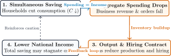
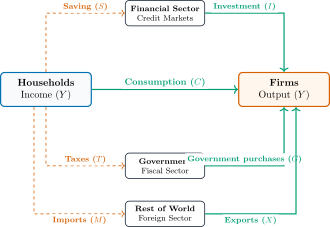
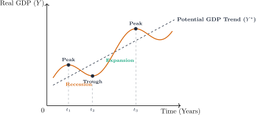

>
This chapter provides a rigorous, pedagogical treatment of Chapter 1: First Principles of Economics & Macroeconomic Systems, benchmarked to standard principles curriculum.

## Macroeconomics vs. Microeconomics and Systemic Feedback

### Conceptual Introduction {.unnumbered}
While microeconomics zooms in on how individual households, workers, and firms make decisions in specific markets, **macroeconomics** steps back to examine the behavior of the entire economy as an interconnected system. Macroeconomists study economy-wide phenomena: why total national output (**Real GDP**) grows over decades, why recessions occasionally trigger widespread **unemployment**, what causes sustained **inflation**, and how central banks and governments use monetary and fiscal policies to stabilize economic fluctuations.

A foundational insight of macroeconomics is that **the whole is more than the simple sum of its parts**. In an economy where people and businesses buy from and sell to one another, one person's spending is another person's income. When many households or businesses change their behavior at the same time, feedback can produce aggregate outcomes different from what any individual intended—a possibility economists call the **fallacy of composition**.

The **Paradox of Thrift** is one possible short-run feedback mechanism. For an individual household facing financial uncertainty, cutting consumption and saving more may be prudent. If many households do this together, however, business sales can fall, reducing production, hiring, and household income. In a model with spare capacity, slow price adjustment, and no offsetting increase in investment or public spending, aggregate income may fall enough that total saving does not rise as intended. This result depends on those assumptions; it is not a universal prediction for every economy or time horizon.

### Visual Representation {.unnumbered}
Figure 1 summarizes this conditional short-run feedback loop: lower consumption can reduce business revenue and household income, reinforcing efforts to save.

::: {.callout-note title="Clear It Up: Fallacy of Composition in Macroeconomics"}

What is true for a single individual is not automatically true for the whole economy at once. If one fan stands up at a stadium concert, they get a better view; if *everyone* stands up simultaneously, nobody sees better and everyone's legs get tired. Similarly, if every firm cuts wages simultaneously to boost profits, worker purchasing power falls and consumer demand for those firms' products shrinks.

:::

{fig-alt="A possible short-run feedback in the Paradox of Thrift. The mechanism assumes spare capacity and no immediate offset from investment or policy; actual outcomes depend on economic conditions."}

### Real-World Application: The 2008–2009 Great Recession and Household Deleveraging {.unnumbered}
The Great Recession offers a case for distinguishing a model mechanism from a historical explanation. When households try to repair balance sheets by cutting consumption, the short-run model predicts weaker sales and income if other spending does not offset the decline. Jones, Midrigan, and Philippon (2022) evaluate the household-leverage explanation and find that credit shocks account for only a small fraction of the aggregate employment decline in 2008–2010, while slowing the recovery. The saving-spending mechanism is useful for organizing the question, but it does not by itself establish the cause or size of a historical downturn.

### Mathematical Foundation (Algebra Level) {.unnumbered}
For the worked model, assume a closed economy with no government or foreign trade, fixed prices, spare productive capacity, fixed planned investment, and a constant marginal propensity to consume. If consumption depends on autonomous spending $C_0$ and a fraction $c$ of income $Y$, private saving is $S=Y-C$:

$$
C = C_0 + cY, \qquad S = Y - (C_0 + cY) = -C_0 + (1 - c)Y
$$

In this model's equilibrium, planned saving equals planned investment ($S=I_p$). The setup illustrates a short-run possibility rather than a universal response.

**Worked Problem:**
Suppose a closed economy has planned business investment fixed at $I_p = \$200\text{ billion}$, and households initially consume according to $C = 100 + 0.75Y$ (so initial saving is $S = -100 + 0.25Y$).

*  Find initial equilibrium national income $Y_1^*$ and confirm that equilibrium saving equals $\$200\text{ billion}$.
*  Suppose consumer anxiety causes households to cut autonomous consumption by $\$50\text{ billion}$ (trying to save $\$50\text{ billion}$ more at every income level), so $C_{\text{new}} = 50 + 0.75Y$ and $S_{\text{new}} = -50 + 0.25Y$. Compute the new equilibrium income $Y_2^*$ and new total saving $S_2^*$.

**Step-by-Step Breakdown:**

*  **Solve for Initial Equilibrium Income ($Y_1^*$) Where $S = I_p$:**

$$
-100 + 0.25Y_1^* = 200 \implies 0.25Y_1^* = 300 \implies Y_1^* = \mathbf{\$1{,}200\text{ billion}}
$$

Check equilibrium saving: $S_1^* = -100 + 0.25(1{,}200) = -100 + 300 = \mathbf{\$200\text{ billion}}$.

*  **Solve for New Equilibrium Income ($Y_2^*$) After the Saving Surge:**
Set $S_{\text{new}} = I_p$:

$$
-50 + 0.25Y_2^* = 200 \implies 0.25Y_2^* = 250 \implies Y_2^* = \mathbf{\$1{,}000\text{ billion}}
$$

Check new equilibrium saving at $Y_2^* = \$1{,}000$:

$$
S_2^* = -50 + 0.25(1{,}000) = -50 + 250 = \mathbf{\$200\text{ billion}}
$$

**Conclusion:** Under the stated assumptions, the $\$50$ billion reduction in autonomous consumption lowers equilibrium income by $\$200$ billion (from $\$1{,}200$ billion to $\$1{,}000$ billion), while equilibrium saving remains $\$200$ billion. This is the paradox-of-thrift result for this model.

## The Expanded Circular Flow, Leakages, and Injections

### Conceptual Introduction {.unnumbered}
To track how dollars circulate across an open economy, macroeconomists add three sectors to the household-firm circular flow: the **financial sector**, which connects savers and borrowers; **government**, which collects taxes and purchases goods and services; and the **rest of the world**, which buys exports and sells imports.

In this four-sector accounting framework, expenditure on domestically produced final goods and services ($Y$) equals four spending components:

$$
Y \equiv C + I + G + NX, \qquad \text{where } NX = X - M
$$

Here $C$ is household consumption, $I$ is private investment spending, $G$ is government purchases of goods and services, and $NX$ is net exports (exports $X$ minus imports $M$).

Three flows are called **leakages**: **private saving ($S$)**, **net taxes ($T$)**, and **imports ($M$)**. Three flows are called **injections**: **investment ($I$)**, **government purchases ($G$)**, and **exports ($X$)**. In the accounting equilibrium represented here, total leakages equal total injections:

$$
S + T + M = I + G + X
$$

### Visual Representation {.unnumbered}
Figure 2 maps the expanded four-sector circular flow, distinguishing leakage channels ($S, T, M$) from injection channels ($I, G, X$) by both label and line style.

{fig-alt="The Four-Sector Macroeconomic Circular Flow. Dashed orange arrows show leakages (S+T+M); solid teal arrows show injections (I+G+X)."}

### Real-World Application: U.S. Budget Deficits and Trade Balances {.unnumbered}
Rearranging the leakage-injection identity $S + T + M = I + G + X$ yields the fundamental open-economy accounting relation:

$$
(S - I) + (T - G) = (X - M) = NX
$$

Here $(S-I)$ is the private sector's net saving balance and $(T-G)$ is public saving (a government budget surplus if positive, or deficit if negative). If public saving and private net saving are both negative, the identity implies $NX<0$. This is an accounting relationship, not proof that a budget deficit causes a trade deficit; the private, public, and foreign balances are jointly linked.

### Mathematical Foundation (Algebra Level) {.unnumbered}
Balancing total leakages against total injections confirms the expenditure identity:

$$
S + T + M = I + G + X \iff Y = C + I + G + (X - M)
$$

**Worked Problem:**
In a macroeconomic model of an open economy (in billions of dollars), household consumption is $C = \$900$, private saving is $S = \$250$, net taxes are $T = \$350$, government purchases are $G = \$400$, private investment is $I = \$300$, exports are $X = \$200$, and imports are $M = \$300$.

*  Verify that total leakages equal total injections.
*  Compute national income ($Y$) using both the income-disposition identity ($Y = C + S + T$) and the aggregate expenditure identity ($Y = C + I + G + NX$).

**Step-by-Step Breakdown:**

*  **Compare Total Leakages and Total Injections:**

$$
\text{Total Leakages} = S + T + M = \$250 + \$350 + \$300 = \mathbf{\$900\text{ billion}}
$$

$$
\text{Total Injections} = I + G + X = \$300 + \$400 + \$200 = \mathbf{\$900\text{ billion}}
$$

Total leakages equal total injections ($\$900\text{B} = \$900\text{B}$).

*  **Compute National Income ($Y$) via Both Identities:**

$$
Y_{\text{income}} = C + S + T = \$900 + \$250 + \$350 = \mathbf{\$1{,}500\text{ billion}}
$$

$$
NX = X - M = \$200 - \$300 = -\$100\text{ billion}
$$

$$
Y_{\text{expenditure}} = C + I + G + NX = \$900 + \$300 + \$400 + (-\$100) = \mathbf{\$1{,}500\text{ billion}}
$$

**Conclusion:** Both accounting views yield the exact same national income of $\$1{,}500\text{ billion}$.

## Business Cycles, Stabilization Policy, and Long-Run Growth

### Conceptual Introduction {.unnumbered}
If you trace U.S. Real GDP over the past century, two distinct patterns jump off the page: a steady upward trend across decades, interrupted periodically by jagged waves of expansion and contraction. Macroeconomists divide their discipline around these two horizons:

*  **The Business Cycle (Short-Run Fluctuations):** Alternating periods of economic **expansion** (rising output and falling unemployment) and **recession** (a broad downturn in output, income, and employment). The turning point from expansion to recession is a **peak**, and the bottom turning point where recovery begins is a **trough**.
*  **Long-Run Economic Growth:** The sustained upward trend in an economy's potential productive capacity over decades, which determines long-run living standards across generations.

To smooth out painful short-run business cycles without derailing long-run growth, policymakers deploy two stabilization toolkits: **fiscal policy** (changes in federal government spending and tax rates enacted by Congress and the President) and **monetary policy** (changes in interest rates and financial conditions implemented by the Federal Reserve).

### Visual Representation {.unnumbered}
Figure 3 is a schematic—not a data series—showing output fluctuating around a rising long-run trend, with illustrative peaks, troughs, contractions, and recoveries.

{fig-alt="Schematic Business Cycle. The solid orange line represents illustrative output fluctuations around a dashed long-run trend; it is not observed U.S. GDP data."}

### Real-World Application: NBER Business Cycle Dating {.unnumbered}
In the United States, the **National Bureau of Economic Research (NBER)** Business Cycle Dating Committee identifies peaks and troughs using a broad set of indicators. It emphasizes economy-wide measures and notes there is no fixed rule about which indicators receive weight; a recession is not determined solely by a two-quarter GDP rule (NBER, n.d.).

### Mathematical Foundation (Algebra Level) {.unnumbered}
The percentage **output gap** measures how far actual Real GDP ($Y$) deviates from estimated Potential GDP ($Y^*$):

$$
\text{Output Gap } (\%) = \frac{Y - Y^*}{Y^*} \times 100\%
$$

**Worked Problem:**
For an illustrative calculation, suppose estimated Potential Real GDP is $Y^*=\$25.0$ trillion and actual Real GDP is $Y=\$24.2$ trillion. Compute the dollar output gap and the percentage output gap. Potential GDP is estimated rather than directly observed.

**Step-by-Step Breakdown:**

*  **Compute the Dollar Output Gap ($Y - Y^*$):**

$$
Y - Y^* = \$24.2\text{ trillion} - \$25.0\text{ trillion} = \mathbf{-\$0.8\text{ trillion}\ (-\$800\text{ billion})}
$$

*  **Compute the Percentage Output Gap:**

$$
\text{Output Gap } (\%) = \frac{-0.8}{25.0} \times 100\% = -0.032 \times 100\% = \mathbf{-3.2\%}
$$

**Conclusion:** In this example, actual output is $3.2\%$ below estimated potential output, a dollar gap of $\$800$ billion.

::: {.callout-note title="Optional Advanced Section: Hodrick-Prescott Trend Decomposition"}

*Note for Economics Majors and Quantitative Students:*
The Hodrick–Prescott filter decomposes observed log Real GDP $y_t=\ln(Y_t)$ into a smooth trend $\tau_t$ and a residual component $c_t=y_t-\tau_t$ by solving:

$$
\begin{aligned}
\min_{\{\tau_t\}} \quad
&\sum_{t=1}^{T} (y_t - \tau_t)^2 \\
&+ \lambda \sum_{t=2}^{T-1}
\left[ (\tau_{t+1} - \tau_t) - (\tau_t - \tau_{t-1}) \right]^2
\end{aligned}
$$

For quarterly data, $\lambda=1{,}600$ is a widely used convention (Hodrick and Prescott, 1997). The residual is not automatically stationary, and the filtered trend is not a direct observation of potential GDP.

:::

### Selected References {.unnumbered}

*  National Bureau of Economic Research. “Business Cycle Dating.” <https://www.nber.org/research/business-cycle-dating>
*  Jones, Callum, Virgiliu Midrigan, and Thomas Philippon. 2022. “Household Leverage and the Recession.” *Econometrica* 90(5): 2471–2505. NBER Working Paper 16965. <https://www.nber.org/papers/w16965>
*  Hodrick, Robert J., and Edward C. Prescott. 1997. “Postwar U.S. Business Cycles: An Empirical Investigation.” *Journal of Money, Credit and Banking* 29(1): 1–16. <https://doi.org/10.2307/2953682>
