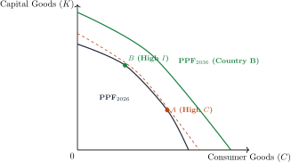

>
This chapter provides a rigorous, pedagogical treatment of Chapter 2: The Macroeconomic Production Possibilities Frontier & Capital Deepening, benchmarked to standard principles curriculum.

## Consumer vs. Capital Goods and Long-Run Secular Growth

### Conceptual Introduction {.unnumbered}
Every nation faces an intertemporal macroeconomic trade-off between **living well today** and **producing more tomorrow**. To visualize this choice, macroeconomists place **Consumer Goods ($C$)**—such as food, clothing, streaming entertainment, and restaurant meals that provide immediate satisfaction—on one axis of the Macroeconomic Production Possibilities Frontier, and **Capital Goods ($K$)**—such as factories, power grids, cargo ships, semiconductor equipment, and research laboratories—on the other axis.

Because capital goods are durable inputs used to produce future goods and services, a nation's operating point along its current PPF affects its capacity for **long-run secular growth**:

*  **High-Consumption Strategy:** Devoting nearly all resources to immediate consumer goods raises current living standards today, but leaves little net investment to replace worn-out machinery (**depreciation**)—causing the future PPF to stagnate or grow slowly.
*  **High-Investment Strategy (**Capital Deepening**):** Sacrificing some current consumption to build physical capital and infrastructure increases the economy's capital-to-labor ratio ($\Delta K > 0$), shifting Potential GDP ($Y^*$) and the entire PPF outward in future years.

**Real-World Connection.** A data-center or power-grid project uses construction labor, equipment, and materials that could have gone to other production today. Whether the investment raises future productive capacity depends on the services the completed capital provides and whether gross investment exceeds depreciation.

### Visual Representation {.unnumbered}
Figure 1 contrasts two nations starting on identical frontiers in 2026: Country A prioritizes current consumption ($C_A$), while Country B invests heavily in capital goods ($K_B$), achieving a substantially larger frontier by 2036.

{fig-alt="Capital Deepening and Future PPF Expansion. Choosing point B (higher capital investment today) sacrifices current consumption relative to point A, but accelerates capital accumulation and shifts the future frontier much further outward."}

### Mathematical Foundation {.unnumbered}
Next year's physical capital stock ($K_{t+1}$) equals this year's capital stock ($K_t$) plus gross investment ($I_t$) minus capital depreciation ($\delta K_t$, where $\delta$ is the annual depreciation rate):

$$
K_{t+1} = K_t + I_t - \delta K_t, \qquad \text{Net Investment} = I_t - \delta K_t
$$

**Worked Problem:**
An economy begins Year 1 with a physical capital stock of $K_1 = \$10{,}000\text{ billion}$. Each year, $6\%$ of existing capital wears out ($\delta = 0.06$).

*  Compute annual capital depreciation in Year 1.
*  Calculate Year 2 capital stock ($K_2$) and net capital deepening ($\Delta K$) if gross investment is $I_1 = \$950\text{ billion}$.
*  Determine the minimum gross investment required just to keep the capital stock from shrinking.

**Step-by-Step Breakdown:**

*  **Compute Annual Depreciation ($\delta K_1$):**

$$
\text{Depreciation} = 0.06 \times \$10{,}000\text{ billion} = \mathbf{\$600\text{ billion}}
$$

*  **Compute Net Investment ($\Delta K$) and Year 2 Capital Stock ($K_2$):**

$$
\Delta K = I_1 - \delta K_1 = \$950\text{ billion} - \$600\text{ billion} = \mathbf{+\$350\text{ billion}}
$$

$$
K_2 = \$10{,}000\text{ billion} + \$350\text{ billion} = \mathbf{\$10{,}350\text{ billion}}
$$

*  **Identify Break-Even Maintenance Investment:**
To keep $\Delta K = 0$, gross investment must at least replace worn-out capital: $I_{\min} = \delta K_1 = \mathbf{\$600\text{ billion}}$.

**Conclusion:** Investing $\$950\text{ billion}$ covers $\$600\text{ billion}$ in depreciation and adds $+\$350\text{ billion}$ in net capital deepening, shifting the economy's future PPF outward.

## Output Gaps vs. Secular Growth on the Macro PPF

### Conceptual Introduction {.unnumbered}
A common source of confusion in public policy debates is mixing up **short-run cyclical recovery** with **long-run structural growth**. On the Macroeconomic PPF, these two processes look completely different:

*  **Recessionary Gap and Cyclical Recovery (Movement Inside to On the Frontier):** During a recession, laid-off workers and idle factories push the economy to an interior point inside its existing PPF ($Y < Y^*$). Economic recovery—aided by countercyclical monetary or fiscal stimulus—puts idle resources back to work and moves the economy *back out to its existing frontier*, without changing Potential GDP ($Y^*$).
*  **Overheating / Inflationary Gap (Unsustainable Temporary Push):** Actual GDP can temporarily exceed an estimate of potential GDP ($Y > Y^*$) when labor and equipment are used unusually intensively, putting upward pressure on inflation. This does not represent a sustainable point beyond the PPF; potential GDP is an estimate of normal sustainable output, not a directly observed frontier.
*  **Secular Growth (Outward Shift of the Frontier Itself):** Expanding long-run Potential GDP ($Y^*$) requires expanding the PPF boundary itself through capital accumulation, labor-force growth, human capital, and technological progress.

**Real-World Connection.** Growth accounting, associated with Robert Solow, separates output growth explained by measured changes in capital and labor from a residual associated with productivity. The residual is not a direct measure of one particular technology; it also reflects influences not captured by measured inputs.

### Visual Representation {.unnumbered}
Figure 2 distinguishes a cyclical recovery from an interior recession point ($R \to E_1$ along an unchanged frontier) from true secular economic growth ($E_1 \to E_2$ onto an expanded frontier).

::: {.callout-note title="Clear It Up: Demand Stimulus Restores Capacity; Supply Drivers Expand It"}

Lowering interest rates or cutting taxes during a recession helps close a negative output gap by moving the economy from an idle interior point ($R$) back to its current PPF ($E_1$). However, once the economy reaches full employment on the frontier, demand stimulus alone cannot push the PPF outward—long-run living standards depend on productivity, education, and investment!

:::

{fig-alt="Cyclical Recovery vs. Secular Growth. Moving from R to E_1 eliminates recessionary unemployment by restoring full utilization of existing capacity. Moving from E_1 to E_2 represents long-run secular growth via outward expansion of the PPF."}

### Mathematical Foundation {.unnumbered}
Aggregate production links Potential Output ($Y^*$) to Total Factor Productivity ($A$), physical capital ($K$), and full-employment labor ($L^*$):

$$
Y^* = A \cdot f(K, L^*)
$$

Using the **Rule of 70**, the approximate number of years required for Real GDP per capita to double at an annual growth rate of $g\%$ is:

$$
\text{Doubling Time (Years)} \approx \frac{70}{g}
$$

In this approximation, enter $g$ as a percentage value (for example, $2.0$, not $0.02$). For an exact annual-compounding calculation, use $Y_n=Y_0(1+r)^n$, where $r$ is the annual growth rate written as a decimal.

**Worked Problem:**
Assume each country's annual growth rate remains constant and income compounds once per year. Country X grows at $r_X=0.02$, whereas Country Y grows at $r_Y=0.035$. Both start with Real GDP per capita of $\$20{,}000$ in 2026.

*  Use the Rule of 70 to compute how many years it takes each country to double its living standard to $\$40{,}000$.
*  Use annual compounding to compute each country's Real GDP per capita after $70$ years (in 2096).

**Step-by-Step Breakdown:**

*  **Apply the Rule of 70:**

$$
\text{Country X Doubling Time} = \frac{70}{2.0} = \mathbf{35\text{ years}}
$$

$$
\text{Country Y Doubling Time} = \frac{70}{3.5} = \mathbf{20\text{ years}}
$$

*  **Compute Real GDP per Capita After $70$ Years:**

$$
Y_{70,X} = \$20{,}000(1+0.02)^{70} \approx \mathbf{\$79{,}991}
$$

$$
Y_{70,Y} = \$20{,}000(1+0.035)^{70} \approx \mathbf{\$222{,}257}
$$

**Conclusion:** Under these assumptions, Country Y's income per person after 70 years is about $2.8$ times Country X's. The Rule of 70 gives useful approximate doubling times; the compound-growth formula supplies the 70-year values.

::: {.callout-note title="Optional Advanced Section: Solow Growth Accounting Equation"}

*Note for Economics Majors and Quantitative Students:*
Assuming a Cobb-Douglas aggregate production function $Y = A K^\alpha L^{1-\alpha}$ with capital share $\alpha \in (0, 1)$, taking natural logarithms and differentiating with respect to time decomposes output growth into three measurable sources:

$$
\frac{\Delta Y}{Y} \approx \frac{\Delta A}{A} + \alpha \frac{\Delta K}{K} + (1 - \alpha)\frac{\Delta L}{L}
$$

Here $\frac{\Delta A}{A}$ is Total Factor Productivity (TFP) growth—the portion of output growth not explained by measured increases in capital or labor hours.

:::
