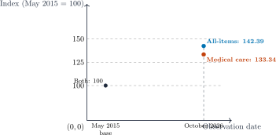
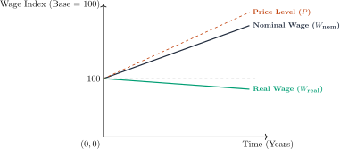

>
This chapter provides a rigorous, pedagogical treatment of Chapter 3: Supply and Demand: Macroeconomic Foundations, benchmarked to standard principles curriculum.

::: {.callout-note title="Bring It Home: Is One Price Increase Inflation?"}

Suppose the price of medical care rises faster than the prices of most other goods. Is that economy-wide inflation, or has medical care become more expensive relative to the overall basket? Compare the component price index with an all-items index before deciding.

:::

## Relative Prices vs. The General Price Level

### Conceptual Introduction {.unnumbered}
In microeconomics, supply and demand explain how the price of a single product—such as coffee, avocados, or apartment rent—adjusts to balance buyers and sellers in that specific market. When the price of a hospital visit or a carton of eggs rises while most other prices remain stable, economists call that a change in a **relative price**. Relative price changes are vital market signals: they tell consumers to economize on scarcer goods and tell producers where to direct resources.

Macroeconomics, by contrast, focuses on the **general price level**—the overall average price of a broad basket of goods and services across the entire economy. A sustained, economy-wide upward climb in a broad price index is called **inflation** (while a sustained decline in the broad price level is **deflation**). A rise in the broad index means that a dollar buys less of its weighted basket on average; it does not require every category's price to rise. A local drought that raises lettuce prices, for example, changes lettuce's relative price even if the broad index is unchanged.

### Visual Representation {.unnumbered}
Figure 1 compares the all-items CPI with its medical-care component at two observation dates. Both series are rebased to 100 in May 2015; the points show the two observations, not the intervening monthly path.

::: {.callout-note title="Clear It Up: A One-Time Price Spike Is Not Ongoing Inflation"}

If a temporary supply disruption pushes gasoline prices up by $15\%$ in one month and prices then stay flat at that higher level, the *price level* is higher, but the *inflation rate* (the percentage rate of change from month to month) returns to zero! Inflation measures the **speed** at which the broad price level is rising over time.

:::

{fig-alt="Two-observation comparison using FRED monthly CPI data. Medical care rose less than the all-items index between May 2015 and October 2026, so its price fell relative to the all-items basket over that interval."}

### Real-World Application: FRED Medical Care (`CPIMEDSL`) vs. All-Items CPI (`CPIAUCSL`) {.unnumbered}
FRED's seasonally adjusted CPIAUCSL (all items) was 237.001 in May 2015 and 337.476 in October 2026; CPIMEDSL (medical care) was 446.743 and 595.675 on those same dates. Each series uses 1982–1984 = 100. First calculate the growth in each index:

$$
\begin{aligned}
\text{All-items growth} &= \frac{337.476-237.001}{237.001}\times100\% = 42.39\%,\\
\text{Medical-care growth} &= \frac{595.675-446.743}{446.743}\times100\% = 33.34\%.
\end{aligned}
$$

To calculate the change in medical care's price relative to the all-items basket, compare the component-to-all-items ratio at the two dates:

$$
\left(\frac{595.675/337.476}{446.743/237.001}-1\right)\times100\%=-6.36\%.
$$

Thus, medical care's relative price fell by 6.36\% over these observations even though both price indexes rose. The all-items CPI represents an average urban-consumer basket, not every household's exact spending pattern.

### Mathematical Foundation (Algebra Level) {.unnumbered}
A price index compares the current dollar cost of a fixed market basket against its base-period cost, and the inflation rate ($\pi_t$) measures the percentage change in that index between periods $t-1$ and $t$:

$$
\text{Price Index}_t = \frac{\text{Cost of Basket}_t}{\text{Cost of Basket}_{\text{base}}} \times 100, \qquad \pi_t = \frac{P_t - P_{t-1}}{P_{t-1}} \times 100\%
$$

**Worked Problem:**
Suppose a simplified urban household basket costs $\$1{,}200$ in the base year (2024), rises to $\$1{,}260$ in 2025, and reaches $\$1{,}310.40$ in 2026. Compute the price index for 2024, 2025, and 2026, and calculate the annual inflation rate for 2025 and 2026.

**Step-by-Step Breakdown:**

*  **Compute the Price Index for Each Year (Base Year 2024 = 100):**

$$
P_{2024} = \frac{\$1{,}200}{\$1{,}200} \times 100 = \mathbf{100.0}
$$

$$
P_{2025} = \frac{\$1{,}260}{\$1{,}200} \times 100 = \mathbf{105.0}
$$

$$
P_{2026} = \frac{\$1{,}310.40}{\$1{,}200} \times 100 = \mathbf{109.2}
$$

*  **Calculate Annual Inflation Rates ($\pi_{2025}$ and $\pi_{2026}$):**

$$
\pi_{2025} = \frac{105.0 - 100.0}{100.0} \times 100\% = \mathbf{5.0\%}
$$

$$
\pi_{2026} = \frac{109.2 - 105.0}{105.0} \times 100\% = \frac{4.2}{105.0} \times 100\% = \mathbf{4.0\%}
$$

**Conclusion:** Notice that while the price level continued rising in 2026 (from $105.0$ to $109.2$), the inflation rate slowed from $5.0\%$ to $4.0\%$—a process economists call **disinflation** (slower positive inflation, not falling prices).

## Nominal vs. Real Values and Purchasing Power

### Conceptual Introduction {.unnumbered}
Because inflation changes the measuring stick of money over time, comparing raw dollar figures across different decades is misleading. A $\$50{,}000$ salary in 1990 bought far more housing, groceries, and tuition than a $\$50{,}000$ salary buys today. To make valid comparisons across time, macroeconomists strictly separate **nominal values** (measured in current, unadjusted dollars of the period) from **real values** (adjusted for price-level changes to reflect true **purchasing power** in constant base-period dollars).

The same distinction governs wages and interest rates:

*  **Real Wage:** Measures how many goods and services a worker's paycheck can actually purchase. If your nominal hourly wage rises by $3\%$ while consumer prices rise by $5\%$, your real wage falls by roughly $2\%$.
*  **Real Interest Rate ($r$):** Measures the true purchasing-power return earned by savers or paid by borrowers after subtracting inflation ($\pi$) from the stated **nominal interest rate ($i$)**—summarized by the **Fisher Equation**: $r \approx i - \pi$.

::: {.callout-note title="Clear It Up: A Nominal Raise Can Be a Real Pay Cut"}

A larger paycheck in dollars does not guarantee more purchasing power. Compare the percentage change in nominal pay with the percentage change in the price index; if prices rise faster, the real wage falls.

:::

### Visual Representation {.unnumbered}
Figure 2 contrasts a rising nominal wage index against a flat or declining real wage index when price-level inflation outpaces paycheck growth.

{fig-alt="Nominal Wages vs. Real Purchasing Power. Even when a worker's nominal wage increases steadily over time, if the broad price level rises faster than nominal pay, the worker's real purchasing power declines."}

### Real-World Application: Minimum Wage Purchasing Power Across Decades {.unnumbered}
For covered nonexempt employees, the U.S. federal minimum wage has been $\$7.25$ per hour since July 24, 2009. If the nominal rate stays fixed while the CPI rises, its purchasing power falls. This illustrates why minimum-wage comparisons should distinguish the stated dollar amount from its real value.

### Mathematical Foundation (Algebra Level) {.unnumbered}
To convert any nominal dollar amount $X_t^{\text{nominal}}$ into constant base-period purchasing power ($X_t^{\text{real}}$):

$$
X_t^{\text{real}} = X_t^{\text{nominal}} \times \frac{P_{\text{base}}}{P_t}, \qquad r \approx i - \pi
$$

**Worked Problem:**
Suppose a paralegal's nominal salary was $\$52{,}000$ in May 2015 and $\$68{,}000$ in October 2026. For these months, CPIAUCSL was $P_{2015}=237.001$ and $P_{2026}=337.476$.

*  Express the 2026 salary in constant 2015 dollars to determine whether the paralegal's real purchasing power increased or decreased.
*  Calculate the percentage change in real salary between 2015 and 2026.

**Step-by-Step Breakdown:**

*  **Deflate the 2026 Nominal Salary into 2015 Base Dollars:**

$$
\text{Salary}_{2026}^{\text{real (May 2015 \$)}} = \$68{,}000 \times \frac{237.001}{337.476} \approx \mathbf{\$47{,}754.71}
$$

*  **Compute the Percentage Change in Real Purchasing Power:**

$$
\%\Delta \text{Real Salary} = \frac{\$47{,}754.71 - \$52{,}000}{\$52{,}000} \times 100\% = \frac{-\$4{,}245.29}{\$52{,}000} \times 100\% \approx \mathbf{-8.16\%}
$$

**Conclusion:** The hypothetical nominal salary rose by 30.77\%, while CPIAUCSL rose by 42.39\%. After adjusting for prices, purchasing power fell by 8.16\%.

## Market Clearing and Sticky Wages in a Labor Market

### Conceptual Introduction {.unnumbered}
In a labor market, firms demand labor and workers supply it. The wage coordinates their plans: at a wage where labor demanded equals labor supplied, the simple competitive model clears. In practice, nominal wages may adjust slowly because of contracts, pay-review schedules, or workplace policies.

If labor demand falls while the nominal wage is temporarily fixed above the new market-clearing wage, firms want fewer workers than households want to supply. In this simplified model, employment is limited by the short side of the market, so the gap is excess labor supply. It is an illustration of one possible adjustment mechanism, not a complete account of unemployment.

When wages are flexible in this model, the wage can move toward a new labor-market equilibrium. That result does not imply that all unemployment disappears in the real economy, nor does the labor-market diagram by itself determine potential GDP. Search frictions, skills, institutions, and the link from employment to output are outside this model; this section is not an aggregate-demand/aggregate-supply analysis.

### Visual Representation {.unnumbered}
Figure 3 uses the labor-market quantities in the worked problem. Coordinates use $x=L/40$ and $y=W/10$ for legibility; labels give labor in millions and wage dollars per hour.

{fig-alt="A leftward labor-demand shift lowers the model's flexible-wage equilibrium from (L,W)=(80,$30) to (60,$20). If the wage stays at $30, labor demanded is 20 million while labor supplied is 80 million; the gap is excess labor supply in this stylized model."}

### Real-World Application: Downward Nominal Wage Rigidity {.unnumbered}
Federal Reserve research documents downward nominal wage rigidity, but also finds that some continuing workers receive nominal wage cuts. Wage freezes, pay cuts, reduced hiring, and layoffs are possible adjustment margins; this example isolates only the fixed-wage case and should not be read as a universal description of recession behavior.

### Mathematical Foundation (Algebra Level) {.unnumbered}
At a fixed nominal wage $\bar{W}$, employment in the simplified labor-market model is limited by the short side:

$$
L_{\text{employed}} = \min\left(L_d(\bar{W}), \; L_s(\bar{W})\right)
$$

If labor supplied exceeds labor demanded, the difference is excess labor supply in this model; it is not automatically an official unemployment statistic.

**Worked Problem:**
In a hypothetical labor market, labor demand is $L_d = 200 - 4W$ and labor supply is $L_s = 20 + 2W$, with quantities in millions of workers and $W$ in dollars per hour. A recession shifts labor demand left to $L_d^{\text{new}} = 140 - 4W$.

*  Compute employment and excess labor supply if the nominal wage remains fixed at $\$30$.
*  Find the new flexible-wage equilibrium $(W_2^*, L_2^*)$ in this model.

**Step-by-Step Breakdown:**

*  **Evaluate the Fixed-Wage Outcome at $W=\$30$:**

$$
\begin{aligned}
L_d^{\text{new}}(30) &= 140 - 4(30) = 140 - 120 = 20\text{ million},\\
L_s(30) &= 20 + 2(30) = 20 + 60 = 80\text{ million}.
\end{aligned}
$$

Employment is the smaller quantity, $20$ million. Excess labor supply is $80-20=\mathbf{60\text{ million}}$ in this hypothetical model.

*  **Solve for the Flexible-Wage Equilibrium ($L_d^{\text{new}} = L_s$):**

$$
\begin{aligned}
140 - 4W_2^* &= 20 + 2W_2^*\\
120 &= 6W_2^*\\
W_2^* &= \$20.
\end{aligned}
$$

Substitute the wage into either schedule:

$$
L_2^* = 20 + 2(20) = \mathbf{60\text{ million}}.
$$

**Conclusion:** Employment is 20 million at the fixed wage and 60 million at the flexible-wage equilibrium in this simplified model. The 60-million gap is excess labor supply, not a measured unemployment count.

::: {.callout-note title="Optional Advanced Section: Exact vs. Approximate Fisher Equation"}

*Note for Economics Majors and Quantitative Students:* Using decimal rates, the Fisher relation is $1+i=(1+r)(1+\pi)$. Solving for the exact real rate gives:

$$
r = \frac{i - \pi}{1 + \pi}
$$

For an expected real return, use expected inflation; realized inflation gives an ex-post real return. When inflation is small, $r \approx i-\pi$ is a useful approximation.

:::

## Bring It Home: Read the Price Signal {.unnumbered}
Return to the opening question. Comparing the medical-care index with the all-items index shows whether medical care became more or less expensive relative to the broad basket. A nominal wage or salary comparison answers a different question: how much the money amount changed. Deflating it by an appropriate price index estimates how its purchasing power changed.

## Practice Questions {.unnumbered}

*  A price index rises from 100 to 105 in one year and then to 109.2 the next year. Which statement is correct?

A.  Inflation is 5\% in the first year and 4\% in the second; this is disinflation. **Correct:** The second annual rate is lower but remains positive.
B.  Inflation is 5\% in both years. **Incorrect:** The second rate is $(109.2-105)/105 \times 100\%=4\%$.
C.  Prices fell by 4\% in the second year. **Incorrect:** The index rose from 105 to 109.2; inflation slowed but stayed positive.
D.  The price level fell by 1\%. **Incorrect:** This confuses the change in the inflation rate with the change in the price index.

*  From May 2015 to October 2026, CPIAUCSL rose from 237.001 to 337.476 while CPIMEDSL rose from 446.743 to 595.675. What happened to medical care's price relative to the all-items basket?

A.  It rose by 9.05 percentage points. **Incorrect:** This subtracts the two growth rates but does not calculate the change in the component-to-all-items price ratio.
B.  It fell by about 6.36\%. **Correct:** The ratio $(CPIMEDSL/CPIAUCSL)$ fell by this percentage between the observations.
C.  It rose by 33.34\%. **Incorrect:** That is medical care's own index growth, not its relative-price change.
D.  It did not change because both indexes increased. **Incorrect:** The indexes grew at different rates.

*  In the labor-market example, labor demand after a recession is $L_d=140-4W$, supply is $L_s=20+2W$, and the wage is fixed at $\$30$. What does the model imply?

A.  Employment is 80 million and excess labor supply is zero. **Incorrect:** It uses labor supplied as employment even though firms demand only 20 million workers.
B.  Employment is 20 million and excess labor supply is 60 million. **Correct:** Demand is 20 million and supply is 80 million; employment is the short side.
C.  Employment is 60 million and excess labor supply is 20 million. **Incorrect:** These values do not equal the model's quantities at $W=\$30$.
D.  The model proves that measured unemployment is 60 million. **Incorrect:** It gives a hypothetical excess-supply gap, not an official unemployment statistic.

## Sources {.unnumbered}

*  Federal Reserve Bank of St. Louis, FRED. CPIAUCSL: Consumer Price Index for All Urban Consumers: All Items. <https://fred.stlouisfed.org/series/CPIAUCSL>
*  Federal Reserve Bank of St. Louis, FRED. CPIMEDSL: Consumer Price Index for All Urban Consumers: Medical Care. <https://fred.stlouisfed.org/series/CPIMEDSL>
*  U.S. Department of Labor. “Minimum Wage.” \href{https://www.dol.gov/agencies/whd/minimum-wage}{DOL minimum-wage guidance}.
*  Fallick, Bruce C., Daniel Villar Vallenas, and William L. Wascher. “Downward Nominal Wage Rigidity in the United States During and After the Great Recession.” Finance and Economics Discussion Series 2016-001r1, Board of Governors of the Federal Reserve System. \href{https://www.federalreserve.gov/econres/feds/files/2016001r1pap.pdf}{FEDS 2016-001r1 paper}.
