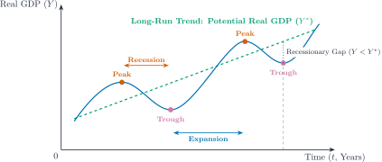
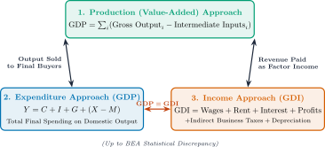

>
This chapter combines the macroeconomic big picture with national income and product accounting. We examine short-run business cycle fluctuations, long-run economic growth, and open-economy international trade balances alongside the Expenditure ($Y = C + I + G + NX$), Production (Value-Added), and Income (Gross Domestic Income, GDI) measures of Gross Domestic Product (GDP). Finally, we distinguish Nominal GDP from Real GDP to separate true physical output expansion from price-level inflation.

## Learning Outcomes and Key Terms {.unnumbered}
\addcontentsline{toc}{section}{Learning Outcomes and Key Terms}

Upon completing this chapter, students should be able to (supporting Course Learning Objectives **MA-1**, **MA-2**, and **C2002-1**):

*  **Distinguish** short-run business cycle fluctuations (peaks, recessions, troughs, and expansions) from long-run secular economic growth in Potential Real GDP ($Y^*$), and interpret open-economy trade balances ($NX = X - M$).
*  **Apply** the four boundary rules of Gross Domestic Product (market value, final goods and services only, domestic production, and current production) to avoid double counting and exclude non-production transfers.
*  **Compute** national output across the three equivalent NIPA accounting approaches: Expenditure ($Y = C + I + G + NX$), Production (Value Added), and Income (GDI).
*  **Calculate** Nominal GDP, Base-Year Real GDP, and real output growth rates to isolate physical production changes from price movements (referencing FRED series \texttt{GDP} and \texttt{GDPC1}).

**Key Terms:** aggregate output, business cycle, expansion, recession, peak, trough, Potential Real GDP ($Y^*$), long-run economic growth, net exports ($NX$), trade surplus, trade deficit, Gross Domestic Product (GDP), final good, intermediate good, value added, consumption ($C$), gross private domestic investment ($I$), government purchases ($G$), Gross Domestic Income (GDI), statistical discrepancy, Nominal GDP, Real GDP.

::: {.callout-tip title="Bring It Home: Why Do ``Dollar GDP'' Headlines Sometimes Mislead Voters?"}

Suppose news headlines report that a nation's total dollar spending on goods and services rose by $8\%$ over the past year. At first glance, that sounds like an economic boom—more factories running, more jobs created, and higher living standards. Yet when families visit the grocery store or pay rent, they feel squeezed rather than richer. Did the economy actually produce $8\%$ more food, housing, and laptops, or did prices rise while physical output barely budged? And even when physical output does expand, why does buying a used home or a share of tech stock fail to add a single dollar to GDP? Building the National Income and Product Accounts (NIPA) gives us the exact accounting rules needed to separate genuine production from price inflation and financial paper shuffling.

:::

## The Macroeconomic Big Picture: Cycles, Growth, and International Balances

### Conceptual Introduction {.unnumbered}
Macroeconomics studies the economy as a unified whole by tracking **aggregate output**—the total quantity of goods and services produced across an entire nation. Over short horizons of months or a few years, aggregate output rarely moves in a straight line. Instead, economies experience **business cycles**: alternating short-run periods of **expansion** (when total output, employment, and household incomes rise broadly) and **recession** (a significant, widespread decline in economic activity lasting more than a few months, measured from a business cycle **peak** down to a **trough**).

Across decades, however, those short-run ups and downs occur around a rising long-run trajectory called **long-run economic growth**—the sustained upward trend in **Potential Real GDP ($Y^*$)** and output per capita. While short-run recessions reflect idle factories and unemployed workers operating below capacity ($Y < Y^*$), long-run growth expands the economy's underlying productive ceiling through physical capital deepening ($K/L$), human capital (education and workforce skills), and technological innovation.

Because modern economies trade goods, services, and financial assets across borders, domestic output also interacts with the rest of the world through **exports ($X$)** (goods produced domestically and sold abroad) and **imports ($M$)** (goods produced abroad and purchased domestically). The difference between exports and imports defines **net exports ($NX = X - M$)**, or the trade balance. When exports exceed imports ($NX > 0$), a country runs a **trade surplus**, meaning domestic production exceeds domestic spending and the nation acts as a net lender to the rest of the world. Conversely, when imports exceed exports ($NX < 0$), a country runs a **trade deficit**, meaning domestic residents spend more than they produce domestically and finance the gap through net capital inflows from foreign savers.

### Visual Representation {.unnumbered}
Figure 1 illustrates how short-run business cycle fluctuations oscillate around an upward-sloping long-run Potential Real GDP ($Y^*$) growth trend.

{fig-alt="Short-Run Business Cycles vs.\ Long-Run Economic Growth. Actual Real GDP (Y, solid blue curve) fluctuates through expansions and recessions around the upward-sloping long-run Potential Real GDP trend (Y^*, dashed teal line)."}

### Mathematical Foundation {.unnumbered}
To evaluate cyclical performance and external trade balances algebraically, macroeconomists track the **output gap** (percentage deviation of actual Real GDP $Y$ from Potential Real GDP $Y^*$) and **net exports ($NX$)**:

$$
\text{Percentage Output Gap} = \frac{Y - Y^*}{Y^*} \times 100\%, \qquad NX = X - M
$$

When $Y < Y^*$, the output gap is negative (a **recessionary gap**); when $Y > Y^*$, the output gap is positive (an **inflationary/overheating gap**).

\paragraph{Work It Out 4.1 (Output Gaps & Open-Economy Trade Balances).}
Suppose an economy has Potential Real GDP of $Y^* = \$25{,}000\text{ billion}$, while a mild downturn holds actual Real GDP to $Y = \$24{,}250\text{ billion}$. In the same year, domestic firms export $X = \$3{,}100\text{ billion}$ of goods and services, while domestic households, firms, and governments purchase $M = \$3{,}850\text{ billion}$ of imports.

*  **Compute the Dollar and Percentage Output Gap:**
$$\text{Dollar Output Gap} = Y - Y^* = \$24{,}250\text{B} - \$25{,}000\text{B} = -\$750\text{ billion}$$
$$\text{Percentage Output Gap} = \frac{-750}{25{,}000} \times 100\% = -0.03 \times 100\% = -3.0\%$$
Because actual output falls $3.0\%$ below potential capacity, the economy faces a recessionary gap.
*  **Compute Net Exports ($NX$) and Classify the Trade Balance:**
$$NX = X - M = \$3{,}100\text{B} - \$3{,}850\text{B} = -\$750\text{ billion}$$
Because $NX = -\$750\text{B} < 0$, the country runs a **trade deficit** of $\$750\text{ billion}$ (financed by $\$750\text{ billion}$ in net capital inflows from abroad).

::: {.callout-tip title="Real-World Application: U.S.\ Business Cycles, Pandemic Recovery, and Persistent Trade Deficits"}

In the United States, the non-partisan **National Bureau of Economic Research (NBER)** Business Cycle Dating Committee formally identifies business cycle peaks and troughs using broad monthly indicators of output, employment, real personal income, and industrial production—rather than relying solely on a two-quarter rule of thumb. For example, NBER dated a peak in February 2020 and a sharp, two-month pandemic trough in April 2020, followed by a sustained expansion that restored output above trend. Over the same decades, the United States has consistently recorded negative net exports ($NX < 0$), importing more consumer electronics, vehicles, and apparel than it exports in aircraft, software services, and agricultural goods—a trade deficit balanced by strong global capital inflows into U.S.\ Treasury securities and corporate assets.

:::

## What GDP Counts: Boundaries and Value Added

### Conceptual Introduction {.unnumbered}
To measure aggregate output reliably without counting the same production twice, macroeconomists define **Gross Domestic Product (GDP)** strictly as *the total market value of all final goods and services produced within a country's geographic borders during a specific time period*. Every single phrase in that definition functions as an explicit accounting boundary rule:

*  **Market Value:** Physical quantities of apples, MRI scans, and commercial aircraft cannot be added directly in physical units. GDP converts diverse outputs into a common dollar metric by multiplying each good's quantity by its market price (and includes imputed rental values for owner-occupied housing so homeownership and renting are treated consistently).
*  **Final Goods and Services Only:** A **final good** is sold to its end user (such as a laptop bought by a student), whereas an **intermediate good** is used up entirely in producing another good during the same period (such as a processor chip or sheet aluminum sold to a laptop manufacturer). Counting both the chip's sale and the laptop's retail price would double-count the chip. National accountants avoid double counting either by counting only final sales or by summing each firm's **value added**—the market value of a firm's output minus the cost of intermediate inputs purchased from other firms.
*  **Within Domestic Borders:** GDP is strictly geographic. A Toyota vehicle assembled in Georgetown, Kentucky counts toward U.S.\ GDP regardless of Japanese corporate ownership, whereas a Ford vehicle assembled in Hermosillo, Mexico counts toward Mexican GDP.
*  **Current Production Only:** GDP measures *new* production created during the current quarter or year. It excludes sales of used cars and existing homes (already counted when originally built), pure financial transactions such as buying stocks or bonds, and government transfer payments such as Social Security checks (which redistribute existing income rather than purchasing newly produced output).

### Visual Representation {.unnumbered}
Figure 2 illustrates a three-stage laptop supply chain—from silicon wafer fabrication to CPU processor manufacturing to final retail assembly—demonstrating why summing value added across stages equals the final market price without double counting.

{fig-alt="Value-Added Accounting Eliminates Double Counting. Summing gross sales across all three firms ($100 + $350 + $1{,}000 = $1{,}450) would count intermediate components twice; summing each stage's value added matches the $1{,}000 final retail price."}

::: {.callout-note title="Clear It Up: Four Classic GDP Boundary Pitfalls"}

*  **Financial Investment vs.\ Economic Investment ($I$):** Buying $\$10{,}000$ of existing shares on the stock market transfers ownership of an existing financial claim; it does *not* create new goods and is excluded from GDP. Only newly built factories, machinery, software, new homes, and inventory additions count as $I$.
*  **Used Home Sales vs.\ Realtor Commissions:** If a family buys a 20-year-old house for $\$600{,}000$ and pays a real estate agent a $\$30{,}000$ commission, the $\$600{,}000$ house value is excluded (counted 20 years ago), while the $\$30{,}000$ brokerage service is *included* because it represents current service production.
*  **Domestic (GDP) vs.\ National (GNP):** GDP counts output produced *inside U.S.\ borders* (even by foreign-owned firms), whereas Gross National Product (GNP) counts output produced by *U.S.-owned factors* anywhere in the world.
*  **What GDP Leaves Out:** GDP is a measure of market production, not total human well-being. It excludes unpaid household childcare, leisure time, underground cash transactions, and environmental degradation.

:::

### Mathematical Foundation {.unnumbered}
For any economy composed of $n$ production stages or firms, firm $i$'s value added ($VA_i$) equals its gross sales revenue ($R_i$) minus the cost of intermediate inputs ($IC_i$) purchased from other firms:

$$
VA_i = R_i - IC_i, \qquad \text{GDP} = \sum_{i=1}^{n} VA_i = \text{Market Value of All Final Goods and Services}
$$

\paragraph{Work It Out 4.2 (Multi-Stage Value Added vs.\ Double Counting).}
Trace a three-stage domestic supply chain (matching Figure 2):

*  **Stage 1 (Silicon Wafer Supplier):** Extracts raw quartz and produces a polished wafer with $\$0$ purchased intermediate inputs, selling it to a chipmaker for $\$100$.
$$VA_1 = \$100 - \$0 = \$100$$
*  **Stage 2 (CPU Processor Maker):** Buys the $\$100$ wafer and fabricates a processor chip, selling it to a laptop assembler for $\$350$.
$$VA_2 = \$350 - \$100 = \$250$$
*  **Stage 3 (Laptop Assembler):** Buys the $\$350$ CPU (assuming no other purchased components for simplicity) and sells the finished laptop to a college student for $\$1{,}000$.
$$VA_3 = \$1{,}000 - \$350 = \$650$$
*  **Verify Equivalence:**
$$\text{Total Value Added} = VA_1 + VA_2 + VA_3 = \$100 + \$250 + \$650 = \$1{,}000 = \text{Final Laptop Price}$$
Summing gross receipts ($\$100 + \$350 + \$1{,}000 = \$1{,}450$) would overstate GDP by $\$450$ because the wafer ($\$100$) was counted three times and the CPU fabrication ($\$250$) was counted twice.

::: {.callout-tip title="Real-World Application: Global Semiconductor Supply Chains and Border Accounting"}

Consider a modern smartphone or AI server assembled in the United States using advanced logic chips fabricated in Taiwan, memory modules produced in South Korea, and assembly/software engineering performed domestically. Under BEA national accounting rules, only the *value added* created within U.S.\ borders enters U.S.\ GDP. When the U.S.\ assembler imports $\$400$ of foreign chips and sells a finished server domestically for $\$1{,}200$, the $\$1{,}200$ sale appears in final domestic spending ($C$ or $I$), while the $\$400$ imported component is subtracted in net exports ($-M$), leaving exactly $\$800$ of domestic U.S.\ value added recorded in U.S.\ GDP.

:::

## Three Equivalent Accounting Views of the National Accounts

### Conceptual Introduction {.unnumbered}
Every dollar spent by a buyer on a final good or service becomes a dollar of revenue for the producing firm, which in turn flows out as wages, rent, interest, or profit to the households and resource owners who supplied the inputs. Because every market transaction has both a buyer and a seller, the Bureau of Economic Analysis (BEA) measures aggregate output through **three mathematically equivalent approaches**: the **Expenditure Approach**, the **Production (Value-Added) Approach**, and the **Income Approach (Gross Domestic Income, GDI)**.

The **Expenditure Approach** adds up total spending on final domestic output across four macroeconomic sectors:

*  **Personal Consumption Expenditures ($C$):** Household spending on durable goods (cars, appliances), nondurable goods (groceries, gasoline), and services (healthcare, haircuts, housing rent).
*  **Gross Private Domestic Investment ($I$):** Business spending on new machinery, factories, and software (nonresidential fixed investment), newly constructed homes (residential fixed investment), and changes in business inventories ($\Delta \text{Inventories}$).
*  **Government Consumption Expenditures and Gross Investment ($G$):** Federal, state, and local government spending on final goods and services (public school teachers' salaries, highway construction, defense equipment), strictly *excluding* transfer payments such as Social Security or unemployment insurance.
*  **Net Exports ($NX = X - M$):** Foreign spending on domestic exports ($X$) minus domestic spending on foreign imports ($M$). Imports are subtracted because $C$, $I$, and $G$ record total domestic purchases regardless of where goods were made; subtracting $M$ removes foreign-produced output so $Y$ reflects domestic production only.

The **Income Approach (Gross Domestic Income, GDI)** sums all factor and non-factor incomes generated in producing domestic output: compensation of employees (wages, salaries, and benefits), proprietors' income, rental income of persons, corporate profits, net interest, taxes on production and imports less subsidies, and consumption of fixed capital (depreciation). In theory, $\text{GDP} \equiv \text{GDI}$ identically. In practice, because the BEA collects expenditure surveys and tax/payroll records from separate administrative sources with different reporting lags, measured GDP and measured GDI differ slightly; national accountants record this minor gap as the **statistical discrepancy**.

### Visual Representation {.unnumbered}
Figure 3 maps the three-way NIPA accounting identity showing how Expenditure ($C + I + G + NX$), Production (Value Added), and Factor Income (GDI) measure the exact same circular flow of aggregate output.

{fig-alt="Three-Way NIPA Equivalence. Expenditure (C + I + G + NX), Production (Value Added), and Factor Income (GDI) measure the exact same flow of current domestic production from three vantage points."}

### Mathematical Foundation {.unnumbered}
The fundamental national income accounting identity expresses aggregate output $Y$ from both the expenditure and income sides:

$$
Y = C + I + G + (X - M)
$$

$$
\text{GDI} = \text{Compensation} + \text{Proprietors' Income} + \text{Rental Income} + \text{Corporate Profits} + \text{Net Interest} + (T_{\text{prod}} - \text{Sub}) + \delta K
$$

where $(T_{\text{prod}} - \text{Sub})$ denotes taxes on production and imports less subsidies, and $\delta K$ denotes consumption of fixed capital (depreciation), with $\text{GDP} = \text{GDI} + \text{Statistical Discrepancy}$.

\paragraph{Work It Out 4.3 (Computing GDP and GDI from NIPA Accounts).}
Table~\ref{tab:nipa_worked} reports annual national account figures (in billions of dollars) for a hypothetical open economy. Note that the table includes two deliberate boundary distractors: Social Security transfer payments ($\$1{,}400\text{B}$) and existing home resales ($\$950\text{B}$).

\begin{table}[htbp]
\centering
\caption{Hypothetical National Income and Product Account Data (\$ Billions)}
\label{tab:nipa_worked}
\begin{tabular}{lr|lr}
\toprule
**Expenditure & Boundary Items** & **\$B** & **Income & Depreciation Items** & **\$B** \\
\midrule
Personal Consumption ($C$) & $\$16{,}500$ & Compensation of Employees & $\$14{,}200$ \\
Gross Private Domestic Investment ($I$) & $\$4{,}400$ & Proprietors' Income & $\$1{,}850$ \\
Government Purchases ($G$) & $\$4{,}600$ & Rental Income of Persons & $\$950$ \\
Exports ($X$) & $\$2{,}900$ & Corporate Profits & $\$3{,}100$ \\
Imports ($M$) & $\$3{,}600$ & Net Interest & $\$650$ \\
*Social Security Transfers (Excluded)* & *$\$1{,}400$* & Indirect Taxes Less Subsidies & $\$1{,}650$ \\
*Used Home Resales (Excluded)* & *$\$950$* & Depreciation ($\delta K$) & $\$2{,}400$ \\
\bottomrule
\end{tabular}
\end{table}

*  **Compute Net Exports ($NX$):**
$$NX = X - M = \$2{,}900\text{B} - \$3{,}600\text{B} = -\$700\text{ billion}$$
*  **Compute GDP via the Expenditure Approach:**
Exclude Social Security transfers ($\$1{,}400\text{B}$) and used home resales ($\$950\text{B}$) because neither represents current production of final goods or services:
$$\text{GDP} = C + I + G + NX = 16{,}500 + 4{,}400 + 4{,}600 + (-700) = \$24{,}800\text{ billion}$$
*  **Verify via the Income Approach (GDI):**
Sum all factor incomes, indirect business taxes net of subsidies, and depreciation:
$$\text{GDI} = 14{,}200 + 1{,}850 + 950 + 3{,}100 + 650 + 1{,}650 + 2{,}400 = \$24{,}800\text{ billion}$$
Here, $\text{GDP} = \text{GDI} = \$24{,}800\text{ billion}$ (zero statistical discrepancy).

::: {.callout-tip title="Real-World Application: Why Economists Track Both GDP and GDI Around Turning Points"}

Although GDP and GDI must equal one another conceptually, their empirical quarterly releases from the BEA occasionally diverge by $0.5\%$ to $1.5\%$ because expenditure data come from retail, construction, and trade surveys while GDI comes from employer payroll tax filings and corporate profit reports. When the two series diverge near a potential recession, economists often average them together (published by the BEA as the ``Average of GDP and GDI'') to filter out measurement noise and get a clearer real-time signal of whether hiring and output are slowing down.

:::

## Nominal GDP vs.\ Real GDP

### Conceptual Introduction {.unnumbered}
Suppose an economy produces only coffee and laptops, and total dollar spending rises from $\$10{,}000$ in Year 1 to $\$14{,}000$ in Year 2. Does that $40\%$ increase mean citizens actually enjoyed $40\%$ more goods and services? Not necessarily. Because GDP measures *market value* ($\text{Price} \times \text{Quantity}$), total dollar spending can increase for two completely different reasons: (1) the economy produced *more physical quantities* of goods and services, or (2) firms charged *higher market prices* for the exact same quantities.

To disentangle physical output growth from price inflation, macroeconomists separate **Nominal GDP** from **Real GDP**:

*  **Nominal GDP** measures the value of current-period production evaluated at *current-period market prices*. Changes in Nominal GDP reflect both changes in physical quantities and changes in prices.
*  **Real GDP** measures the value of current-period production evaluated at *constant base-year prices* (or using a chain-type quantity index). By holding prices fixed at base-year levels, Real GDP eliminates price-level distortions so that any change in Real GDP reflects pure changes in physical output.

*(Note: How economists use the ratio of Nominal GDP to Real GDP to construct economy-wide price indexes—specifically the GDP Implicit Price Deflator, alongside the Consumer Price Index and Producer Price Index—is developed systematically in Chapter 5.)*

### Visual Representation {.unnumbered}
Figure 4 contrasts Nominal GDP against Base-Year Real GDP across two years for a simplified two-good economy (matching Work It Out 4.4), illustrating how rising prices inflate Nominal GDP growth ($+40.0\%$) far above true physical output growth ($+12.0\%$).

{fig-alt="Separating Quantity Growth from Price Inflation. In the base year (Year 1), Nominal GDP equals Real GDP ($10{,}000). In Year 2, Nominal GDP jumps 40.0\% to $14{,}000, but holding prices constant reveals that physical Real GDP grew by 12.0\% to $11{,}200."}

### Mathematical Foundation {.unnumbered}
For an economy producing $k$ final goods indexed by $j = 1, \dots, k$, let $P_{j,t}$ and $Q_{j,t}$ denote the price and quantity of good $j$ in year $t$, and let $P_{j,0}$ denote the price of good $j$ in the chosen base year ($t = 0$):

$$
\text{Nominal GDP}_t = \sum_{j=1}^{k} P_{j,t} \cdot Q_{j,t}, \qquad \text{Real GDP}_t = \sum_{j=1}^{k} P_{j,0} \cdot Q_{j,t}
$$

The annual percentage growth rate of Real GDP between year $t-1$ and year $t$ is:

$$
g_{Y,t} = \frac{\text{Real GDP}_t - \text{Real GDP}_{t-1}}{\text{Real GDP}_{t-1}} \times 100\%
$$

\paragraph{Work It Out 4.4 (Calculating Nominal GDP, Base-Year Real GDP, and Real Growth).}
Consider a two-good economy producing **Laptops** and **Coffee** across two years, with **Year 1 selected as the Base Year** (Table~\ref{tab:nom_real_worked}).

\begin{table}[htbp]
\centering
\caption{Prices and Quantities in a Two-Good Economy (Year 1 = Base Year)}
\label{tab:nom_real_worked}
\begin{tabular}{lcccc}
\toprule
**Product** & **Year 1 Price ($P_1$)** & **Year 1 Qty ($Q_1$)** & **Year 2 Price ($P_2$)** & **Year 2 Qty ($Q_2$)** \\
\midrule
Laptops & $\$800$ & $10$ & $\$1{,}000$ & $11$ \\
Coffee (cups) & $\$4$ & $500$ & $\$5$ & $600$ \\
\bottomrule
\end{tabular}
\end{table}

*  **Year 1 Nominal GDP and Real GDP (Base Year):**
In the base year, current prices equal base-year prices ($P_1 = P_0$), so Nominal GDP and Real GDP are identical:
$$\text{Nominal GDP}_1 = (\$800 \times 10) + (\$4 \times 500) = \$8{,}000 + \$2{,}000 = \$10{,}000$$
$$\text{Real GDP}_1 = (\$800 \times 10) + (\$4 \times 500) = \$10{,}000$$
*  **Year 2 Nominal GDP (Current Year 2 Prices $\times$ Year 2 Quantities):**
$$\text{Nominal GDP}_2 = (\$1{,}000 \times 11) + (\$5 \times 600) = \$11{,}000 + \$3{,}000 = \$14{,}000$$
Nominal GDP rose by $\frac{\$14{,}000 - \$10{,}000}{\$10{,}000} \times 100\% = +40.0\%$.
*  **Year 2 Real GDP (Constant Year 1 Base Prices $\times$ Year 2 Quantities):**
Holding prices fixed at Year 1 levels ($\$800$ per laptop, $\$4$ per cup):
$$\text{Real GDP}_2 = (\$800 \times 11) + (\$4 \times 600) = \$8{,}800 + \$2{,}400 = \$11{,}200$$
*  **Compute Real GDP Growth Rate and Price Effect:**
$$g_{Y,2} = \frac{\$11{,}200 - \$10{,}000}{\$10{,}000} \times 100\% = \frac{1{,}200}{10{,}000} \times 100\% = +12.0\%$$
While Nominal GDP surged $+40.0\%$ (by $\$4{,}000$), true physical output expanded by $+12.0\%$ ($\$1{,}200$ in base-year dollars). The remaining $\$2{,}800$ gap ($\$14{,}000 - \$11{,}200$) reflects pure price inflation—resolving our opening *Bring It Home* puzzle.

::: {.callout-tip title="Real-World Application: FRED Data—Current-Dollar (\texttt{GDP"}
) vs.\ Chained-Dollar (\texttt{GDPC1}) Series}
When retrieving U.S.\ national output from the Federal Reserve Economic Data (FRED) database maintained by the Federal Reserve Bank of St.\ Louis, always verify the series code and units:

*  \texttt{GDP}: Reports **Nominal Gross Domestic Product** in billions of current dollars at a seasonally adjusted annual rate (SAAR), quarterly.
*  \texttt{GDPC1}: Reports **Real Gross Domestic Product** in billions of chained 2017 dollars at a seasonally adjusted annual rate (SAAR), quarterly.

Always measure economic growth rates and business cycle recessions using \texttt{GDPC1} rather than \texttt{GDP}. Furthermore, because chained-dollar levels reflect relative price weights anchored to the 2017 reference year, never interpret \texttt{GDPC1} dollar levels as current-dollar spending.

:::

\begin{casestudy}
\boxheader{SlateBlue}{Optional Advanced Calculus Box: Continuous Growth Decomposition and BEA Chain-Weighted Indexes}
In continuous time, writing Nominal GDP as the product of the aggregate price level $P(t)$ and Real GDP $Y(t)$ gives $\text{Nominal GDP}(t) = P(t) \cdot Y(t)$. Taking natural logarithms and differentiating with respect to time $t$ yields the exact instantaneous growth-rate decomposition:
$$\frac{d}{dt}\ln\bigl(\text{Nominal GDP}(t)\bigr) = \frac{d}{dt}\ln P(t) + \frac{d}{dt}\ln Y(t) \implies g_{\text{Nominal}} = \pi + g_{\text{Real}}$$
where $\pi = \dot{P}/P$ is the instantaneous inflation rate and $g_{\text{Real}} = \dot{Y}/Y$ is the instantaneous real output growth rate. For small discrete annual changes, this calculus identity explains why Nominal GDP growth approximately equals inflation plus Real GDP growth.

In addition, holding base-year prices fixed forever introduces **substitution bias**: over time, goods experiencing rapid technological productivity gains (such as computers and semiconductors) fall sharply in relative price while their quantities surge. Evaluating modern computer quantities using decade-old high prices exaggerates modern Real GDP growth. To eliminate fixed-base-year distortion, the U.S.\ Bureau of Economic Analysis (BEA) computes \texttt{GDPC1} using a **chain-weighted Fisher ideal quantity index**. Between consecutive periods $t-1$ and $t$, the BEA computes two gross real growth factors—a Laspeyres index ($L_t$, using period $t-1$ prices) and a Paasche index ($P_t$, using period $t$ prices)—and takes their geometric mean:
$$Q_t^F = \sqrt{ L_t \cdot P_t } = \sqrt{ \left(\frac{\sum_{j} P_{j,t-1} Q_{j,t}}{\sum_{j} P_{j,t-1} Q_{j,t-1}}\right) \left(\frac{\sum_{j} P_{j,t} Q_{j,t}}{\sum_{j} P_{j,t} Q_{j,t-1}}\right) }$$
Chaining these annual growth factors forward from the 2017 reference year produces real output growth rates that do not change arbitrarily whenever the government updates its reference year.
\end{casestudy}

\begin{takeaways}
\boxheader{SlateBlue}{Chapter 4 Key Takeaways}

*  **Cycles, Growth & Trade Balances:** Short-run business cycles oscillate through expansions and recessions around upward-sloping Potential Real GDP ($Y^*$). In an open economy, $NX = X - M$ tracks trade surpluses ($NX > 0$) and deficits ($NX < 0$).
*  **GDP Boundaries:** GDP counts the market value of *final* goods and services produced *within domestic borders* during the *current period*, excluding intermediate inputs, financial asset trades, used goods, and government transfers.
*  **Three Equivalent Views:** Expenditure ($Y = C + I + G + NX$), Production (sum of value added), and Income (GDI) measure the exact same national output up to the BEA statistical discrepancy.
*  **Nominal vs.\ Real GDP:** Nominal GDP uses current prices; Real GDP (\texttt{GDPC1}) holds prices constant to isolate true physical output growth.

\end{takeaways}

## Check Your Understanding {.unnumbered}
\addcontentsline{toc}{section}{Check Your Understanding}

*  **GDP Inclusion & Boundary Rules:** Classify whether each transaction below is *included* in current-year U.S.\ GDP (and if so, under which expenditure component $C, I, G,$ or $NX$) or *excluded*, explaining why in one sentence:

*  A household purchases a newly built townhouse from a residential developer for $\$520{,}000$.
*  A retiree receives a $\$2{,}100$ monthly Social Security payment from the federal government.
*  A domestic consumer buys a $\$1{,}200$ smartphone assembled overseas and imported into the United States.
*  An automaker buys $\$40{,}000$ of sheet steel from a domestic mill to stamp into new car doors sold later that same year.

*  **Expenditure vs.\ Income Accounting:** In a given year, an economy records $C = \$12{,}400\text{B}$, $I = \$3{,}200\text{B}$, $G = \$3{,}800\text{B}$, $X = \$2{,}100\text{B}$, and $M = \$2{,}500\text{B}$.

*  Calculate Net Exports ($NX$) and total Expenditure GDP ($Y$).
*  If Compensation of Employees is $\$11{,}100\text{B}$, Proprietors' Income is $\$1{,}400\text{B}$, Rental Income is $\$700\text{B}$, Net Interest is $\$500\text{B}$, Indirect Taxes Less Subsidies are $\$1{,}300\text{B}$, and Depreciation is $\$1{,}800\text{B}$, what must Corporate Profits equal if the statistical discrepancy is zero?

*  **Nominal vs.\ Real GDP:** Suppose an economy produces only electric bicycles. In Year 1 (Base Year), it produces $1{,}000$ bikes at $\$1{,}500$ each. In Year 2, it produces $1{,}100$ bikes at $\$1{,}800$ each.

*  Compute Nominal GDP in Year 1 and Year 2, and find the percentage change in Nominal GDP.
*  Compute Real GDP in Year 1 and Year 2 (using Year 1 base prices), and find the percentage growth rate of physical output.

### Worked Solutions {.unnumbered}

*  **(a) Included in $I$:** Newly constructed residential housing counts as gross private domestic investment ($I$). **(b) Excluded:** Social Security benefits are government transfer payments that redistribute income without purchasing current output. **(c) Net zero effect on GDP:** The $\$1{,}200$ purchase adds $+\$1{,}200$ to $C$ and $-\$1{,}200$ to $NX$ ($-M$), leaving domestic GDP unchanged because the phone was produced abroad. **(d) Excluded separately:** Sheet steel is an intermediate good whose value is already embedded in the final retail price of the finished cars.
*  **(a)** $NX = \$2{,}100\text{B} - \$2{,}500\text{B} = -\$400\text{ billion}$; $Y = 12{,}400 + 3{,}200 + 3{,}800 + (-400) = \$19{,}000\text{ billion}$. **(b)** Summing known GDI items gives $11{,}100 + 1{,}400 + 700 + 500 + 1{,}300 + 1{,}800 = \$16{,}800\text{B}$; with zero statistical discrepancy, Corporate Profits $= \$19{,}000\text{B} - \$16{,}800\text{B} = \$2{,}200\text{ billion}$.
*  **(a)** $\text{Nominal GDP}_1 = 1{,}000 \times \$1{,}500 = \$1{,}500{,}000$; $\text{Nominal GDP}_2 = 1{,}100 \times \$1{,}800 = \$1{,}980{,}000$; percentage increase $= \frac{1{,}980{,}000 - 1{,}500{,}000}{1{,}500{,}000} \times 100\% = +32.0\%$. **(b)** $\text{Real GDP}_1 = \$1{,}500{,}000$; $\text{Real GDP}_2 = 1{,}100 \times \$1{,}500 = \$1{,}650{,}000$; physical output growth $= \frac{1{,}650{,}000 - 1{,}500{,}000}{1{,}500{,}000} \times 100\% = +10.0\%$.
