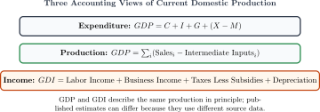
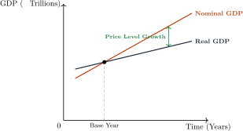

>
This chapter explains what GDP measures, how the expenditure, production, and income approaches account for current output, and why nominal and real GDP can tell different stories. Worked examples show how to avoid double counting and separate output changes from price changes.

::: {.callout-note title="Bring It Home: Is a Bigger GDP Always a Better Economy?"}

Suppose the dollar value of production rises this year. Did the economy make more goods and services, or did prices rise? And even if real production increased, does that tell us who benefited or whether unpaid care, leisure, and environmental quality improved? This chapter builds the accounting tools to answer the first question and explains why GDP alone cannot answer the others.

:::

## Defining Gross Domestic Product and Avoiding Double Counting

### Conceptual Introduction {.unnumbered}
To gauge the health and size of a national economy, macroeconomists rely on **Gross Domestic Product (GDP)**—defined strictly as **the total market value of all final goods and services produced within a country's borders during a given time period**. Every single word in that definition acts as an accounting rule:

*  **Market Value:** Physical quantities of apples, airplanes, and haircuts are converted into a common dollar metric using market prices (with imputed rental values included for owner-occupied homes).
*  **Final Goods and Services Only:** To prevent **double counting**, GDP counts only finished products sold to end users—or equivalently, sums each firm's **value added** at every stage of production—excluding **intermediate goods** (such as microchips, flour, or sheet steel) used up to make final goods.
*  **Produced Within Domestic Borders:** GDP is geographic—a Toyota Camry assembled in Kentucky counts in U.S. GDP, whereas a Ford assembled in Mexico counts in Mexican GDP (contrasting with Gross National Product, which tracks ownership).
*  **Current Production Only:** GDP excludes sales of used cars, existing homes, pure financial transfers (buying stocks or bonds), and government transfer payments (Social Security checks), because no new current good or service was produced.

These rules make GDP a measure of current market production, not a balance sheet of national wealth or a complete measure of well-being. Unpaid household work and leisure are generally outside its market-production boundary. GDP totals also do not show how income is distributed, and they do not subtract every environmental or social cost associated with production. Those limits do not make GDP useless; they define the narrower question it answers.

### Visual Representation {.unnumbered}
Figure 1 uses an illustrative three-stage supply chain—from silicon wafer to laptop processor to retail laptop—to show why summing each firm's **value added** ($\$100 + \$250 + \$650 = \$1{,}000$) matches the final retail price without counting intermediate sales twice. The dollar amounts are hypothetical teaching values, not reported company data.

{fig-alt="Value-Added Accounting Eliminates Double Counting. Summing gross receipts across all three firms ($100 + $350 + $1{,}000 = $1{,}450) would count intermediate components twice; summing each stage's value added equals the final retail value of $1{,}000."}

**Cross-Country Real GDP, 1990–2024.** The two panels compare each country's real-GDP path and its annual growth rate. Each index starts at 100 in 1990; the first panel uses a logarithmic vertical scale so equal vertical distances represent equal percentage changes.

{fig-alt="Real GDP in the United States, Japan, China, and the United Kingdom, 1990–2024. The upper panel indexes each country's output to 100 in 1990; the lower panel reports annual percentage growth. Shaded windows mark the event periods keyed to notes 1–4 below."}

**How to read the panels.** Let $Y_{i,t}$ denote country $i$'s real GDP in year $t$. The index is $I_{i,t}=100 \times \frac{Y_{i,t}}{Y_{i,1990}}$, so an index of 150 means output is 50\% above its 1990 level. Annual growth is $g_{i,t}=\frac{Y_{i,t}-Y_{i,t-1}}{Y_{i,t-1}}\times100\%$, the percentage change from the previous year. The index normalizes countries' starting levels; its logarithmic vertical scale makes equal distances represent equal proportional changes.

**Selected event windows:**

*  **1. United States, 2007–2009:** The NBER dates the recession from December 2007 to June 2009. World Bank real GDP growth was $-2.6\%$ in 2009; the annual series shows the timing and scale of the downturn, not a causal estimate. <https://www.nber.org/research/data/us-business-cycle-expansions-and-contractions>
*  **2. Japan, 2011:** Real GDP growth was $-0.2\%$. The IMF's contemporaneous assessment said the Great East Japan earthquake halted the nascent recovery and that supply disruptions remained a risk. <https://www.imf.org/en/news/articles/2015/09/28/04/52/mcs060711>
*  **3. United Kingdom, 2016–2019:** Annual growth remained positive ($2.2\%$ in 2016, $3.0\%$ in 2017, $1.6\%$ in 2018, and $1.3\%$ in 2019). The OBR reported slower growth after the referendum and weaker investment, while cautioning that it is difficult to identify how much investment underperformance was due to the referendum. <https://obr.uk/box/g7-growth-investment-since-eu-referendum/>
*  **4. China, 2020:** Growth slowed from $6.1\%$ in 2019 to $2.3\%$ in 2020, but remained positive. China's National Bureau of Statistics also reported $2.3\%$ growth for 2020. <https://www.stats.gov.cn/english/PressRelease/202101/t20210118_1812432.html>

### Real-World Application: Residential Construction vs. Existing Home Sales {.unnumbered}
When a family buys a newly built house, the value of the newly produced residential structure counts as residential investment in GDP. When another family buys an existing house, the sale price of the previously produced structure is an asset transfer, not current production. Current services connected to that sale, such as a real estate broker's commission, do count because they are produced in the current period. The distinction is between the old asset and the new service, not between whether money changed hands.

### Mathematical Foundation (Algebra Level) {.unnumbered}
At each production stage $i$, Value Added equals firm revenue minus intermediate input purchases:

$$
\text{Value Added}_i = \text{Sales Revenue}_i - \text{Cost of Intermediate Goods}_i, \qquad \text{GDP} = \sum_{i} \text{Value Added}_i
$$

**Worked Problem:**
In this hypothetical 2026 accounting exercise, assume the domestic steel is used to make the new SUVs. Evaluate which transactions count in GDP and compute their combined contribution:

*  A U.S. automaker buys $\$40\text{ million}$ of domestic steel to build new electric SUVs, which it sells to retail consumers for $\$180\text{ million}$.
*  A retiree receives $\$24{,}000$ in Social Security benefit payments.
*  A household buys a used 2022 sedan from a private seller for $\$19{,}000$.
*  A state government spends $\$65\text{ million}$ repaving interstate highways.

**Step-by-Step Breakdown:**

*  **Steel and New SUVs:** The $\$40\text{M}$ steel is an intermediate good already embedded in the final SUVs; count only the final retail value of $\$180\text{ million}$ ($\$40\text{M}$ steel value added plus $\$140\text{M}$ automaker value added).
*  **Social Security Payment:** A government transfer payment redistributes income without purchasing current production ($\$0$).
*  **Used 2022 Sedan:** Secondhand asset transfer produced in an earlier year ($\$0$).
*  **Highway Repaving:** Current government purchases include the $\$65\text{ million}$ spent on interstate repaving.

**Conclusion:** Total 2026 GDP contribution equals $\$180\text{M} + \$0 + \$0 + \$65\text{M} = \mathbf{\$245\text{ million}}$.

## Three Equivalent Approaches to Measuring GDP

### Conceptual Introduction {.unnumbered}
Because every dollar a buyer spends on a final good becomes a dollar of income for the workers, landlords, lenders, and business owners who produced it, national income accountants measure GDP using three equivalent perspectives:

*  **The Expenditure Approach ($Y = C + I + G + NX$):** Sums final spending across four sectors: **Personal Consumption Expenditures ($C$)**, **Gross Private Domestic Investment ($I$)** (new business equipment, new residential housing, and changes in business inventories), **Government Purchases ($G$)** (excluding transfers), and **Net Exports ($NX = X - M$)**. Imports ($M$) are subtracted because imported goods were already counted inside $C$, $I$, or $G$ even though they were produced abroad.
*  **The Income Approach (Gross Domestic Income, $GDI$):** Sums all factor incomes earned in domestic production—wages and salaries, proprietors' income, rental income, corporate profits, and net interest—plus indirect business taxes (less subsidies) and depreciation (**consumption of fixed capital**).
*  **The Production (Value-Added) Approach:** Sums value added across every industry sector.

These are three accounting views of the same production, not three different kinds of GDP to add together. In the expenditure view, the final buyer's spending is counted once. In the production view, the same final value is built up as value added at each stage. In the income view, the revenues generated by production appear as income to workers, owners, lenders, and government. In principle, the totals are equal; in practice, GDP and gross domestic income are estimated from different data and can differ.

### Visual Representation {.unnumbered}
Figure 3 is a schematic comparison, not a chart of measured component shares. It places the three accounting approaches side by side and emphasizes that each is intended to measure the same underlying domestic production.

::: {.callout-note title="Clear It Up: Why Are Imports Subtracted in $Y = C + I + G + X - M$?"}

Subtracting imports ($-M$) does *not* mean imports hurt GDP! When a U.S. consumer buys a $\$1{,}000$ smartphone imported from abroad, Consumption ($C$) rises by $+\$1{,}000$ and Imports ($M$) rise by $+\$1{,}000$, so net U.S. GDP changes by $\$1{,}000 - \$1{,}000 = \$0$—accurately reflecting that the phone was produced outside U.S. borders.

:::

{fig-alt="Three Accounting Views of GDP. The expenditure, production, and income approaches are different ways to organize the value of current domestic production; the diagram is schematic and not proportional to observed shares."}

### Real-World Application: BEA Data Releases and FRED GDP and GDPC1 Data {.unnumbered}
The U.S. Bureau of Economic Analysis (BEA) publishes quarterly national accounts tracked by the Federal Reserve Bank of St. Louis's FRED database. The GDP series (<https://fred.stlouisfed.org/series/GDP>) reports gross domestic product in billions of current dollars at a seasonally adjusted annual rate (SAAR). The GDPC1 series (<https://fred.stlouisfed.org/series/GDPC1>) reports real GDP in billions of chained 2017 dollars at a SAAR. A SAAR expresses the quarter's pace as if it continued for a full year; it is not a separate observation of four quarters' production.

GDP and GDI are compiled from different source data. Their difference is recorded as the **statistical discrepancy**; it is a measurement difference, not an additional type of production. Both series are revised as BEA incorporates new or updated data, so a reported historical value can change.

### Mathematical Foundation (Algebra Level) {.unnumbered}
The expenditure identity and Net Domestic Product ($NDP$) relations are:

$$
GDP = C + I + G + (X - M), \qquad NDP = GDP - \text{Depreciation}
$$

**Worked Problem:**
Given the following national accounts data (in billions of dollars): Personal Consumption $C = \$14{,}500$, Gross Private Domestic Investment $I = \$3{,}800$, Government Purchases $G = \$3{,}600$, Exports $X = \$2{,}500$, Imports $M = \$3{,}200$, and Depreciation $= \$2{,}900$. Compute Net Exports ($NX$), Gross Domestic Product ($GDP$), and Net Domestic Product ($NDP$).

**Step-by-Step Breakdown:**

*  **Compute Net Exports ($NX = X - M$):**

$$
NX = \$2{,}500 - \$3{,}200 = \mathbf{-\$700\text{ billion}}
$$

*  **Compute Gross Domestic Product ($GDP = C + I + G + NX$):**

$$
GDP = \$14{,}500 + \$3{,}800 + \$3{,}600 + (-\$700) = \mathbf{\$21{,}200\text{ billion}}
$$

*  **Compute Net Domestic Product ($NDP = GDP - \text{Depreciation}$):**

$$
NDP = \$21{,}200 - \$2{,}900 = \mathbf{\$18{,}300\text{ billion}}
$$

**Conclusion:** GDP is $\$21{,}200$ billion and NDP is $\$18{,}300$ billion.

## Nominal GDP, Real GDP, and the GDP Deflator

### Conceptual Introduction {.unnumbered}
Suppose an economy's dollar GDP increases by $8\%$ this year. Did the economy produce more cars, haircuts, and software, or did prices rise while physical production stayed flat? Nominal GDP alone cannot separate those possibilities. To make the distinction, macroeconomists use two measures:

*  **Nominal GDP:** Values current-period production using current-period prices ($\sum P_t Q_t$). It can rise because quantities rise, prices rise, or both.
*  **Real GDP:** Adjusts the value of production to remove price change so that changes over time more closely track changes in output. In a simple fixed-base classroom example, this is calculated with base-year prices ($\sum P_{\text{base}}Q_t$). BEA's official real GDP uses a chain-type quantity index, which updates price weights over time.

The ratio of nominal to real GDP, multiplied by 100, is the **GDP implicit price deflator**. It summarizes price changes for domestically produced final output. It differs from the Consumer Price Index (CPI): the GDP deflator covers domestic production, including investment and government output, while the CPI tracks a consumer basket that can include imported goods. Neither index is a cost-of-living measure for every household.

### Visual Representation {.unnumbered}
Figure 4 is a schematic example. In the base year, nominal and real GDP are equal by construction; in later years, their gap reflects price changes as well as output changes. The lines are illustrative, not historical data.

{fig-alt="Nominal GDP vs. Real GDP. In the base year, Nominal GDP and Real GDP are identical. When output and prices both rise after the base year, nominal GDP grows faster than real GDP because it reflects both changes."}

### Real-World Application: Reading GDP Alongside Other Indicators {.unnumbered}
Real GDP per capita is a commonly used indicator of average material output per person, but it is not a complete measure of living standards or welfare. It does not show how income is distributed and it does not directly measure unpaid care work, leisure, health, or environmental quality. Economists therefore use GDP alongside other indicators when a question concerns household well-being rather than production alone.

### Mathematical Foundation (Algebra Level) {.unnumbered}
Nominal GDP, Real GDP, and the GDP Deflator satisfy:

$$
\text{GDP Deflator}_t = \frac{\text{Nominal GDP}_t}{\text{Real GDP}_t} \times 100
$$

**Worked Problem:**
For a fixed-base instructional calculation, suppose an economy produces only two final goods: laptops and bicycles. In the 2024 base year, it produces $100$ laptops at $\$800$ each and $200$ bicycles at $\$300$ each. In 2026, it produces $120$ laptops at $\$900$ each and $250$ bicycles at $\$360$ each. Compute nominal GDP, real GDP at 2024 prices, and the GDP deflator for both years, plus real GDP growth.

**Step-by-Step Breakdown:**

*  **Compute 2024 Base Year Values:**

$$
\begin{aligned}
\text{Nominal GDP}_{2024} = \text{Real GDP}_{2024}
&= (100 \times \$800) + (200 \times \$300) \\
&= \$80{,}000 + \$60{,}000 \\
&= \mathbf{\$140{,}000}
\end{aligned}
$$

$$
\text{GDP Deflator}_{2024} = \frac{\$140{,}000}{\$140{,}000} \times 100 = \mathbf{100.0}
$$

*  **Compute 2026 Nominal GDP (Using 2026 Prices):**

$$
\text{Nominal GDP}_{2026} = (120 \times \$900) + (250 \times \$360) = \$108{,}000 + \$90{,}000 = \mathbf{\$198{,}000}
$$

*  **Compute 2026 Real GDP (Using 2024 Base Prices):**

$$
\text{Real GDP}_{2026} = (120 \times \$800) + (250 \times \$300) = \$96{,}000 + \$75{,}000 = \mathbf{\$171{,}000}
$$

*  **Compute 2026 GDP Deflator and Real Output Growth:**

$$
\text{GDP Deflator}_{2026} = \frac{\$198{,}000}{\$171{,}000} \times 100 \approx \mathbf{115.79}
$$

$$
\text{Real GDP Growth} = \frac{\$171{,}000 - \$140{,}000}{\$140{,}000} \times 100\% = \frac{\$31{,}000}{\$140{,}000} \times 100\% \approx \mathbf{+22.14\%}
$$

**Conclusion:** While Nominal GDP surged by $41.43\%$, physical Real GDP grew by $22.14\%$ and the overall GDP price level rose by $15.79\%$.

::: {.callout-note title="Optional Advanced Section: Chain-Weighted Real GDP Indices"}

*Note for Economics Majors and Quantitative Students:*
With a fixed base year, the relative importance of goods can become outdated as prices and production patterns change. A Fisher quantity index balances a Laspeyres index, which values quantities using previous-period prices, and a Paasche index, which uses current-period prices. The geometric mean gives the two price-weighting perspectives equal influence:

$$
Q_t^{L} = \frac{\sum_i P_{i,t-1}Q_{i,t}}{\sum_i P_{i,t-1}Q_{i,t-1}}, \qquad
Q_t^{P} = \frac{\sum_i P_{i,t}Q_{i,t}}{\sum_i P_{i,t}Q_{i,t-1}}
$$

The chain-type quantity growth factor is:

$$
Q_t^{F} = \sqrt{Q_t^{L}Q_t^{P}}
$$

This extension explains why official chained-dollar component levels are generally not additive: the chain-type index is designed to measure growth across periods, not to preserve fixed-base component sums.

:::

## Practice and Self-Check {.unnumbered}
Use the explanations after each answer to check both the correct reasoning and common distractors.

*  A domestic bakery buys $\$2{,}000$ of flour and sells the bread made from it to households for $\$5{,}000$. Ignoring other inputs, how much does the bread production contribute to GDP? (A) $\$2{,}000$, (B) $\$5{,}000$, or (C) $\$7{,}000$.\\
**Answer: B.** Count the final bread value once. A counts only the intermediate input; C adds the flour value again even though it is already embodied in the bread.

*  A U.S. household directly imports a newly produced $\$1{,}000$ tablet from a foreign producer. What is the direct effect on U.S. GDP from the purchase? (A) It rises by $\$1{,}000$, (B) it falls by $\$1{,}000$, or (C) there is no direct change.\\
**Answer: C.** Consumption rises by $\$1{,}000$, but imports also rise by $\$1{,}000$ and are subtracted in net exports. A ignores the foreign origin of production; B incorrectly treats the import adjustment as a loss of domestic output.

*  Nominal GDP rises while real GDP is unchanged. What happens to the GDP deflator? (A) It rises, (B) it falls, or (C) it stays unchanged.\\
**Answer: A.** With real GDP fixed, a higher nominal value raises the nominal-to-real ratio. B reverses the ratio's implication; C would require nominal GDP to stay fixed as well.

*  A household buys a newly built home and later buys an existing home from another household. Which transaction adds the structure's value to current GDP?\\
**Answer:** The newly built home adds current residential construction to investment. The existing structure was counted when it was produced; current brokerage services associated with its resale are counted separately.

::: {.callout-note title="Bring It Home: What GDP Can and Cannot Tell Us"}

GDP provides a consistent way to track the market value of current domestic production. To interpret a change, separate price movements from real output movements, check which production is domestic and current, and remember that a production total does not describe distribution or every dimension of well-being.

:::
