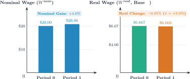

>
This chapter examines how macroeconomists measure the economy-wide aggregate price level using market baskets and price indexes (the Consumer Price Index, Producer Price Index, and GDP Implicit Price Deflator), compute national inflation, disinflation, and deflation rates, diagnose upward measurement biases in fixed-basket indexes, adjust nominal dollar figures into real purchasing power, and evaluate real interest rates and wealth redistribution via the Fisher Equation.

## Learning Outcomes and Key Terms {.unnumbered}
\addcontentsline{toc}{section}{Learning Outcomes and Key Terms}

Upon completing this chapter, students should be able to (supporting Course Learning Objectives **MA-1** and **C2002-1**):

*  **Construct** a market-basket price index and contrast the scope and weighting methods of the Consumer Price Index (\texttt{CPIAUCSL}), Producer Price Index (\texttt{PPIACO}), and GDP Implicit Price Deflator.
*  **Identify** the three primary upward biases in fixed-weight consumer price indexes (substitution bias, quality/new-product bias, and outlet substitution bias) and explain why they overstate true cost-of-living changes.
*  **Compute** national inflation, disinflation, and deflation rates ($\pi_t$) from aggregate price index series and evaluate the economic costs of price-level instability.
*  **Convert** nominal wages and nominal interest rates into real purchasing power using index deflation and the Fisher Equation ($r = i - \pi^e$), distinguishing expected from realized real returns.

**Key Terms:** aggregate price level, market basket, base period, Consumer Price Index (CPI), Producer Price Index (PPI), GDP Implicit Price Deflator, substitution bias, quality bias, new-product bias, inflation rate ($\pi_t$), disinflation, deflation, shoe-leather costs, menu costs, unit-of-account costs, indexation, cost-of-living adjustment (COLA), nominal wage, real wage, nominal interest rate ($i$), real interest rate ($r$), Fisher equation.

::: {.callout-tip title="Bring It Home: Why a 4\% Raise Can Leave You Poorer at the Grocery Store"}

Suppose you graduate, start a full-time job earning $\$20.00$ per hour, and celebrate a year later when your manager awards you a $4\%$ raise to $\$20.80$ per hour. Your paycheck has eighty extra cents for every hour you work. Yet when you pay rent, buy groceries, and cover utilities, your bank balance feels tighter than it did a year earlier. How can a larger dollar paycheck buy fewer goods and services? The answer lies in distinguishing *single-market nominal prices* (studied in Chapter 3) from changes in the *economy-wide aggregate price level*. When broad consumer prices rise by $5\%$ while your dollar wage rises by $4\%$, your real purchasing power actually falls. Understanding how economists track the aggregate price level—and why both rapid inflation and outright deflation disrupt saving, borrowing, and wages—gives households and policymakers the tools needed to see past dollar illusions.

:::

## Market Baskets, Price Indexes, and CPI Upward Biases

### Conceptual Introduction {.unnumbered}
In Chapter 3, we analyzed how supply and demand determine the equilibrium price $P^*$ of a single good, such as coffee or apartments. Across an entire macroeconomy, however, millions of individual prices rise and fall simultaneously at different speeds. To summarize whether the overall cost of living is rising or falling, economists construct a single summary statistic called the **aggregate price level**—an index number measuring the weighted average price of a standardized collection of goods and services relative to a chosen **base period** (where the index is normalized to $100$).

Because different economic groups buy and sell different bundles of goods, statistical agencies maintain three complementary price indexes. The **Consumer Price Index (CPI)**, published monthly by the U.S.\ Bureau of Labor Statistics (BLS), tracks the retail cost of a fixed **market basket** of housing, food, transportation, medical care, energy, and apparel purchased by typical urban households—including imported consumer goods. The **Producer Price Index (PPI)** measures average wholesale selling prices received by domestic producers for raw materials, intermediate inputs, and finished goods; because producer input costs often pass through to retail shelves later, the PPI serves as an early warning indicator of consumer inflation. By contrast, the **GDP Implicit Price Deflator** (derived from the National Income and Product Accounts introduced in Chapter 4) measures price changes across *all* domestically produced final goods and services ($C, I, G, X$), excluding imports and updating its expenditure weights automatically every quarter.

These structural differences directly affect how households, businesses, and governments allocate resources. Social Security benefits, federal income tax brackets, and union wage contracts are indexed to the CPI, whereas macroeconomic growth adjustments rely on the GDP Deflator. Moreover, because the standard CPI holds base-period basket quantities fixed in the short run, it tends to overstate true increases in the cost of living—a systematic upward drift that affects public budget outlays and real wage measurements across the economy.

### Visual Representation {.unnumbered}
Figure 1 compares the economic coverage, weighting structure, and import treatment across the three primary U.S.\ aggregate price indexes.

{fig-alt="Comparing the Three Aggregate Price Indexes. The CPI tracks a fixed basket of urban consumer purchases (including imported consumer goods), the PPI tracks domestic wholesale producer prices, and the GDP Deflator covers all current domestically produced final goods and services (C, I, G, X)."}

::: {.callout-note title="Clear It Up: Why Does the CPI Overstate True Cost-of-Living Increases?"}

Because the standard CPI tracks the cost of purchasing a *fixed* basket of goods, economists estimate that it overstates true increases in the cost of living by roughly $0.5$ to $1.0$ percentage points per year due to three well-documented biases:

*  **Substitution Bias:** When the price of beef jumps while chicken stays cheap, households substitute toward chicken. A fixed-weight index assumes consumers keep buying the exact same expensive bundle, overstating the welfare loss.
*  **Quality and New-Product Bias:** When a new smartphone or laptop costs $\$50$ more than last year's model but delivers twice the battery life, camera resolution, and speed, part of the price tag reflects higher product quality rather than pure inflation. Similarly, brand-new inventions enter the fixed basket with a lag, missing steep early price declines.
*  **Outlet Substitution Bias:** Consumers shift purchases toward discount warehouse clubs and online retailers when retail prices rise, lowering actual prices paid relative to traditional store surveys.

:::

### Mathematical Foundation {.unnumbered}
To construct a fixed-basket price index such as the CPI, multiply the fixed base-period quantities ($Q_{j,0}$) of each item $j = 1, \dots, k$ in the market basket by current-period prices ($P_{j,t}$), divide by the base-period cost of that identical basket, and multiply by $100$:

$$
\text{Cost of Market Basket}_t = \sum_{j=1}^{k} P_{j,t} \cdot Q_{j,0}, \qquad
\text{CPI}_t = \frac{\text{Cost of Market Basket}_t}{\text{Cost of Market Basket}_0} \times 100.
$$

By construction, in the base period ($t = 0$), $\text{CPI}_0 = \frac{\text{Cost}_0}{\text{Cost}_0} \times 100 = 100.0$. By contrast, the **GDP Implicit Price Deflator** uses current-period quantities ($Q_{j,t}$) and equals the ratio of Nominal GDP to Real GDP multiplied by $100$:

$$
\text{GDP Deflator}_t = \frac{\text{Nominal GDP}_t}{\text{Real GDP}_t} \times 100 = \frac{\sum_{j=1}^{k} P_{j,t} \cdot Q_{j,t}}{\sum_{j=1}^{k} P_{j,0} \cdot Q_{j,t}} \times 100.
$$

\paragraph{Work It Out 5.1 (Constructing a Market-Basket CPI and GDP Deflator).}
Suppose an urban household market basket consists of $10$ units of housing/utilities and $50$ units of groceries. In the base year ($t = 0$), housing costs $\$30$ per unit and groceries cost $\$4$ per unit.

*  **Compute the Base-Year Market Basket Cost ($t = 0$):**
$$\text{Cost of Market Basket}_0 = (\$30 \times 10) + (\$4 \times 50) = \$300 + \$200 = \$500$$
$$\text{CPI}_0 = \frac{\$500}{\$500} \times 100 = 100.0$$
*  **Compute Year 1 CPI when Basket Cost Rises to $\$550$:**
Suppose in Year 1 ($t = 1$), housing rises to $\$33$ per unit and groceries rise to $\$4.40$ per unit, bringing the fixed-basket cost to $(\$33 \times 10) + (\$4.40 \times 50) = \$330 + \$220 = \$550$:
$$\text{CPI}_1 = \frac{\$550}{\$500} \times 100 = 110.0$$
*  **Compute Year 2 CPI when Basket Cost Falls to $\$539$:**
Suppose in Year 2 ($t = 2$), lower energy and food prices reduce the basket cost to $\$539$:
$$\text{CPI}_2 = \frac{\$539}{\$500} \times 100 = 107.8$$
*  **Compare with a GDP Deflator Calculation:**
Separately, if an economy produces Nominal GDP of $\$27{,}500\text{ billion}$ and Real GDP of $\$25{,}000\text{ billion}$ in Year 1, its GDP Implicit Price Deflator is:
$$\text{GDP Deflator}_1 = \frac{\$27{,}500\text{B}}{\$25{,}000\text{B}} \times 100 = 110.0$$

::: {.callout-tip title="FRED Data: Tracking Consumer and Producer Price Indexes (\texttt{CPIAUCSL"}
and \texttt{PPIACO})}
In empirical macroeconomic analysis using Federal Reserve Economic Data (FRED), two canonical monthly series anchor price-level monitoring:

*  \texttt{CPIAUCSL}: Reports the seasonally adjusted **Consumer Price Index for All Urban Consumers: All Items in U.S.\ City Average**, indexed so that the average level across $1982\text{–}1984 = 100$.
*  \texttt{PPIACO}: Reports the **Producer Price Index by Commodity: All Commodities**, indexed to $1982 = 100$.

During the 2021–2022 global supply-chain bottleneck and energy surge, \texttt{PPIACO} accelerated sharply several months before \texttt{CPIAUCSL} peaked, illustrating how wholesale commodity and freight price increases propagate along supply chains into retail consumer prices. Conversely, when imported consumer electronics or foreign crude oil fall in price, \texttt{CPIAUCSL} registers the relief directly because consumer imports sit inside the urban household basket, whereas the GDP Deflator excludes imported goods.

:::

\begin{casestudy}
\boxheader{SlateBlue}{Optional Advanced Box: Laspeyres (CPI) vs.\ Paasche and Chained-CPI Formulas}
In index-number theory, the standard CPI is a **Laspeyres price index** because it weights price changes using fixed base-period quantities ($Q_{j,0}$):
$$I_t^{\text{Laspeyres}} = \frac{\sum_{j=1}^{k} P_{j,t} Q_{j,0}}{\sum_{j=1}^{k} P_{j,0} Q_{j,0}} \times 100.$$
Because consumers substitute away from goods whose relative prices rise fastest, a Laspeyres index places too much weight on high-inflation items and overstates true cost-of-living growth. Conversely, a **Paasche price index** (the implicit weighting structure of the GDP Deflator) weights prices using current-period quantities ($Q_{j,t}$), which tends to understate cost-of-living increases relative to base-year utility. To eliminate substitution bias, the BLS also publishes the **Chained CPI for All Urban Consumers** (\texttt{SUUR0000SA0}), which takes the geometric mean of adjacent-period Laspeyres and Paasche ratios (a T\"ornqvist/Fisher-style superlative index) to capture consumer substitution across categories in real time.
\end{casestudy}

## Calculating National Inflation, Disinflation, and Deflation

### Conceptual Introduction {.unnumbered}
Once economists have an aggregate price index series ($P_0, P_1, P_2, \dots$), they measure the speed of economy-wide price changes through the **inflation rate ($\pi_t$)**—the percentage rate of change in the aggregate price level from one period ($t-1$) to the next ($t$). Notice the crucial distinction between the *price level* (an index number such as $\text{CPI} = 110.0$ or $315.0$) and the *inflation rate* (a percentage growth rate per year, such as $+10.0\%$ or $+3.2\%$).

Economists classify aggregate price dynamics into three distinct regimes based on the sign and trajectory of $\pi_t$:

*  **Inflation ($\pi_t > 0$):** A sustained increase in the aggregate price level, which erodes the purchasing power of each dollar.
*  **Disinflation ($\pi_t > 0$, with $\pi_t < \pi_{t-1}$):** A *slowdown* in the rate of inflation—for example, annual inflation cooling from $6.0\%$ to $3.0\%$. During disinflation, the aggregate price level is *still rising*, just at a slower pace than before.
*  **Deflation ($\pi_t < 0$):** An outright decline in the aggregate price level, meaning average prices fall below their prior-period levels and the inflation rate turns negative.

Both high inflation and outright deflation distort economic decision-making and resource allocation. High, volatile inflation obscures relative price signals (making it hard for firms and shoppers to tell whether a price hike reflects higher demand or general inflation) and imposes real resource costs. Conversely, economy-wide deflation is dangerous because wages and debt contracts are denominated in fixed nominal dollars: falling prices raise the real burden of household and corporate debt, prompting borrowers to slash spending and firms to freeze hiring—a self-reinforcing contractionary spiral known as **debt deflation**.

### Visual Representation {.unnumbered}
Figure 2 plots the hypothetical market-basket CPI trajectory from Work It Out 5.1 alongside a multi-period inflation rate path, visually separating rising prices during *inflation* and *disinflation* from falling prices during *deflation*.

{fig-alt="Aggregate Price Levels vs.\ Inflation Regimes. Left: An index rise from 100.0 to 110.0 corresponds to +10.0\% inflation, whereas a drop from 110.0 to 107.8 corresponds to -2.0\% deflation. Right: Disinflation occurs when \pi_t declines toward 0\% while remaining positive."}

::: {.callout-note title="Clear It Up: Disinflation Is Not Deflation"}

Students frequently confuse **disinflation** with **deflation** when reading economic news. If headline CPI inflation falls from $6.0\%$ in Year 1 to $3.0\%$ in Year 2, the economy is experiencing *disinflation*, not deflation: average consumer prices still increased by $3.0\%$ over Year 2, so the price index is higher than ever—it simply climbed less rapidly than in Year 1. Average prices fall below prior levels only when $\pi_t < 0$ (*deflation*).

:::

### Mathematical Foundation {.unnumbered}
Let $P_t$ denote the value of an aggregate price index (such as the CPI or GDP Deflator) in period $t$, and let $P_{t-1}$ denote its value in the immediately preceding period. The percentage inflation rate $\pi_t$ is:

$$
\pi_t = \frac{P_t - P_{t-1}}{P_{t-1}} \times 100\% = \left(\frac{P_t}{P_{t-1}} - 1\right) \times 100\%.
$$

Notice that the denominator is always the *prior period's* index ($P_{t-1}$), not the base-year index ($100.0$), unless $t - 1$ happens to be the base year.

\paragraph{Work It Out 5.2 (Computing Inflation, Disinflation, and Deflation from a Basket Series).}
Using the market-basket CPI series from Work It Out 5.1—where the basket costs $\$500$ in Year 0 ($t = 0$), $\$550$ in Year 1 ($t = 1$), and $\$539$ in Year 2 ($t = 2$)—compute the annual inflation rate for each year:

*  **Year 1 Inflation Rate ($\pi_1$, from Year 0 to Year 1):**
With $\text{CPI}_0 = 100.0$ and $\text{CPI}_1 = 110.0$:
$$\pi_1 = \frac{\text{CPI}_1 - \text{CPI}_0}{\text{CPI}_0} \times 100\% = \frac{110.0 - 100.0}{100.0} \times 100\% = \frac{10.0}{100.0} \times 100\% = +10.0\%.$$
Because $\pi_1 > 0$, the economy experiences **inflation** of $10.0\%$.
*  **Year 2 Inflation Rate ($\pi_2$, from Year 1 to Year 2):**
With $\text{CPI}_1 = 110.0$ and $\text{CPI}_2 = 107.8$:
$$\pi_2 = \frac{\text{CPI}_2 - \text{CPI}_1}{\text{CPI}_1} \times 100\% = \frac{107.8 - 110.0}{110.0} \times 100\% = \frac{-2.2}{110.0} \times 100\% = -2.0\%.$$
Because $\pi_2 < 0$, the economy experiences outright **deflation** of $2.0\%$. *(Note: A common algebra error is dividing $-2.2$ by the Year 0 base index $100.0$ instead of Year 1's index $110.0$, which would falsely yield $-2.2\%$.)*
*  **Contrast with a Disinflation Scenario:**
If instead the Year 2 basket cost had risen to $\$577.50$ ($\text{CPI}_2 = \frac{577.50}{500} \times 100 = 115.5$), then:
$$\pi_2^{\text{alt}} = \frac{115.5 - 110.0}{110.0} \times 100\% = \frac{5.5}{110.0} \times 100\% = +5.0\%.$$
Here $\pi_2^{\text{alt}} = +5.0\% < \pi_1 = +10.0\%$, representing **disinflation** (inflation slowed by $5.0$ percentage points, even though prices still rose $5.0\%$).

::: {.callout-tip title="U.S.\ Post-Pandemic Disinflation (2022–2024) vs.\ Japan's Lost Decades of Deflation"}

Between 2021 and mid-2022, U.S.\ year-over-year CPI inflation (\texttt{CPIAUCSL}) surged above $8\%$, driven by pandemic supply-chain disruptions, fiscal stimulus, and energy price shocks. Over 2023 and 2024, tighter monetary policy and healing supply chains brought annual U.S.\ inflation back down toward $3\%$—a textbook episode of **disinflation** in which the price level stabilized at a higher plateau rather than returning to 2019 prices. By contrast, following the burst of its asset-price bubble in the early 1990s, Japan experienced prolonged **deflation** ($\pi_t < 0$) across much of the late 1990s and 2000s. Expecting prices to be even lower next year, Japanese households postponed durable purchases and corporations delayed capital investment, illustrating why central banks target a low, positive inflation rate (typically $2\%$) rather than $0\%$ or negative inflation.

:::

## Real Purchasing Power, Indexation, and Costs of Inflation

### Conceptual Introduction {.unnumbered}
Because dollars are merely measuring rods whose purchasing power shrinks during inflation, economists separate **nominal variables** (measured in current-period dollars, such as a $\$20.80$ hourly wage) from **real variables** (adjusted for changes in the aggregate price level to measure actual purchasing power over physical goods and services). If every wage, pension, and price doubled overnight, real purchasing power would be unchanged—a property known as **money neutrality** in the long run.

In the short run, however, wages, tax thresholds, and contracts adjust unevenly, creating three distinct resource costs when inflation is elevated or unanticipated:

*  **Shoe-Leather Costs:** High inflation erodes the purchasing power of cash sitting in non-interest-bearing wallets or low-interest checking accounts, forcing households and firms to spend extra time and effort ("wearing out shoe leather") making frequent trips to the bank or shifting funds between interest-bearing assets and cash.
*  **Menu Costs:** Businesses must spend real resources—printing new restaurant menus, re-tagging retail shelves, updating digital catalogs, and renegotiating supplier quotes—every time they adjust nominal prices.
*  **Unit-of-Account Costs:** Inflation makes the dollar a shrinking yardstick over time, distorting accounting profits, capital gains taxes, and long-term business planning. For example, if an asset rises $10\%$ in nominal value solely because of $10\%$ inflation, the investor earned zero real gain yet may still owe capital gains taxes on the illusory nominal profit.

To shield households from unintended purchasing-power erosion, governments and private contracts use automatic **indexation**—tying dollar payments directly to a published price index. For example, U.S.\ Social Security retirement benefits receive an annual **cost-of-living adjustment (COLA)** tied to the Consumer Price Index, and federal income tax brackets are indexed annually to prevent *bracket creep* (being pushed into a higher marginal tax rate solely because nominal income rose with inflation).

### Visual Representation {.unnumbered}
Figure 3 illustrates the hourly wage example from our chapter opening: although the worker's nominal hourly wage rises $+4.0\%$ from $\$20.00$ to $\$20.80$, consumer prices rise $+5.0\%$ ($\text{CPI}$ from $300$ to $315$), reducing the worker's real wage in base-period dollars from $\$6.667$ to $\$6.603$ ($-0.95\%$).

{fig-alt="Nominal Wage Growth vs.\ Real Purchasing Power. Even though the worker's nominal wage rises 4.0\% (from $20.00 to $20.80), a 5.0\% jump in the CPI (from 300 to 315) reduces real purchasing power by 0.95\%."}

### Mathematical Foundation {.unnumbered}
To convert any nominal dollar amount $X_t^{\text{nom}}$ (such as a wage, salary, or historical price) into constant base-period purchasing power ($X_t^{\text{real}}$), divide by period $t$'s price index and multiply by $100$:

$$
W_t^{\text{real}} = \frac{W_t^{\text{nom}}}{\text{CPI}_t} \times 100.
$$

More generally, to compare a dollar figure from historical period $A$ in the purchasing power of target period $B$:

$$
\text{Value in Period } B \text{ Dollars} = \text{Nominal Value}_A \times \frac{\text{CPI}_B}{\text{CPI}_A}.
$$

\paragraph{Work It Out 5.3 (Evaluating a Nominal Raise Against Consumer Inflation).}
Suppose a worker's nominal hourly wage rises from $\$20.00$ in Period 0 to $\$20.80$ in Period 1, while the CPI rises from $300$ in Period 0 to $315$ in Period 1.

*  **Compute Nominal Wage Growth ($g_W$) and Inflation ($\pi$):**
$$g_W = \frac{\$20.80 - \$20.00}{\$20.00} \times 100\% = \frac{\$0.80}{\$20.00} \times 100\% = +4.0\%,$$
$$\pi = \frac{315 - 300}{300} \times 100\% = \frac{15}{300} \times 100\% = +5.0\%.$$
*  **Compute Real Wages in Constant Base-Period Dollars ($\text{CPI}_{\text{base}} = 100$):**
$$W_0^{\text{real}} = \frac{\$20.00}{300} \times 100 \approx \$6.667 \text{ per hour},$$
$$W_1^{\text{real}} = \frac{\$20.80}{315} \times 100 \approx \$6.603 \text{ per hour}.$$
*  **Compute the Percentage Change in Real Purchasing Power (retaining full precision):**
$$g_{\text{real}} = \frac{W_1^{\text{real}} - W_0^{\text{real}}}{W_0^{\text{real}}} \times 100\% = \left(\frac{20.80 / 315}{20.00 / 300} - 1\right) \times 100\% = \left(\frac{1.04}{1.05} - 1\right) \times 100\% \approx -0.95\%.$$
Because nominal wage growth ($+4.0\%$) trailed CPI inflation ($+5.0\%$), the worker's real hourly purchasing power declined by approximately $0.95\%$.

::: {.callout-tip title="Social Security COLAs, Minimum Wage Erosion, and Historical Comparisons"}

Deflating nominal dollar values into constant-dollar purchasing power allows economists to compare living standards across decades or evaluate whether statutory benefits keep pace with inflation. For instance, if the federal minimum wage remains fixed at $\$7.25$ per hour in nominal terms while the CPI rises over fifteen years, the real purchasing power of that statutory wage floor falls steadily every single year. Conversely, because Social Security benefits are legally indexed to the CPI, recipients receive an automatic annual Cost-of-Living Adjustment (such as the $8.7\%$ COLA in 2023 following 2022 inflation) designed to preserve real purchasing power—though upward CPI substitution bias means full CPI indexation slightly overcompensates for true cost-of-living changes.

:::

## Real vs.\ Nominal Interest Rates and the Fisher Equation

### Conceptual Introduction {.unnumbered}
Just as workers care about how many groceries their wages can buy, savers and borrowers care about how much purchasing power a loan repays. When you deposit money in a savings account or take out a fixed-rate auto loan, the bank quotes a **nominal interest rate ($i$)**—the annual percentage return measured in current dollars without adjusting for inflation. However, if prices rise while the loan is outstanding, the dollars repaid at maturity buy fewer goods than the dollars originally lent.

To measure the true gain in purchasing power earned by a lender (and the true real cost paid by a borrower), economist Irving Fisher established the distinction between the nominal interest rate ($i$) and the **real interest rate ($r$)**—the nominal interest rate adjusted for inflation. Because inflation over the life of a loan is unknown at the moment a loan contract is signed, lenders and borrowers negotiate the nominal rate $i$ based on their **expected inflation rate ($\pi^e$)**, targeting a desired expected real return $r^e = i - \pi^e$ (a relationship known as the **Fisher Effect**: higher expected inflation pushes nominal interest rates upward one-for-one).

Once the loan period concludes and **actual inflation ($\pi$)** is observed, the **realized real interest rate** is $r_{\text{actual}} = i - \pi$. Whenever actual inflation differs from expected inflation, fixed-rate debt contracts arbitrarily redistribute real wealth between creditors and debtors:

*  **Unexpectedly High Inflation ($\pi > \pi^e$):** Realized real interest rates fall below expected real rates ($r_{\text{actual}} < r^e$). **Borrowers win** because they repay their fixed-dollar debts with cheaper, less valuable dollars; **lenders lose** purchasing power.
*  **Unexpectedly Low Inflation or Deflation ($\pi < \pi^e$):** Realized real interest rates rise above expected real rates ($r_{\text{actual}} > r^e$). **Lenders win** because repaid dollars buy more goods than anticipated; **borrowers lose** because the real burden of debt repayment increases.

### Visual Representation {.unnumbered}
Figure 4 decomposes a $7.0\%$ fixed nominal loan rate ($i = 7.0\%$) under $3.0\%$ expected inflation ($\pi^e = 3.0\%$, yielding $r^e = 4.0\%$) and contrasts what happens when actual inflation surges unexpectedly to $\pi = 6.0\%$, compressing the lender's realized real return to $r_{\text{actual}} = 1.0\%$.

{fig-alt="The Fisher Equation and Unexpected Inflation Redistribution. On a 7.0\% fixed-rate loan priced for 3.0\% expected inflation (r^e = 4.0\%), an unexpected inflation surge to 6.0\% transfers 3.0 percentage points of real purchasing power from the lender to the borrower (r_{\text{actual}} = 1.0\%)."}

::: {.callout-note title="Clear It Up: Can the Real Interest Rate Be Negative?"}

Yes. While nominal interest rates on ordinary bank loans and deposits rarely fall below zero (because savers can hold physical currency yielding $0\%$), the **real interest rate** ($r = i - \pi$) turns negative whenever inflation exceeds the nominal interest rate ($\pi > i$). For example, if a savings account pays $i = 2.0\%$ nominal interest while consumer prices rise by $\pi = 5.0\%$, your account balance grows by $2.0\%$ in dollars, but those dollars buy $3.0\%$ fewer goods ($r \approx 2.0\% - 5.0\% = -3.0\%$).

:::

### Mathematical Foundation {.unnumbered}
For moderate inflation and interest rates, the **linear Fisher Equation** relates the nominal interest rate ($i$), expected or realized real interest rate ($r$), and expected or actual inflation rate ($\pi^e$ or $\pi$):

$$
i = r^e + \pi^e \quad \Longleftrightarrow \quad r^e = i - \pi^e \quad (\text{expected}), \qquad r_{\text{actual}} = i - \pi \quad (\text{realized}).
$$

\paragraph{Work It Out 5.4 (Expected vs.\ Realized Real Interest Rates on a Fixed-Rate Loan).}
A credit union and a small business agree on a one-year fixed-rate loan of $\$10{,}000$ at a nominal interest rate of $i = 7.0\%$. At the time the contract is signed, both parties expect annual inflation to be $\pi^e = 3.0\%$.

*  **Compute the Expected Real Interest Rate ($r^e$):**
$$r^e = i - \pi^e = 7.0\% - 3.0\% = 4.0\%.$$
Both lender and borrower anticipate that the credit union will gain $4.0\%$ in real purchasing power over the year.
*  **Compute the Realized Real Interest Rate ($r_{\text{actual}}$) if Actual Inflation Hits $\pi = 6.0\%$:**
$$r_{\text{actual}} = i - \pi = 7.0\% - 6.0\% = 1.0\%.$$
*  **Identify Who Gained and Who Lost from the Inflation Surprise:**
Because actual inflation ($\pi = 6.0\%$) exceeded expected inflation ($\pi^e = 3.0\%$) by $3.0$ percentage points, the lender's realized real return fell from $4.0\%$ to $1.0\%$, transferring $3.0\%$ of real purchasing power ($\$300$ on a $\$10{,}000$ loan) from the credit union to the small-business borrower.
*  **Compute the Realized Real Interest Rate if Unexpected Disinflation Drops $\pi$ to $1.0\%$:**
$$r_{\text{actual}}^{\text{low}} = 7.0\% - 1.0\% = 6.0\%.$$
Here realized inflation was $2.0$ percentage points *lower* than expected, raising the lender's real return to $6.0\%$ and hurting the borrower.

::: {.callout-tip title="Fixed-Rate Mortgages and Treasury Inflation-Protected Securities (TIPS)"}

In the United States, millions of homeowners hold $30$-year fixed-rate mortgages locked in at nominal rates between $3.0\%$ and $4.0\%$ during 2020–2021. When U.S.\ inflation subsequently exceeded $4\%$ to $8\%$ in 2021–2023, those borrowers experienced negative realized real mortgage rates ($r_{\text{actual}} = i - \pi < 0$), substantially reducing the real purchasing-power burden of their monthly mortgage payments while eroding the real returns of mortgage bondholders. To protect savers against unexpected inflation, the U.S.\ Treasury issues **Treasury Inflation-Protected Securities (TIPS)**, whose principal value adjusts automatically with the CPI (\texttt{CPIAUCSL}), guaranteeing investors a fixed real return regardless of future inflation surprises.

:::

\begin{casestudy}
\boxheader{SlateBlue}{Optional Advanced Calculus Box: Exact Multiplicative Fisher Compounding & Continuous Time}
The linear formula $r = i - \pi$ is a first-order approximation that ignores the cross-product term $r \cdot \pi$. Let $\$1$ lent at nominal rate $i$ grow to $(1 + i)$ dollars while the price level rises by factor $(1 + \pi)$. The exact real gross return $(1 + r)$ equals the nominal gross return divided by the gross price-level factor:
$$1 + r = \frac{1 + i}{1 + \pi} \quad \Longleftrightarrow \quad i = r + \pi + (r \cdot \pi) \quad \Longleftrightarrow \quad r = \frac{i - \pi}{1 + \pi}.$$
Notice that the exact multiplicative relation applies identically to real wage growth ($1 + g_{\text{real}} = \frac{1 + g_W}{1 + \pi}$):

*  **Wage Example ($g_W = 0.04$, $\pi = 0.05$):** The linear approximation gives $g_{\text{real}} \approx 4\% - 5\% = -1.00\%$, whereas the exact formula gives $g_{\text{real}} = \frac{1.04}{1.05} - 1 \approx -0.00952$, or $-0.95\%$.
*  **Loan Example ($i = 0.07$, $\pi = 0.06$):** The linear approximation gives $r_{\text{actual}} \approx 7\% - 6\% = 1.00\%$, whereas the exact formula gives $r_{\text{actual}} = \frac{0.07 - 0.06}{1.06} = \frac{0.01}{1.06} \approx 0.00943$, or $0.94\%$. At high inflation rates (such as $i = 40\%$, $\pi = 30\%$), the difference becomes substantial: linear $r = 10.0\%$, whereas exact $r = \frac{0.10}{1.30} \approx 7.69\%$.
*  **Continuous-Time Calculus Extension:** With continuous compounding, the real value of a nominal asset $V(t)$ deflated by the price level $P(t)$ is $v(t) = V(t)/P(t)$. Taking natural logarithms and differentiating with respect to time gives the exact continuous-time Fisher identity:
$$r(t) = \frac{d \ln v(t)}{dt} = \frac{d \ln V(t)}{dt} - \frac{d \ln P(t)}{dt} = i(t) - \pi(t).$$

\end{casestudy}

\begin{takeaways}
\boxheader{SlateBlue}{Chapter 5 Key Takeaways}

*  **Price Indexes:** The CPI (\texttt{CPIAUCSL}) tracks a fixed urban consumer basket (including imports), the PPI (\texttt{PPIACO}) tracks domestic wholesale producer prices, and the GDP Implicit Price Deflator covers all current domestic final output ($C, I, G, X$) with changing weights.
*  **CPI Biases:** Fixed-basket weights cause the CPI to overstate true cost-of-living growth by roughly $0.5$ to $1.0$ percentage points annually due to substitution bias, quality/new-product bias, and outlet substitution bias.
*  **Inflation vs.\ Disinflation vs.\ Deflation:** Inflation is $\pi_t > 0$; disinflation is a falling but still positive $\pi_t > 0$; deflation is an outright fall in the aggregate price level ($\pi_t < 0$).
*  **Real Purchasing Power & Fisher Equation:** Real wages ($W^{\text{real}} = \frac{W^{\text{nom}}}{\text{CPI}} \times 100$) and real interest rates ($r \approx i - \pi^e$) isolate true purchasing power. Unexpectedly high inflation redistributes wealth from lenders to borrowers.

\end{takeaways}

## Check Your Understanding {.unnumbered}
\addcontentsline{toc}{section}{Check Your Understanding}

*  **Price Index Coverage & Biases:**

*  Suppose the price of imported European olive oil and imported Japanese automobiles jumps sharply, while prices of all domestically produced U.S.\ goods stay constant. Which index rises more: the U.S.\ CPI or the U.S.\ GDP Implicit Price Deflator? Explain why in one sentence.
*  Explain how *substitution bias* and *quality/new-product bias* cause a fixed-basket CPI to overstate true cost-of-living increases.

*  **Inflation, Disinflation, and Deflation:** Suppose an economy's CPI is $200.0$ in Year 1, $216.0$ in Year 2, $222.48$ in Year 3, and $218.03$ in Year 4.

*  Calculate the annual inflation rate for Year 2, Year 3, and Year 4.
*  Classify each year (Year 2, Year 3, Year 4) as experiencing *inflation*, *disinflation*, or *deflation*.

*  **Real Wages and the Fisher Equation:**

*  A worker's nominal hourly wage rises by $3.0\%$ while CPI inflation is $6.0\%$. Use the exact multiplicative relation $1 + g_{\text{real}} = \frac{1 + g_W}{1 + \pi}$ to compute exact real wage growth.
*  A bank issues a fixed-rate loan at a nominal interest rate of $i = 6.5\%$ when expected inflation is $\pi^e = 2.5\%$. What is the expected real interest rate $r^e$? If actual inflation turns out to be $\pi = 5.0\%$, what is the realized real interest rate $r_{\text{actual}}$, and who benefits from the surprise?

### Worked Solutions {.unnumbered}

*  **(a) U.S.\ CPI rises more:** The CPI tracks a basket of urban consumer purchases that includes imported consumer goods, whereas the GDP Deflator measures only domestically produced final goods and services ($C, I, G, X$) and excludes imports. **(b)** Substitution bias occurs because fixed base-year weights ignore consumers switching away from items whose relative prices rise fastest; quality/new-product bias occurs because fixed-basket surveys treat higher prices for improved technology/quality as pure price inflation and incorporate new products after their initial steep price drops.
*  **(a)** Year 2: $\pi_2 = \frac{216.0 - 200.0}{200.0} \times 100\% = +8.0\%$; Year 3: $\pi_3 = \frac{222.48 - 216.0}{216.0} \times 100\% = +3.0\%$; Year 4: $\pi_4 = \frac{218.03 - 222.48}{222.48} \times 100\% \approx -2.0\%$. **(b)** Year 2 experiences **inflation** ($+8.0\%$); Year 3 experiences **disinflation** ($+3.0\% < +8.0\%$, prices still rising but more slowly); Year 4 experiences **deflation** ($-2.0\% < 0$).
*  **(a)** $1 + g_{\text{real}} = \frac{1.03}{1.06} \approx 0.9717 \implies g_{\text{real}} \approx -2.83\%$ (real purchasing power falls by $2.83\%$). **(b)** Expected real interest rate: $r^e = 6.5\% - 2.5\% = 4.0\%$. Realized real interest rate: $r_{\text{actual}} = 6.5\% - 5.0\% = 1.5\%$ (or exact: $\frac{0.065 - 0.05}{1.05} \approx 1.43\%$). Because actual inflation ($5.0\%$) exceeded expected inflation ($2.5\%$), the **borrower** benefits at the expense of the lender.
