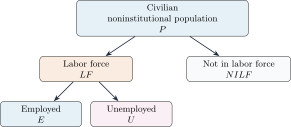
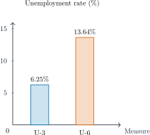
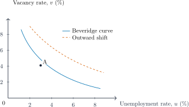
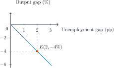
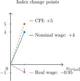

>
This chapter provides a rigorous, pedagogical treatment of Chapter 5: Employment, Unemployment Metrics, and the Price Level, benchmarked to standard principles curriculum.

## Learning Outcomes and Key Terms
By the end of this chapter, students should be able to classify people in the Bureau of Labor Statistics (BLS) household-survey framework; calculate labor-force participation, employment-population, U-3, and U-6 rates; interpret unemployment and vacancy movements over the business cycle; estimate an illustrative output loss with Okun's law; and distinguish nominal wage growth from changes in real purchasing power. Key terms include civilian noninstitutional population, labor force, not in the labor force, marginally attached, underemployment, U-3, U-6, Beveridge curve, potential output, CPI, and real wage.

## Part 1: The BLS Population Map
### Bring It Home: One Person, One Survey Week
Imagine that a worker's restaurant closes for renovations during the BLS survey reference week. The worker did no paid work that week, is available, is on temporary layoff, and expects to be recalled within six months; the worker has not searched elsewhere. Another person worked a paid shift for a delivery platform, even though the work was only a few hours. A third person wants a job but stopped searching after repeated rejections. These people may all describe themselves as needing more work, but the household survey classifies them differently using consistent rules.

The starting population is the civilian noninstitutional population (CNIP) age 16 and older, denoted $P$. The BLS partitions it into people in the labor force and people not in the labor force:

$$
P = LF + NILF, \qquad LF = E + U.
$$

Here $E$ is employed, $U$ is unemployed, $LF$ is the labor force, and $NILF$ is not in the labor force. A person is employed if they did work for pay or profit during the reference week, worked without pay for at least 15 hours in a family-owned business or farm, or had a job but were temporarily absent. A person is generally unemployed if they had no job, were available for work, and actively searched in the prior four weeks. A person on temporary layoff can be counted as unemployed without searching if they have been given a return date or expect to return within six months. Everyone else in $P$ is classified as not in the labor force.

::: {.callout-note title="SSOT Benchmark: Population and Headline Rates"}

For the Master Summary benchmark, $P=200$ million, $LF=120$ million, $E=114$ million, and $U=6$ million. Thus $U$-$3=6/120\times100\%=5.0\%$ and $LFPR=120/200\times100\%=60.0\%$. A U-6 calculation also requires counts for marginally attached people and employed part-time workers for economic reasons; those component counts are not specified here.

:::

### Graph Description: The BLS Classification Tree
Picture a flowchart rather than a graph with a behavioral curve. At the top is the full rectangle $P$. A vertical split separates $LF$ on the left from $NILF$ on the right. The $LF$ rectangle splits again into $E$ and $U$. Every person belongs to exactly one leaf of this tree for the survey classification. The categories describe survey status, not a person's worth, effort, or need for income.

{fig-alt="The BLS population partition. Each person in the civilian noninstitutional population is classified as employed, unemployed, or not in the labor force; employed and unemployed people together make up the labor force."}

### Work It Out: Rates Have Different Denominators
Suppose a hypothetical local population has $P=1{,}000$, with $E=600$, $U=40$, and therefore $NILF=360$. First add employed and unemployed people to find the labor force:
\begin{align}
LF &= E+U = 600+40=640,\\
u_3 &= \frac{U}{LF}\times 100\% = \frac{40}{640}\times100\%=6.25\%,\\
LFPR &= \frac{LF}{P}\times100\% = \frac{640}{1{,}000}\times100\%=64\%,\\
EPOP &= \frac{E}{P}\times100\% = \frac{600}{1{,}000}\times100\%=60\%.
\end{align}
The unemployment rate is not the share of the entire population without a job. Its denominator is the labor force. The participation rate asks what share of the population is working or actively seeking work; the employment-population ratio asks what share is employed.

::: {.callout-note title="Clear It Up: A Falling U-3 Rate Can Hide a Falling Labor Force"}

If unemployed people stop searching, they generally move from $U$ to $NILF$. That lowers both the numerator and denominator of U-3 and can make the rate fall without any new hiring. Check $LFPR$ and $EPOP$ alongside unemployment before concluding that job conditions improved.

:::

## Part 2: U-3, U-6, and the Gig Economy
### The Headline Rate and Broader Underutilization
U-3 is the official unemployment rate: unemployed people as a share of the civilian labor force. It is useful, comparable, and deliberately narrow. It does not count people who want a job but have not searched recently, and it counts a person working part time as employed even if that person wants full-time hours.

U-6 is a broader BLS measure of labor underutilization. It includes the unemployed, people marginally attached to the labor force, and people employed part time for economic reasons. The latter category includes people working fewer than 35 hours for an economic reason who want and are available for full-time work. Marginally attached people want and are available for work, searched sometime in the prior 12 months, but did not search during the most recent four weeks. Discouraged workers are one subset of the marginally attached. U-6's denominator adds the marginally attached to the labor force, so the numerator and denominator must be expanded together:

$$
U\text{-}6 =
\frac{U + M + PT_{econ}}{LF + M}\times100\%,
$$

where $M$ is marginally attached people and $PT_{econ}$ is employed part-time for economic reasons.

### Bring It Home: A Platform Worker Wants More Hours
A courier completes several paid deliveries during the reference week and wants a stable, full-time schedule. Under the household-survey concept, the courier is employed because they performed paid work; being a gig worker does not by itself make someone unemployed. If the courier works fewer than 35 hours for an economic reason and wants and is available for full-time hours, they may be included in the U-6 numerator but not in U-3's unemployed count. Another courier who did no work, wants a job, is available, and searched within the last four weeks may be unemployed. A worker who stopped searching may be marginally attached, rather than unemployed under U-3.

The distinction is about measured labor utilization, not whether a gig job is good or bad. The survey classification alone does not reveal earnings volatility, benefits, schedule control, job security, or whether the worker prefers independent contracting. Those are important dimensions of job quality, but they require additional data.

### Work It Out: Compare U-3 and U-6
Continue the hypothetical example with $LF=640$ and $U=40$. Suppose $M=20$ people are marginally attached and $PT_{econ}=30$ employed people want full-time work but can only find part-time hours. Then:
\begin{align}
U\text{-}3 &= \frac{40}{640}\times100\%=6.25\%,\\
U\text{-}6 &= \frac{40+20+30}{640+20}\times100\%
=\frac{90}{660}\times100\%\approx13.64\%.
\end{align}
These are illustrative counts, not a current estimate for any city or month. The gap between the measures shows that the headline rate omits forms of underutilization; it does not mean U-3 is incorrectly calculated.

{fig-alt="Illustrative U-3 and U-6 rates from the hypothetical counts in this section. The measures use different definitions and denominators; these values are not current estimates."}

::: {.callout-tip title="FRED Data: Compare Measures, Not Just Headlines"}

FRED distributes official BLS series including UNRATE (U-3), U6RATE (U-6), CIVPART (labor-force participation rate), and EMRATIO (employment-population ratio). These are seasonally adjusted monthly percentage series. Plotting them together can show whether a change in U-3 coincides with movement in broader underutilization or participation. The rates have different definitions and denominators; their difference is informative, not an arithmetic error.

:::

## Part 3: Vacancies, Unemployment, and Output Slack
### The Beveridge Curve
The Beveridge curve describes the usual inverse relationship between the unemployment rate and the job-vacancy rate. In a Cartesian diagram, place unemployment $u$ (percent) on the horizontal axis and vacancies $v$ (percent) on the vertical axis. Along a given curve, an up-left movement means vacancies rise while unemployment falls; a down-right movement means vacancies fall while unemployment rises. These movements can reflect changes in labor demand. This is a descriptive relationship, not a mechanical law.

The curve can shift. Improved matching, geographic mobility, or training can move the relationship inward, allowing more hires for a given vacancy rate. Mismatch between workers' skills and open jobs, search frictions, or slower matching can shift it outward. A point on the curve is an observed combination; a shift is a change in the relationship itself.

{fig-alt="A downward-sloping Beveridge relationship and an outward shift associated with weaker matching. Curves and endpoints are shown within the labeled 0–10 percent plotting range."}

### Okun's Law: From an Unemployment Gap to an Output Gap
Okun's law summarizes a regularity: when unemployment is above its sustainable or natural benchmark, real output tends to be below potential. The relationship helps policymakers interpret labor-market slack alongside production, but it is an empirical approximation rather than a causal law. A simplified gap form is:

$$
\frac{Y-Y^*}{Y^*}\times100\%\approx -\beta(u_{\rm pp}-u^*_{\rm pp}), \qquad \beta>0,
$$

where $Y$ is real output, $Y^*$ is potential output, and $u_{\rm pp}$ and $u^*_{\rm pp}$ are unemployment rates stated in percentage-point units. The coefficient $\beta$ is the percentage-point output gap associated with a one-percentage-point unemployment gap; it varies by period and specification.

{fig-alt="Illustrative Okun relationship when \beta=2: a two-percentage-point unemployment gap corresponds to an estimated output gap of -4\%. The line is a schematic, not an estimated time series."}

**Application:** A local policymaker comparing employment conditions across neighborhoods might use unemployment and output-gap estimates together when assessing a downturn. Neither measure alone identifies the cause of the decline, and both the potential-output benchmark and Okun coefficient must be stated.

### Work It Out: An Illustrative \$1.0 Trillion Output Shortfall
Assume potential real GDP is $Y^*=\$25.0$ trillion in a chosen base-year dollar measure, actual unemployment is $u_{\rm pp}=6$, the estimated benchmark is $u^*_{\rm pp}=4$, and an illustrative Okun coefficient is $\beta=2$. First find the unemployment gap: $6-4=2$ percentage points. Then estimate the output gap:
\begin{align}
\frac{Y-Y^*}{Y^*}\times100\% &\approx -2(6-4)=-4\%,\\
Y^*-Y &\approx 0.04\times \$25.0\text{ trillion}
=\$1.0\text{ trillion}.
\end{align}
The estimated shortfall is \$1.0 trillion of real output relative to the assumed potential level. This is a model-based illustration, not a reported current loss. Potential GDP and $\beta$ are estimates, and the result depends on the units and period used.

::: {.callout-note title="Optional Advanced: Markov Job-Finding and Separation Flows"}

In a two-state model, let $s$ be the period separation probability from employment to unemployment and $f$ the job-finding probability from unemployment to employment. At steady state, inflows to unemployment equal outflows: $s(1-u)=fu$. Solving gives:

$$
u^*=\frac{s}{s+f}.
$$

This result assumes a stable two-state population, constant transition probabilities, and no labor-force entry or exit. It makes the stock-flow logic explicit: a higher separation rate raises steady-state unemployment, while a higher job-finding rate lowers it.

:::

::: {.callout-note title="Optional Advanced: State-Space Slack and Growth-Rate Okun Relations"}

Potential output $Y_t^*$ and the natural unemployment rate $u_t^*$ are not directly observed. A state-space approach treats them as latent states inferred from noisy observations. Output slack can be represented as $x_t=\ln Y_t-\ln Y_t^*$, approximately the percentage output gap for small differences; labor slack can be represented as $u_t-u_t^*$. Their estimated paths depend on the model and can be revised as new observations arrive.

An alternative growth-difference form is $\Delta u_t\approx-\kappa(g_{Y,t}-g_{Y,t}^*)$, where $g_{Y,t}$ is real output growth, $g_{Y,t}^*$ is potential growth, and $\kappa>0$ is an estimated response coefficient. Growth above potential tends to reduce unemployment; growth below potential tends to raise it. This is an empirical approximation, not an identity.

:::

## Part 4: CPI Inflation and Real-Wage Purchasing Power
### A Price Index and the Cost of a Basket
The Consumer Price Index (CPI) tracks price changes for a representative consumer basket under the BLS methodology. Inflation over a period is the percentage change in the index:

$$
\pi_t=\frac{CPI_t-CPI_{t-1}}{CPI_{t-1}}\times100\%.
$$

The CPI is an index, not a dollar price and not a perfect measure of every household's cost of living. Households have different spending patterns, and the index summarizes an average basket using a defined method.

### Nominal Wages and Real Purchasing Power
A nominal wage is measured in current dollars. A real wage adjusts for the price level and indicates how much of a reference-period basket that wage can buy:

$$
W^{real,0}_t=W^{nom}_t\frac{CPI_0}{CPI_t},
$$

where $CPI_0$ is the CPI in the chosen base period. If the CPI series is not rebased to that period, use the ratio $CPI_0/CPI_t$. When nominal wages rise more slowly than prices, purchasing power falls even though the dollar wage increased.

**Application:** When workers and employers discuss an annual raise, comparing nominal wage growth with inflation helps distinguish a larger paycheck from a gain in purchasing power. The numerical values below are illustrative, not a current wage or CPI observation.

### Work It Out: A Raise That Does Not Keep Pace with Prices
Suppose an hourly wage rises from \$20.00 to \$20.80, a 4\% increase. Over the same period, the CPI rises from 300 to 315, a 5\% increase. Express the new wage in the initial period's purchasing power:
\begin{align}
W^{real,0}_0 &= \$20.00\frac{300}{300}=\$20.00,\\
W^{real,0}_1 &= \$20.80\frac{300}{315}\approx \$19.81.
\end{align}
The real wage changes by approximately $(19.81/20.00)-1=-0.95\%$. The worker receives 80 cents more per hour in nominal terms, but the CPI basket costs more, so purchasing power falls slightly.

{fig-alt="Illustrative index changes from period 0 to period 1. With nominal wages indexed to 100 initially, the wage index rises 4 points while CPI rises 5 points, so the real-wage index falls to about 99.05."}

::: {.callout-note title="Clear It Up: Nominal Raise Does Not Guarantee a Real Raise"}

Compare growth rates, not dollar changes alone. When nominal wage growth is below inflation, real wage growth is negative. When the two rates are close, the approximation $g_{real}\approx g_W-\pi$ is useful, but exact compounding gives a slightly different result.

:::

::: {.callout-note title="Optional Advanced: Exact Real-Wage Growth Identity"}

The exact relation between nominal wage growth $g_W$, inflation $\pi$, and real wage growth $g_{real}$ is:

$$
1+g_{real}=\frac{1+g_W}{1+\pi},
\qquad
g_{real}=\frac{1+g_W}{1+\pi}-1.
$$

For $g_W=0.04$ and $\pi=0.05$, exact real growth is $1.04/1.05-1\approx-0.00952$, or about $-0.95\%$. The subtraction approximation gives $4\%-5\%=-1\%$. The difference is small here but matters when rates are large.

:::

::: {.callout-tip title="FRED Data: Track Inflation and Real-Wage Context"}

FRED series CPIAUCSL is the seasonally adjusted U.S. all-items CPI for all urban consumers, reported monthly as an index with 1982–84=100. UNRATE and U6RATE report U-3 and U-6, while CIVPART and EMRATIO provide participation and employment-population context. To study purchasing power, compare nominal wage growth with CPI inflation over matching dates and frequencies; do not divide a wage by an index without stating the chosen base convention.

:::

## Check Your Understanding

*  In the BLS partition, where is a person who wants work but has not searched in the past four weeks? What additional condition could make them marginally attached?
*  With $LF=800$, $U=48$, $M=16$, and $PT_{econ}=32$, calculate U-3 and U-6.
*  On the Beveridge diagram, what do an inward shift and a movement up-left represent?
*  If $Y^*=\$20$ trillion, $u-u^*=1.5$ percentage points, and $\beta=2$, estimate the output gap and shortfall.
*  A nominal wage rises 3\% while CPI inflation is 6\%. Is real wage growth positive or negative? Use the exact relation to estimate it.

Answers: (1) NILF; if they want a job, are available, searched in the prior 12 months, and not in the prior four weeks, they may be marginally attached. (2) U-3 $=48/800=6\%$; U-6 $=(48+16+32)/(800+16)=96/816\approx11.76\%$. (3) An inward shift indicates improved matching; up-left is a movement along the curve as vacancies rise and unemployment falls. (4) Output gap $\approx-3\%$ and shortfall $\$0.6$ trillion. (5) Negative: $1.03/1.06-1\approx-2.83\%$.
