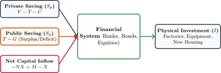

>
This chapter provides a rigorous, pedagogical treatment of Chapter 6: Saving, Investment Spending, and the Financial System, benchmarked to standard principles curriculum.

## National Saving Identities and Capital Flows

### 1. Conceptual Introduction {.unnumbered}
In everyday conversation, people often say they are "investing" when they buy shares of Apple stock or deposit money into a mutual fund. In macroeconomics, that terminology is strictly separated:

*  **Saving:** Income that is not spent on current consumption or taxes—a **flow** measured per year that adds to a household's accumulated **stock** of wealth.
*  **Investment ($I$):** Physical spending on newly produced factories, machinery, software, new residential housing, and business inventories—the engine that expands the economy's future capital stock.

The financial system—banks, bond markets, and stock exchanges—acts as the bridge channeling household and government saving into business investment. To see how saving and investment connect mathematically, start with the expenditure identity $Y = C + I + G + NX$ and subtract $C$ and $G$ from both sides:

$$
Y - C - G = I + NX
$$

The left-hand side ($Y - C - G$) is total income remaining after household consumption and government purchases—defined as **National Saving ($S$)**. Inserting net taxes $T$ splits National Saving into two components:

$$
S = \underbrace{(Y - T - C)}_{\text{Private Saving } (S_p)} + \underbrace{(T - G)}_{\text{Public Saving } (S_g)} = Y - C - G
$$

When tax revenues exceed government spending ($T > G$), the government runs a **budget surplus** and adds to national saving; when $T < G$, the government runs a **budget deficit** ($S_g < 0$) and subtracts from national saving. In a closed economy ($NX = 0$), National Saving must identically equal Investment ($S = I$). In an open economy, $S - I = NX$: a nation that invests more than it saves ($I > S$) finances the gap through net foreign capital inflows ($NX < 0$).

### 2. Visual Representation {.unnumbered}
Figure 1 illustrates how Private Saving ($S_p$), Public Saving ($S_g$), and Net Capital Inflows ($-NX$) pool together inside the financial system to fund Gross Private Domestic Investment ($I$).

::: {.callout-note title="Clear It Up: Saving Is a Flow; Wealth Is a Stock"}

Think of a bathtub. The water pouring out of the faucet each minute is **saving** (a flow measured per unit of time), while the total gallons of water sitting inside the tub at 8:00 PM is **wealth** (a stock measured at a specific instant). Similarly, an annual federal budget deficit is a flow of new borrowing during one fiscal year, whereas the national debt is the accumulated stock of past borrowing.

:::

{fig-alt="The Macroeconomic Saving-Investment Channel. Domestic investment (I) is funded by the sum of private saving (S_p), public saving (S_g), and net capital inflows from abroad (-NX)."}

### 3. Real-World Application: FRED Gross Private Domestic Investment (`GPDI`) {.unnumbered}
Macroeconomists monitor business capital formation using St. Louis Fed FRED series `GPDI` (Gross Private Domestic Investment, quarterly, seasonally adjusted annual rate). Because `GPDI` fluctuates far more sharply than consumer spending during recessions, tracking business fixed investment and inventory swings provides an early warning signal of business-cycle turning points.

### 4. Mathematical Foundation (Algebra Level) {.unnumbered}
The closed- and open-economy saving identities are:

$$
S_p = Y - T - C, \qquad S_g = T - G, \qquad S = S_p + S_g = I + NX
$$

**Worked Problem:**
In a closed economy ($NX = 0$), total output is $Y = \$18{,}000\text{ billion}$, household consumption is $C = \$12{,}400\text{ billion}$, net taxes are $T = \$3{,}200\text{ billion}$, and government purchases are $G = \$3{,}600\text{ billion}$. Compute Private Saving ($S_p$), Public Saving ($S_g$), National Saving ($S$), and Private Investment ($I$).

**Step-by-Step Breakdown:**

*  **Compute Private Saving ($S_p = Y - T - C$):**

$$
S_p = \$18{,}000 - \$3{,}200 - \$12{,}400 = \mathbf{\$2{,}400\text{ billion}}
$$

*  **Compute Public Saving ($S_g = T - G$):**

$$
S_g = \$3{,}200 - \$3{,}600 = \mathbf{-\$400\text{ billion}\ (\text{a budget deficit of } \$400\text{B})}
$$

*  **Compute National Saving ($S$) and Investment ($I$):**

$$
S = S_p + S_g = \$2{,}400 + (-\$400) = \mathbf{\$2{,}000\text{ billion}}
$$

Since $NX = 0$, Investment equals National Saving: $I = \mathbf{\$2{,}000\text{ billion}}$.

**Conclusion:** The government's $\$400\text{ billion}$ budget deficit absorbs $\$400\text{ billion}$ of private saving, leaving $\$2{,}000\text{ billion}$ available for physical business investment.

## The Market for Loanable Funds and Crowding Out

### 1. Conceptual Introduction {.unnumbered}
To understand how real interest rates ($r$) coordinate desired saving and planned investment, macroeconomists construct the **Market for Loanable Funds**. In this market:

*  **Supply of Loanable Funds ($S_{\text{LF}}$):** Comes from national saving ($S_p + S_g$). Because a higher real interest rate rewards savers with greater future purchasing power, the supply of loanable funds slopes upward.
*  **Demand for Loanable Funds ($D_{\text{LF}}$):** Comes from households and firms borrowing to build new factories, buy equipment, or construct homes. Because a higher real interest rate makes borrowing more expensive, fewer investment projects pass the profitability hurdle, so the demand for loanable funds slopes downward.

Equilibrium occurs at the real interest rate $r^*$ where $S_{\text{LF}} = D_{\text{LF}}$. This framework explains a crucial fiscal trade-off known as **crowding out**: if the government increases spending or cuts taxes without reducing outlays, public saving falls ($S_g \downarrow$), shifting the supply of loanable funds **leftward**. That leftward shift drives the equilibrium real interest rate $r^*$ upward—raising borrowing costs and **crowding out** private business investment!

### 2. Visual Representation {.unnumbered}
Figure 2 shows how a government budget deficit shifts the supply of loanable funds leftward from $S_{\text{LF1}}$ to $S_{\text{LF2}}$, raising the real interest rate from $r_1^*$ to $r_2^*$ and reducing private investment from $I_1^*$ to $I_2^*$.

{fig-alt="Budget Deficits and Crowding Out in the Loanable Funds Market. A larger government deficit reduces national saving, shifting S_{\text{LF1}} leftward to S_{\text{LF2}}. The equilibrium real interest rate rises from 5.5\% to 6.5\%, crowding out private investment from I_1^* to I_2^*."}

### 3. Real-World Application: Investment Tax Credits vs. Deficit-Financed Spending {.unnumbered}
When Congress enacts an **investment tax credit** (subsidizing firms that purchase new clean-energy equipment or factory robots), the demand for loanable funds shifts rightward—raising both the equilibrium real interest rate and total physical investment. By contrast, deficit-financed transfer spending shifts the supply of loanable funds leftward, raising interest rates while reducing private investment.

### 4. Mathematical Foundation (Algebra Level) {.unnumbered}
Equilibrium in the loanable funds market solves $S_{\text{LF}}(r^*) = D_{\text{LF}}(r^*)$:

$$
S_p(r^*) + S_g = I(r^*)
$$

**Worked Problem:**
In a closed economy, Private Saving is $S_p = 1{,}000 + 200r$, Investment Demand is $I = 3{,}000 - 200r$, and initially the government runs a balanced budget ($S_g = T - G = 0$), where $r$ is the real interest rate in percentage points (e.g., $r = 5$ means $5\%$) and quantities are in billions of dollars.

*  Find the initial equilibrium real interest rate $r_1^*$ and equilibrium investment $I_1^*$.
*  Suppose the government increases spending without raising taxes, creating a budget deficit of $\$400\text{ billion}$ ($S_g = -400$). Find the new real interest rate $r_2^*$, new investment $I_2^*$, and exact dollar amount of private investment crowded out.

**Step-by-Step Breakdown:**

*  **Solve for Initial Equilibrium ($S_p + S_g = I$ with $S_g = 0$):**

$$
1{,}000 + 200r_1^* = 3{,}000 - 200r_1^* \implies 400r_1^* = 2{,}000 \implies r_1^* = \mathbf{5.0\%}
$$

$$
I_1^* = 3{,}000 - 200(5.0) = \mathbf{\$2{,}000\text{ billion}}
$$

*  **Recompute Equilibrium After $\$400\text{B}$ Deficit ($S_g = -400$):**
National saving becomes $S_{\text{LF2}} = (1{,}000 + 200r) - 400 = 600 + 200r$. Set equal to Investment Demand:

$$
600 + 200r_2^* = 3{,}000 - 200r_2^* \implies 400r_2^* = 2{,}400 \implies r_2^* = \mathbf{6.0\%}
$$

$$
I_2^* = 3{,}000 - 200(6.0) = \mathbf{\$1{,}800\text{ billion}}
$$

*  **Calculate Crowded-Out Private Investment:**

$$
\text{Crowding Out} = I_1^* - I_2^* = \$2{,}000\text{B} - \$1{,}800\text{B} = \mathbf{\$200\text{ billion}}
$$

**Conclusion:** A $\$400\text{ billion}$ budget deficit drives the real interest rate up by $1.0$ percentage point (to $6.0\%$) and crowds out $\$200\text{ billion}$ of private investment (while higher interest rates induce households to save $\$200\text{ billion}$ more).

::: {.callout-note title="Optional Advanced Section: Ricardian Equivalence Theorem"}

*Note for Economics Majors and Quantitative Students:*
Economist Robert Barro formalized **Ricardian Equivalence**: if forward-looking households recognize that a debt-financed tax cut today ($\Delta T < 0$) implies higher future taxes with present value $-\Delta T$ to repay the government bonds, households may save $100\%$ of the tax cut ($\Delta S_p = -\Delta S_g$), leaving National Saving $S = S_p + S_g$, the real interest rate $r^*$, and investment $I^*$ unchanged. Liquidity constraints and finite horizons limit full Ricardian equivalence in practice.

:::
