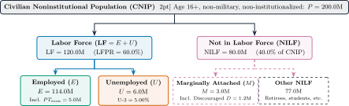
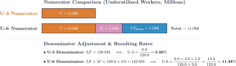
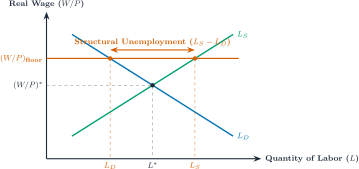
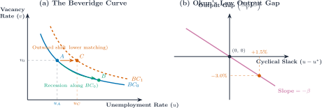

{\color{CourseBlue}\rule{\linewidth}{2pt}}

{\bfseries\color{SlateBlue} CHAPTER 6 \quad|\quad MACROECONOMIC INDICATORS AND LABOR DYNAMICS}\par
{\LARGE\bfseries\color{SlateBlue} Unemployment, Labor Market Structure, and Cyclical Slack}\par

{\color{CourseBlue}\rule{\linewidth}{0.8pt}}

\begin{casestudy}
\boxheader{SlateBlue}{Chapter Learning Objectives}
After completing this chapter, you will be able to:
[leftmargin=1.4em, itemsep=2pt, topsep=2pt]
*  Partition the Civilian Noninstitutional Population into employed, unemployed, and not-in-the-labor-force subgroups using Bureau of Labor Statistics (BLS) Current Population Survey criteria.
*  Compute and contrast the headline unemployment rate (U-3), the broad labor underutilization rate (U-6), the labor force participation rate, and the employment-to-population ratio.
*  Distinguish frictional, structural, and cyclical unemployment, explain how wage rigidities generate structural joblessness, and analyze the determinants of the natural rate of unemployment ($u^*$).
*  Interpret movements along versus shifts of the Beveridge Curve and quantify cyclical output gaps using Okun's Law.

\end{casestudy}

## The BLS Household Survey and Labor Market Partition

### Conceptual Introduction {.unnumbered}
Assessing the health of the macroeconomy requires measuring not only how much output an economy produces, but also how effectively it utilizes its human resources. In the United States, official labor market statistics derive primarily from the Current Population Survey (CPS), a monthly household survey of roughly $60{,}000$ eligible households conducted by the U.S. Census Bureau for the Bureau of Labor Statistics (BLS). Rather than asking whether a respondent feels employed or desires a job, the CPS classifies individuals through a strict, hierarchical sequence of behavioral questions covering a specific reference week (usually the calendar week containing the 12th day of the month). This objective behavioral standard ensures consistent measurement across business cycles and demographic groups.

The survey begins with the **Civilian Noninstitutional Population ($P$ or $\text{CNIP}$)**, which encompasses all U.S. residents aged 16 and older who are not serving on active duty in the Armed Forces and are not residing in institutions such as correctional facilities, nursing homes, or residential psychiatric hospitals. Within this base population, respondents are partitioned into three mutually exclusive and collectively exhaustive categories: **Employed ($E$)**, **Unemployed ($U$)**, and **Not in the Labor Force ($\text{NILF}$)**.

To be counted as **employed ($E$)**, an individual must have worked at least one hour for pay or profit during the reference week, worked at least 15 unpaid hours in a family-operated enterprise, or held a job from which they were temporarily absent due to illness, vacation, weather, industrial dispute, or parental leave. To be counted as **unemployed ($U$)**, a person must simultaneously satisfy three conditions: (1) have no employment during the reference week, (2) be currently available to start work (except for temporary illness), and (3) have engaged in *active job search*—such as submitting applications, interviewing, contacting employers, or answering job advertisements—within the preceding four weeks. Workers on temporary layoff awaiting recall are also counted in $U$ even without active search. Anyone in the civilian noninstitutional population who is neither employed nor actively searching is classified as **not in the labor force ($\text{NILF}$)**, including full-time students, retirees, homemakers, and individuals who have stopped looking for work.

Alongside the CPS household survey, the BLS conducts the **Current Employment Statistics (CES) Establishment Survey**, which samples roughly $122{,}000$ businesses and government agencies covering approximately $666{,}000$ worksites. While the CPS measures the *unemployment rate* and demographic labor force status by surveying households (counting self-employed, agricultural, and unpaid family workers), the CES measures *nonfarm payroll employment*, average weekly hours, and average hourly earnings by surveying employer payrolls. Because a worker holding two jobs appears once in CPS employment ($E$) but twice on CES establishment payrolls, the two surveys provide complementary lenses on labor market momentum.

\begin{examplecase}
\boxheader{CourseBlue}{Bring It Home: Why Graduation Season Can Push the Unemployment Rate Up}
Consider Maya, a full-time college senior who does not work a paid job during spring semester. Under CPS rules, Maya is classified as **Not in the Labor Force ($\text{NILF}$)**. The day after graduation in May, she begins submitting applications and interviewing for entry-level analyst roles. Although no one lost a job, Maya immediately moves from $\text{NILF}$ into the **Unemployed ($U$)** category, increasing both the numerator ($U$) and denominator ($\text{LF}$) of the headline unemployment rate by one. Across the entire U.S. economy, millions of students enter the labor market every May and June—which is why the BLS publishes *seasonally adjusted* headline unemployment rates (\texttt{UNRATE}) to separate predictable calendar waves from genuine macroeconomic shifts.
\end{examplecase}

### Visual Representation {.unnumbered}
Figure 1 illustrates the hierarchical BLS classification tree applied to our flagship benchmark economy, where the Civilian Noninstitutional Population equals $200.0\text{ million}$. Notice how the labor force ($120.0\text{ million}$) forms the core active market, while $\text{NILF}$ ($80.0\text{ million}$) contains critical subgroups—specifically marginally attached and discouraged workers—that lie on the boundary of labor market participation.

{fig-alt="BLS Household Survey Population Partition and Flagship Quantitative Baseline."}

### Mathematical Foundation {.unnumbered}
Let $P$ denote the Civilian Noninstitutional Population, $E$ total employment, $U$ total unemployment, and $\text{NILF}$ those not in the labor force. The fundamental population accounting identities are:
\begin{align}
\text{LF} &= E + U \label{eq:lf_identity} \\
P &= \text{LF} + \text{NILF} = E + U + \text{NILF} \label{eq:cnip_identity}
\end{align}
From these aggregates, three core headline labor market rates are defined:
\begin{align}
\text{Headline Unemployment Rate (U-3)} &= \frac{U}{\text{LF}} \times 100 = \frac{U}{E + U} \times 100 \label{eq:u3} \\
\text{Labor Force Participation Rate (LFPR)} &= \frac{\text{LF}}{P} \times 100 = \frac{E + U}{P} \times 100 \label{eq:lfpr} \\
\text{Employment-to-Population Ratio (EPOP)} &= \frac{E}{P} \times 100 \label{eq:epop}
\end{align}
Notice that when expressed as proportions, these three indicators are algebraically linked through the identity $\text{EPOP} = \text{LFPR} \times (1 - \text{U-3})$.

**Flagship Baseline Calculation.** Using our benchmark economy ($P = 200.0\text{M}$, $E = 114.0\text{M}$, $U = 6.0\text{M}$, and $\text{NILF} = 80.0\text{M}$):
\[
\text{LF} = 114.0 + 6.0 = 120.0\text{M}
$$

$$
\text{U-3} = \frac{6.0}{120.0} \times 100 = 5.00\%, \qquad
\text{LFPR} = \frac{120.0}{200.0} \times 100 = 60.00\%, \qquad
\text{EPOP} = \frac{114.0}{200.0} \times 100 = 57.00\%
$$

::: {.callout-note title="Clear It Up: Why Discouraged Workers Lower the Headline Unemployment Rate"}

A common misconception is that when an unemployed worker gives up searching for a job out of frustration, the headline unemployment rate rises. In fact, the exact opposite occurs. Because an individual must actively search within the past four weeks to remain in $U$, ceasing job search moves the worker out of both the numerator ($U$) and the denominator ($\text{LF} = E + U$) of $\text{U-3} = U / \text{LF}$. Since $U < \text{LF}$, subtracting the same positive number from both numerator and denominator strictly *reduces* the fraction. Thus, a wave of discouragement during a prolonged recession artificially depresses the headline unemployment rate even though labor market conditions have deteriorated.

:::

### Real-World Application {.unnumbered}
Tracking both the headline unemployment rate (\texttt{UNRATE}) and participation indicators in the Federal Reserve Economic Data (FRED) repository reveals structural shifts that the unemployment rate alone cannot capture. Specifically, macroeconomists pair \texttt{UNRATE} with two demographic engagement ratios: the **Labor Force Participation Rate (\texttt{CIVPART})** and the **Employment-to-Population Ratio (\texttt{EMRATIO})**.

Between 2000 and 2015, the U.S. \texttt{CIVPART} declined steadily from roughly $67.3\%$ to $62.4\%$, driven primarily by the aging of the Baby Boom cohort into retirement alongside lower participation among younger workers pursuing higher education. During the onset of the COVID-19 shock in spring 2020, \texttt{CIVPART} plunged by roughly $3$ percentage points as lockdowns prevented millions of displaced workers from conducting active job searches, temporarily classifying them as $\text{NILF}$ rather than unemployed. Consequently, economists monitor \texttt{EMRATIO}—the share of the entire working-age population actively holding a job—as well as **Prime-Age EPOP** (ages 25–54, \texttt{LNS12300060}) as robust cross-checks that strip out population aging and shifts between $U$ and $\text{NILF}$.

\begin{table}[htbp]
\centering
\caption{Comparison of the BLS Household Survey (CPS) and Establishment Survey (CES).}
\label{tab:cps_vs_ces}

\begin{tabularx}{\linewidth}{@{} l X X @{}}
\toprule
**Dimension** & **CPS (Household Survey)** & **CES (Establishment / Payroll Survey)** \\
\midrule
**Primary Unit** & Households ($\approx 60{,}000$ monthly) & Nonfarm business & government payrolls \\
**Key Indicators** & $\text{U-3}$ through $\text{U-6}$, $\text{LFPR}$, $\text{EPOP}$ & Nonfarm payroll jobs, hours, hourly wages \\
**Self-Employed & Farm** & Included in total employment ($E$) & Excluded from nonfarm payroll counts \\
**Multiple Jobholders** & Counted once (person-based measure) & Counted at each job (job-based measure) \\
**Unpaid Absences** & Counted as employed if job-attached & Excluded if unpaid for entire pay period \\
\bottomrule
\end{tabularx}
\end{table}

## Measuring Underutilization: Headline U-3 vs. Broad U-6

### Conceptual Introduction {.unnumbered}
While the headline U-3 rate serves as the standard benchmark for joblessness, it treats employment as a binary state: working just one hour per week for pay places a person in $E$, regardless of whether they seek a full-time career. Similarly, U-3 excludes individuals on the periphery of the labor market who want to work and have searched recently, even if they did not search during the specific four-week CPS window. During economic downturns, firms often cut employee hours before laying off staff (intensive-margin adjustment), while long-term jobless workers temporarily pause active applications. Relying solely on U-3 therefore understates total labor slack.

To capture hidden underemployment and latent labor supply, the BLS publishes six alternative measures of labor underutilization, labeled U-1 through U-6. As summarized in Table~\ref{tab:bls_u1_u6}, these measures progress systematically from narrow indicators of long-term joblessness (U-1) and job losers (U-2) to the official headline rate (U-3), and finally to broad measures incorporating discouraged workers (U-4), all marginally attached workers (U-5), and involuntary part-time workers (U-6).

\begin{table}[htbp]
\centering
\caption{BLS Alternative Measures of Labor Underutilization (U-1 through U-6).}
\label{tab:bls_u1_u6}

\begin{tabularx}{\linewidth}{@{} l X l @{}}
\toprule
**Measure** & **BLS Definition** & **Formula** \\
\midrule
**U-1** & Persons unemployed 15 weeks or longer, as a percent of $\text{LF}$ & $U_{\ge 15\text{w}} / \text{LF}$ \\
**U-2** & Job losers and persons who completed temporary jobs, as a percent of $\text{LF}$ & $U_{\text{losers}} / \text{LF}$ \\
**U-3** & **Official headline unemployment rate:** total unemployed as a percent of $\text{LF}$ & $U / \text{LF}$ \\
**U-4** & Total unemployed plus discouraged workers ($D$), as a percent of $\text{LF} + D$ & $(U + D) / (\text{LF} + D)$ \\
**U-5** & Total unemployed plus all marginally attached workers ($M$), as a percent of $\text{LF} + M$ & $(U + M) / (\text{LF} + M)$ \\
**U-6** & **Broad underutilization:** total unemployed, plus $M$, plus $PT_{\text{econ}}$ & $(U + M + PT_{\text{econ}}) / (\text{LF} + M)$ \\
\bottomrule
\end{tabularx}
\end{table}

The broadest measure, **U-6**, expands U-3 by incorporating two critical groups:
[leftmargin=1.5em, itemsep=3pt]
*  **Marginally Attached Workers ($M$):** Persons currently classified as $\text{NILF}$ who want and are available for a job and have actively looked for work sometime in the past 12 months, though not in the past four weeks. A key subset of $M$ is **Discouraged Workers ($D$)**, who cite labor-market reasons—such as believing no jobs are available in their line of work or lacking required schooling—for not searching recently. Other marginally attached workers cite non-market barriers such as childcare or transportation constraints.
*  **Persons Employed Part-Time for Economic Reasons ($PT_{\text{econ}}$):** Also termed *involuntary part-time workers*, these are individuals working fewer than 35 hours per week who prefer full-time employment and are available for full-time hours, but whose hours were reduced due to slack business conditions or inability to find a full-time position.

### Visual Representation {.unnumbered}
Figure 2 contrasts the composition of U-3 and U-6 in our flagship baseline economy. Moving from U-3 to U-6 expands the numerator from $6.0\text{M}$ to $14.0\text{M}$ by adding marginally attached workers ($3.0\text{M}$) and involuntary part-time workers ($5.0\text{M}$). Because marginally attached workers are drawn from $\text{NILF}$, they must simultaneously be added to the denominator so that the rate remains a consistent proportion of the expanded labor pool ($\text{LF} + M = 123.0\text{M}$).

{fig-alt="Decomposition of Numerators, Denominators, and Rates for U-3 versus U-6."}

### Mathematical Foundation {.unnumbered}
Formally, let $M$ denote all marginally attached workers (with $D \subseteq M$ representing discouraged workers) and let $PT_{\text{econ}}$ denote persons employed part-time for economic reasons. The broad underutilization rate U-6 is defined as:

$$
\text{U-6} = \frac{U + M + PT_{\text{econ}}}{\text{LF} + M} \times 100
\label{eq:u6}
$$

Notice why $PT_{\text{econ}}$ is added *only* to the numerator whereas $M$ is added to *both* numerator and denominator:
[leftmargin=1.5em, itemsep=2pt]
*  $PT_{\text{econ}}$ workers are already employed ($PT_{\text{econ}} \subset E \subset \text{LF}$), so they are already counted inside $\text{LF}$ in the denominator.
*  $M$ workers are classified as $\text{NILF}$ ($M \subset \text{NILF}$), so they are excluded from $\text{LF}$ and must be added to the denominator so that U-6 remains bounded between $0\%$ and $100\%$.

**Flagship Baseline Calculation.** Using $U = 6.0\text{M}$, $\text{LF} = 120.0\text{M}$, $M = 3.0\text{M}$ (of which $D = 1.2\text{M}$ are discouraged), and $PT_{\text{econ}} = 5.0\text{M}$:

$$
\text{U-6} = \frac{6.0 + 3.0 + 5.0}{120.0 + 3.0} \times 100 = \frac{14.0}{123.0} \times 100 \approx 11.38\%
$$

The underutilization spread in the baseline economy is $\text{U-6} - \text{U-3} = 11.38\% - 5.00\% = 6.38\text{ percentage points}$.

\begin{casestudy}
\boxheader{SlateBlue}{Work It Out: Computing U-3, U-6, and Intensive-Margin Recovery}
Suppose a regional economy has $E = 57.0\text{ million}$ employed workers (of whom $PT_{\text{econ}} = 2.0\text{ million}$ are part-time for economic reasons), $U = 3.0\text{ million}$ unemployed workers, and $M = 2.5\text{ million}$ marginally attached workers (including $D = 1.0\text{ million}$ discouraged workers).
[leftmargin=1.5em, itemsep=2pt, topsep=3pt]
*  **Step 1 (Compute $\text{LF}$ and $\text{U-3}$):** $\text{LF} = 57.0 + 3.0 = 60.0\text{M}$, so $\text{U-3} = \frac{3.0}{60.0} \times 100 = 5.00\%$.
*  **Step 2 (Compute $\text{U-6}$ without double-counting $D$):** Because $D \subset M$, we use $M = 2.5\text{M}$ directly:

$$
\text{U-6} = \frac{3.0 + 2.5 + 2.0}{60.0 + 2.5} \times 100 = \frac{7.5}{62.5} \times 100 = 12.00\%
$$

The initial underutilization spread is $12.00\% - 5.00\% = 7.00\text{ percentage points}$.
*  **Step 3 (Intensive-margin recovery):** Now suppose demand improves and employers restore full-time hours to $1.0\text{ million}$ involuntary part-time workers ($PT_{\text{econ}}$ drops from $2.0\text{M}$ to $1.0\text{M}$), while $E$, $U$, and $M$ stay constant. Headline $\text{U-3}$ remains unchanged at $5.00\%$, whereas $\text{U-6}$ falls to $\frac{3.0 + 2.5 + 1.0}{62.5} \times 100 = \frac{6.5}{62.5} \times 100 = 10.40\%$, illustrating how U-6 captures work-hour recoveries that U-3 misses.

\end{casestudy}

### Real-World Application {.unnumbered}
The spread between U-6 (\texttt{U6RATE}) and U-3 (\texttt{UNRATE}) acts as a sensitive barometer of labor-market intensity and work-hour rationing. Following the 2007–2009 Great Recession, U-3 peaked at $10.0\%$ in October 2009, while U-6 surged to $17.1\%$—a spread of $7.1$ percentage points—reflecting millions of retail, construction, and service employees whose schedules were cut to part-time and a historic wave of long-term discouraged workers. By contrast, during the tight labor market of 2022–2023, U-3 fell to $3.4\%$ and U-6 dropped to $6.5\%$, compressing the spread to just $3.1$ percentage points as firms converted part-time roles into full-time schedules to retain staff.

In modern labor markets featuring flexible scheduling and independent platform work, involuntary part-time employment remains structurally sensitive to aggregate demand. Note a critical classification rule: workers who choose part-time schedules voluntarily—such as students, semi-retirees, or caregivers preferring 20 hours per week—are classified as *part-time for noneconomic reasons* and are **not** included in $PT_{\text{econ}}$ or U-6. Likewise, because discouraged workers ($D$) are already a subset of marginally attached workers ($M$), adding both $M$ and $D$ into the U-6 numerator would double-count discouraged workers.

## Types of Unemployment, Institutional Rigidities, and the Natural Rate ($u^*$)

### Conceptual Introduction {.unnumbered}
Even in a booming economy operating at full capacity, the unemployment rate never falls to zero. Economists decompose observed unemployment ($u$) into three distinct components based on underlying economic causes:
[leftmargin=1.5em, itemsep=3pt]
*  **Frictional Unemployment ($u_f$):** Short-term unemployment arising from the normal process of matching heterogeneous workers with heterogeneous job openings. Imperfect information, geographic mobility, recent graduation, and career transitions mean that workers and firms require time to search, interview, and negotiate offers. Frictional unemployment is largely voluntary and efficiency-enhancing because better matches raise long-run productivity.
*  **Structural Unemployment ($u_s$):** Persistent unemployment resulting from a mismatch between the skills, occupational credentials, or geographic locations of job seekers and the requirements of available vacancies, or from *institutional wage rigidities* that hold real wages above the market-clearing equilibrium. Unlike frictional search, structurally unemployed workers face a genuine shortage of jobs at prevailing wages.
*  **Cyclical Unemployment ($u_c$):** The deviation of actual unemployment from the economy's long-run sustainable benchmark, driven by short-run fluctuations in aggregate demand across the business cycle. During recessions, falling aggregate spending reduces labor demand across industries ($u_c > 0$); during economic expansions, tight labor markets push actual unemployment below its normal level ($u_c < 0$).

The sum of frictional and structural unemployment defines the **Natural Rate of Unemployment ($u^*$)**, also referred to in monetary policy analysis as the **Non-Accelerating Inflation Rate of Unemployment (NAIRU)**. When $u = u^*$, cyclical unemployment is zero ($u_c = 0$) and the economy is producing at its sustainable potential output ($Y = Y^*$).

::: {.callout-note title="Clear It Up: Full Employment Does Not Mean Zero Unemployment"}

Students often assume that ``full employment'' means $u = 0\%$. In macroeconomics, full employment means $u = u^*$ (zero *cyclical* unemployment, $u_c = 0$), not zero total unemployment. In a dynamic economy where firms continually innovate, new graduates enter the labor force, and workers relocate for better career fits, a positive baseline of frictional and structural unemployment ($u_f + u_s > 0$) is always present. Pushing actual unemployment persistently below $u^*$ creates labor shortages and upward wage-price inflation pressure rather than sustainable output gains.

:::

### Visual Representation {.unnumbered}
Figure 3 illustrates how institutional and behavioral wage rigidities generate structural unemployment in an aggregate labor market. At the market-clearing real wage $(W/P)^*$, labor demand $L_D$ equals labor supply $L_S$ at employment $L^*$. When a binding wage floor—such as a statutory minimum wage, collective bargaining agreement, or efficiency wage—holds the real wage at $(W/P)_{\text{floor}} > (W/P)^*$, firms reduce hiring to $L_D$ while more workers seek jobs at $L_S$, creating persistent structural joblessness equal to $L_S - L_D$.

{fig-alt="Wage Rigidity and Structural Unemployment Above the Market-Clearing Real Wage."}

### Mathematical Foundation {.unnumbered}
Observed unemployment decomposes additively into its natural and cyclical components:
\begin{align}
u &= u_f + u_s + u_c \label{eq:u_decomp} \\
u^* &= u_f + u_s \label{eq:natural_rate} \\
u_c &= u - u^* \label{eq:cyclical_u}
\end{align}
When $u > u^*$, the labor market exhibits positive cyclical unemployment ($u_c > 0$), signaling economic slack. When $u < u^*$, cyclical unemployment is negative ($u_c < 0$), signaling an overheated labor market where employers bid up wages to fill vacancies.

\begin{casestudy}
\boxheader{SlateBlue}{Optional Advanced Calculus Box: Steady-State Labor Flows and the Markov Natural Rate}
In dynamic search-and-matching models, the natural rate of unemployment emerges from continuous gross flows between employment ($E$) and unemployment ($U$). Let $s \in (0,1)$ denote the monthly *job separation rate* (the fraction of employed workers who lose or leave their jobs each month) and $f \in (0,1)$ denote the monthly *job finding rate* (the fraction of unemployed workers who find a job each month). Assuming a constant labor force $\text{LF} = E + U$, the discrete-time change in unemployment is $\Delta U = s E - f U = s(\text{LF} - U) - f U$. In continuous time, dividing by $\text{LF}$ yields the first-order differential equation for the unemployment rate $u(t) = U(t)/\text{LF}$:

$$
\frac{du}{dt} = s(1 - u) - f u
$$

In steady state ($\frac{du}{dt} = 0$), inflows into unemployment equal outflows from unemployment ($s(1 - u^*) = f u^*$), yielding the fundamental Markov steady-state identity:

$$
u^* = \frac{s}{s + f}, \qquad
\frac{\partial u^*}{\partial s} = \frac{f}{(s+f)^2} > 0, \qquad
\frac{\partial u^*}{\partial f} = -\frac{s}{(s+f)^2} < 0
$$

For example, if $s = 0.015$ ($1.5\%$ of employed workers separate each month) and $f = 0.30$ ($30\%$ of unemployed workers find jobs each month), the steady-state natural rate is $u^* = \frac{0.015}{0.015 + 0.30} = \frac{0.015}{0.315} \approx 4.76\%$. Policies that improve job-matching platforms raise $f$ and lower $u^*$, whereas structural shocks that accelerate plant closures raise $s$ and push $u^*$ upward.
\end{casestudy}

### Real-World Application {.unnumbered}
Three primary institutional and microeconomic mechanisms prevent real wages from falling to clear excess labor supply, thereby shaping the natural rate $u^*$:
[leftmargin=1.5em, itemsep=3pt]
*  **Minimum Wage Laws:** Statutory wage floors bind primarily for younger, less-experienced, or entry-level workers whose marginal revenue product lies below the mandated wage. While modest increases often have small employment effects in concentrated local labor markets, steep wage floors above local equilibrium productivity expand $L_S - L_D$.
*  **Collective Bargaining and Union Contracts:** Labor unions negotiate multi-year wage scales and benefit packages above competitive spot-market levels. Insiders who retain positions earn higher compensation, while outsiders queue for scarce union openings.
*  **Efficiency Wages:** Even without government mandates or unions, firms voluntarily pay above-market wages to boost worker morale, reduce costly turnover, attract higher-ability applicants, and deter shirking when effort is costly to monitor (as in the Shapiro–Stiglitz shirking model or Akerlof's gift-exchange framework).

Alongside wage rigidities, the design of **Unemployment Insurance (UI)** and demographic composition influence $u^*$. Generous UI replacement rates cushion household consumption during job transitions and allow workers to hold out for better skill matches, but they also lower the opportunity cost of remaining unemployed, slightly lengthening average search spells and raising $u_f$. Demographics also shift $u^*$ slowly over decades: younger workers exhibit higher job-separation rates ($s$) as they sample careers, so the aging of the U.S. workforce since the 1980s exerted downward secular pressure on $u^*$, partially offsetting structural skill-mismatch shocks from automation and global trade.

## The Beveridge Curve and Okun's Law

### Conceptual Introduction {.unnumbered}
To diagnose whether rising unemployment stems from a temporary shortfall in aggregate demand or a deeper breakdown in labor-market matching, macroeconomists rely on two empirical pillars: the **Beveridge Curve** and **Okun's Law**.

The **Beveridge Curve** maps the inverse empirical relationship between the **job vacancy rate ($v$)**—measured by the BLS Job Openings and Labor Turnover Survey (JOLTS) as unfilled job openings divided by employment plus openings—and the **unemployment rate ($u$)**. During an economic boom, firms post abundant vacancies while few workers remain unemployed (high $v$, low $u$). During a recession, firms freeze hiring and lay off staff, causing vacancies to collapse as unemployment climbs (low $v$, high $u$). Crucially, business-cycle fluctuations generate *movements along* a stable Beveridge Curve, whereas changes in matching efficiency—such as geographic immobility, skill obsolescence, or shifts in remote-work preferences—cause the entire curve to *shift* inward or outward.

**Okun's Law** connects the labor market directly to the goods market by quantifying the inverse relationship between cyclical unemployment ($u - u^*$) and the percentage **output gap** $\left(\frac{Y - Y^*}{Y^*}\right)$, where $Y$ is actual real GDP and $Y^*$ is potential real GDP. Because idle workers produce zero output and recessions also reduce average hours worked and capital utilization, every $1\text{-percentage-point}$ rise in unemployment above $u^*$ corresponds to a roughly $2\%$ shortfall in real GDP below potential.

### Visual Representation {.unnumbered}
Figure 4 presents both relationships side by side in standardized graphical form: Panel~(a) contrasts a cyclical movement along the Beveridge Curve ($A \to B$) with an outward structural shift ($A \to C$), while Panel~(b) depicts the downward-sloping Okun's Law locus linking labor market slack to the real GDP output gap.

{fig-alt="Cyclical Movements vs. Structural Shifts on the Beveridge Curve and Okun's Law."}

### Mathematical Foundation {.unnumbered}
In level-gap form, **Okun's Law** states that the percentage deviation of actual real GDP ($Y$) from potential real GDP ($Y^*$) is proportional to the cyclical unemployment gap ($u - u^*$):

$$
\frac{Y - Y^*}{Y^*} = -\beta (u - u^*)
\label{eq:okun_gap}
$$

where $\beta > 0$ is the Okun coefficient (empirically $\beta \approx 2.0$ for the United States). Multiplying both sides by $Y^*$ yields the dollar output shortfall:

$$
Y - Y^* = -\beta (u - u^*) Y^*
\label{eq:okun_dollar}
$$

Notice why $\beta > 1$: a $1\%$ decline in employment does not merely lower output by $1\%$; it is accompanied by reduced overtime hours, lower labor force participation, and underutilized factory capacity, amplifying the total GDP loss to roughly $2\%$.

**Flagship Baseline Calculation.** Suppose potential output is $Y^* = \$25.0\text{ trillion}$, the natural rate of unemployment is $u^* = 4.50\%$, the actual unemployment rate is $u = 6.50\%$, and the Okun coefficient is $\beta = 2.0$. Substituting into Equations~\eqref{eq:okun_gap} and~\eqref{eq:okun_dollar}:

$$
\frac{Y - Y^*}{Y^*} = -2.0 \times (0.065 - 0.045) = -2.0 \times 0.020 = -0.040 = -4.00\%
$$

$$
Y - Y^* = -0.040 \times \$25.0\text{ trillion} = -\$1.0\text{ trillion}
$$

Actual real GDP equals $Y = \$24.0\text{ trillion}$, representing a cyclical output shortfall of $\$1.0\text{ trillion}$.

\begin{casestudy}
\boxheader{SlateBlue}{Work It Out: Quantifying an Okun's Law Recessionary Output Gap}
Suppose an economy has potential real GDP $Y^* = \$20.0\text{ trillion}$, a natural rate of unemployment $u^* = 4.00\%$, an actual unemployment rate $u = 6.25\%$, and an Okun coefficient $\beta = 2.0$.
[leftmargin=1.5em, itemsep=2pt, topsep=3pt]
*  **Step 1 (Compute cyclical unemployment):** $u_c = u - u^* = 6.25\% - 4.00\% = +2.25\%$ (or $0.0225$).
*  **Step 2 (Compute the percentage output gap):** Applying Equation~\eqref{eq:okun_gap}:

$$
\frac{Y - Y^*}{Y^*} = -2.0 \times 0.0225 = -0.045 = -4.50\%
$$

*  **Step 3 (Compute dollar shortfall and actual real GDP):** Multiplying by $Y^* = \$20.0\text{ trillion}$ gives $Y - Y^* = -0.045 \times \$20.0\text{ trillion} = -\$0.90\text{ trillion}$ ($-\$900\text{ billion}$), so actual real GDP is $Y = \$20.0\text{ trillion} - \$0.90\text{ trillion} = \$19.10\text{ trillion}$.

\end{casestudy}

\begin{casestudy}
\boxheader{SlateBlue}{Optional Advanced Calculus Box: Dynamic Growth-Rate Form and State-Space Slack}
When potential output $Y^*$ and the natural rate $u^*$ are unobserved directly, econometricians differentiate $\ln Y - \ln Y^* \approx -\beta (u - u^*)$ with respect to time ($d\ln Y/dt - d\ln Y^*/dt = -\beta\, du/dt$) and estimate Okun's Law in first-difference (growth-rate) form:

$$
g_Y - g_{Y^*} = -\beta \Delta u
$$

where $g_Y = \Delta Y / Y$ is actual real GDP growth, $g_{Y^*}$ is trend potential GDP growth (typically $2.0\%$ to $2.5\%$ per year in mature economies), and $\Delta u = u_t - u_{t-1}$ is the annual percentage-point change in unemployment. Thus, if potential GDP grows at $2.2\%$ per year and $\beta = 2.0$, real GDP must grow at $2.2\%$ merely to keep the unemployment rate constant ($\Delta u = 0$); achieving a $1.0\text{-percentage-point}$ reduction in unemployment ($\Delta u = -1.0\%$) requires real GDP growth of $2.2\% + 2.0\% = 4.2\%$. In modern central-bank state-space models (such as Laubach–Williams and Congressional Budget Office filters), unobserved $u_t^*$ and $Y_t^*$ are jointly inferred by combining Okun's Law with a Phillips Curve linking $u_t - u_t^*$ to core inflation.
\end{casestudy}

### Real-World Application {.unnumbered}
\begin{examplecase}
\boxheader{CourseBlue}{Bring It Home: The 2020–2024 Post-Pandemic Beveridge Curve and ``Soft Landing''}
The U.S. labor market between 2020 and 2024 provides a textbook demonstration of an outward shift and subsequent inward normalization of the Beveridge Curve. During the rapid post-pandemic recovery in 2021–2022, JOLTS job openings surged past $12.0\text{ million}$ (a vacancy rate exceeding $7\%$) even while unemployment remained near $3.6\%$ to $4.0\%$—shifting the curve sharply outward to $BC_1$. Rapid sectoral reallocation from in-person hospitality toward logistics, healthcare, and remote technology, combined with geographic dispersion from remote work, created intense matching frictions. Between 2022 and 2024, Federal Reserve monetary tightening cooled excess labor demand; remarkably, the vacancy rate fell back toward $4.5\%$ while unemployment rose only modestly, tracing a steep path back inward toward $BC_0$ without triggering a severe recession.
\end{examplecase}

Historically, Okun's Law has also reliably tracked major U.S. business cycles. During the 1982 recession, unemployment peaked at $10.8\%$ against an estimated natural rate near $6.0\%$ ($u - u^* \approx +4.8\%$), coinciding with a severe real GDP gap approaching $-9\%$. Similarly, during the Great Recession of 2009, unemployment reached $10.0\%$ against $u^* \approx 4.8\%$, implying an output gap of roughly $-10\%$ and trillions of dollars in forgone national income.

## Chapter Summary and Practice {.unnumbered}

\begin{takeaways}
\boxheader{CourseTeal}{Key Takeaways}
[leftmargin=1.4em, itemsep=3pt, topsep=2pt]
*  **BLS Population Partition:** The Civilian Noninstitutional Population ($P$) divides into Employed ($E$), Unemployed ($U$, requiring no job, availability, and active search within 4 weeks), and Not in the Labor Force ($\text{NILF}$). Headline rates are $\text{U-3} = U / (E+U)$, $\text{LFPR} = (E+U)/P$, and $\text{EPOP} = E/P$.
*  **Discouraged Workers and U-6:** Because discouraged workers stop searching actively, they exit both $U$ and $\text{LF}$, lowering U-3. Broad underutilization $\text{U-6} = (U + M + PT_{\text{econ}}) / (\text{LF} + M)$ restores marginally attached workers ($M$) and involuntary part-time workers ($PT_{\text{econ}}$).
*  **Natural Rate ($u^*$):** Total unemployment decomposes into frictional ($u_f$), structural ($u_s$, driven by skill mismatch and binding wage floors above equilibrium), and cyclical ($u_c = u - u^*$). At $u = u^*$, cyclical unemployment is zero and output equals potential ($Y = Y^*$).
*  **Beveridge Curve and Okun's Law:** Demand shocks move the economy along the downward-sloping $(u, v)$ Beveridge Curve, whereas matching efficiency shocks shift the curve. Okun's Law links cyclical slack to output via $\frac{Y - Y^*}{Y^*} = -\beta(u - u^*)$.

\end{takeaways}

### Check Your Understanding {.unnumbered}
[leftmargin=1.5em, itemsep=6pt]
*  **BLS Classification and Rates:** An economy has a Civilian Noninstitutional Population of $P = 250.0\text{ million}$, of whom $142.5\text{ million}$ are employed and $7.5\text{ million}$ are unemployed. Among those not in the labor force, $4.0\text{ million}$ are marginally attached (including $1.5\text{ million}$ discouraged workers), while $6.0\text{ million}$ of the employed are working part-time for economic reasons. Compute: (a) the Labor Force ($\text{LF}$), (b) $\text{LFPR}$, (c) $\text{EPOP}$, (d) headline $\text{U-3}$, and (e) broad $\text{U-6}$.
*  **Labor Force Exit Dynamics:** Starting from the baseline economy in Question~1, suppose $1.5\text{ million}$ unemployed workers become discouraged and stop searching for jobs, while employment remains unchanged at $142.5\text{ million}$. Calculate the new $\text{U-3}$ rate and explain why the direction of change can mislead casual observers.
*  **Wage Floors and Steady-State Flows:** (a) Using a labor supply and demand framework, explain how an increase in a binding minimum wage affects employment, labor force participation, and structural unemployment. (b) In a dynamic labor market with a monthly separation rate of $s = 1.2\%$ and a monthly job-finding rate of $f = 22.8\%$, compute the steady-state natural rate of unemployment $u^*$.
*  **Beveridge Curve and Okun's Law:** Suppose an economy has potential real GDP $Y^* = \$28.0\text{ trillion}$, a natural rate of unemployment $u^* = 4.2\%$, an actual unemployment rate $u = 5.7\%$, and an Okun coefficient $\beta = 2.0$. (a) Calculate the percentage output gap and the dollar shortfall $Y - Y^*$. (b) If job vacancies simultaneously fell sharply while unemployment rose from $4.2\%$ to $5.7\%$, did the economy experience a movement along the Beveridge Curve or an outward shift? Explain.
*  **Growth-Rate Okun's Law:** Suppose trend potential GDP growth in an economy is $g_{Y^*} = 2.4\%$ per year and the Okun coefficient is $\beta = 2.0$. (a) If actual real GDP grows by $1.4\%$ over the year, by how many percentage points does the unemployment rate change ($\Delta u$)? (b) What real GDP growth rate is required to reduce the unemployment rate by $0.75\text{ percentage points}$ over a single year?
*  **CPS vs. CES Divergence:** During the early stages of an economic recovery, analysts observe that nonfarm payroll employment (CES) increases by $250{,}000$ jobs while the household survey unemployment rate (U-3) simultaneously rises from $5.2\%$ to $5.4\%$. Explain how both statistics can be accurate at the same time.

### Worked Solutions {.unnumbered}
[leftmargin=1.5em, itemsep=6pt]
*  **BLS Classification and Rates:**
[leftmargin=1.2em, itemsep=2pt]
(a)  $\text{LF} = E + U = 142.5 + 7.5 = 150.0\text{ million}$.
(b)  $\text{LFPR} = \frac{\text{LF}}{P} \times 100 = \frac{150.0}{250.0} \times 100 = 60.00\%$.
(c)  $\text{EPOP} = \frac{E}{P} \times 100 = \frac{142.5}{250.0} \times 100 = 57.00\%$.
(d)  $\text{U-3} = \frac{U}{\text{LF}} \times 100 = \frac{7.5}{150.0} \times 100 = 5.00\%$.
(e)  Note that discouraged workers ($1.5\text{M}$) are already counted inside $M = 4.0\text{M}$, so they are not added separately:

$$
\text{U-6} = \frac{U + M + PT_{\text{econ}}}{\text{LF} + M} \times 100 = \frac{7.5 + 4.0 + 6.0}{150.0 + 4.0} \times 100 = \frac{17.5}{154.0} \times 100 \approx 11.36\%.
$$

*  **Labor Force Exit Dynamics:**
When $1.5\text{ million}$ unemployed workers stop searching, they leave both $U$ and $\text{LF}$:

$$
U_{\text{new}} = 7.5 - 1.5 = 6.0\text{ million}, \qquad \text{LF}_{\text{new}} = 142.5 + 6.0 = 148.5\text{ million}
$$

$$
\text{U-3}_{\text{new}} = \frac{6.0}{148.5} \times 100 \approx 4.04\%
$$

Headline $\text{U-3}$ falls by $0.96\text{ percentage points}$ (from $5.00\%$ to $4.04\%$) even though zero jobs were created, because the numerator fell proportionally faster than the denominator. Meanwhile, $\text{U-6}$ remains unchanged at $11.36\%$ because those $1.5\text{ million}$ workers simply shifted from $U$ to $M$.

*  **Wage Floors and Steady-State Flows:**
[leftmargin=1.2em, itemsep=2pt]
(a)  Raising a binding wage floor further above $(W/P)^*$ moves firms up along the downward-sloping labor demand curve $L_D$ (reducing employment) and attracts additional job seekers up along the upward-sloping labor supply curve $L_S$ (increasing labor force participation). Both effects widen the structural surplus $L_S - L_D$.
(b)  Using the Markov steady-state flow equation with $s = 0.012$ and $f = 0.228$:

$$
u^* = \frac{s}{s + f} = \frac{0.012}{0.012 + 0.228} = \frac{0.012}{0.240} = 0.050 = 5.00\%.
$$

*  **Beveridge Curve and Okun's Law:**
[leftmargin=1.2em, itemsep=2pt]
(a)  Cyclical unemployment is $u - u^* = 5.7\% - 4.2\% = +1.5\%$. Applying Okun's Law:

$$
\frac{Y - Y^*}{Y^*} = -2.0 \times 0.015 = -0.030 = -3.00\%
$$

$$
Y - Y^* = -0.030 \times \$28.0\text{ trillion} = -\$0.84\text{ trillion}\;(-\$840\text{ billion}).
$$

(b)  A simultaneous drop in job vacancies and rise in unemployment represents a downward-right **movement along** the existing Beveridge Curve, driven by a negative aggregate demand shock rather than a structural deterioration in matching efficiency.

*  **Growth-Rate Okun's Law:**
[leftmargin=1.2em, itemsep=2pt]
(a)  Using $g_Y - g_{Y^*} = -\beta \Delta u$ with $g_Y = 1.4\%$, $g_{Y^*} = 2.4\%$, and $\beta = 2.0$:

$$
1.4\% - 2.4\% = -2.0 \Delta u \implies -1.0\% = -2.0 \Delta u \implies \Delta u = +0.50\text{ percentage points}.
$$

Because output grew more slowly than potential trend growth, unemployment rises by $0.50\text{ percentage points}$.
(b)  Setting $\Delta u = -0.75\%$:

$$
g_Y = g_{Y^*} - \beta \Delta u = 2.4\% - 2.0(-0.75\%) = 2.4\% + 1.5\% = 3.90\%.
$$

*  **CPS vs. CES Divergence:**
First, an improving job market frequently draws previously discouraged or marginally attached workers back into active job search ($\text{NILF} \to U$). Because these re-entrants are counted in $U$ before securing an offer, $\text{U-3} = U / (E + U)$ can temporarily tick upward even as hiring expands. Second, if existing workers take on second jobs, CES establishment payrolls record each new position while CPS household employment counts each individual only once.
