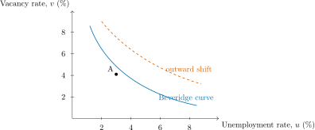

>
This chapter analyzes labor market measurement via the Bureau of Labor Statistics (BLS) household survey, compares headline U-3 and broad U-6 underutilization metrics, decomposes unemployment into frictional, structural, and cyclical components around the natural rate ($u^*$), and applies the Beveridge Curve and Okun's Law.

## Learning Outcomes and Key Terms
By the end of this chapter, students should be able to classify people in the Bureau of Labor Statistics (BLS) household-survey framework; calculate labor-force participation, employment-population, U-3, and U-6 rates; distinguish frictional, structural, and cyclical unemployment; define the natural rate of unemployment ($u^*$); interpret unemployment and vacancy movements along and across the Beveridge curve; and estimate cyclical output losses with Okun's law. These goals support MA-1 and MA-2. Key terms include civilian noninstitutional population, labor force, not in the labor force, marginally attached, discouraged worker, underemployment, U-3, U-6, frictional unemployment, structural unemployment, cyclical unemployment, natural rate of unemployment, Beveridge curve, and Okun's law.

## Part 1: The BLS Population Map
### Bring It Home: One Person, One Survey Week
Imagine that a worker's restaurant closes for renovations during the BLS survey reference week. The worker did no paid work that week, is available to return, and has not searched elsewhere because the employer expects the temporary layoff to end. Another person worked a paid shift for a delivery platform, even though the work was only a few hours. A third person wants a job but stopped searching after repeated rejections. These people may all describe themselves as needing more work, but the household survey classifies them differently using consistent rules.

The starting population is the civilian noninstitutional population (CNIP) age 16 and older, denoted $P$. The BLS partitions it into people in the labor force and people not in the labor force:

$$
P = LF + NILF, \qquad LF = E + U.
$$

Here $E$ is employed, $U$ is unemployed, $LF$ is the labor force, and $NILF$ is not in the labor force. A person is employed if they did any work for pay or profit during the reference week, worked without pay in a family business under the survey threshold, or had a job but were temporarily absent. A person is unemployed if they had no job, were available for work, and actively searched in the prior four weeks; people on temporary layoff are treated under a specific exception. Everyone else in $P$ is classified as not in the labor force.

### Graph Description: The BLS Classification Tree
Picture a flowchart rather than a graph with a behavioral curve. At the top is the full rectangle $P$. A vertical split separates $LF$ on the left from $NILF$ on the right. The $LF$ rectangle splits again into $E$ and $U$. Every person belongs to exactly one leaf of this tree for the survey classification. The categories describe survey status, not a person's worth, effort, or need for income.

### Work It Out: Rates Have Different Denominators
Suppose a hypothetical local population has $P=1{,}000$, with $E=600$, $U=40$, and therefore $NILF=360$. First add employed and unemployed people to find the labor force:
\begin{align}
LF &= E+U = 600+40=640,\\
u_3 &= \frac{U}{LF}\times 100\% = \frac{40}{640}\times100\%=6.25\%,\\
LFPR &= \frac{LF}{P}\times100\% = \frac{640}{1{,}000}\times100\%=64\%,\\
EPOP &= \frac{E}{P}\times100\% = \frac{600}{1{,}000}\times100\%=60\%.
\end{align}
The unemployment rate is not the share of the entire population without a job. Its denominator is the labor force. The participation rate asks what share of the population is working or actively seeking work; the employment-population ratio asks what share is employed.

::: {.callout-note title="Clear It Up: A Falling U-3 Rate Can Hide a Falling Labor Force"}

If unemployed people stop searching, they generally move from $U$ to $NILF$. That lowers both the numerator and denominator of U-3 and can make the rate fall without any new hiring. Check $LFPR$ and $EPOP$ alongside unemployment before concluding that job conditions improved.

:::

## Part 2: U-3, U-6, and the Gig Economy
### The Headline Rate and Broader Underutilization
U-3 is the official unemployment rate: unemployed people as a share of the civilian labor force. It is useful, comparable, and deliberately narrow. It does not count people who want a job but have not searched recently, and it counts a person working part time as employed even if that person wants full-time hours.

U-6 is a broader BLS measure of labor underutilization. It includes the unemployed, people marginally attached to the labor force, and people employed part time for economic reasons. Marginally attached people want and are available for work, searched sometime in the prior 12 months, but did not search during the most recent four weeks. Discouraged workers are one subset of the marginally attached. U-6's denominator adds the marginally attached to the labor force, so the numerator and denominator must be expanded together:

$$
\text{U-}6 = \frac{U + M + PT_{\text{econ}}}{LF + M}\times100\%,
$$

where $M$ is marginally attached people and $PT_{\text{econ}}$ is employed part-time for economic reasons.

### Bring It Home: A Platform Worker Wants More Hours
A courier completes several paid deliveries during the reference week and wants a stable, full-time schedule. Under the household-survey concept, the courier is employed because they performed paid work; being a gig worker does not by itself make someone unemployed. If the courier is working part time for economic reasons and wants full-time hours, they may be included in the U-6 numerator but not in U-3's unemployed count. Another courier who did no work, wants a job, is available, and searched within the last four weeks may be unemployed. A worker who stopped searching may be marginally attached, rather than unemployed under U-3.

### Work It Out: Compare U-3 and U-6
Continue the hypothetical example with $LF=640$ and $U=40$. Suppose $M=20$ people are marginally attached and $PT_{\text{econ}}=30$ employed people want full-time work but can only find part-time hours. Then:
\begin{align}
\text{U-}3 &= \frac{40}{640}\times100\%=6.25\%,\\
\text{U-}6 &= \frac{40+20+30}{640+20}\times100\% = \frac{90}{660}\times100\%\approx13.64\%.
\end{align}
These are illustrative counts, not a current estimate for any city or month. The gap between the measures shows that the headline rate omits forms of underutilization; it does not mean U-3 is incorrectly calculated.

::: {.callout-tip title="FRED Data: Compare Measures, Not Just Headlines"}

FRED distributes official BLS series including \texttt{UNRATE} (U-3), \texttt{U6RATE} (U-6), \texttt{CIVPART} (labor-force participation rate), and \texttt{EMRATIO} (employment-population ratio). These are seasonally adjusted monthly percentage series. Plotting them together can show whether a change in U-3 coincides with movement in broader underutilization or participation.

:::

## Part 3: Types of Unemployment, Natural Rate, and Output Slack
### Frictional, Structural, and Cyclical Unemployment
Economists decompose total unemployment into three distinct types:

*  **Frictional unemployment ($u_f$):** Short-term unemployment arising from the time workers spend searching for jobs that match their skills and preferences (such as recent graduates or job switchers).
*  **Structural unemployment ($u_s$):** Persistent unemployment caused by mismatches between workers' skills or locations and available jobs, or institutional wage rigidities (minimum wages, efficiency wages, union contracts).
*  **Cyclical unemployment ($u_c$):** Deviation of actual unemployment from the natural rate ($u - u^*$) caused by business-cycle downturns and deficient aggregate demand.

The **natural rate of unemployment ($u^*$)** is the unemployment rate when cyclical unemployment is zero ($u^* = u_f + u_s$) and the economy produces at potential output ($Y = Y^*$).

### The Beveridge Curve
The Beveridge curve describes the usual inverse relationship between the unemployment rate and the job-vacancy rate. In a Cartesian diagram, place unemployment $u$ (percent) on the horizontal axis and vacancies $v$ (percent) on the vertical axis. A movement down and left is consistent with a stronger matching environment: vacancies rise as unemployment falls. A movement up and right is consistent with weaker labor demand: vacancies fall as unemployment rises. Improved matching or training shifts the curve inward; skill mismatch or search friction shifts it outward.

{fig-alt="A downward-sloping Beveridge relationship and an outward shift associated with weaker matching. Curves and endpoints are shown within the labeled 0–10 percent plotting range."}

### Okun's Law: From an Unemployment Gap to an Output Gap
Okun's law summarizes an empirical regularity: when unemployment is above its sustainable or natural benchmark, real output tends to be below potential:

$$
\frac{Y-Y^*}{Y^*}\approx -\beta(u-u^*), \qquad \beta>0,
$$

where $Y$ is real output, $Y^*$ is potential output, $u$ and $u^*$ are measured in percentage points, and $\beta$ is an estimated coefficient.

### Work It Out: An Illustrative \$1.0 Trillion Output Shortfall
Assume potential real GDP is $Y^*=\$25.0$ trillion in a chosen base-year dollar measure, actual unemployment is $u=6\%$, the estimated benchmark is $u^*=4\%$, and an illustrative Okun coefficient is $\beta=2$. First find the unemployment gap: $u-u^*=2$ percentage points. Then estimate the output gap:
\begin{align}
\frac{Y-Y^*}{Y^*} &\approx -2(2\%)=-4\%,\\
Y^*-Y &\approx 0.04\times \$25.0\text{ trillion} = \$1.0\text{ trillion}.
\end{align}
The estimated shortfall is \$1.0 trillion of real output relative to the assumed potential level.

::: {.callout-note title="Optional Advanced: Markov Job-Finding and Separation Flows"}

In a two-state model, let $s$ be the period separation probability from employment to unemployment and $f$ the job-finding probability from unemployment to employment. At steady state, inflows to unemployment equal outflows: $s(1-u)=fu$. Solving gives:

$$
u^*=\frac{s}{s+f}.
$$

This result makes the stock-flow logic explicit: a higher separation rate raises steady-state unemployment, while a higher job-finding rate lowers it.

:::

::: {.callout-note title="Optional Advanced: State-Space Slack and Growth-Rate Okun Relations"}

Potential output $Y_t^*$ and the natural unemployment rate $u_t^*$ are latent states inferred from noisy observations. Output slack can be represented as $x_t=\ln Y_t-\ln Y_t^*$, approximately the percentage output gap for small differences; labor slack can be represented as $u_t-u_t^*$. An alternative growth-difference form is $\Delta u_t\approx-\kappa(g_{Y,t}-g_{Y,t}^*)$, where $g_{Y,t}$ is real output growth, $g_{Y,t}^*$ is potential growth, and $\kappa>0$ is an estimated response coefficient.

:::

## Check Your Understanding

*  In the BLS partition, where is a person who wants work but has not searched in the past four weeks? What additional condition could make them marginally attached?
*  With $LF=800$, $U=48$, $M=16$, and $PT_{\text{econ}}=32$, calculate U-3 and U-6.
*  On the Beveridge diagram, what do an inward shift and a movement down-left represent?
*  If $Y^*=\$20$ trillion, $u-u^*=1.5$ percentage points, and $\beta=2$, estimate the output gap and shortfall.

Answers: (1) NILF; if they want a job, are available, searched in the prior 12 months, and not in the prior four weeks, they may be marginally attached. (2) U-3 $=48/800=6\%$; U-6 $=(48+16+32)/(800+16)=96/816\approx11.76\%$. (3) An inward shift indicates improved matching; down-left is a movement along the curve as vacancies rise and unemployment falls. (4) Output gap $\approx-3\%$ and shortfall $\$0.6$ trillion.
