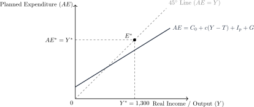

>
This chapter provides a rigorous, pedagogical treatment of Chapter 7: Income and Expenditure: The Keynesian Cross and Multipliers, benchmarked to standard principles curriculum.

## Planned Aggregate Expenditure and the Keynesian Cross

### 1. Conceptual Introduction {.unnumbered}
In the short run when prices are sticky and productive resources are underutilized, output is determined not by long-run supply limits, but by total spending—what macroeconomists call **Planned Aggregate Expenditure ($AE$)**. Developed by John Maynard Keynes during the Great Depression, the **Keynesian Cross** model explains how equilibrium national income is established when total planned spending equals total output.

Planned aggregate expenditure in a closed economy consists of four components:

$$
AE = C + I_p + G
$$

where $C$ is consumer spending, $I_p$ is planned business investment, and $G$ is government purchases. Household consumption depends on autonomous consumption ($C_0$) and disposable income $(Y - T)$ through the **Marginal Propensity to Consume ($c = \Delta C / \Delta(Y-T)$)**, where $0 < c < 1$:

$$
C = C_0 + c(Y - T)
$$

When households and businesses plan to spend less than the economy is producing ($AE < Y$), unsold goods accumulate as **unplanned inventory investment**. Firms respond by cutting production and laying off workers, causing national income ($Y$) to fall until spending and output balance. Conversely, if planned spending exceeds output ($AE > Y$), inventories drop unexpectedly and firms expand production.

### 2. Visual Representation {.unnumbered}
Figure 1 illustrates the Keynesian Cross diagram, showing the $45^\circ$ line ($AE = Y$) intersecting the planned expenditure schedule ($AE$) at short-run equilibrium output $Y^*$.

::: {.callout-note title="Clear It Up: Real GDP vs. Planned Expenditure"}

Real GDP measures *actual realized production* (tracked in St. Louis Fed FRED series `GDPC1`), whereas aggregate expenditure measures *planned spending*. In unplanned recessions, firms build up unintended inventories, making actual $GDP$ temporarily higher than planned $AE$.

:::

{fig-alt="The Keynesian Cross. Short-run macroeconomic equilibrium occurs at output Y^* where the planned aggregate expenditure schedule (AE) intersects the 45^\circ reference line (AE = Y)."}

### 3. Real-World Application: Inventory Cycles and Auto Plant Shutdowns {.unnumbered}
During economic downturns, automobile dealerships often experience unexpected drops in showroom traffic. Unsold SUVs accumulate on lots as unintended inventory investment, prompting automotive manufacturers to halt assembly lines temporarily until dealer inventories clear.

### 4. Mathematical Foundation (Algebra Level) {.unnumbered}
Equilibrium output solves $Y = AE$:

$$
Y^* = \frac{C_0 - cT + I_p + G}{1 - c}
$$

**Worked Problem:**
In a simplified closed economy, autonomous consumption is $C_0 = \$100\text{ billion}$, the marginal propensity to consume is $c = 0.8$, lump-sum taxes are $T = \$50\text{ billion}$, planned investment is $I_p = \$120\text{ billion}$, and government purchases are $G = \$80\text{ billion}$ (all values in billions).

*  Write the aggregate expenditure equation $AE(Y)$.
*  Calculate short-run equilibrium output $Y^*$.

**Step-by-Step Breakdown:**

*  **Construct the $AE$ Equation:**

$$
AE = [100 + 0.8(Y - 50)] + 120 + 80 = 100 + 0.8Y - 40 + 120 + 80 = \mathbf{260 + 0.8Y}
$$

*  **Solve for Equilibrium Output ($Y^* = AE$):**

$$
Y^* = 260 + 0.8Y^* \implies 0.2Y^* = 260 \implies Y^* = \frac{260}{0.2} = \mathbf{\$1{,}300\text{ billion}}
$$

**Conclusion:** Short-run equilibrium national income is established at $\$1{,}300\text{ billion}$.

## The Government Purchases Multiplier and Leakages

### 1. Conceptual Introduction {.unnumbered}
One of the most powerful insights of the Keynesian model is the **multiplier effect**: an initial injection of autonomous spending—such as $\$20\text{ billion}$ in new federal infrastructure contracts—triggers a cascading chain reaction of higher incomes and induced consumption, causing equilibrium output to expand by a multiple of the initial spending injection.

The simple closed-economy **government purchases multiplier ($k_G$)** depends entirely on the marginal propensity to consume ($c$):

$$
k_G = \frac{1}{1 - c}
$$

For instance, if $c = 0.8$, the simple multiplier is $\frac{1}{1 - 0.8} = 5$, meaning a $\$20\text{ billion}$ increase in government purchases generates $\Delta Y = 5 \times \$20\text{B} = \$100\text{ billion}$ in total output.

However, in reality, every round of domestic spending suffers from **leakages**—income that escapes the domestic circular flow through **saving** ($s = 1 - c$), **proportional income taxes** ($t$), and **spending on imported goods** ($m$). Accounting for these leakages yields a more realistic, smaller multiplier:

$$
k_{\text{realistic}} = \frac{1}{1 - c(1 - t) + m}
$$

### 2. Visual Representation {.unnumbered}
Figure~\fig:multiplier_rounds} breaks down the successive rounds of induced spending triggered by an initial government spending injection, showing how cumulative output converges toward the multiplier limit.

{fig-alt="Cascading Rounds of the Keynesian Multiplier (c = 0.8). An initial $20\text{B} government injection sparks successive rounds of induced consumption ($16\text{B}, $12.8\text{B}, $10.24\text{B}\dots), converging to a cumulative output expansion of $100\text{B}."}

### 3. Real-World Application: Fiscal Stimulus Packages and Open-Economy Leakages {.unnumbered}
When an open economy like Canada or the U.S. enacts tax rebates or infrastructure spending, a significant share of that extra disposable income leaks out immediately to purchase imported automobiles or electronics from abroad—reducing the domestic spending multiplier compared to a closed economy.

### 4. Mathematical Foundation (Algebra Level) {.unnumbered}
The change in equilibrium output resulting from a change in government purchases ($\Delta G$) is:

$$
\Delta Y^* = k_G \cdot \Delta G = \frac{1}{1 - c} \cdot \Delta G
$$

**Worked Problem:**
Using the closed-economy model from Section 7.1 ($c = 0.8$), suppose autonomous government purchases increase by $\Delta G = \$20\text{ billion}$.

*  Compute the simple government purchases multiplier $k_G$.
*  Calculate the total change in equilibrium output ($\Delta Y^*$) and the new equilibrium output level.

**Step-by-Step Breakdown:**

*  **Calculate the Multiplier ($k_G$):**

$$
k_G = \frac{1}{1 - 0.8} = \frac{1}{0.2} = \mathbf{5}
$$

*  **Compute Total Output Change and New Equilibrium:**

$$
\Delta Y^* = 5 \times \$20\text{ billion} = \mathbf{+\$100\text{ billion}}
$$

$$
Y_2^* = Y_1^* + \Delta Y^* = \$1{,}300\text{B} + \$100\text{B} = \mathbf{\$1{,}400\text{ billion}}
$$

**Conclusion:** A $\$20\text{ billion}$ boost in government purchases expands national output by $\$100\text{ billion}$.

::: {.callout-note title="Optional Advanced Section: Calculus Derivation of the Multiplier"}

*Note for Economics Majors and Quantitative Students:*
Total differentiation of the equilibrium condition $Y = C_0 + c(Y - T) + I_p + G$ with respect to $G$ yields:

$$
dY = c \cdot dY + dG \implies (1 - c)dY = dG \implies \frac{dY}{dG} = \frac{1}{1 - c}
$$

Similarly, differentiating with respect to taxes $T$ yields the tax multiplier $k_T = \frac{-c}{1 - c}$, which is smaller in absolute value than $k_G$ because part of a tax cut is saved rather than spent.

:::
