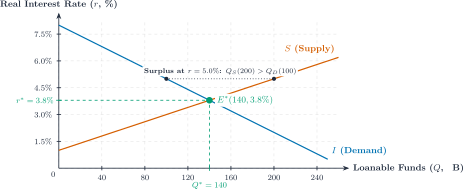
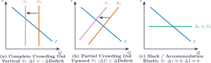

>
This chapter develops the macroeconomic framework linking household and government saving decisions, physical capital investment, and financial intermediation, benchmarked to Krugman and Wells. We distinguish saving flows from wealth stocks, derive the closed- and open-economy national saving identities, analyze how financial markets and intermediaries reduce transaction costs, diversify risk, and provide liquidity, and model equilibrium in the market for loanable funds to evaluate fiscal crowding out.

## Learning Outcomes and Key Terms {.unnumbered}
\addcontentsline{toc}{section}{Learning Outcomes and Key Terms}

Upon completing this chapter, students should be able to (aligned with Course Learning Outcomes MA-2, MA-3, and C2002-2):

*  **Distinguish** saving flows from wealth stocks and separate macroeconomic physical capital investment from personal financial asset purchases.
*  **Derive** private saving, public saving, and national saving from the expenditure identity, and apply the closed-economy ($S = I$) and open-economy ($I = S + NCI$) accounting identities.
*  **Explain** how financial assets and financial intermediaries channel funds from savers to borrowers by reducing transaction costs, diversifying risk, and providing liquidity.
*  **Analyze** equilibrium in the market for loanable funds ($r^*, Q^*$) and evaluate how budget deficits and investment shifts alter real interest rates and cause partial crowding out.

**Key Terms:** saving, wealth, physical investment, financial investment, private saving ($S_p$), public saving ($S_g$), national saving ($S$), budget surplus, budget deficit, net capital inflow ($NCI$), financial system, financial intermediary, liquidity, diversification, loanable funds market, real interest rate ($r$), crowding out.

::: {.callout-tip title="Bring It Home: Why Do Trillions in U.S. Budget Deficits Coexist with Record Data-Center Investment?"}

Between 2023 and 2026, the U.S. federal government ran annual budget deficits exceeding $\$1.6\text{ trillion}$ while technology and utility firms simultaneously committed hundreds of billions of dollars to hyperscale AI data centers, semiconductor fabs, and electrical grid upgrades. In a closed economy with fixed saving, massive government borrowing should drive up real interest rates and squeeze out private business investment. Yet U.S. corporations continued raising capital at scale—aided by rising household saving yields and hundreds of billions of dollars in foreign capital inflows from global savers. Understanding how the financial system and the loanable-funds market reconcile competing claims on national saving explains how interest rates allocate scarce capital across public and private borrowers.

:::

## Saving Flows, Wealth Stocks, and Macroeconomic Investment

### Conceptual Introduction {.unnumbered}
\label{sec:saving-flow-wealth-stock}
In everyday conversation, people use ``saving'' and ``wealth'' interchangeably, yet macroeconomics draws a strict boundary between a **flow** and a **stock**. **Saving ($S$)** is a flow variable: it measures the portion of current disposable income ($Y_d$) that a household, business, or government chooses not to spend on current consumption during a specific time interval, such as a month, quarter, or year. By contrast, **wealth ($W$)** is a stock variable: it measures the total net value of assets (bank deposits, bonds, equities, real estate, minus debts) owned at a single point in time. Positive saving acts like water flowing into a bathtub—each month of positive saving raises the water level of accumulated wealth, whereas negative saving (**dissaving**, when spending exceeds current income) drains the stock of wealth.

Understanding how wealth evolves also requires separating active saving flows from asset valuation changes. A household's net worth can rise over a year either because the household actively refrains from consuming part of its paycheck ($S > 0$) or because the market price of existing assets it already owns—such as a home or stock index fund—appreciates (**capital gains**). Conversely, falling asset prices (**capital losses**) can reduce household wealth even when a family continues to save out of every paycheck. Tracking both the saving flow and balance-sheet asset valuations explains why household spending responds sharply to housing and stock market swings.

Equally critical is the macroeconomic distinction between **physical investment ($I$)** and **financial investment**. In macroeconomic accounting (NIPA), investment refers exclusively to spending on newly produced physical capital goods—such as factory machinery, commercial buildings, software, cloud servers, and additions to business inventories—that expand the economy's future productive capacity. When an individual buys shares of an existing corporation on the New York Stock Exchange or purchases an existing suburban house, no new physical capital is created; ownership of an existing asset simply transfers from seller to buyer. In macroeconomics, buying stocks or bonds is household *saving* (supplying funds to the financial system), whereas a firm using borrowed funds to build a new warehouse is *investment*.

### Visual Representation {.unnumbered}
Figure 1 illustrates the stock–flow relationship over a five-year horizon for a household starting with zero initial wealth ($W_0 = \$0$). Each vertical bar represents the annual saving flow ($S_t$), while the connected trajectory tracks cumulative end-of-year wealth ($W_t = \sum_{k=1}^{t} S_k$). Notice that even when the annual saving flow dips in Years 3 and 4, cumulative wealth continues rising because every positive flow adds to the existing stock.

{fig-alt="Annual Saving (Flow) vs. Cumulative Wealth (Stock). Blue bars measure annual saving flows (S_t: $5\text{k}, $10\text{k}, $8\text{k}, $7\text{k}, $9\text{k}), whereas the orange trajectory tracks the accumulated stock of wealth (W_t: $5\text{k}, $15\text{k}, $23\text{k}, $30\text{k}, $39\text{k})."}

### Real-World Application: U.S. Household Saving Rate Swings {.unnumbered}
The U.S. Bureau of Economic Analysis tracks household saving flows relative to disposable personal income through the **Personal Saving Rate** (FRED: \texttt{PSAVERT}). During the 2007–2009 Great Recession, collapsing home prices and equity values erased trillions of dollars in household wealth; in response, families cut discretionary consumption and raised their personal saving rate from roughly $2.5\%$ in 2007 to over $6\%$ by 2009 to rebuild depleted wealth buffers. A decade later, during the 2020 COVID-19 lockdowns, pandemic stimulus transfers combined with closed restaurants and travel restrictions pushed \texttt{PSAVERT} above $30\%$ in April 2020, creating a massive stock of ``excess savings'' that fueled consumer spending through 2022–2023 before the saving rate normalized near $4\%$–$5\%$ in 2024–2026.

::: {.callout-note title="Clear It Up: Economic Investment vs. Financial Investment"}

Students frequently lose points on exams by labeling stock or bond purchases as ``investment.'' In macroeconomics:
[noitemsep]
*  **Financial Investment (Household Saving):** Buying stocks, corporate bonds, Treasury bills, or existing real estate transfers ownership of existing claims and supplies funds to financial markets.
*  **Physical Investment ($I$ in GDP):** Firms purchasing newly manufactured machinery, commercial structures, software, or residential construction adds directly to the nation's capital stock ($K$).

:::

### Mathematical Foundation {.unnumbered}
Let disposable income in period $t$ be $Y_{d,t} = Y_t + TR_t - T_t$ (total income plus government transfers minus taxes) and household consumption spending be $C_t$. Household saving flow in period $t$ is:

$$
S_t = Y_{d,t} - C_t
$$

Given beginning-of-period wealth $W_{t-1}$ and net capital gains $\Delta V_t$ on existing assets, end-of-period wealth evolves according to the stock–flow accumulation identity:

$$
W_t = W_{t-1} + S_t + \Delta V_t
$$

::: {.callout-tip title="Work It Out: Calculating Saving Flows and Ending Wealth"}

Suppose a household begins the year with $W_0 = \$120{,}000$ in financial and housing assets. During the year, the household earns $\$95{,}000$ in gross income, pays $\$15{,}000$ in taxes, receives $\$0$ in transfers, and spends $\$68{,}000$ on consumption goods and services. Meanwhile, its existing retirement index fund rises in market value by $\Delta V_1 = +\$6{,}000$.

*  **Compute Disposable Income ($Y_{d,1}$):**
$$Y_{d,1} = \$95{,}000 + \$0 - \$15{,}000 = \$80{,}000$$
*  **Compute Annual Saving Flow ($S_1$):**
$$S_1 = Y_{d,1} - C_1 = \$80{,}000 - \$68{,}000 = \$12{,}000$$
The household's personal saving rate is $\frac{\$12{,}000}{\$80{,}000} \times 100 = 15.0\%$.
*  **Compute End-of-Year Wealth Stock ($W_1$):**
$$W_1 = W_0 + S_1 + \Delta V_1 = \$120{,}000 + \$12{,}000 + \$6{,}000 = \$138{,}000$$

:::

::: {.callout-note title="[Advanced: For Economics Majors] Continuous-Time Wealth Accumulation"}

In continuous time, let $w(t)$ denote the real wealth stock at instant $t$, $s(t) = y_d(t) - c(t)$ denote the instantaneous saving flow rate, and $r_a$ denote the real capital-gain rate on existing assets. Wealth evolves according to the first-order linear differential equation:
$$\frac{dw(t)}{dt} = s(t) + r_a w(t)$$
Integrating from $t = 0$ to $T$ yields $w(T) = w(0)e^{r_a T} + \int_0^T s(\tau)e^{r_a(T-\tau)}\,d\tau$, showing how early saving flows compound across time.

:::

## National Saving and the Open-Economy Identity

### Conceptual Introduction {.unnumbered}
To understand how an entire nation finances physical capital investment, we scale up from an individual household to the macroeconomy using the National Income and Product Accounts (NIPA) expenditure identity: $Y = C + I + G + NX$. In any economy, total output produced ($Y$) that is neither consumed by households ($C$) nor purchased by government agencies ($G$) represents output set aside from current consumption—which is the macroeconomic definition of **national saving ($S$)**.

National saving is generated by two domestic sectors. **Private saving ($S_p$)** is the disposable income households and firms retain after paying net taxes ($T_{\text{net}} = T - TR$) and purchasing consumption goods: $S_p = Y - T_{\text{net}} - C$. **Public saving ($S_g$)** is the difference between government net tax revenue and government purchases of goods and services: $S_g = T_{\text{net}} - G$. When $T_{\text{net}} > G$, the government runs a **budget surplus** ($S_g > 0$) and adds to national saving; when $T_{\text{net}} < G$, the government runs a **budget deficit** ($S_g < 0$), reducing national saving.

Linking national saving to domestic investment depends on whether the economy interacts financially with the rest of the world. In a **closed economy** ($NX = 0$), every dollar of domestic investment must be financed by domestic saving, yielding the closed-economy saving–investment identity $S = I$. In an **open economy**, domestic investment can exceed domestic national saving ($I > S$) if foreign savers lend funds to domestic borrowers. Because a trade deficit ($NX < 0$, meaning imports exceed exports) leaves foreign trading partners holding domestic currency that they reinvest in domestic bonds, stocks, and factories, **net capital inflow ($NCI$)** equals the negative of net exports ($NCI = -NX$), giving the open-economy funding identity $I = S_p + S_g + NCI$.

### Visual Representation {.unnumbered}
Figure 2 compares how domestic physical investment ($I$) is financed under closed-economy versus open-economy accounting. In the left panel (Closed Economy), domestic investment equals national saving ($I = S_p + S_g$). In the right panel (Open Economy with a budget deficit $S_g < 0$ and a trade deficit $NX < 0$), positive net capital inflows ($NCI = -NX > 0$) supplement private saving to fund total domestic investment.

{fig-alt="Closed vs. Open Economy Saving–Investment Accounting. In a closed economy (Panel A), national saving (S_p + S_g) exactly equals domestic investment (I). In an open economy running both a budget deficit (S_g < 0) and a trade deficit (NX < 0), net capital inflows (NCI = -NX > 0) help finance domestic investment and public borrowing (Panel B)."}

### Real-World Application: U.S. Twin Deficits and Foreign Capital Inflows {.unnumbered}
In recent U.S. macroeconomic data, Gross Private Domestic Investment (FRED: \texttt{GPDI}) has consistently exceeded domestic national saving because Net Government Saving (FRED: \texttt{TGDEF}) has been deeply negative while private saving remains moderate. How does the United States sustain high domestic capital formation despite low net national saving? Foreign central banks, sovereign wealth funds, and international private investors purchase U.S. Treasury securities, corporate bonds, and equities—generating positive Net Capital Inflows ($NCI > 0$) that mirror the U.S. current account (trade) deficit ($NX < 0$).

::: {.callout-note title="Clear It Up: Accounting Identities Do Not Prove Causation"}

The open-economy identity $S - I = NX$ (or $I = S + NCI$) holds *ex post* by national accounting definition, just as $2 + 2 = 4$ is always true. However, an accounting identity alone does not tell us whether a fall in national saving *caused* a trade deficit or whether strong foreign demand for U.S. assets drove capital inflows ($NCI > 0$) that appreciated the dollar and widened the trade deficit ($NX < 0$). Economists use behavioral models (such as the loanable-funds market) to establish causal mechanisms.

:::

### Mathematical Foundation {.unnumbered}
Starting from the aggregate expenditure identity $Y = C + I + G + NX$, subtract $C$ and $G$ from both sides:

$$
Y - C - G = I + NX
$$

Add and subtract net taxes $T_{\text{net}} = T - TR$ on the left-hand side to separate private saving ($S_p$) and public saving ($S_g$):

$$
S = \underbrace{(Y - T_{\text{net}} - C)}_{S_p} + \underbrace{(T_{\text{net}} - G)}_{S_g} = Y - C - G
$$

Substituting $S = Y - C - G$ and defining Net Capital Inflow as $NCI = -NX$ (capital inflows from abroad minus capital outflows to abroad) yields the closed- and open-economy investment identities:

$$
\text{Closed Economy } (NX = 0): \quad I = S = S_p + S_g
$$

$$
\text{Open Economy } (NCI = -NX): \quad I = S + NCI = S_p + S_g + NCI
$$

::: {.callout-tip title="Work It Out: Decomposing National Saving and Net Capital Inflows"}

Suppose an open economy has GDP of $Y = \$20{,}000\text{ billion}$, household consumption $C = \$13{,}600\text{ billion}$, government purchases $G = \$3{,}400\text{ billion}$, net tax collections $T_{\text{net}} = \$3{,}000\text{ billion}$, and domestic physical investment $I = \$3{,}600\text{ billion}$.

*  **Calculate Private Saving ($S_p$):**
$$S_p = Y - T_{\text{net}} - C = \$20{,}000 - \$3{,}000 - \$13{,}600 = \$3{,}400\text{ billion}$$
*  **Calculate Public Saving ($S_g$):**
$$S_g = T_{\text{net}} - G = \$3{,}000 - \$3{,}400 = -\$400\text{ billion} \quad (\text{a } \$400\text{B budget deficit})$$
*  **Calculate National Saving ($S$):**
$$S = S_p + S_g = \$3{,}400 + (-\$400) = \$3{,}000\text{ billion}$$
*  **Calculate Net Capital Inflow ($NCI$) and Net Exports ($NX$):**
$$NCI = I - S = \$3{,}600 - \$3{,}000 = +\$600\text{ billion}$$
$$NX = -NCI = -\$600\text{ billion} \quad (\text{a } \$600\text{B trade deficit financed by foreign saving})$$

:::

## The Financial System: Assets, Intermediaries, and Core Tasks

### Conceptual Introduction {.unnumbered}
National saving cannot automatically transform into factories, power grids, and software unless an institutional mechanism connects millions of small household savers with businesses seeking large sums for long-term capital projects. The **financial system** consists of the markets and institutions that channel funds from savers (lenders) to investors (borrowers). Savers supply funds by acquiring **financial assets**—paper or electronic claims that entitle the buyer to future income from the seller—including **loans** (direct debt contracts), **bonds** (tradeable IOUs promising fixed interest payments and principal repayment at maturity), **stocks** (shares of partial ownership in a corporation), and **bank deposits**.

Rather than requiring every household to vet individual corporate borrowers directly, modern economies rely heavily on **financial intermediaries**—institutions that transform funds gathered from many individuals into financial assets. Major intermediaries include **commercial banks** (which accept liquid checking and savings deposits and originate business and mortgage loans), **mutual funds and exchange-traded funds (ETFs)** (which pool saver money to buy diversified portfolios of stocks and bonds), **pension funds** (which invest worker retirement contributions over multi-decade horizons), and **life insurance companies**.

Across all these institutions, a well-functioning financial system performs three indispensable macroeconomic tasks:
[noitemsep]
*  **Reducing Transaction Costs:** Standardized bond markets and bank lending departments eliminate the prohibitive search, legal, and credit-monitoring costs that would arise if an individual saver tried to negotiate loans directly with thousands of firms.
*  **Reducing Risk through Diversification:** Because future business profits are uncertain, investing all of one's savings in a single company exposes a household to idiosyncratic failure. Mutual funds and banks pool funds across hundreds of firms and industries, allowing savers to earn steady average returns while shedding firm-specific risk.
*  **Providing Liquidity:** Businesses need funds locked into machinery for years, whereas households want rapid access to cash for emergencies. Banks and secondary stock/bond markets provide **liquidity**—the ability to convert an asset into spendable cash quickly without significant loss of value.

### Visual Representation {.unnumbered}
Figure 3 maps the architecture of the financial system, showing how household and foreign saving flows through both direct financial markets (stocks and bonds) and financial intermediaries (banks, mutual funds, pension funds) to finance business capital formation while performing the three core financial tasks.

{fig-alt="Architecture of the Financial System. Funds flow from domestic and foreign savers either directly through bond and stock markets or indirectly through financial intermediaries to finance physical investment (I)."}

### Real-World Application: Index Funds and Liquidity Mismatch Risks {.unnumbered}
Consider how retail index mutual funds and ETFs democratized diversification: for an expense ratio below $0.05\%$ per year, a first-time investor with $\$500$ can own fractional shares of 500 major U.S. corporations, achieving near-complete diversification of idiosyncratic firm risk at minimal transaction cost. Conversely, when financial intermediaries mismanage liquidity transformation, systemic fragility emerges. In March 2023, Silicon Valley Bank (SVB) held long-term fixed-rate Treasury bonds funded by uninsured, instantly withdrawable tech-startup deposits. When rising interest rates lowered the market value of SVB's long-term bonds and depositors triggered rapid digital withdrawals, SVB suffered an acute liquidity run—illustrating why bank capital and liquidity regulations are essential to financial stability.

### Mathematical Foundation {.unnumbered}
Two foundational quantitative relationships govern financial assets:

*  **Inverse Relationship Between Bond Prices and Interest Rates:** For a one-year zero-coupon bond paying face value $F$ at maturity and selling today at market price $P_B$, the nominal yield (interest rate) $i$ is:

$$
i = \frac{F - P_B}{P_B} \iff P_B = \frac{F}{1 + i}
$$

When market interest rates $i$ rise, the market price $P_B$ of existing fixed-payment bonds must fall so new buyers earn the competitive market yield.
*  **The Fisher Equation (Real vs. Nominal Interest Rates):** Because inflation erodes the purchasing power of repaid dollars, borrowers and lenders evaluate the **real interest rate ($r$)**, approximated by subtracting expected inflation ($\pi^e$) from the nominal interest rate ($i$):

$$
r \approx i - \pi^e \qquad \left(\text{exact formula: } 1 + r = \frac{1 + i}{1 + \pi^e}\right)
$$

::: {.callout-tip title="Work It Out: Bond Pricing, Real Yields, and Risk Diversification"}

*  **Bond Price and Yield:** A one-year U.S. Treasury bill has a face value of $F = \$1{,}000$ and trades today at $P_B = \$950$. Its nominal interest rate is:
$$i = \frac{\$1{,}000 - \$950}{\$950} = \frac{\$50}{\$950} \approx 0.0526 \quad (5.26\%)$$
If market interest rates rise to $i' = 6.0\%$, the bond's market price drops to:
$$P_B' = \frac{\$1{,}000}{1.06} \approx \$943.40$$
*  **Real Interest Rate:** If the nominal bond yield is $i = 5.26\%$ and expected inflation is $\pi^e = 2.26\%$, the expected real return to the saver is:
$$r \approx 5.26\% - 2.26\% = 3.00\%$$
*  **Diversification Math:** Suppose each independent biotech startup has an annual return standard deviation of $\sigma = 40\%$. An equally weighted mutual fund holding $N = 100$ uncorrelated startups reduces portfolio volatility to:
$$\sigma_p = \frac{\sigma}{\sqrt{N}} = \frac{40\%}{\sqrt{100}} = \frac{40\%}{10} = 4.0\%$$

:::

::: {.callout-note title="[Advanced: For Economics Majors] Multi-Year Bond Valuation and Duration"}

For a multi-year bond paying annual coupon $C$ for $T$ years plus face value $F$ at maturity, its present discounted value at yield $i$ is:
$$P_B(i) = \sum_{t=1}^{T} \frac{C}{(1+i)^t} + \frac{F}{(1+i)^T}$$
Differentiating with respect to $i$ yields $\frac{dP_B}{di} = -\frac{D_{\text{Mac}}}{1+i} P_B < 0$, where $D_{\text{Mac}}$ is Macaulay duration. Longer-maturity bonds have higher duration and suffer larger percentage price drops when interest rates rise.

:::

## The Market for Loanable Funds

### Conceptual Introduction {.unnumbered}
Economists model how the financial system coordinates saving and investment using the **market for loanable funds**—a hypothetical market that brings together all savers who want to lend funds and all borrowers who want to finance investment spending. The ``price'' in this market is the **real interest rate ($r$)**, which measures the inflation-adjusted return earned by lenders and the inflation-adjusted cost paid by borrowers.

The **demand for loanable funds ($I$)** comes from firms (and homebuyers) borrowing to finance physical investment projects, and it **slopes downward**. A firm undertakes a capital project only if its expected rate of return meets or exceeds the real interest rate ($r$). When $r$ is high (say, $7\%$), only highly profitable projects pass this hurdle, so the quantity of loanable funds demanded is low. When $r$ falls (say, to $3\%$), many additional warehouse, factory, and equipment projects become profitable, increasing the quantity of investment funds demanded. Any change in perceived business opportunities—such as a breakthrough in artificial intelligence or an investment tax credit—shifts the entire investment demand curve rightward.

The **supply of loanable funds ($S$)** comes from national saving (private plus public saving) and net capital inflows, and it **slopes upward**. Households face an intertemporal trade-off between consuming today versus consuming in the future; a higher real interest rate raises the reward for deferring consumption, inducing households to save more and attracting foreign capital inflows. Changes in household thrift, tax incentives for retirement accounts (such as 401(k) or Roth IRA expansions), foreign capital flows, or government budget balances shift the supply curve of loanable funds. At the equilibrium real interest rate $r^*$, the quantity of loanable funds supplied exactly equals the quantity demanded ($Q_S(r^*) = Q_D(r^*) = Q^*$).

### Visual Representation {.unnumbered}
Figure 4 depicts equilibrium in the market for loanable funds. The downward-sloping investment demand curve ($I$: $r = 8.0 - 0.03Q$) intersects the upward-sloping supply curve ($S$: $r = 1.0 + 0.02Q$) at point $E^*$, establishing an equilibrium real interest rate of $r^* = 3.8\%$ and equilibrium loanable funds of $Q^* = \$140\text{ billion}$. At any rate above equilibrium (such as $r = 5.0\%$), desired saving ($\$200\text{B}$) exceeds desired investment ($\$100\text{B}$), creating a $\$100\text{B}$ surplus of funds that drives $r$ down toward $3.8\%$.

{fig-alt="Loanable Funds Market Equilibrium. Upward-sloping supply S (r = 1.0 + 0.02Q) intersects downward-sloping investment demand I (r = 8.0 - 0.03Q) at Q^* = $140\text{ billion} and r^* = 3.8\%."}

### Real-World Application: Real Treasury Yields and Corporate Investment Hurdles {.unnumbered}
Financial analysts monitor the 10-Year Treasury Inflation-Indexed Security yield (FRED: \texttt{DFII10}) alongside the nominal 10-Year Treasury yield (FRED: \texttt{DGS10}) as a real-time barometer of the economy's benchmark real interest rate. Between 2020 and 2021, \texttt{DFII10} hovered near $-1.0\%$, encouraging aggressive corporate borrowing for warehouse expansion, residential construction, and software investment. By 2024–2026, as \texttt{DFII10} rose near $+1.8\%$ to $+2.1\%$, capital-intensive housing and commercial real estate projects faced much steeper borrowing hurdles, shifting private investment toward high-expected-return sectors such as artificial intelligence infrastructure and semiconductor manufacturing.

### Mathematical Foundation {.unnumbered}
Let the supply of loanable funds ($Q_S$, in billions of dollars) and the investment demand for loanable funds ($Q_D$, in billions of dollars) be linear functions of the real interest rate $r$ (measured in percentage points):
\begin{align}
\text{Supply of Loanable Funds:} \quad & Q_S = -50 + 50r \qquad \left(\text{inverse: } r = 1.0 + 0.02Q_S\right) \\
\text{Investment Demand:} \quad & Q_D = \frac{800 - 100r}{3} \qquad \left(\text{inverse: } r = 8.0 - 0.03Q_D\right)
\end{align}
Market equilibrium requires $Q_S(r^*) = Q_D(r^*)$, or equivalently equating the inverse supply and demand curves at $Q^*$.

::: {.callout-tip title="Work It Out: Solving for Loanable-Funds Equilibrium and Disequilibrium"}

Using the supply curve $r = 1.0 + 0.02Q$ and investment demand curve $r = 8.0 - 0.03Q$ plotted in Figure 4:

*  **Find Equilibrium Quantity ($Q^*$):** Set inverse supply equal to inverse demand:
$$1.0 + 0.02Q^* = 8.0 - 0.03Q^*$$
$$0.05Q^* = 7.0 \implies Q^* = \frac{7.0}{0.05} = \$140\text{ billion}$$
*  **Find Equilibrium Real Interest Rate ($r^*$):** Substitute $Q^* = 140$ into either curve:
$$r^* = 1.0 + 0.02(140) = 1.0 + 2.8 = 3.8\%$$
*  **Verify Disequilibrium at $r = 5.0\%$:**
[noitemsep]
*  Quantity supplied: $Q_S = -50 + 50(5.0) = \$200\text{ billion}$.
*  Quantity demanded: $Q_D = \frac{800 - 100(5.0)}{3} = \frac{300}{3} = \$100\text{ billion}$.
*  Excess supply (surplus) $= \$200\text{B} - \$100\text{B} = \$100\text{ billion}$, putting downward pressure on $r$ until $r^* = 3.8\%$.

:::

::: {.callout-note title="[Advanced: For Economics Majors] Two-Period Intertemporal Optimization"}

A representative household maximizes lifetime utility $U(C_1, C_2) = u(C_1) + \beta u(C_2)$ subject to the intertemporal budget constraint $C_1 + \frac{C_2}{1+r} = Y_1 + \frac{Y_2}{1+r}$, where $\beta \in (0,1)$ is the subjective discount factor. Setting up the Lagrangian $\mathcal{L} = u(C_1) + \beta u(C_2) + \lambda\left(Y_1 - C_1 + \frac{Y_2 - C_2}{1+r}\right)$ yields the consumption Euler equation:
$$\frac{u'(C_1)}{\beta u'(C_2)} = 1 + r$$
When $r$ rises, the relative price of current consumption ($1+r$) increases, inducing the household to substitute away from $C_1$ and increase saving $S_1 = Y_1 - C_1$ (assuming the substitution effect dominates the income effect).

:::

## Government Budget Deficits, Interest Rates, and Crowding Out

### Conceptual Introduction {.unnumbered}
Because national saving equals the sum of private saving and public saving ($S = S_p + S_g$), fiscal policy directly affects the supply of loanable funds. When the federal government increases spending ($G$) or cuts taxes ($T$) without offsetting revenue, its budget balance ($S_g = T_{\text{net}} - G$) moves into deficit ($S_g < 0$). Because the U.S. Treasury must issue government bonds to finance that deficit, it absorbs a share of private saving, shifting the **supply of loanable funds leftward** at every real interest rate.

The leftward shift in loanable-funds supply creates a temporary shortage of funds at the initial real interest rate $r_1^*$, bidding the equilibrium real interest rate up to a higher level $r_2^* > r_1^*$. As borrowing becomes more expensive, private businesses cancel or scale back marginal investment projects, reducing private investment from $I_1^*$ to $I_2^*$. Economists call this negative side effect of government budget deficits **crowding out**: government borrowing drives up real interest rates and reduces private physical investment spending.

Crucially, however, crowding out is typically **partial rather than one-for-one**. A $\$50\text{ billion}$ increase in the government budget deficit rarely reduces private investment by the full $\$50\text{ billion}$ for three reasons: (1) the higher real interest rate $r_2^*$ induces domestic households to save more along the upward-sloping supply curve, (2) higher U.S. real interest rates attract foreign capital inflows ($NCI$) from global savers, and (3) during a deep recession with idle factories and slack labor, increased government spending raises national income ($Y$), generating additional private saving and prompting the Federal Reserve to keep policy rates accommodative.

### Visual Representation {.unnumbered}
Figure 5 illustrates a $\$50\text{ billion}$ budget deficit shock using our baseline curves from Section~7.4. Initially, $S_0$ ($r = 1.0 + 0.02Q$) and $I$ ($r = 8.0 - 0.03Q$) intersect at $E_1(Q_1^* = \$140\text{B}, r_1^* = 3.8\%)$. A $\$50\text{ billion}$ deficit shifts supply leftward by $\$50\text{B}$ at every interest rate to $S_1$ ($r = 2.0 + 0.02Q$). Equilibrium moves to $E_2(Q_2^* = \$120\text{B}, r_2^* = 4.4\%)$: private investment falls by $\$20\text{B}$ (partial crowding out), while higher interest rates induce $+\$30\text{B}$ of additional private saving (from $\$140\text{B}$ to $\$170\text{B}$ along $S_0$) to absorb the remainder of the $\$50\text{B}$ deficit. Figure 6 contrasts complete crowding out (vertical supply), partial crowding out (upward-sloping supply), and recessionary/accommodative conditions (flat supply).

{fig-alt="Crowding Out in the Loanable Funds Market. A $50\text{ billion} budget deficit shifts national saving left from S_0 to S_1, raising r^* from 3.8\% to 4.4\% and reducing private investment by $20\text{ billion} (from $140\text{B} to $120\text{B})."}

{fig-alt="Three Regimes of Crowding-Out Magnitude. The sensitivity of saving supply to the real interest rate—and the presence of foreign capital inflows or central bank accommodation—governs how strongly budget deficits crowd out private investment."}

### Real-World Application: U.S. Federal Deficits and Empirical Crowding Out {.unnumbered}
Empirical data from the Federal Reserve Bank of St. Louis allow economists to track fiscal deficits alongside real borrowing costs and private investment. Specifically, FRED series \texttt{FYFSD} measures the annual federal surplus or deficit, \texttt{TGDEF} reports net government saving across federal, state, and local governments, \texttt{GPDI} tracks gross private domestic investment, and \texttt{DFII10} measures the 10-year TIPS real interest rate. During the 2009 Great Recession, federal deficits surged above $\$1.4\text{ trillion}$ while \texttt{DFII10} fell below $1\%$, demonstrating Panel (c) of Figure 6: economic slack and Federal Reserve accommodation prevented interest rate spikes. Conversely, during the full-employment expansion of 2023–2026, persistent structural deficits coincided with \texttt{DFII10} rising above $2\%$, illustrating classic partial crowding out under full capacity.

::: {.callout-note title="Clear It Up: Why Foreign Capital Inflows Cushion Crowding Out"}

In an open economy like the United States, a higher real interest rate $r_2^*$ does not just coax extra saving out of domestic households—it also attracts foreign investors seeking higher real returns on U.S. Treasury bonds. Those foreign capital inflows ($NCI > 0$) partially replenish the domestic pool of loanable funds, moderating the rise in $r^*$ and reducing domestic investment crowding out, though at the cost of a wider trade deficit ($NX < 0$) and higher future interest payments to foreign bondholders.

:::

### Mathematical Foundation {.unnumbered}
Let initial loanable-funds supply be $Q_{S,0} = -50 + 50r$ (where $S_g = 0$ initially) and investment demand be $Q_D = \frac{800 - 100r}{3}$. When the government runs a budget deficit of $\Delta D = \$50\text{ billion}$ ($S_g' = -\$50\text{B}$), total national saving shifts leftward by $\$50\text{B}$ at every interest rate:

$$
Q_{S,1} = Q_{S,0} - \Delta D = (-50 + 50r) - 50 = -100 + 50r \qquad \left(\text{inverse: } r = 2.0 + 0.02Q_{S,1}\right)
$$

::: {.callout-tip title="Work It Out: Quantifying Partial Crowding Out from a \$50 Billion Deficit"}

Using the baseline equilibrium $E_1(Q_1^* = \$140\text{B}, r_1^* = 3.8\%)$ from Figure 5, trace the impact of a $\$50\text{ billion}$ government budget deficit:

*  **Solve for Post-Deficit Equilibrium Investment ($I_2^*$):** Equate the shifted inverse supply $r = 2.0 + 0.02Q$ to inverse investment demand $r = 8.0 - 0.03Q$:
$$2.0 + 0.02Q_2^* = 8.0 - 0.03Q_2^*$$
$$0.05Q_2^* = 6.0 \implies Q_2^* = I_2^* = \frac{6.0}{0.05} = \$120\text{ billion}$$
*  **Solve for Post-Deficit Real Interest Rate ($r_2^*$):** Substitute $Q_2^* = 120$ into either curve:
$$r_2^* = 2.0 + 0.02(120) = 2.0 + 2.4 = 4.4\% \quad (\Delta r^* = +0.6\text{ percentage points})$$
*  **Measure Private Investment Crowded Out ($\Delta I$):**
$$\Delta I = I_2^* - I_1^* = \$120\text{B} - \$140\text{B} = -\$20\text{ billion}$$
*  **Verify How the \$50B Deficit Is Financed (Partial Crowding Out Decomposition):**
At $r_2^* = 4.4\%$, private saving along $Q_{S,0} = -50 + 50r$ rises to:
$$S_{p,2} = -50 + 50(4.4) = -50 + 220 = \$170\text{ billion} \quad (\Delta S_p = +\$30\text{B})$$
Thus, the $\$50\text{B}$ deficit is financed by $+\$30\text{B}$ in induced private saving plus $-\$20\text{B}$ in crowded-out private investment ($\Delta S_p + |\Delta I| = \$30\text{B} + \$20\text{B} = \$50\text{B}$).

:::

## Chapter Summary and Check Your Understanding

\begin{takeaways}
\boxheader{SlateBlue}{Core Chapter Takeaways}
[noitemsep]
*  **Flow vs. Stock:** Saving ($S = Y_d - C$) is a per-period flow; wealth ($W$) is an accumulated stock at a point in time ($W_t = W_{t-1} + S_t + \Delta V_t$). Physical investment ($I$) creates new capital goods, whereas financial investment transfers ownership of existing financial claims.
*  **National Saving Identities:** National saving sums private and public saving: $S = S_p + S_g = Y - C - G$. In a closed economy, $I = S$; in an open economy, $I = S + NCI$, where net capital inflow $NCI = -NX$.
*  **Financial System Tasks:** Financial markets (bonds, stocks) and financial intermediaries (banks, mutual funds, pension funds, insurers) channel funds from savers to borrowers by reducing transaction costs, diversifying risk, and providing liquidity.
*  **Loanable Funds and Crowding Out:** The equilibrium real interest rate $r^*$ equates desired saving supply with desired investment demand. Government budget deficits ($S_g < 0$) shift loanable-funds supply leftward, raising $r^*$ and causing partial crowding out of private investment.

\end{takeaways}

### Review Problems {.unnumbered}

*  **Flow vs. Stock Accounting:** A household begins 2026 with $\$85{,}000$ in net wealth. During 2026, it earns $\$72{,}000$ in disposable income, spends $\$64{,}000$ on consumption, and experiences $\$3{,}500$ in capital gains on its index fund. Compute its 2026 saving flow, personal saving rate, and end-of-year wealth stock.
*  **Physical vs. Financial Investment:** Classify each transaction as macroeconomic physical investment ($I$), household saving (financial investment), or consumption ($C$): (a) a biotech firm builds a new $\$40\text{ million}$ laboratory; (b) a teacher buys $\$5{,}000$ of S&P 500 ETF shares; (c) a family buys a newly built townhouse; (d) a retiree buys a 15-year-old condominium.
*  **Open-Economy National Saving Identity:** In an open economy, $Y = \$15{,}000\text{B}$, $C = \$10{,}200\text{B}$, $G = \$2{,}700\text{B}$, $T_{\text{net}} = \$2{,}400\text{B}$, and $I = \$2{,}500\text{B}$. Calculate $S_p$, $S_g$, $S$, $NCI$, and $NX$.
*  **Bond Prices and Fisher Parity:** A one-year Treasury bill with a $\$1{,}000$ face value sells for $\$960$. Calculate its nominal yield $i$. If expected inflation is $\pi^e = 1.8\%$, what is the expected real interest rate $r$?
*  **Loanable-Funds Equilibrium and Crowding Out:** Suppose loanable-funds supply is $Q_S = -20 + 40r$ and investment demand is $Q_D = 220 - 20r$ (in billions of dollars, with $r$ in percent).

*  Find the initial equilibrium real interest rate $r_1^*$ and investment $I_1^*$.
*  If a $\$30\text{ billion}$ government budget deficit shifts supply leftward by $\$30\text{B}$, find the new equilibrium $r_2^*$, new investment $I_2^*$, and the exact dollar amount of private investment crowded out.

### Solutions to Review Problems {.unnumbered}

*  **Saving Flow:** $S = \$72{,}000 - \$64{,}000 = \$8{,}000$. **Saving Rate:** $\frac{\$8{,}000}{\$72{,}000} \times 100 = 11.11\%$. **Ending Wealth:** $W_{\text{end}} = \$85{,}000 + \$8{,}000 + \$3{,}500 = \$96{,}500$.
*  (a) Physical investment ($I$); (b) Household saving / financial investment; (c) Physical investment ($I$, residential construction); (d) Asset transfer of existing housing stock (neither new $I$ nor $C$).
*  $S_p = \$15{,}000 - \$2{,}400 - \$10{,}200 = \$2{,}400\text{B}$; $S_g = \$2{,}400 - \$2{,}700 = -\$300\text{B}$ (deficit); $S = \$2{,}400 - \$300 = \$2{,}100\text{B}$; $NCI = I - S = \$2{,}500 - \$2{,}100 = +\$400\text{B}$; $NX = -NCI = -\$400\text{B}$ (trade deficit).
*  Nominal yield: $i = \frac{\$1{,}000 - \$960}{\$960} = \frac{\$40}{\$960} \approx 4.17\%$. Expected real interest rate: $r \approx 4.17\% - 1.80\% = 2.37\%$.
*  (a) Set $-20 + 40r_1^* = 220 - 20r_1^* \implies 60r_1^* = 240 \implies r_1^* = 4.0\%$ and $I_1^* = 220 - 20(4.0) = \$140\text{ billion}$. (b) Shifted supply is $Q_{S,1} = -50 + 40r$. Set $-50 + 40r_2^* = 220 - 20r_2^* \implies 60r_2^* = 270 \implies r_2^* = 4.5\%$ and $I_2^* = 220 - 20(4.5) = \$130\text{ billion}$. Private investment crowded out is $\Delta I = \$130\text{B} - \$140\text{B} = -\$10\text{ billion}$ (while induced private saving rose by $+\$20\text{B}$).
