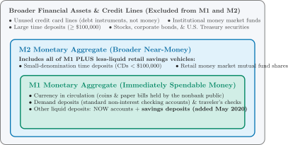
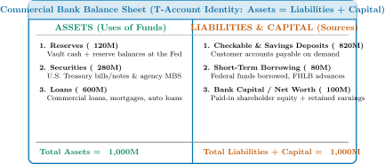
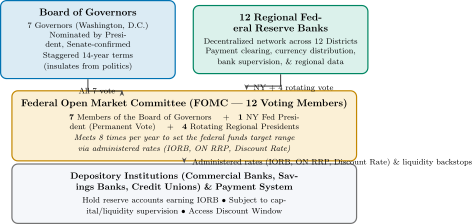

\chapter{Money, Banking, and the Federal Reserve System}

\begin{learningbox}
**Course Learning Outcomes:** SFSU \texttt{MA-4}; CCSF \texttt{C2002-2}, \texttt{C2002-3}, \texttt{C2002-4}.

\medskip
After studying this chapter, you will be able to:
[leftmargin=1.5em, itemsep=3pt]
*  Explain the three economic functions of money, compare commodity money with fiat money, and analyze why modern economies rely on fiat currency rather than barter.
*  Classify financial assets into the post-May 2020 Federal Reserve H.6 monetary aggregates (\texttt{M1} and \texttt{M2}) and explain why credit card limits and non-monetary assets are excluded.
*  Construct and interpret a commercial bank T-account balance sheet, tracing how loan origination creates checkable deposits and why modern lending is constrained by capital, liquidity, and borrower demand rather than a mechanical reserve ratio alone.
*  Describe the institutional architecture of the Federal Reserve System (Board of Governors, 12 Regional Federal Reserve Banks, and the FOMC) and explain how deposit insurance, bank capital, and the Discount Window stabilize the banking system.

\end{learningbox}

\begin{bringithome}
If you opened the Federal Reserve Economic Data (FRED) database and plotted the U.S. \texttt{M1} money supply (\texttt{M1SL}) across 2020, you would see a dramatic vertical jump: in April 2020, \texttt{M1} stood at roughly \$4.8 trillion, and in May 2020 it leaped to more than \$16.2 trillion. At first glance, that spike looks like the central bank tripled the stock of spendable cash in a single month.

In reality, no one woke up with triple the money in their pocket. In May 2020, the Federal Reserve revised its H.6 Statistical Release after eliminating Regulation D's six-per-month transfer limit on savings accounts. Because households could now spend directly out of savings deposits without restriction, the Fed reclassified savings deposits from \texttt{M2}-only into \texttt{M1}. Meanwhile, three years later in March 2023, Silicon Valley Bank collapsed in less than 48 hours—not because its assets were worthless on paper, but because uninsured depositors withdrew \$42 billion in a single day while the bank's long-term Treasury bonds had fallen in market value. Understanding how money is defined, how banks transform short-term deposits into long-term loans, and how the Federal Reserve backstops financial stability is the foundation of modern monetary macroeconomics.
\end{bringithome}

## Overview, Core Vocabulary, and Chapter Roadmap

Every macroeconomy depends on an invisible infrastructure that allows millions of strangers to trade goods, save for retirement, and finance business investment without knowing one another personally. That infrastructure rests on two institutions: **money** and **financial intermediaries**. Without money, trade collapses into barter; without banks and capital markets, household savings sit idle instead of funding productive factories, housing, and technology.

### Key Vocabulary {.unnumbered}
\begin{description}[leftmargin=1.5em, style=nextline, itemsep=4pt]
Barter  The direct exchange of one good or service for another without using money; requires a *double coincidence of wants*.
Medium of Exchange  Anything widely accepted as payment for goods, services, and debts.
Unit of Account  A standardized yardstick used to quote prices, record debts, and measure economic value.
Store of Value  An asset that preserves purchasing power from the present into the future.
Commodity Money  An item used as money that also possesses intrinsic value in non-monetary uses (such as gold or silver coins).
Fiat Money  Currency established as legal tender by government decree that has no intrinsic commodity value and is not backed by physical gold or silver.
Liquidity  The ease, speed, and low transaction cost with which an asset can be converted into a spendable medium of exchange without losing nominal value.
M1  The narrowest official Federal Reserve monetary aggregate, consisting of currency in circulation, traveler's checks, demand deposits, and other liquid deposits (including savings deposits since May 2020).
M2  A broader monetary aggregate equal to \texttt{M1} plus small-denomination time deposits (under \$100,000) and retail money market mutual fund shares.
Reserves  Vault cash held by commercial banks plus deposit balances commercial banks hold in their accounts at a Federal Reserve Bank.
Bank Capital (Net Worth)  The residual claim of bank owners: $\text{Assets} - \text{Liabilities}$. Serves as the primary buffer absorbing loan losses before depositors are harmed.
Federal Open Market Committee (FOMC)  The 12-member policymaking body of the Federal Reserve System that sets the target range for the federal funds rate and directs monetary policy implementation.
Ample-Reserves Operating Regime  The post-2020 Federal Reserve framework in which the banking system holds abundant reserves and the Fed steers the federal funds rate primarily through administered rates—**Interest on Reserve Balances (IORB)**, the **Overnight Reverse Repurchase Agreement (ON RRP)** facility, and the **Discount Window**—rather than rationing scarce reserves.
\end{description}

## Functions of Money and Post-2020 Monetary Aggregates

### Conceptual Introduction {.unnumbered}

Imagine an economy without money. A software engineer who wants groceries must find a grocer who simultaneously happens to need debugging services at that exact moment. Economists call this obstacle the **double coincidence of wants**. Searching for trading partners wastes enormous time, prevents workers from specializing in what they do best, and makes long-term credit contracts nearly impossible. Money solves this coordination failure by serving three distinct economic functions:

[leftmargin=1.5em, itemsep=4pt]
*  **Medium of Exchange:** Money is universally accepted in settlement of transactions. The software engineer sells labor for dollars and uses those dollars to buy groceries from any store, severing the need for bilateral barter.
*  **Unit of Account:** Money provides a common denominator for measuring value. In a barter economy with $N$ goods, traders must track $\frac{N(N-1)}{2}$ relative prices (for 1,000 goods, that equals 499,500 exchange ratios). When every good is priced in dollars, only $N = 1,000$ prices are needed.
*  **Store of Value:** Money allows households to separate the timing of earning income from the timing of spending it. While real estate, corporate equities, and Treasury bonds also serve as stores of value, money is unique because it combines value storage with immediate **liquidity**—the ability to spend without delay or brokerage fees. Note, however, that inflation erodes money's real purchasing power over time.

Historically, societies used **commodity money**—such as gold, silver, salt, or cattle—whose physical substance had value outside exchange. Commodity money naturally limits government over-issuance, but it is heavy to transport, costly to assay, and leaves the money supply hostage to mining discoveries. Modern economies rely on **fiat money**—paper notes and digital central bank balances declared legal tender by government decree. Fiat money carries zero intrinsic value; its purchasing power rests entirely on collective trust, legal tender laws, and disciplined central bank stewardship of price stability.

To track how much spendable purchasing power circulates in the U.S. economy, the Federal Reserve publishes monthly statistical releases measuring two nested monetary aggregates, \texttt{M1} and \texttt{M2}, ordered by liquidity:
[leftmargin=1.5em, itemsep=3pt]
*  **M1 (Most Liquid Spendable Balances):** Includes physical currency in circulation outside banks, traveler's checks, demand deposits (traditional checking accounts), and *other liquid deposits*—a category created in May 2020 that combines Negotiable Order of Withdrawal (NOW) accounts and household savings deposits.
*  **M2 (Broader Near-Money Balances):** Includes everything in \texttt{M1} plus assets that can be converted into cash quickly with minor restrictions or small early-withdrawal penalties: small-denomination time deposits (certificates of deposit under \$100,000) and retail money market mutual fund balances.

Crucially, **credit cards are not money**. Swiping a credit card creates an instant short-term loan from the card-issuing bank to the buyer; the buyer still must settle that debt later using checking funds inside \texttt{M1}. Similarly, debit cards are not a separate component of the money supply—they are simply electronic keys that access existing checking balances already counted in \texttt{M1}.

### Visual Representation {.unnumbered}

Figure 1 illustrates the nested relationship between \texttt{M1}, \texttt{M2}, and non-monetary financial instruments or credit lines under the post-May 2020 Federal Reserve H.6 framework. Every dollar in \texttt{M1} is automatically part of \texttt{M2}, whereas credit card limits, corporate bonds, and equities lie entirely outside both aggregates.

{fig-alt="Nested Architecture of Post-May 2020 U.S. Monetary Aggregates (\texttt{M1} \subset \texttt{M2}) and Excluded Instruments."}

### Mathematical Foundation {.unnumbered}

Formally, the two monetary aggregates are defined by additive accounting identities:

$$
M1 = C + DD + OLD
\label{eq:m1_def}
$$

where $C$ is currency in circulation outside depository institutions, $DD$ is demand deposits (plus traveler's checks), and $OLD$ is other liquid deposits (including savings deposits and NOW accounts).

The broader aggregate $M2$ builds directly on $M1$:

$$
M2 = M1 + STD + RMMF
\label{eq:m2_def}
$$

where $STD$ represents small-denomination time deposits ($< \$100{,}000$) and $RMMF$ represents retail money market mutual fund balances. Notice that vault cash held inside commercial banks is *excluded* from $C$ (and therefore excluded from both $M1$ and $M2$) so that the same dollar is never double-counted as both bank vault cash and a customer checking deposit.

\begin{workitout}[Work It Out 11.1: Calculating Post-May 2020 M1 and M2]
Suppose a simplified national monetary report lists the following balances (in billions of dollars):
\begin{center}
\begin{tabular}{lr}
\toprule
**Financial Item** & **Amount (\$ Billions)** \\
\midrule
Currency in circulation outside banks ($C$) & \$2,250 \\
Vault cash held inside commercial banks & \$95 \\
Demand deposits ($DD$) & \$5,100 \\
Savings deposits & NOW accounts ($OLD$) & \$10,450 \\
Small-denomination time deposits ($<\$100{,}000$) & \$1,120 \\
Retail money market mutual funds & \$1,680 \\
Unused household credit card limits & \$4,300 \\
Large-denomination time deposits ($\ge \$100{,}000$) & \$2,150 \\
\bottomrule
\end{tabular}
\end{center}

**Step 1: Filter out non-monetary items and bank vault cash.**
[leftmargin=1.5em, itemsep=2pt]
*  Unused credit card limits (\$4,300B) are lines of credit, not money $\rightarrow$ *exclude*.
*  Large time deposits $\ge \$100{,}000$ (\$2,150B) are institutional holdings outside retail M2 $\rightarrow$ *exclude*.
*  Vault cash (\$95B) sits inside bank vaults rather than public circulation $\rightarrow$ *exclude to prevent double counting*.

**Step 2: Compute $M1$ using Equation~\eqref{eq:m1_def}.**

$$
M1 = C + DD + OLD = \$2{,}250 + \$5{,}100 + \$10{,}450 = \$17{,}800\text{ billion (\$17.80 trillion)}
$$

**Step 3: Compute $M2$ using Equation~\eqref{eq:m2_def}.**

$$
M2 = M1 + STD + RMMF = \$17{,}800 + \$1{,}120 + \$1{,}680 = \$20{,}600\text{ billion (\$20.60 trillion)}
$$

\end{workitout}

\begin{fredbox}[Tracking Monetary Aggregates in FRED: \texttt{M1SL} and \texttt{M2SL}]
When analyzing U.S. monetary trends on the Federal Reserve Bank of St. Louis FRED portal, economists examine two flagship monthly series:
[leftmargin=1.5em, itemsep=2pt]
*  \texttt{M1SL}: M1 Money Stock (Seasonally Adjusted, Billions of Dollars).
*  \texttt{M2SL}: M2 Money Stock (Seasonally Adjusted, Billions of Dollars).

**Critical Empirical Break (May 2020):** Before May 2020, Federal Reserve Regulation D capped convenient transfers from savings accounts at six per month, so savings deposits were counted in \texttt{M2SL} but excluded from \texttt{M1SL}. In April 2020, the Board of Governors suspended the six-transfer limit to help households manage pandemic liquidity needs, and in May 2020 the H.6 release merged savings deposits into \texttt{M1SL}. Consequently, \texttt{M1SL} jumped from roughly \$4.8 trillion to \$16.2 trillion in a single month, whereas \texttt{M2SL} showed no artificial discontinuity because savings accounts were already inside \texttt{M2SL}. Whenever researchers compare \texttt{M1SL} across 2020, they must account for this definitional reclassification rather than mistaking it for an overnight printing surge.
\end{fredbox}

## Financial Intermediation, Bank Balance Sheets, and Deposit Creation

### Conceptual Introduction {.unnumbered}

Commercial banks are not mere warehouses that lock customer cash in underground vaults. Instead, banks operate as **financial intermediaries** that pool funds from millions of savers and channel them to creditworthy households, homebuyers, and businesses. In doing so, banks perform three vital economic transformations:
[leftmargin=1.5em, itemsep=3pt]
*  **Maturity Transformation:** Banks accept short-term liabilities that depositors can withdraw on demand (checking and savings accounts) and originate long-term illiquid assets (30-year mortgages and 5-year business loans).
*  **Risk Diversification and Screening:** Individual savers lack the expertise to audit borrower creditworthiness and would suffer catastrophic losses if one borrower defaulted. Banks screen applicants and hold diversified loan portfolios across thousands of borrowers.
*  **Liquidity Creation and Payment Clearing:** Checking deposits created through bank lending circulate directly as part of \texttt{M1}, settling payrolls, utility bills, and commercial invoices across the economy.

Because banks borrow short and lend long, they must continuously manage two distinct vulnerabilities:
[leftmargin=1.5em, itemsep=3pt]
*  **Liquidity Risk:** The danger that a bank lacks sufficient immediately available cash or reserves to meet sudden deposit withdrawals, even if its long-term loans are fundamentally sound.
*  **Credit (Insolvency) Risk:** The danger that borrowers default on loans—or that market interest rate spikes depress bond values—causing the true value of a bank's assets to fall below its liabilities and wiping out **bank capital (net worth)**.

**How Banks Actually Create Money:** When a commercial bank approves a \$100,000 business loan, it does not hand out suitcases of paper currency from a vault. Instead, the bank makes two simultaneous accounting entries: it records a new \$100,000 loan on the asset side of its balance sheet and credits \$100,000 to the borrower's checking account on the liability side. Because checking deposits are counted in \texttt{M1}, *commercial bank lending directly creates new checkable money*. Conversely, when borrowers repay loan principal, checkable deposits are extinguished.

In traditional textbooks, deposit creation is often illustrated through a mechanical **simple deposit multiplier** ($1 / rr$, where $rr$ is the required reserve ratio). In modern banking systems—including the United States, where the Federal Reserve reduced reserve requirement ratios to **0\%** in March 2020 and operates in an ample-reserves regime—that mechanical formula represents only a stylized theoretical upper bound under strict assumptions. In reality, commercial bank lending is constrained by:
[leftmargin=1.5em, itemsep=2pt]
*  Regulatory **capital adequacy ratios** (risk-weighted equity buffers),
*  Internal and regulatory **liquidity buffers** to cover interbank clearing outflows when borrowers spend their new deposits at other banks,
*  Borrower demand for credit at prevailing interest rates and bank underwriting standards.

### Visual Representation {.unnumbered}

Figure 2 displays a stylized commercial bank **T-account** balance sheet, separating economic resources owned by the bank (**Assets**) on the left from claims against those resources (**Liabilities** and **Bank Capital**) on the right.

{fig-alt="Commercial Bank T-Account Balance Sheet Showing Assets, Liabilities, and Bank Capital."}

### Mathematical Foundation {.unnumbered}

Every commercial bank must satisfy the fundamental balance sheet accounting identity at every instant:

$$
\underbrace{R + S + L}_{\text{Total Assets}} \equiv \underbrace{D + B}_{\text{Total Liabilities}} + \underbrace{K}_{\text{Bank Capital}}
\label{eq:bank_balance_sheet}
$$

where $R$ is total reserves (vault cash plus deposits at the Federal Reserve), $S$ is marketable securities, $L$ is loans, $D$ is customer deposits, $B$ is non-deposit borrowing, and $K$ is bank capital (net worth). Rearranging Equation~\eqref{eq:bank_balance_sheet} defines bank capital as a residual cushion:

$$
K = (R + S + L) - (D + B)
\label{eq:bank_capital}
$$

Because customer deposits $D$ are fixed nominal promises, any dollar decline in asset value ($\Delta L < 0$ or $\Delta S < 0$) reduces bank capital dollar-for-dollar ($\Delta K = \Delta \text{Assets}$) until $K$ reaches zero.

**Stylized Deposit Expansion Benchmark:** Under classical textbook assumptions—(i) banks hold zero excess reserves above a strictly binding required reserve ratio $rr \in (0, 1)$, (ii) the public holds zero additional currency ($c = 0$), and (iii) borrower demand absorbs every available dollar—an initial injection of $\Delta R$ in new reserves can support a maximum theoretical deposit expansion of:

$$
\Delta D_{\max} = \left(\frac{1}{rr}\right) \Delta R
\label{eq:simple_multiplier}
$$

Whenever banks hold voluntary liquidity buffers ($e > 0$), households hold cash ($c > 0$), or capital requirements bind, actual deposit creation is strictly smaller than $(1/rr)\Delta R$.

\begin{workitout}[Work It Out 11.2: Tracing Loan Creation, Interbank Clearing, and Loan Default]
Begin with the commercial bank balance sheet in Figure 2:

$$
\text{Assets: } R = \$120\text{M},\; S = \$280\text{M},\; L = \$600\text{M} \quad|\quad
\text{Liabilities & Capital: } D = \$820\text{M},\; B = \$80\text{M},\; K = \$100\text{M}
$$

**Part A: Loan Origination (\$50M New Business Loan).**
The bank approves a \$50M loan to a local manufacturer and credits the borrower's checking account:
[leftmargin=1.5em, itemsep=2pt]
*  Loans $L$ rise from \$600M to $\$650\text{M}$ ($+\$50\text{M}$).
*  Checkable deposits $D$ rise from \$820M to $\$870\text{M}$ ($+\$50\text{M}$).
*  Total Assets $= \$120\text{M} + \$280\text{M} + \$650\text{M} = \$1{,}050\text{M}$; Total Liabilities + Capital $= \$870\text{M} + \$80\text{M} + \$100\text{M} = \$1{,}050\text{M}$. The \texttt{M1} money supply has increased by \$50M.

**Part B: Interbank Settlement (Borrower Spends \$50M at a Supplier Using Another Bank).**
When the manufacturer writes a \$50M check to a supplier whose account is at Bank B, the Federal Reserve clears the payment by transferring \$50M of reserves from our bank's Fed account to Bank B's Fed account:
[leftmargin=1.5em, itemsep=2pt]
*  Reserves $R$ fall from \$120M to $\$70\text{M}$ ($-\$50\text{M}$).
*  Deposits $D$ fall from \$870M back to $\$820\text{M}$ ($-\$50\text{M}$).
*  Notice why liquidity matters: if our bank had held only \$30M in reserves before making the loan, it would have suffered a \$20M reserve shortfall during interbank clearing!

**Part C: Credit Loss Absorption (\$40M Loan Default).**
Suppose \$40M of existing loans default and are written off as uncollectible:
[leftmargin=1.5em, itemsep=2pt]
*  Loans $L$ fall from \$650M to $\$610\text{M}$ ($-\$40\text{M}$).
*  Depositors' legal claims ($D = \$820\text{M}$) do not shrink when another borrower defaults; instead, **Bank Capital $K$** absorbs the loss, falling from \$100M to $\$60\text{M}$ ($-\$40\text{M}$). Because $K = \$60\text{M} > 0$, the bank remains solvent and depositors suffer zero loss.

\end{workitout}

\begin{clearitup}[Why Do Banks Fail? Illiquidity vs. Insolvency (March 2023 Case)]
Students often assume a bank fails only when its borrowers stop repaying loans. In practice, a bank can collapse from either **insolvency** or **acute illiquidity**:
[leftmargin=1.5em, itemsep=3pt]
*  **Insolvency (Capital Depletion):** Suppose a bank holds \$1,000M in assets, \$900M in deposits, and \$100M in capital. If \$120M of commercial real estate loans default, total assets fall to \$880M. Because deposits remain \$900M, bank capital becomes $-\$20\text{M}$—the bank cannot pay all depositors even if given years to liquidate.
*  **Illiquidity and Fire-Sale Losses:** In 2022–2023, Silicon Valley Bank (SVB) held massive portfolios of long-term U.S. Treasury and agency bonds with minimal default risk, funded largely by uninsured corporate tech deposits exceeding the \$250,000 FDIC insurance cap. When the Federal Reserve raised interest rates sharply in 2022, the market value of SVB's fixed-rate bonds fell. When nervous tech depositors initiated \$42 billion in withdrawals on March 9, 2023, SVB was forced to sell bonds at steep realized losses, wiping out its equity buffer and triggering regulatory closure the next morning.

\end{clearitup}

\begin{advancedbox}
In a system where the public holds currency in fixed proportion $c = C/D$ to checkable deposits, banks must hold required reserves $rr \cdot D$, and banks voluntarily hold excess liquidity reserves $e \cdot D$, total central bank base money ($MB = C + R$) equals:

$$
MB = cD + rrD + eD = (c + rr + e)D
$$

Solving for checkable deposits $D$ yields the **generalized money multiplier** $m(rr, e, c)$:

$$
D = \left(\frac{1}{rr + e + c}\right) MB \quad \Longrightarrow \quad M1 = C + D = \left(\frac{1 + c}{rr + e + c}\right) MB
$$

Notice that when $c = 0$ and $e = 0$, this expression collapses to the simple deposit multiplier $1/rr$. Taking partial derivatives with respect to excess reserves $e$ and the currency-deposit ratio $c$ demonstrates why the multiplier breaks down in an ample-reserves regime:

$$
\frac{\partial m}{\partial e} = -\frac{1 + c}{(rr + e + c)^2} < 0, \qquad
\frac{\partial m}{\partial c} = \frac{rr + e - 1}{(rr + e + c)^2} < 0 \quad (\text{whenever } rr + e < 1).
$$

Whenever banks hold abundant excess reserves ($e$ is large) or households hold more currency ($c$ rises), the multiplier $m$ shrinks monotonically, severing any mechanical link between base money $MB$ and $M1$.
\end{advancedbox}

## Institutional Structure and Roles of the Federal Reserve System

### Conceptual Introduction {.unnumbered}

Established by Congress through the Federal Reserve Act of 1913 following recurring 19th- and early-20th-century banking panics, the **Federal Reserve System (the Fed)** serves as the central bank of the United States. Unlike a commercial bank—which maximizes shareholder profit by taking deposits from households and making loans to businesses—a central bank is a public-purpose monetary authority that issues base money, conducts monetary policy, supervises banking institutions, and acts as the **lender of last resort** during financial crises.

Congress designed the Federal Reserve with a distinctive hybrid structure that blends public accountability in Washington, D.C., with decentralized regional input across the country:
[leftmargin=1.5em, itemsep=3pt]
*  **Board of Governors (Washington, D.C.):** A federal government agency consisting of seven Governors nominated by the President of the United States and confirmed by the U.S. Senate. Governors serve staggered **14-year non-renewable terms** (one expiring every two years) so that no single presidential administration can pack the Board to engineer short-term pre-election inflation. The Chair and Vice Chairs are appointed from among the Governors for four-year terms.
*  **Twelve Regional Federal Reserve Banks:** Located in Boston, New York, Philadelphia, Cleveland, Richmond, Atlanta, Chicago, St. Louis, Minneapolis, Kansas City, Dallas, and San Francisco. These quasi-public institutions clear interbank payments, distribute physical currency, supervise regional member banks, and gather local economic intelligence (published in the *Beige Book*).
*  **Federal Open Market Committee (FOMC):** The Fed's core monetary policymaking committee, composed of **12 voting members**: all 7 members of the Board of Governors, the President of the Federal Reserve Bank of New York (who holds a permanent vote because market operations are executed through the New York Fed's trading desk), and 4 of the remaining 11 Regional Reserve Bank Presidents serving on an annual rotating basis (though all 12 presidents attend and deliberate at every FOMC meeting).

**Monetary Policy Implementation in the Post-2020 Ample-Reserves Regime:** Historically, textbooks described the Fed steering interest rates by rationing scarce bank reserves through daily open market purchases and sales. Since 2008—and formally institutionalized alongside the March 2020 reduction of reserve requirements to 0\%—the Federal Reserve operates in an **ample-reserves regime**. Rather than fine-tuning scarce reserves, the Fed controls the federal funds rate primarily through three **administered rates** (analyzed graphically in Chapter~12):
[leftmargin=1.5em, itemsep=3pt]
*  **Interest on Reserve Balances (IORB):** The interest rate the Federal Reserve pays depository institutions on reserves held in their Fed accounts, which serves as the primary anchor for banks' willingness to lend overnight.
*  **Overnight Reverse Repurchase Agreement (ON RRP) Facility:** An overnight facility offering a safe administered interest rate to eligible nonbank financial institutions (such as money market mutual funds and government-sponsored enterprises), establishing a firm floor under short-term market rates.
*  **Discount Window (Primary Credit Rate):** The administered rate at which sound depository institutions can borrow overnight reserves directly from their Regional Federal Reserve Bank against pledged collateral, functioning as both an upper ceiling on interbank rates and the Fed's lender-of-last-resort backstop.

Beyond setting monetary policy, the Federal Reserve and allied regulators maintain a three-pillar safety net to prevent contagious bank runs:
[leftmargin=1.5em, itemsep=3pt]
*  **Deposit Insurance (FDIC):** The Federal Deposit Insurance Corporation insures deposits up to \$250,000 per depositor, per insured bank, per ownership category, removing the incentive for retail households to panic when rumors circulate.
*  **Prudential Capital and Liquidity Supervision:** Regulators require banks to maintain minimum equity capital ratios (so shareholders absorb loan losses first) and hold High-Quality Liquid Assets (HQLA) to survive short-term cash outflows.
*  **Lender of Last Resort (The Discount Window):** If an otherwise solvent bank experiences a sudden liquidity squeeze, it can pledge sound collateral to its Regional Federal Reserve Bank and borrow reserves overnight at the **discount rate**, preventing destructive fire sales of assets.

### Visual Representation {.unnumbered}

Figure 3 maps the institutional architecture of the Federal Reserve System and shows how the Board of Governors and the 12 Regional Federal Reserve Banks converge inside the 12-member FOMC.

{fig-alt="Institutional Structure of the Federal Reserve System and Composition of the FOMC."}

### Mathematical Foundation {.unnumbered}

At the system-wide level, the Federal Reserve's own balance sheet anchors the **monetary base** ($MB$), also called high-powered money:

$$
MB = C + R
\label{eq:monetary_base}
$$

where $C$ is currency in public circulation and $R$ is total depository institution reserves held at the Federal Reserve (plus vault cash). When the Federal Reserve purchases Treasury securities from the banking system or lends reserves through the Discount Window, total reserves $R$ increase dollar-for-dollar, expanding the monetary base $MB$ and increasing the banking system's aggregate liquidity.

Meanwhile, bank regulators evaluate solvency resilience using the **Tier 1 Leverage Ratio**:

$$
\text{Capital Ratio} = \frac{K}{\text{Total Assets}} = \frac{(R + S + L) - (D + B)}{R + S + L}
\label{eq:capital_ratio}
$$

For example, if a bank holds \$100M in capital against \$1,000M in total assets, its capital ratio is $100 / 1{,}000 = 10.0\%$. This ratio tells regulators immediately that the bank can absorb up to a $10.0\%$ decline in total asset value before its net worth hits zero.

\begin{workitout}[Work It Out 11.3: Evaluating Bank Capital Ratios and Discount Window Liquidity]
Suppose Regional Bank X has the following initial balance sheet (in millions of dollars):

$$
R = \$40\text{M},\; S = \$160\text{M},\; L = \$600\text{M} \quad|\quad
D = \$700\text{M},\; B = \$36\text{M},\; K = \$64\text{M}
$$

**Step 1: Compute Regional Bank X's initial capital ratio using Equation~\eqref{eq:capital_ratio}.**

$$
\text{Total Assets} = \$40 + \$160 + \$600 = \$800\text{M}
$$

$$
\text{Initial Capital Ratio} = \frac{\$64\text{M}}{\$800\text{M}} = 0.08 = 8.0\%
$$

**Step 2: Suppose \$50M of uninsured depositors withdraw funds immediately.**
Bank X holds only \$40M in reserves ($R = \$40\text{M}$), so it faces a \$10M immediate cash shortfall. Rather than selling illiquid loans at a fire-sale discount, Bank X pledges \$15M of its Treasury securities ($S$) as collateral at the Federal Reserve's **Discount Window** and borrows \$10M in reserves ($B$ increases from \$36M to \$46M; $R$ temporarily rises by \$10M to pay the remaining depositors).
[leftmargin=1.5em, itemsep=2pt]
*  After the \$50M withdrawal settles: $R = \$0\text{M}$, $S = \$160\text{M}$, $L = \$600\text{M}$ (Total Assets $= \$760\text{M}$).
*  Liabilities & Capital: $D = \$650\text{M}$, $B = \$46\text{M}$, $K = \$64\text{M}$ (Total $= \$760\text{M}$).
*  Notice that Discount Window lending resolved the **liquidity** crunch without destroying any bank capital ($K$ remains \$64M, and the capital ratio is now $\$64\text{M} / \$760\text{M} \approx 8.42\%$).

\end{workitout}

\begin{clearitup}[Distinguishing Bank Reserves from Bank Capital]
Students and news commentators frequently confuse **bank reserves** with **bank capital**, yet they sit on opposite sides of a bank's balance sheet and solve completely different problems:
\begin{center}
\begin{tabular}{p{3.1cm}p{5.5cm}p{5.5cm}}
\toprule
**Dimension** & **Bank Reserves ($R$)** & **Bank Capital / Net Worth ($K$)** \\
\midrule
**Balance Sheet Side** & **Asset** (vault cash + Fed account balance) & **Equity / Net Worth** ($\text{Assets} - \text{Liabilities}$) \\
**Economic Purpose** & Meets day-to-day customer cash withdrawals and interbank clearing outflows & Absorbs loan defaults and security losses so depositors remain protected \\
**Failure Mode if Depleted** & **Illiquidity** (can be bridged by borrowing against good collateral at the Fed Discount Window) & **Insolvency** (assets are worth less than liabilities; requires recapitalization or FDIC resolution) \\
\bottomrule
\end{tabular}
\end{center}
\end{clearitup}

## Chapter Summary and Review Problems

### Key Takeaways {.unnumbered}
[leftmargin=1.5em, itemsep=3pt]
*  **Three Functions of Money:** Money serves as a *medium of exchange* (eliminating barter's double coincidence of wants), a *unit of account* (standardizing prices), and a *store of value* (preserving liquid purchasing power). Modern economies use *fiat money* rather than *commodity money*.
*  **Post-May 2020 Monetary Aggregates:** \texttt{M1} measures immediately spendable funds—currency in circulation, demand deposits, traveler's checks, and other liquid deposits (including savings accounts since May 2020). \texttt{M2} equals \texttt{M1} plus small time deposits ($<\$100{,}000$) and retail money market funds. Credit card limits are lines of credit, not money.
*  **Bank Balance Sheets and Deposit Creation:** Banks satisfy $\text{Assets} \equiv \text{Liabilities} + \text{Bank Capital}$. Commercial banks create checkable deposits when they originate loans, but real-world lending is bounded by capital adequacy, liquidity buffers for interbank clearing, and credit demand rather than a mechanical $1/rr$ deposit multiplier.
*  **The Federal Reserve System & Post-2020 Ample-Reserves Regime:** Comprises the 7-member Board of Governors (14-year staggered terms), 12 Regional Federal Reserve Banks, and the 12-member FOMC. The Fed steers short-term interest rates via administered rates—**IORB**, **ON RRP**, and the **Discount Window**—while reinforcing financial stability through FDIC deposit insurance and capital/liquidity supervision.

### Check Your Understanding {.unnumbered}

[leftmargin=1.5em, itemsep=6pt]
*  **Classifying Monetary Aggregates:** Identify whether each of the following items is included in \texttt{M1} (and therefore also \texttt{M2}), included in \texttt{M2} only, or excluded from both:
[label=(\alph*), itemsep=2pt]
*  A \$50 bill in your wallet.
*  \$3,200 in an online household savings account (post-May 2020 H.6 definition).
*  \$15,000 in a 12-month retail Certificate of Deposit (CD).
*  \$8,000 of available credit on a Visa credit card.
*  \$400 in cash sitting inside a commercial bank's ATM vault.

*  **Balance Sheet and Deposit Creation:** A commercial bank holds \$90M in reserves, \$210M in Treasury securities, and \$500M in loans, funded by \$680M in deposits, \$40M in short-term borrowing, and \$80M in bank capital.
[label=(\alph*), itemsep=2pt]
*  Verify the balance sheet identity and calculate the bank's initial capital ratio ($K / \text{Assets}$).
*  Suppose the bank originates a \$30M commercial loan by crediting the borrower's checking account. Show the immediate effect on \texttt{M1} and on the bank's balance sheet before the borrower spends the funds.
*  Next, suppose \$55M of the bank's existing loans default and are written off. What happens to bank capital, and is the bank still solvent?

*  **Federal Reserve Governance and Stability:**
[label=(\alph*), itemsep=2pt]
*  Explain why Congress gave members of the Federal Reserve Board of Governors 14-year staggered terms and included both Governors and Regional Reserve Bank Presidents on the FOMC.
*  Why can a solvent bank with positive bank capital still fail during a sudden deposit run if it lacks access to a lender of last resort?

### Solutions to Check Your Understanding {.unnumbered}

[leftmargin=1.5em, itemsep=6pt]
*  **Classifying Monetary Aggregates:**
[label=(\alph*), itemsep=2pt]
*  **Included in \texttt{M1} (and \texttt{M2}):** Currency in circulation outside banks is a core component of \texttt{M1}.
*  **Included in \texttt{M1} (and \texttt{M2}):** Since May 2020, household savings deposits are classified under other liquid deposits inside \texttt{M1}.
*  **Included in \texttt{M2} only:** Small-denomination time deposits ($<\$100{,}000$) are part of \texttt{M2} but excluded from \texttt{M1}.
*  **Excluded from both:** Unused credit card limits represent borrowing capacity (debt), not an existing monetary asset.
*  **Excluded from both:** Vault cash inside depository institutions is part of bank reserves ($R$), not currency in public circulation ($C$).

*  **Balance Sheet and Deposit Creation:**
[label=(\alph*), itemsep=2pt]
*  $\text{Total Assets} = \$90 + \$210 + \$500 = \$800\text{M}$; $\text{Liabilities + Capital} = \$680 + \$40 + \$80 = \$800\text{M}$. Initial capital ratio $= \$80\text{M} / \$800\text{M} = 10.0\%$.
*  Loans rise from \$500M to \$530M and checkable deposits rise from \$680M to \$710M (Total Assets $=$ Total Liabilities + Capital $= \$830\text{M}$). Because checkable deposits are part of \texttt{M1}, the \texttt{M1} money supply increases by \$30M.
*  Writing off \$55M in loans reduces Loans from \$530M to \$475M (Total Assets fall by \$55M to \$775M). Bank capital absorbs the entire \$55M loss, dropping from \$80M to $\$25\text{M}$. Because $K = \$25\text{M} > 0$, the bank remains solvent, though its capital ratio falls to $\$25\text{M} / \$775\text{M} \approx 3.23\%$.

*  **Federal Reserve Governance and Stability:**
[label=(\alph*), itemsep=2pt]
*  Staggered 14-year terms insulate monetary policymakers from short-term electoral pressure to overstimulate the economy before elections. Combining the Washington-based Board of Governors with Regional Reserve Bank Presidents balances national public oversight with decentralized economic intelligence from all 12 Federal Reserve Districts.
*  Because banks transform short-term demand deposits into long-term illiquid loans and bonds, a sudden surge in withdrawals can exhaust cash reserves ($R$). Forced rapid asset sales ("fire sales") depress asset prices below fundamental value, turning a temporary liquidity shortage into realized capital losses and insolvency unless the central bank lends reserves against sound collateral via the Discount Window.
