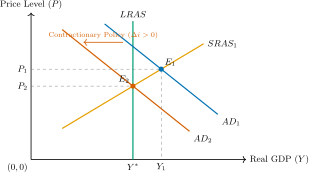

\begin{center}
{**\textcolor{oiBlue}{MACROECONOMICS $\cdot$ MODULE MA-6 $\cdot$ COURSE CODE C2002-3}**}\\[0.35em]
{\LARGE**Chapter 12: Monetary Policy**}\\[0.35em]
{\normalsize*Money Demand, the Ample-Reserves Corridor, Aggregate Demand Transmission, and Long-Run Neutrality*}
\end{center}

\begin{pedbox}{oiBlue}{boxTintBlue}{Chapter Learning Objectives}
After completing this chapter, you will be able to:
[leftmargin=1.4em, itemsep=0.25em]
*  **Explain the Demand for Money:** Distinguish between the transactions, precautionary, and speculative motives for holding money, and identify how changes in nominal interest rates, real income, and the price level affect the money demand curve.
*  **Analyze the Ample-Reserves Operating Regime:** Explain how the Federal Reserve sets the federal funds rate within an administered-rate corridor using Interest on Reserve Balances (\texttt{IORB}), the Overnight Reverse Repurchase Agreement (\texttt{ON RRP}) facility, and the Discount Rate.
*  **Trace Monetary Policy Transmission:** Model how changes in policy interest rates alter investment and consumption, shift Aggregate Demand ($AD$), close output gaps, and operate under Taylor-type policy rules and the Effective Lower Bound (\texttt{ELB}).
*  **Evaluate Long-Run Monetary Neutrality:** Use the Quantity Theory of Money to demonstrate why sustained changes in the money supply affect nominal prices and inflation in the long run without permanently altering potential real GDP ($Y^*$).

\end{pedbox}

\begin{pedbox}{oiOrange}{boxTintAmber}{Bring It Home: Why Did Borrowing Costs Surge Between 2022 and 2024?}
In early 2021, a thirty-year fixed-rate mortgage in the United States carried an interest rate below $3\%$, and annual consumer price inflation was just beginning to climb above the Federal Reserve's $2\%$ target. By mid-2022, inflation measured by the Consumer Price Index (\texttt{CPIAUCSL}) reached $9.1\%$—its highest reading in four decades. Over sixteen months, the Federal Reserve raised its target range for the federal funds rate (\texttt{FEDFUNDS}) eleven times, lifting it from near $0\%$ to $5.25\%$–$5.50\%$.

Unlike in prior decades, the Federal Reserve did not have to drain hundreds of billions of dollars of bank reserves just to nudge overnight rates upward; commercial banks already held trillions of dollars in reserves. How does a central bank raise interest rates across an entire economy when the banking system is flush with liquidity? And once those higher rates take hold, how do they cool inflation without triggering a severe recession? Answering these questions requires tracing the full chain of modern monetary policy.
\end{pedbox}

## The Demand for Money

### Conceptual Introduction {.unnumbered}
In everyday speech, people say they ``want more money'' when they actually mean they want higher income or greater wealth. In macroeconomics, the **demand for money** ($MD$) has a much more specific meaning: it is the portion of total financial wealth that households and firms choose to hold in liquid monetary assets—currency in circulation and checkable bank deposits—rather than in less liquid, interest-bearing assets such as Treasury bills, corporate bonds, or equity shares.

Choosing how much money to hold involves a fundamental trade-off between **liquidity** and **opportunity cost**. Money is immediately accepted for settling transactions without conversion fees or price risk, whereas bonds must be sold or matured before their proceeds can be spent. However, cash pays zero nominal interest, and checking accounts typically pay minimal interest compared to short-term government securities. Consequently, the nominal interest rate ($i$) on non-monetary assets represents the opportunity cost of holding money. When $i$ rises, holding cash becomes more expensive in terms of forgone interest income, prompting households and firms to economize on cash balances and shift funds into interest-bearing accounts.

Economists group the reasons people hold money into three classic motives:
[leftmargin=1.4em, itemsep=0.25em]
*  **Transactions Motive:** Households and businesses hold money to bridge the timing gap between receiving income (such as biweekly paychecks) and paying routine expenses (groceries, rent, payroll). Higher nominal spending requires larger transaction balances.
*  **Precautionary Motive:** Individuals and firms maintain liquid reserves as a buffer against unexpected expenses, medical emergencies, or sudden delays in customer payments.
*  **Speculative (Portfolio) Motive:** Investors hold money as a safe, zero-duration store of value when bond prices are expected to fall (i.e., when market interest rates are expected to rise) or when financial market volatility spikes.

Because the quantity of money demanded falls as the nominal interest rate rises (holding real income and the price level constant), the money demand curve slopes downward. By contrast, an increase in **real GDP** ($Y$) increases the volume of transactions in the economy and shifts the entire $MD$ curve to the right. Similarly, an increase in the **aggregate price level** ($P$) means each basket of goods requires more dollars to purchase, shifting the nominal $MD$ curve to the right in proportion to the price increase.

### Visual Representation {.unnumbered}
Figure 1 illustrates the downward-sloping money demand schedule and the distinction between a movement along the curve versus a shift of the curve. At a lower nominal interest rate ($i_2 < i_1$), the opportunity cost of liquidity falls, causing the quantity of money demanded to increase along $MD_1$ from $M_1$ to $M_2$. Conversely, if real GDP rises or the price level increases, households need more money at every interest rate, shifting the entire schedule rightward from $MD_1$ to $MD_2$.

{fig-alt="The Demand for Money (MD). A decrease in the nominal interest rate from i_1 to i_2 causes a downward movement along MD_1 from point A to point B. An increase in real income (Y) or the aggregate price level (P) shifts the entire curve rightward from MD_1 to MD_2, raising money demand from M_1 to M_3 at interest rate i_1."}

### Mathematical Foundation {.unnumbered}
In linear algebraic form, nominal money demand ($MD$) is proportional to nominal GDP ($P \times Y$) and negatively related to the nominal interest rate ($i$, expressed in percentage points):

$$
MD = P \cdot (k Y - h i)
\label{eq:money_demand}
$$

where $k > 0$ measures the sensitivity of real money demand to real income $Y$, and $h > 0$ measures the sensitivity of real money demand to the nominal interest rate $i$. Dividing both sides by the price level $P$ yields **real money demand** ($MD/P = kY - hi$).

\begin{pedbox}{oiGreen}{boxTintGreen}{Work It Out: Calculating Nominal and Real Money Demand}
**Problem:** Suppose an economy has a price level $P = 1.20$, real GDP $Y = \$20{,}000\text{ billion}$, income sensitivity $k = 0.25$, and interest sensitivity $h = 300$ (where $i$ is entered in percentage points, e.g., $i = 4$ for $4\%$).
[leftmargin=1.4em, itemsep=0.2em]
*  Calculate nominal money demand ($MD$) and real money demand ($MD/P$) when the nominal interest rate is $i = 4\%$.
*  Suppose the Federal Reserve raises interest rates so that $i$ increases to $6\%$, while $P$ and $Y$ remain unchanged. Find the new nominal money demand.

**Step-by-Step Solution:**
[leftmargin=1.4em, itemsep=0.2em]
*  **Initial Equilibrium ($i = 4$):** Substitute $k = 0.25$, $Y = 20{,}000$, $h = 300$, and $i = 4$ into the real money demand expression:

$$
\frac{MD}{P} = (0.25 \times 20{,}000) - (300 \times 4) = 5{,}000 - 1{,}200 = \$3{,}800\text{ billion (in real terms)}
$$

Multiply by the price level $P = 1.20$ to find nominal money demand:

$$
MD = 1.20 \times 3{,}800 = \$4{,}560\text{ billion}
$$

*  **Effect of Higher Interest Rate ($i = 6$):** Recompute real money demand at $i = 6$:

$$
\frac{MD'}{P} = (0.25 \times 20{,}000) - (300 \times 6) = 5{,}000 - 1{,}800 = \$3{,}200\text{ billion}
$$

Multiply by $P = 1.20$:

$$
MD' = 1.20 \times 3{,}200 = \$3{,}840\text{ billion}
$$

Raising the nominal interest rate by $2$ percentage points reduces nominal money demand by $\$4{,}560 - \$3{,}840 = \$720\text{ billion}$, illustrating a movement upward and to the left along the $MD$ curve.

\end{pedbox}

### Real-World Application {.unnumbered}
Financial technology continually reshapes the transactions demand for money. During the late twentieth century, the widespread adoption of Automated Teller Machines (ATMs), credit cards, and money market mutual funds allowed households to keep smaller average checking balances for any given level of income, shifting the $MD$ curve to the left. Conversely, during episodes of acute financial uncertainty—such as March 2020 at the onset of the COVID-19 pandemic—both households and corporations aggressively drew down credit lines and accumulated liquid bank deposits (\texttt{M2SL} rose by more than $25\%$ year-over-year), representing a dramatic rightward shift in precautionary and speculative money demand.

## Monetary Policy Implementation in an Ample-Reserves Regime

### Conceptual Introduction {.unnumbered}
To steer interest rates across the entire economy, the Federal Reserve targets the **federal funds rate** (\texttt{FEDFUNDS})—the overnight interest rate at which commercial banks lend reserve balances held at the Federal Reserve to one another on an uncollateralized basis. Before 2008, bank reserves were scarce, so the Federal Reserve adjusted the federal funds rate by conducting daily open market operations to slightly expand or shrink the supply of reserves along the steep portion of the bank reserve demand curve.

Following the 2008 financial crisis and the 2020 pandemic response, large-scale asset purchases expanded total reserve balances in the U.S. banking system from roughly $\$10\text{ billion}$ to more than $\$3\text{ trillion}$. In this modern **ample-reserves regime**, banks hold far more reserves than needed to meet payment clearing or regulatory liquidity buffers. Consequently, small day-to-day changes in reserve supply no longer move the federal funds rate. Instead, the Federal Reserve controls the federal funds rate directly through an **administered-rate corridor** built on three key policy rates:
[leftmargin=1.4em, itemsep=0.25em]
*  **Interest on Reserve Balances (\texttt{IORB}):** The interest rate the Federal Reserve pays commercial banks on balances kept in their master accounts at regional Federal Reserve Banks. Because any eligible bank can earn the risk-free \texttt{IORB} rate overnight simply by leaving funds at the Fed, no bank will lend reserves in the federal funds market for less than \texttt{IORB}. Thus, \texttt{IORB} acts as the primary anchor (reservation rate) for the federal funds rate.
*  **Overnight Reverse Repurchase Agreement (\texttt{ON RRP}) Facility Rate:** Non-bank financial institutions—such as money market mutual funds and government-sponsored enterprises (GSEs)—cannot earn \texttt{IORB}. Without an alternative floor, these institutions might lend cash to banks below \texttt{IORB}, pulling the federal funds rate down. The \texttt{ON RRP} facility allows eligible non-banks to lend cash overnight to the Federal Reserve against Treasury collateral at a fixed administered rate set slightly below \texttt{IORB}, creating a firm sub-floor for overnight money market rates.
*  **Discount Rate (Primary Credit Rate):** The interest rate at which the Federal Reserve lends reserves directly to sound commercial banks through the Discount Window. Because no bank needs to pay another bank more than the rate charged by the Fed, the Discount Rate forms the ceiling of the interest rate corridor.

\begin{pedbox}{oiPurple}{boxTintGray}{Clear It Up: Scarce Reserves vs. Ample Reserves}
Older textbooks often describe monetary policy as adjusting the reserve ratio or conducting small open market operations to shift a vertical reserve supply curve along a downward-sloping reserve demand curve. Since March 2020, statutory reserve requirements in the United States have been set to $0\%$, and the banking system operates with ample reserves. In an ample-reserves regime, the reserve demand curve is flat at the \texttt{IORB} floor, so the Federal Reserve raises or lowers the federal funds rate simply by raising or lowering its administered rates (\texttt{IORB}, \texttt{ON RRP}, and the Discount Rate) in tandem—without needing to shrink or expand the money supply on a daily basis.
\end{pedbox}

### Visual Representation {.unnumbered}
Figure 2 depicts the market for bank reserves in an ample-reserves regime. The reserve demand curve ($D_R$) slopes downward at very low levels of reserves (the scarce-reserves region), where banks scramble for liquidity and bid rates up toward the Discount Rate ceiling. However, once reserves become abundant, $D_R$ flattens out along the \texttt{IORB} rate (with the \texttt{ON RRP} rate just underneath as a sub-floor). Because the vertical reserve supply curve ($S_R$) intersects $D_R$ on its flat horizontal segment, shifting $S_R$ moderately left or right leaves the equilibrium federal funds rate ($i_{ff}^*$) unchanged at \texttt{IORB}. To tighten policy, the Fed raises the entire corridor (\texttt{Discount Rate}, \texttt{IORB}, and \texttt{ON RRP}), shifting the flat portion of $D_R$ upward.

{fig-alt="The Market for Bank Reserves in an Ample-Reserves Regime. Reserve supply curves S_{R1} and S_{R2} intersect the flat portion of the reserve demand curve D_R, anchoring the equilibrium federal funds rate at \texttt{IORB} (between the \texttt{ON RRP} sub-floor and the Discount Rate ceiling)."}

### Mathematical Foundation {.unnumbered}
In an ample-reserves corridor, arbitrage by commercial banks and non-bank money market funds bounds the effective federal funds rate ($i_{ff}$) strictly between the \texttt{ON RRP} sub-floor and the Discount Rate ceiling ($i_{\text{disc}}$), with a small institutional spread ($s$) below \texttt{IORB} reflecting FDIC deposit insurance fees and balance-sheet costs paid by banks when borrowing from non-banks:

$$
i_{\text{ON RRP}} \le i_{ff} = i_{\text{IORB}} - s \le i_{\text{disc}}
\label{eq:corridor}
$$

Suppose the FOMC sets a target range of $[i_{\text{lower}}, i_{\text{upper}}]$ with width $0.25\text{ percentage points}$ ($25\text{ basis points}$). Typically, the Fed sets $i_{\text{ON RRP}} = i_{\text{lower}} + 0.05\%$, $i_{\text{IORB}} = i_{\text{lower}} + 0.15\%$, and $i_{\text{disc}} = i_{\text{upper}}$. If the market spread is $s = 0.07\%$, then $i_{ff} = (i_{\text{lower}} + 0.15\%) - 0.07\% = i_{\text{lower}} + 0.08\%$, placing the market rate cleanly inside the target range.

### Real-World Application {.unnumbered}
\begin{pedbox}{oiBlue}{boxTintBlue}{FRED Data Spotlight: Tracking the Policy Corridor (\texttt{FEDFUNDS})}
Empirical data from Federal Reserve Economic Data (FRED) vividly demonstrates how the corridor system functions in practice. During the Federal Reserve's 2022–2023 tightening cycle, the Federal Open Market Committee (FOMC) raised its target range for the federal funds rate (\texttt{FEDFUNDS}) from $0.00\%$–$0.25\%$ in February 2022 to $5.25\%$–$5.50\%$ by July 2023. At each meeting, the Fed adjusted its administered rates in lockstep: for example, when the target range stood at $5.25\%$–$5.50\%$, \texttt{IORB} was set at $5.40\%$, the \texttt{ON RRP} offering rate at $5.30\%$, and the Primary Credit (Discount) Rate at $5.50\%$. Throughout this entire period, the effective federal funds rate (\texttt{FEDFUNDS}) tracked at $5.33\%$—locked inside the administered corridor even while the Fed gradually reduced its securities holdings (Quantitative Tightening).
\end{pedbox}

## Monetary Policy Transmission, Taylor Rules, and the ELB

### Conceptual Introduction {.unnumbered}
Changing the overnight federal funds rate affects households and businesses through the **monetary policy transmission mechanism**. When the FOMC lowers its policy rate (**expansionary monetary policy**), short-term money market rates fall, which in turn reduces yields on Treasury notes, corporate bonds, auto loans, and mortgages. Lower real interest rates ($r = i - \pi^e$) stimulate aggregate expenditure through four channels:
[leftmargin=1.4em, itemsep=0.25em]
*  **Business Fixed Investment ($I$):** Lower borrowing costs raise the net present value of new factories, machinery, and software projects, increasing investment spending.
*  **Residential Investment and Consumer Durables ($C$):** Lower mortgage and auto loan rates encourage households to purchase new homes, vehicles, and appliances.
*  **Wealth and Asset-Price Channel:** Lower discount rates lift equity and housing prices, increasing household net worth and boosting consumption spending.
*  **Exchange-Rate Channel:** Lower domestic interest rates relative to foreign rates reduce capital inflows, depreciating the domestic currency and making exports more competitive ($NX$ rises).

Together, higher $C$, $I$, and $NX$ shift the **Aggregate Demand ($AD$)** curve to the right, raising real GDP ($Y$) and the price level in the short run. Conversely, **contractionary monetary policy** (raising the policy rate) increases borrowing costs, dampens $C$, $I$, and $NX$, and shifts $AD$ to the left to cool an overheating, inflationary economy.

To make policy systematic and predictable, central banks frequently benchmark their decisions against a **Taylor-type monetary policy rule**. Proposed by economist John B. Taylor, this rule links the target nominal federal funds rate ($i_t$) to the neutral real interest rate ($r^*$), current inflation ($\pi_t$), the **inflation gap** ($\pi_t - \pi^*$), and the **output gap** ($\frac{Y_t - Y_t^*}{Y_t^*} \times 100$):

$$
i_t = r^* + \pi_t + \alpha(\pi_t - \pi^*) + \beta\left(\frac{Y_t - Y_t^*}{Y_t^*} \times 100\right)
\label{eq:taylor_rule}
$$

A crucial stability condition known as the **Taylor Principle** requires $\alpha > 0$: whenever inflation rises by $1$ percentage point above target, the central bank must raise the nominal policy rate by *more* than $1$ percentage point ($1 + \alpha > 1$) so that the *real* interest rate rises and cools aggregate demand.

However, during severe recessions, the Taylor rule may prescribe a negative nominal interest rate ($i_t < 0$). Because investors can always hold physical currency yielding $0\%$, nominal interest rates cannot be pushed substantially below zero—a constraint called the **Effective Lower Bound (\texttt{ELB})**. When pinned at the \texttt{ELB}, central banks deploy unconventional tools: **forward guidance** (committing to keep policy rates low for an extended horizon to lower long-term expectations) and **Quantitative Easing (\texttt{QE})** (purchasing long-term Treasury and mortgage-backed securities to directly compress long-term yields and term premiums).

### Visual Representation {.unnumbered}
Figure 3 illustrates contractionary monetary policy used to close an inflationary gap. Initially, the economy operates at point $E_1$, where $AD_1$ intersects Short-Run Aggregate Supply ($SRAS_1$) at output $Y_1 > Y^*$ and elevated price level $P_1$. By raising the federal funds rate, the Federal Reserve reduces interest-sensitive spending ($C$ and $I$), shifting $AD_1$ leftward to $AD_2$. The economy moves along $SRAS_1$ to point $E_2$, restoring potential output $Y^*$ and moderating the price level from $P_1$ to $P_2$.

{fig-alt="Contractionary Monetary Policy in the AD\text{–}AS Model. Raising the policy interest rate reduces investment and consumption, shifting AD_1 leftward to AD_2 and closing the inflationary gap (Y_1 - Y^*) at point E_2."}

### Mathematical Foundation {.unnumbered}
We can quantify both the Taylor rule rate setting and its transmission to aggregate demand using two compact equations:
[leftmargin=1.4em, itemsep=0.2em]
*  **Taylor Rule:** $i_t = r^* + \pi_t + \alpha(\pi_t - \pi^*) + \beta\left(\frac{Y_t - Y_t^*}{Y_t^*} \times 100\right)$, where standard benchmark weights are $\alpha = 0.5$ and $\beta = 0.5$.
*  **Aggregate Demand Output Response:** $\Delta Y = m_e \cdot (-b \cdot \Delta r)$, where $b > 0$ is the interest sensitivity of planned investment (in billions of dollars per percentage point change in the real interest rate $r$) and $m_e = \frac{1}{1 - MPC}$ is the spending multiplier.

\begin{pedbox}{oiGreen}{boxTintGreen}{Work It Out: Applying the Taylor Rule and Closing an Inflationary Gap}
**Part A (Taylor Rule):** Suppose the neutral real interest rate is $r^* = 2.0\%$, the Fed's inflation target is $\pi^* = 2.0\%$, current inflation is $\pi_t = 4.0\%$, real GDP is $Y_t = \$20{,}400\text{ billion}$, and potential GDP is $Y_t^* = \$20{,}000\text{ billion}$. Using $\alpha = 0.5$ and $\beta = 0.5$, compute the Taylor-rule target nominal federal funds rate $i_t$ and the implied real interest rate $r_t = i_t - \pi_t$.

**Solution to Part A:**
[leftmargin=1.4em, itemsep=0.15em]
*  Compute the inflation gap: $\pi_t - \pi^* = 4.0\% - 2.0\% = +2.0\%$.
*  Compute the percentage output gap: $\frac{20{,}400 - 20{,}000}{20{,}000} \times 100 = \frac{400}{20{,}000} \times 100 = +2.0\%$.
*  Substitute into Equation~\eqref{eq:taylor_rule}:

$$
i_t = 2.0\% + 4.0\% + 0.5(2.0\%) + 0.5(2.0\%) = 6.0\% + 1.0\% + 1.0\% = 8.0\%
$$

The implied real interest rate is $r_t = 8.0\% - 4.0\% = 4.0\%$, which is $2.0$ percentage points above the neutral real rate $r^* = 2.0\%$.

**Part B (Closing the Output Gap):** Suppose the marginal propensity to consume is $MPC = 0.75$ (so the expenditure multiplier is $m_e = \frac{1}{1 - 0.75} = 4$) and every $1$-percentage-point increase in the real interest rate reduces planned investment by $\$50\text{ billion}$ ($b = 50$). By how many percentage points must the Fed raise the real interest rate ($\Delta r$) to eliminate the $+\$400\text{ billion}$ inflationary gap ($\Delta Y = -\$400\text{ billion}$)?

**Solution to Part B:**
Set $\Delta Y = m_e \cdot (-b \cdot \Delta r)$ equal to $-\$400\text{ billion}$:

$$
-400 = 4 \cdot (-50 \cdot \Delta r) \implies -400 = -200 \cdot \Delta r \implies \Delta r = +2.0\text{ percentage points}
$$

Raising the real interest rate by $2.0$ percentage points reduces initial investment by $\$100\text{ billion}$, which through the multiplier of $4$ reduces aggregate demand by $\$400\text{ billion}$ and returns real GDP to $Y^* = \$20{,}000\text{ billion}$.
\end{pedbox}

### Real-World Application {.unnumbered}
During the 2008–2009 Great Recession and again in March 2020, the FOMC cut its target federal funds rate to $0.00\%$–$0.25\%$, hitting the Effective Lower Bound. Standard Taylor rules prescribed policy rates near $-3\%$ to $-4\%$. Because the Fed could not push \texttt{FEDFUNDS} into deep negative territory, it implemented multiple rounds of Quantitative Easing—purchasing trillions of dollars of long-term U.S. Treasury bonds and agency mortgage-backed securities—and issued explicit forward guidance tying future rate hikes to concrete labor-market and inflation thresholds. This lowered $30$-year mortgage rates and corporate bond yields even while the overnight rate remained at zero.

## Long-Run Monetary Neutrality and Inflation

### Conceptual Introduction {.unnumbered}
While monetary policy exerts powerful effects on real output and employment in the short run (when nominal wages and prices are sticky), macroeconomists draw a sharp distinction between short-run dynamics and long-run equilibrium. In the long run, nominal wages, input contracts, and product prices adjust fully to clear labor and goods markets, anchoring real GDP at its supply-determined potential level ($Y^*$), which depends on labor, physical capital, human capital, and technology—not on the supply of paper currency or bank reserves.

This foundational principle is called the **long-run neutrality of money**: a permanent change in the level of the money supply changes all nominal variables (the aggregate price level, nominal wages, and nominal GDP) in exact proportion, while leaving real variables (real GDP, real wages, employment, and the natural rate of unemployment) unchanged.

To organize this relationship, economists use the **Equation of Exchange**:

$$
M \times V = P \times Y
\label{eq:quantity_theory}
$$

where $M$ is the money supply (such as \texttt{M2SL}), $V$ is the **income velocity of money** (the average number of times a dollar is spent on final goods and services in a year), $P$ is the aggregate price level, and $Y$ is real GDP. By definition, $M \times V$ equals total nominal spending, which must equal nominal GDP ($P \times Y$). Converting Equation~\eqref{eq:quantity_theory} into percentage growth rates yields the **Quantity Theory of Money** in dynamic form:

$$
\%\Delta M + \%\Delta V \approx \%\Delta P + \%\Delta Y
\label{eq:quantity_growth}
$$

If velocity is stable in the long run ($\%\Delta V \approx 0$) and real GDP grows at its potential trend rate ($\%\Delta Y = \%\Delta Y^*$), then sustained inflation ($\%\Delta P = \pi$) is governed by the excess of money supply growth over real output growth: $\pi \approx \%\Delta M - \%\Delta Y^*$.

### Visual Representation {.unnumbered}
Figure 4 demonstrates long-run monetary neutrality in the $AD\text{–}AS$ framework. Starting at long-run equilibrium $E_1$ ($Y^*, P_1$), an expansionary increase in the money supply shifts $AD_1$ rightward to $AD_2$. In the short run, sticky wages allow real output to rise to $Y_2$ at price level $P_2$ (point $E_2$). However, with unemployment below its natural rate, workers demand higher nominal wages and firms face rising input costs, shifting $SRAS_1$ upward and to the left to $SRAS_2$. The economy settles at point $E_3$, where real GDP has returned to $Y^*$ and the entire long-run effect of the monetary expansion is reflected in a permanently higher price level ($P_3 > P_1$).

{fig-alt="Long-Run Monetary Neutrality. A monetary expansion shifts AD_1 to AD_2, lifting output temporarily to Y_2 at E_2. Rising nominal wages subsequently shift SRAS_1 to SRAS_2, returning output to Y^* at E_3 with a proportionally higher price level P_3."}

### Mathematical Foundation {.unnumbered}
Using the Quantity Theory identity $M \times V = P \times Y$, we can solve directly for the price level ($P = \frac{M \cdot V}{Y}$) or the long-run inflation rate ($\pi = \%\Delta P$):

$$
\%\Delta P \approx \%\Delta M + \%\Delta V - \%\Delta Y
\label{eq:inflation_qtm}
$$

\begin{pedbox}{oiGreen}{boxTintGreen}{Work It Out: Quantity Theory of Money and Long-Run Inflation}
**Problem:** Suppose an economy has a money supply $M = \$4{,}000\text{ billion}$, velocity $V = 5$, and potential real GDP $Y^* = \$10{,}000\text{ billion}$.
[leftmargin=1.4em, itemsep=0.2em]
*  Calculate nominal GDP ($P \times Y^*$) and the initial aggregate price level ($P$).
*  Suppose the central bank increases the money supply by $10\%$ (to $M' = \$4{,}400\text{ billion}$), while velocity remains $V = 5$ and potential output remains $Y^* = \$10{,}000\text{ billion}$ in the long run. Find the new long-run price level $P'$ and the percentage change in $P$.
*  Now suppose instead that over a decade, potential real GDP grows at $2.5\%$ per year, velocity declines at $0.5\%$ per year, and the central bank targets $2.0\%$ annual inflation. At what annual rate should the money supply grow ($\%\Delta M$)?

**Step-by-Step Solution:**
[leftmargin=1.4em, itemsep=0.2em]
*  **Initial Price Level:**

$$
P \times Y^* = M \times V = 4{,}000 \times 5 = \$20{,}000\text{ billion}
$$

Dividing by $Y^* = \$10{,}000\text{ billion}$ yields:

$$
P = \frac{20{,}000}{10{,}000} = 2.00
$$

*  **Long-Run Neutrality Check:** With $M' = \$4{,}400\text{ billion}$, $V = 5$, and $Y^* = \$10{,}000\text{ billion}$:

$$
P' = \frac{4{,}400 \times 5}{10{,}000} = \frac{22{,}000}{10{,}000} = 2.20
$$

The price level rises from $2.00$ to $2.20$, which is $\frac{2.20 - 2.00}{2.00} \times 100 = +10\%$, matching the $+10\%$ increase in $M$ with zero permanent change in $Y^*$.
*  **Target Money Growth Rate:** Rearranging Equation~\eqref{eq:inflation_qtm} for $\%\Delta M$:

$$
\%\Delta M \approx \%\Delta P + \%\Delta Y^* - \%\Delta V = 2.0\% + 2.5\% - (-0.5\%) = 5.0\%\text{ per year}
$$

\end{pedbox}

### Real-World Application {.unnumbered}
\begin{pedbox}{oiBlue}{boxTintBlue}{FRED Data Spotlight: Money Growth (\texttt{M2SL}) and Inflation (\texttt{CPIAUCSL})}
Comparing the FRED series for the broad money supply (\texttt{M2SL}) and the Consumer Price Index (\texttt{CPIAUCSL}) illustrates both the power and the nuance of the Quantity Theory of Money:
[leftmargin=1.4em, itemsep=0.2em]
*  **Multi-Decade Evidence:** Across countries and across multi-decade periods in the United States (such as the Great Inflation of 1965–1982 versus the Great Moderation of 1985–2007), sustained double-digit inflation never occurs without sustained rapid growth in \texttt{M2SL} far exceeding real GDP growth.
*  **Short-Run Velocity Shifts:** Over shorter horizons of one to two years, velocity ($V$) is not strictly constant. Between February 2020 and February 2022, \texttt{M2SL} surged by roughly $40\%$ (from $\$15.5\text{ trillion}$ to $\$21.7\text{ trillion}$). Initially, in 2020, \texttt{CPIAUCSL} inflation remained low near $1.4\%$ because precautionary saving caused velocity ($V$) to plunge. Once lockdowns ended and supply chains tightened in 2021–2022, spending normalized and \texttt{CPIAUCSL} inflation surged to $9.1\%$, confirming that excessive money growth eventually feeds into the price level.

\end{pedbox}

\begin{pedbox}{oiPurple}{boxTintGray}{Optional Advanced Calculus Extension: Continuous-Time Quantity Theory and Money Demand Semi-Elasticity}
In advanced macroeconomic modeling, real money demand is frequently written in semi-logarithmic (Cagan) form:

$$
\ln\left(\frac{M}{P}\right) = \phi \ln Y - \eta i
$$

where $\phi > 0$ is the income elasticity of money demand and $\eta = -\frac{\partial \ln(M/P)}{\partial i} > 0$ is the **interest semi-elasticity of money demand** (the percentage drop in real money balances caused by a $1$-percentage-point increase in the nominal interest rate $i$). Differentiating with respect to time $t$ and setting $\frac{d \ln X}{dt} = g_X$ yields the exact continuous-time inflation equation:

$$
\pi_t = g_{M,t} - \phi g_{Y,t} + \eta \frac{di_t}{dt}
$$

In a steady state where the nominal interest rate is constant ($\frac{di_t}{dt} = 0$) and $\phi = 1$, this reduces identically to the discrete-time Quantity Theory result $\pi = g_M - g_{Y^*}$. During hyperinflations, however, accelerating inflation raises $i_t$ ($\frac{di_t}{dt} > 0$), triggering a flight from currency that pushes $\pi_t$ even higher than money growth $g_{M,t}$.
\end{pedbox}

## Chapter Summary and Key Equations

\begin{table}[htbp]
\centering
\renewcommand{\arraystretch}{1.35}
\begin{tabularx}{\textwidth}{>{\bfseries}l X}
\toprule
Concept & Core Principle / Governing Equation \\
\midrule
Money Demand ($MD$) & Downward-sloping in the nominal interest rate $i$; shifts right with higher real GDP ($Y$) or price level ($P$): $MD = P(kY - hi)$. \\
Ample-Reserves Corridor & The Fed anchors \texttt{FEDFUNDS} via administered rates: $i_{\text{ON RRP}} \le i_{ff} = i_{\text{IORB}} - s \le i_{\text{disc}}$. \\
Monetary Transmission & Lowering $i$ reduces real borrowing costs $r$, stimulating $C$, $I$, and $NX$, shifting $AD$ right, and closing recessionary gaps. \\
Taylor-Type Policy Rule & $i_t = r^* + \pi_t + \alpha(\pi_t - \pi^*) + \beta\left(\frac{Y_t - Y_t^*}{Y_t^*} \times 100\right)$, obeying the Taylor Principle ($\alpha > 0$). \\
Effective Lower Bound & When $i_t$ hits $0\%$, central banks use forward guidance and Quantitative Easing (\texttt{QE}) to lower long-term yields. \\
Quantity Theory & Neutrality & $M \times V = P \times Y \implies \%\Delta P \approx \%\Delta M + \%\Delta V - \%\Delta Y^*$; money is neutral with respect to $Y^*$ in the long run. \\
\bottomrule
\end{tabularx}
\caption{Summary of Core Monetary Policy Relationships}
\end{table}

## Check Your Understanding

[leftmargin=1.4em, itemsep=0.45em]
*  **Money Demand Movements vs. Shifts:** Explain why an increase in the nominal interest rate causes a movement along the money demand curve, whereas an increase in real GDP shifts the entire curve to the right.
*  **Ample-Reserves Mechanics:** Why does an open market purchase of $\$50\text{ billion}$ in Treasury bills fail to lower the federal funds rate when the banking system is already operating in an ample-reserves regime? Which specific policy rates must the Federal Reserve change instead?
*  **Taylor Rule Calculation:** Suppose $r^* = 1.5\%$, $\pi^* = 2.0\%$, $\alpha = 0.5$, and $\beta = 0.5$. If current inflation is $\pi_t = 3.0\%$ and real GDP is $4.0\%$ *below* potential GDP ($\frac{Y_t - Y_t^*}{Y_t^*} \times 100 = -4.0\%$), what nominal federal funds rate does the Taylor rule prescribe?
*  **Output Gap Transmission:** Using the model $\Delta Y = m_e \cdot (-b \cdot \Delta r)$, suppose $MPC = 0.80$ and $b = 40$ (in billions of dollars per percentage point). If the economy faces a recessionary gap of $-\$600\text{ billion}$, by how many percentage points must the Federal Reserve reduce the real interest rate to restore potential output?
*  **Long-Run Monetary Neutrality:** If velocity is constant ($\%\Delta V = 0$), potential real GDP grows at $3\%$ per year, and the central bank permanently increases money supply growth from $5\%$ per year to $9\%$ per year, what happens to the long-run inflation rate and long-run real GDP growth?

\begin{pedbox}{oiBlue}{boxTintBlue}{Selected Solutions to Check Your Understanding}
[leftmargin=1.4em, itemsep=0.25em]
*  The nominal interest rate $i$ is on the vertical axis of the money market diagram and measures the opportunity cost of holding cash; changing $i$ moves the economy along a given $MD$ schedule. Real GDP ($Y$) is an external shift variable: higher $Y$ increases transaction volume at *every* interest rate, shifting $MD$ rightward.
*  In an ample-reserves regime, reserve supply already intersects the flat horizontal portion of reserve demand anchored at \texttt{IORB}, so adding $\$50\text{ billion}$ of reserves leaves the equilibrium rate unchanged at \texttt{IORB}. To lower the federal funds rate, the Fed must lower its administered rates (\texttt{IORB}, \texttt{ON RRP}, and the Discount Rate).
*  $i_t = 1.5\% + 3.0\% + 0.5(3.0\% - 2.0\%) + 0.5(-4.0\%) = 4.5\% + 0.5\% - 2.0\% = 3.0\%$.
*  The multiplier is $m_e = \frac{1}{1 - 0.80} = 5$. Setting $+600 = 5 \cdot (-40 \cdot \Delta r) = -200 \cdot \Delta r$ gives $\Delta r = -3.0\text{ percentage points}$.
*  Long-run inflation rises by $4$ percentage points (from $5\% - 3\% = 2\%$ per year to $9\% - 3\% = 6\%$ per year), while long-run real GDP growth remains unchanged at $3\%$ per year due to long-run monetary neutrality.

\end{pedbox}
