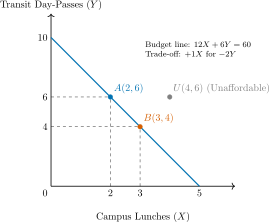
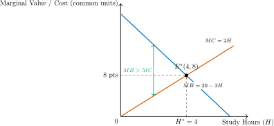
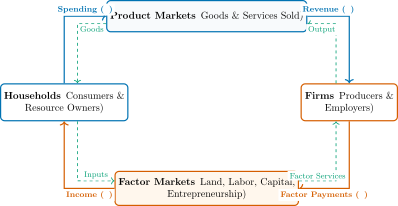

>
This chapter provides a rigorous, pedagogical treatment of Chapter 1: Foundations of Microeconomic Analysis & Core Principles, benchmarked to standard principles curriculum.

## Scarcity, Choice, and Opportunity Cost

### Conceptual Introduction {.unnumbered}
Every day begins with a boundary you cannot escape: there are only 24 hours in a day, and your bank account holds a finite number of dollars. Yet human desires—for housing, education, travel, healthcare, clean air, and leisure—are virtually limitless. Economics exists because of this fundamental collision, known as **scarcity**: the condition in which limited productive resources cannot satisfy all human wants simultaneously. Because we cannot have everything, every individual, household, business, and government is forced to make choices.

Whenever you choose one option, you automatically give up the next best alternative you could have pursued with that same time or money. Economists call this sacrifice your **opportunity cost**. Crucially, true economic opportunity cost is wider than the cash receipt you get at a checkout counter. It combines two distinct components: **explicit costs** (direct out-of-pocket dollar payments) and **implicit costs** (the non-monetary value of foregone time, foregone wages, or alternative uses of assets you already own).

Understanding opportunity cost transforms how rational people evaluate decisions. A decision is only worthwhile if its total benefit exceeds its full economic cost—not merely its cash price. At the same time, rational decision-makers must ignore **sunk costs**: historical expenses that have already been paid and cannot be recovered regardless of what choice you make today. Letting unrecoverable past spending trap you into bad future choices is known as the **sunk cost fallacy**.

### Visual Representation {.unnumbered}
Figure 1 illustrates scarcity and opportunity cost on a simple linear budget constraint for a college student dividing a fixed weekly budget of $\$60$ between campus lunches ($\$12$ each) and commuter transit passes ($\$6$ each).

::: {.callout-note title="Clear It Up: Sunk Costs Are Not Opportunity Costs"}

Suppose you pay $\$80$ for a non-refundable concert ticket, and on the night of the show a severe winter storm hits. Driving to the arena risks a car accident and three hours in freezing traffic. The $\$80$ ticket price is a **sunk cost**—whether you stay home in a warm blanket or drive through the blizzard, that $\$80$ is gone forever. Your true opportunity cost of going to the concert tonight is your safety and three hours of warm study time, not the $\$80$ you already spent last month.

:::

{fig-alt="Scarcity and Opportunity Cost on a Budget Line. Moving from bundle A to bundle B gains 1 additional campus lunch by sacrificing 2 transit day-passes, illustrating a constant opportunity cost of 2 passes per lunch."}

### Real-World Application: The True Cost of a College Degree {.unnumbered}
When families look at the cost of attending a four-year public university, they usually focus on the bursar's bill: tuition, campus fees, and textbooks. Yet for most full-time undergraduates, the largest single cost of higher education never appears on an invoice.

*  **Explicit Costs:** Suppose annual tuition, fees, and books total $\$11{,}000$ per year. (Note that room and board are generally excluded if you would have paid similar rent and grocery bills even while working full-time.)
*  **Implicit Costs:** By attending classes full-time instead of working an entry-level full-time job paying $\$38{,}000$ per year, the student foregoes $\$38{,}000$ in annual wages.

Adding both components together gives an illustrative annual economic opportunity cost of $\$11{,}000 + \$38{,}000 = \mathbf{\$49{,}000}$. Assuming these amounts remain constant for four years, the total is $\$196{,}000$. Actual costs depend on tuition, financial aid, living arrangements, work hours, and the wages a student could otherwise earn. The model predicts that lower available wages can reduce the opportunity cost of full-time schooling, all else equal; it does not imply enrollment rises in every recession.

### Mathematical Foundation (Algebra Level) {.unnumbered}
Total Economic Cost sums explicit monetary outlays and implicit opportunity costs:

$$
\text{Total Economic Cost} = \text{Explicit Costs} + \text{Implicit Costs}
$$

Similarly, when comparing two goods $X$ and $Y$ along a linear budget constraint $P_x X + P_y Y = I$, the opportunity cost of one unit of Good $X$ is the price ratio:

$$
\text{Opportunity Cost of } 1 \text{ unit of } X = \left|\frac{\Delta Y}{\Delta X}\right| = \frac{P_x}{P_y}
$$

**Worked Problem:**
Maya currently works as a graphic designer earning $\$65{,}000$ per year. She is considering quitting her job to launch her own independent design studio. In her first year, she expects to pay $\$18{,}000$ for studio rent, $\$7{,}000$ for software and equipment leases, and $\$15{,}000$ for marketing and supplies. Additionally, she must withdraw $\$20{,}000$ from a personal savings account that was earning $5\%$ annual interest to cover startup cash needs. Calculate Maya's explicit costs, implicit costs, and total economic cost for Year 1.

**Step-by-Step Breakdown:**

*  **Sum All Explicit Out-of-Pocket Costs:**
Add the direct monetary payments required to run the studio:

$$
\text{Explicit Costs} = \$18{,}000 + \$7{,}000 + \$15{,}000 = \mathbf{\$40{,}000}
$$

*  **Calculate Implicit Foregone Interest:**
Multiply the $\$20{,}000$ withdrawn from savings by the $5\%$ annual interest rate:

$$
\text{Foregone Interest} = \$20{,}000 \times 0.05 = \$1{,}000
$$

*  **Sum All Implicit Opportunity Costs:**
Combine Maya's foregone salary with her foregone savings interest:

$$
\text{Implicit Costs} = \$65{,}000 + \$1{,}000 = \mathbf{\$66{,}000}
$$

*  **Compute Total Economic Cost:**

$$
\text{Total Economic Cost} = \$40{,}000 + \$66{,}000 = \mathbf{\$106{,}000}
$$

**Conclusion:** Even if Maya's studio brings in $\$80{,}000$ in client revenue—giving her an accounting profit of $\$80{,}000 - \$40{,}000 = \$40{,}000$—she would suffer an *economic loss* of $\$80{,}000 - \$106{,}000 = -\$26{,}000$ compared to keeping her salaried job.

## Marginal Decision-Making and Incentives

### Conceptual Introduction {.unnumbered}
Most real-world economic decisions are not "all-or-nothing" ultimatums. A student rarely chooses between studying zero hours or 24 hours straight; they decide whether to study *one more hour* tonight. A coffee shop does not decide between brewing zero cups or one million cups; it decides whether to stay open *one extra hour* in the evening. Economists analyze these incremental adjustments through **marginal analysis**, comparing the **marginal benefit ($MB$)** of one additional unit of an activity against its **marginal cost ($MC$)**.

The basic rule is straightforward: as long as the extra benefit of one more unit exceeds its extra cost ($MB > MC$), expanding the activity increases net benefit. If the extra cost is greater ($MC > MB$), scale back. For a smooth, interior choice, net benefit is maximized where $MB=MC$; with indivisible choices, compare successive units and stop before the next unit whose marginal cost exceeds its marginal benefit.

Because rational agents weigh marginal benefits against marginal costs, changing either side of that ledger predictably alters human behavior. Economists call any reward or penalty that shifts $MB$ or $MC$ an **incentive**. When policymakers introduce taxes, subsidies, fines, or regulations, people respond to the new incentives—sometimes in clever, unintended ways that backfire against the policy's original goal.

### Visual Representation {.unnumbered}
Figure 2 uses hypothetical linear schedules, measured in the same illustrative value units, to show a downward-sloping Marginal Benefit curve intersecting an upward-sloping Marginal Cost curve at $H^* = 4$ study hours.

{fig-alt="Marginal Optimization Rule. Under the illustrative schedules, marginal benefit and cost intersect at H^*=4, where both equal 8 common value units. At H=2, MB>MC; beyond the intersection, MC>MB."}

### Real-World Application: Seatbelt Laws and the Peltzman Effect {.unnumbered}
Beginning January 1, 1968, federal safety standards required new U.S. passenger cars to have seat belts. The goal was to improve safety. Economist Sam Peltzman (1975) argued that drivers might respond to some safety improvements by taking greater risks:

*  By making car crashes far more survivable for the driver, safety equipment lowered the *marginal cost* to a driver of speeding or braking late.
*  If drivers perceive lower personal risk, some may drive faster or more aggressively, offsetting part of the safety benefit and shifting risk toward people outside the vehicle.

This proposed behavioral response is often called the **Peltzman effect**. It is a hypothesis about incentives, not a claim that seat belts generally increase fatalities; the size and distribution of any response depend on evidence and context.

### Mathematical Foundation (Algebra Level) {.unnumbered}
Marginal Benefit and Marginal Cost measure the change in total benefit ($TB$) and total cost ($TC$) from a one-unit increase in quantity ($\Delta Q = 1$):

$$
\begin{aligned}
MB &= \frac{\Delta TB}{\Delta Q}, \\
MC &= \frac{\Delta TC}{\Delta Q}, \\
\text{Interior optimum: } & MB = MC
\end{aligned}
$$

**Worked Problem:**
A regional airline operates a 150-seat flight from San Francisco to Seattle. Total fixed and fuel costs for the flight equal $\$15{,}000$, which works out to an *average cost* of $\$15{,}000 / 150 = \$100$ per seat. Ten minutes before boarding closes, 12 seats remain empty. Adding one standby passenger requires only $\$15$ in extra jet fuel, cabin snacks, and baggage handling. A standby passenger offers to pay $\$65$ for a ticket. Should the airline sell the seat?

**Step-by-Step Breakdown:**

*  **Identify Sunk Costs vs. Marginal Cost ($MC$):**
The $\$15{,}000$ cost to fly the plane is already committed regardless of whether the empty seat is filled. The incremental cost of boarding one additional passenger is:

$$
MC = \mathbf{\$15}
$$

*  **Identify Marginal Benefit ($MB$):**
The additional revenue collected from selling the standby ticket is:

$$
MB = \mathbf{\$65}
$$

*  **Apply the Marginal Decision Rule ($MB$ vs. $MC$):**
Compare marginal benefit to marginal cost (ignoring the irrelevant $\$100$ average cost):

$$
MB\ (\$65) > MC\ (\$15) \implies \text{Net Operating Gain} = \$65 - \$15 = \mathbf{+\$50}
$$

**Conclusion:** Yes—the airline should sell the seat. Although the $\$65$ fare is below the $\$100$ average cost per seat, it exceeds the $\$15$ incremental cost and adds $\$50$ to profit.

::: {.callout-note title="Optional Advanced Section: Calculus of Net Benefit Maximization"}

*Note for Economics Majors and Quantitative Students:*
Let Total Benefit be $TB(Q)$ and Total Cost be $TC(Q)$. Net Benefit is $NB(Q) = TB(Q) - TC(Q)$. Maximizing $NB(Q)$ requires setting the first derivative with respect to $Q$ equal to zero:

$$
\frac{d(NB)}{dQ} = \frac{d(TB)}{dQ} - \frac{d(TC)}{dQ} = 0 \implies MB(Q^*) = MC(Q^*)
$$

The second-order sufficient condition for a maximum requires $\frac{d^2(NB)}{dQ^2} = \frac{d(MB)}{dQ} - \frac{d(MC)}{dQ} < 0$, which holds whenever $MB$ slopes downward and $MC$ slopes upward.

:::

## Economic Models, Ceteris Paribus, and Methodology

### Conceptual Introduction {.unnumbered}
The real economy involves millions of consumers, firms, prices, weather events, and policy changes interacting simultaneously. To make sense of this complexity without getting lost in irrelevant detail, economists build simplified analytical maps called **economic models**. Just as a subway map omits every tree and storefront so you can clearly trace train routes, an economic model strips away secondary noise to isolate how one specific variable affects another.

To test a single cause-and-effect link cleanly, economists rely on the foundational assumption of ***ceteris paribus***—a Latin phrase meaning *"all other things held constant."* When an economist states that a lower price increases the quantity of coffee demanded *ceteris paribus*, they mean quantity rises assuming consumer income, weather, competitor prices, and tastes remain frozen. Without *ceteris paribus*, it is impossible to tell whether coffee sales rose because of a price discount or because a winter cold snap hit the city.

Finally, rigorous economic analysis separates two distinct types of statements:

*  **Positive Economics:** Testable statements about *what is* or *what may happen* if a policy changes (e.g., *"A minimum-wage increase may affect teen restaurant employment"*). The direction and size of any effect are empirical questions.
*  **Normative Economics:** Value judgments and opinions about *what ought to be* (e.g., *"The government should raise the minimum wage to reduce poverty"*). Normative claims depend on ethical priorities and cannot be settled by data alone.

### Visual Representation {.unnumbered}
Figure 3 maps the economy's core interactions using the **Circular Flow Diagram**, illustrating how households and firms exchange goods, services, factors of production, and dollars across two interconnected markets.

{fig-alt="The Circular Flow Model. Solid outer arrows trace dollar flows (consumer spending becoming firm revenue, and factor payments becoming household income), while dashed inner arrows trace physical goods and productive inputs."}

### Real-World Application: Separating Micro from Macro in Housing Policy {.unnumbered}
Economics divides into two complementary lenses:

*  **Microeconomics** examines individual markets, households, and firms—such as how a city's zoning law affects apartment rents in San Francisco or how Uber drivers respond to surge pricing.
*  **Macroeconomics** examines the economy as a whole—such as national GDP growth, Federal Reserve interest-rate policy, and U.S. unemployment rates.

For example, a study of higher mortgage rates might ask how home construction changes nationally, while a study of a local housing market might ask how individual buyers adjust between owning and renting. These are questions a model can organize; establishing causation requires evidence beyond the model itself.

### Mathematical Foundation (Algebra Level) {.unnumbered}
A linear model isolates a dependent variable $Y$ as a function of an explanatory variable $X$, holding all other determinants fixed inside the intercept $a$:

$$
Y = a + bX \qquad (\text{holding all non-}X\text{ factors constant})
$$

**Worked Problem:**
Suppose a city's monthly transit ridership $R$ (in thousands of rides) depends on the subway fare $F$ (in dollars) and average local gasoline prices $G$ (in dollars per gallon) according to the model:

$$
R = 120 - 15F + 10G
$$

Using *ceteris paribus*, calculate monthly ridership when the fare is $F = \$2.00$ and gas is $G = \$4.00$, and find the pure effect of raising the fare to $F = \$3.00$ while holding gas prices constant.

**Step-by-Step Breakdown:**

*  **Compute Baseline Ridership ($F = \$2.00$, $G = \$4.00$):**

$$
\begin{aligned}
R_1 &= 120 - 15(2.00) + 10(4.00) \\
&= 120 - 30 + 40 \\
&= \mathbf{130\text{ thousand rides}}
\end{aligned}
$$

*  **Apply *Ceteris Paribus* ($F = \$3.00$, holding $G = \$4.00$ fixed):**

$$
\begin{aligned}
R_2 &= 120 - 15(3.00) + 10(4.00) \\
&= 120 - 45 + 40 \\
&= \mathbf{115\text{ thousand rides}}
\end{aligned}
$$

*  **Isolate the Causal Effect of the Fare Hike:**

$$
\Delta R = R_2 - R_1 = 115 - 130 = \mathbf{-15\text{ thousand rides}}
$$

**Conclusion:** Holding gasoline prices constant, each $\$1.00$ increase in subway fare reduces monthly transit ridership by $15{,}000$ rides.

### Selected References {.unnumbered}

*  National Highway Traffic Safety Administration. “Seat Belts in New Passenger Cars” (interpretation 11695JEG; requirement effective January 1, 1968). <https://www.nhtsa.gov/interpretations/11695jeg>
*  Peltzman, Sam. 1975. “The Effects of Automobile Safety Regulation.” *Journal of Political Economy* 83(4): 677–725. <https://doi.org/10.1086/260352>
