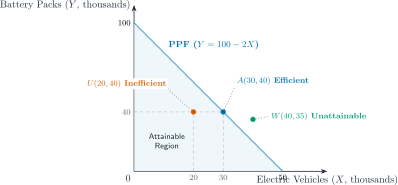
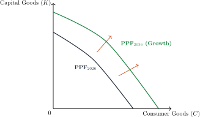
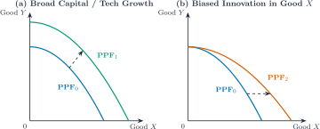

>
This chapter provides a rigorous, pedagogical treatment of Chapter 2: The Production Possibilities Frontier & Gains from Trade, benchmarked to standard principles curriculum.

## The Production Possibilities Frontier and Efficiency

### Conceptual Introduction {.unnumbered}
No economy—not even the wealthiest nation on earth—has enough workers, factories, farmland, and energy to produce unlimited quantities of every good simultaneously. To visualize this society-wide scarcity constraint, economists construct the **Production Possibilities Frontier (PPF)**, a curve showing the maximum combinations of two goods an economy can produce when all available resources and technology are fully and efficiently employed.

Every point on or near the PPF reveals a critical truth about how an economy is performing:

*  **Productive Efficiency (Points on the Frontier):** The economy is squeezing the maximum possible output from its existing workers and machines. Along the frontier, producing more of Good $X$ is impossible without giving up some of Good $Y$.
*  **Inefficiency (Points Inside the Frontier):** The economy is producing below its potential due to unemployed workers, idle factories, or misallocated resources. Moving from an interior point to the frontier allows society to gain more of *both* goods without any sacrifice.
*  **Unattainable Output (Points Outside the Frontier):** Combinations beyond the boundary cannot be achieved today given current labor, capital, and technology.

Because societies must choose *which* point along the frontier best matches citizen preferences, economists also distinguish **productive efficiency** (producing at lowest possible cost on the curve) from **allocative efficiency** (choosing the specific point on the curve where marginal social benefit equals marginal social cost, $MB = MC$).

**Real-World Connection.** During the 2020 recession, the U.S. unemployment rate reached $14.7\%$ in April, its highest seasonally adjusted level in the BLS series dating to 1948, as reported in the U.S. Bureau of Labor Statistics' *The Employment Situation—April 2020* (<https://www.bls.gov/news.release/archives/empsit_05082020.htm>). In a PPF model, unused workers and capacity are represented by a point inside the frontier; the diagram is conceptual rather than a measured location. Wartime conversion of civilian production to military production is another illustration: at full use of resources, shifting output toward one good requires sacrificing some of another.

### Visual Representation {.unnumbered}
Figure 1 illustrates a bowed-out Production Possibilities Frontier comparing clean-energy wind turbines ($X$) against commercial cargo ships ($Y$), marking efficient, inefficient, and unattainable allocations.

::: {.callout-note title="Clear It Up: Productive Efficiency vs. Allocative Efficiency"}

Every single point *on* the PPF is **productively efficient** because no resources are wasted. However, only *one* specific point on the PPF is **allocatively efficient**—the mix of goods society actually wants most ($MB = MC$). Producing $100\%$ left-handed baseball gloves and zero right-handed gloves is productively efficient if no leather is wasted, yet completely allocatively inefficient!

:::

{fig-alt="The Production Possibilities Frontier. Points B and C lie on the frontier and represent full employment and productive efficiency. Point U lies inside the frontier (idle resources), while point N is currently unattainable."}

### Mathematical Foundation {.unnumbered}
Along a linear PPF connecting vertical intercept $Y_{\max}$ and horizontal intercept $X_{\max}$, the **Marginal Rate of Transformation ($MRT$)**—the opportunity cost of producing one additional unit of $X$—is the absolute slope of the line:

$$
MRT = \left|\frac{\Delta Y}{\Delta X}\right| = \frac{Y_{\max}}{X_{\max}}
$$

**Worked Problem:**
A small island nation can produce a maximum of $200$ tons of mangoes per month if it devotes all labor to farming, or $50$ fishing boats per month if it devotes all labor to boatbuilding. Assuming a linear PPF with constant opportunity cost:

*  Write the equation of the island's PPF with mangoes ($M$) on the vertical axis and boats ($B$) on the horizontal axis.
*  Calculate the opportunity cost of building $1$ fishing boat and the opportunity cost of harvesting $1$ ton of mangoes.
*  Determine whether the bundle $(B = 30, M = 90)$ is efficient, inefficient, or unattainable.

**Step-by-Step Breakdown:**

*  **Write the Linear PPF Equation:**
The vertical intercept is $M_{\max} = 200$ and the horizontal intercept is $B_{\max} = 50$. The slope is $-\frac{200}{50} = -4$:

$$
M = 200 - 4B
$$

*  **Compute Opportunity Costs:**

$$
\text{Opportunity Cost of } 1 \text{ Boat} = \frac{200\text{ mangoes}}{50\text{ boats}} = \mathbf{4\text{ tons of mangoes}}
$$

$$
\text{Opportunity Cost of } 1 \text{ Ton of Mangoes} = \frac{50\text{ boats}}{200\text{ mangoes}} = \mathbf{0.25\text{ fishing boats}}
$$

*  **Evaluate Bundle $(B = 30, M = 90)$:**
Plug $B = 30$ into the PPF equation to find the maximum possible mango output:

$$
M_{\text{frontier}} = 200 - 4(30) = 200 - 120 = 80\text{ tons of mangoes}
$$

Because $90 > 80$, the bundle $(30, 90)$ lies outside the frontier and is **unattainable**.

**Conclusion:** Building $30$ boats leaves only enough resources to harvest $80$ tons of mangoes, so producing $90$ tons is impossible without new technology or more workers.

## Law of Increasing Opportunity Cost and Economic Growth

### Conceptual Introduction {.unnumbered}
Why is the PPF in Figure 1 bowed outward (concave to the origin) rather than drawn as a straight line? Because economic resources are **not equally suited to producing every good**. Farmland in California's Central Valley is extraordinarily productive for growing almonds and tomatoes, whereas software engineers in Silicon Valley are specialized in writing code.

When an economy first begins shifting resources out of agriculture and into software, it transfers the least fertile farmland and the most tech-savvy workers first—giving up very few crops for a huge gain in software. However, as society pushes further toward producing almost exclusively software, it must eventually pull prime agricultural land and veteran farmers out of farming, causing crop output to plummet for only a tiny gain in code. This universal pattern is the **Law of Increasing Opportunity Cost**: as production of one good expands, the opportunity cost of producing each additional unit rises.

Over time, an economy can break through its existing frontier via **economic growth**—an outward shift of the entire PPF. Economic growth is driven by three engines: (1) expanding the capital stock through investment in machines and infrastructure (**capital deepening**), (2) growing the labor force or improving worker skills (**human capital**), and (3) advancing **technology**.

**Real-World Connection.** A semiconductor fabrication plant requires land, skilled labor, equipment, and electricity that could have been used elsewhere while the plant is built. If the completed facility adds productive capacity, this investment can expand future production possibilities; the scale of that effect depends on the resources invested and the facility's productivity.

### Visual Representation {.unnumbered}
Figure 2 illustrates how prioritizing capital goods investment today shifts the entire PPF outward tomorrow, expanding future production possibilities.

{fig-alt="Economic Growth Shifts the PPF Outward. Investing in physical capital, human capital, and technological innovation expands an economy's productive capacity from the 2026 frontier to the 2036 frontier."}

### Mathematical Foundation {.unnumbered}
Along a curved PPF, the opportunity cost between two discrete points $(X_1, Y_1)$ and $(X_2, Y_2)$ is computed by dividing the vertical drop in $Y$ by the horizontal gain in $X$:

$$
\text{Opportunity Cost of } X \text{ over interval} = \left|\frac{Y_2 - Y_1}{X_2 - X_1}\right|
$$

**Worked Problem:**
An economy produces solar panels ($X$) and electric buses ($Y$) along a bowed-out PPF with the following efficient production combinations:

*  **Point A:** $0$ solar panels, $100$ electric buses
*  **Point B:** $20$ solar panels, $90$ electric buses
*  **Point C:** $40$ solar panels, $65$ electric buses
*  **Point D:** $60$ solar panels, $0$ electric buses

Calculate the per-unit opportunity cost of producing solar panels as the economy moves from $A \to B$, from $B \to C$, and from $C \to D$.

**Step-by-Step Breakdown:**

*  **Interval $A \to B$:**

$$
\text{Opportunity Cost} = \left|\frac{90 - 100}{20 - 0}\right| = \frac{10}{20} = \mathbf{0.50\text{ buses per solar panel}}
$$

*  **Interval $B \to C$:**

$$
\text{Opportunity Cost} = \left|\frac{65 - 90}{40 - 20}\right| = \frac{25}{20} = \mathbf{1.25\text{ buses per solar panel}}
$$

*  **Interval $C \to D$:**

$$
\text{Opportunity Cost} = \left|\frac{0 - 65}{60 - 40}\right| = \frac{65}{20} = \mathbf{3.25\text{ buses per solar panel}}
$$

**Conclusion:** Per-unit opportunity cost rises from $0.50 \to 1.25 \to 3.25$ buses per panel, confirming the Law of Increasing Opportunity Cost.

::: {.callout-note title="Optional Advanced Section: Calculus of Concave PPFs"}

*Note for Economics Majors and Quantitative Students:*
Suppose a bowed-out PPF is described by the quadratic equation $Y = 100 - \frac{1}{4}X^2$ for $X \in [0, 20]$. The instantaneous Marginal Rate of Transformation ($MRT$) is the absolute value of the first derivative:

$$
MRT(X) = \left|\frac{dY}{dX}\right| = \frac{1}{2}X
$$

Because the second derivative of $MRT(X)$ with respect to $X$ is $\frac{d(MRT)}{dX} = \frac{1}{2} > 0$, opportunity cost strictly increases with $X$ at every point along the frontier.

:::

## Comparative Advantage and Gains from Trade

### Conceptual Introduction {.unnumbered}
Why do individuals, cities, and nations specialize in specific careers or industries and trade with one another instead of producing everything themselves? In 1817, economist David Ricardo proved that mutually beneficial trade does *not* require being the most productive producer in the world. Instead, trade is governed by **comparative advantage**.

To see why, keep two concepts strictly separate:

*  **Absolute Advantage:** The ability to produce a larger quantity of a good using the same amount of inputs (or the same output using fewer labor hours).
*  **Comparative Advantage:** The ability to produce a good at a **lower domestic opportunity cost** than a trading partner.

Even if one person or country holds an absolute advantage in *every* activity, it is mathematically impossible for one party to have a comparative advantage in both goods (unless their opportunity costs are identical). When each party specializes in the good where its opportunity cost is lower and trades at a mutually agreeable **Terms of Trade ($TOT$)**, each gains access to consumption bundles beyond its domestic PPF. The expanded choice set allows each party to choose a bundle it prefers to its autarky bundle.

**Real-World Connection.** The contrast between technology firms in Silicon Valley and agricultural production in the Central Valley offers a local illustration of specialization. Whether either region has a comparative advantage in a particular good depends on its opportunity cost, not simply on its reputation or absolute output.

### Visual Representation {.unnumbered}
Figure 3 shows Region A's domestic PPF and its consumption possibilities frontier when it can trade at 2 tons of wheat per semiconductor.

{fig-alt="Trade expands Region A's feasible consumption set. After specializing in semiconductors, Region A exports 10 units for 20 tons of wheat at a terms of trade of 2 tons per semiconductor; the resulting bundle lies outside its domestic PPF."}

### Mathematical Foundation {.unnumbered}
For trade between Region A and Region B to benefit both sides, the **Terms of Trade ($TOT$)** for $1$ unit of Good $X$ must settle strictly between their two domestic opportunity costs:

$$
\text{Opportunity Cost of } X \text{ in Region A} < TOT < \text{Opportunity Cost of } X \text{ in Region B}
$$

**Worked Problem:**
In a single workday, **Region A** can produce either $40$ units of semiconductors ($X$) or $40$ tons of wheat ($Y$). **Region B** can produce either $10$ units of semiconductors ($X$) or $30$ tons of wheat ($Y$).

*  Identify which region holds the absolute advantage in each good.
*  Calculate domestic opportunity costs and identify comparative advantage.
*  Verify that a Terms of Trade of $1\text{ semiconductor} = 2\text{ tons of wheat}$ benefits both regions if Region A trades $10$ semiconductors to Region B.

**Step-by-Step Breakdown:**

*  **Determine Absolute Advantage:**
Region A produces more semiconductors ($40 > 10$) and more wheat ($40 > 30$), so **Region A holds the absolute advantage in both goods**.

*  **Calculate Domestic Opportunity Costs:**

*  **Region A:** One semiconductor costs $\frac{40}{40}=1$ ton of wheat; one ton of wheat costs $\frac{40}{40}=1$ semiconductor.
*  **Region B:** One semiconductor costs $\frac{30}{10}=3$ tons of wheat; one ton of wheat costs $\frac{10}{30}=\frac{1}{3}$ semiconductor.

Comparing opportunity costs:

*  Region A has comparative advantage in semiconductors because $1 < 3$ tons of wheat per semiconductor.
*  Region B has comparative advantage in wheat because $\frac{1}{3} < 1$ semiconductor per ton of wheat.

*  **Verify Gains at $TOT = 2\text{ tons of wheat per semiconductor}$:**

*  Region A specializes in semiconductors and produces $(40\ X,0\ Y)$. It exports $10\ X$ and imports $10 \times 2=20\ Y$, consuming $(30\ X,20\ Y)$. Its comparison bundle $(30\ X,10\ Y)$ is feasible on its domestic PPF, so trade makes 10 more tons of wheat available at the same semiconductor consumption.
*  Region B specializes in wheat and produces $(0\ X,30\ Y)$. It imports $10\ X$ and exports $10 \times 2=20\ Y$, consuming $(10\ X,10\ Y)$. Its comparison bundle $(10\ X,0\ Y)$ is feasible on its domestic PPF, so trade makes 10 more tons of wheat available at the same semiconductor consumption.

**Conclusion:** The terms of trade ($2$ tons of wheat per semiconductor) lie between Region A's opportunity cost ($1$ ton) and Region B's ($3$ tons). Given the stated comparison bundles and the assumption that more of a good is preferred to less, each region can gain 10 tons of wheat at the same semiconductor consumption. The trade bundles lie beyond each region's domestic PPF.
