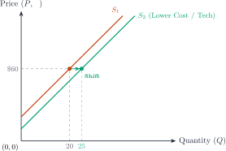

>
This chapter provides a rigorous, pedagogical treatment of Chapter 3: Supply, Demand, and Market Equilibrium, benchmarked to standard principles curriculum.

::: {.callout-note title="Bring It Home: Why Did Campus Coffee Sales Change?"}

If a campus coffee shop sells fewer drinks after raising its price, that is a movement along its demand curve. If a new café opens nearby or students' preferences change, demand may shift. If the price of coffee beans rises, supply may shift instead. This chapter gives you a method to distinguish these explanations and predict what happens to price and quantity.

:::

## Demand: Consumer Valuation and Curve Shifts

### Conceptual Introduction {.unnumbered}
In any market economy, prices serve as the primary signaling mechanism coordinating millions of decentralized buyers and sellers. On the buyer's side, the **Law of Demand** states that, *ceteris paribus* (holding all other factors constant), when the price of a good rises, the quantity demanded falls, and when the price falls, the quantity demanded rises. Two microeconomic forces drive this inverse relationship: the **substitution effect** (a higher price makes alternative products relatively cheaper, prompting consumers to switch) and the **income effect** (a higher price reduces the real purchasing power of a household's fixed paycheck).

Keeping a **change in quantity demanded** strictly separate from a **change in demand** is one of the most important analytical habits in economics. A change in the product's *own price* moves consumers up or down along a fixed demand curve. By contrast, a change in any non-price determinant shifts the entire demand curve to the right (an increase in demand at every price) or to the left (a decrease in demand at every price).

Five major non-price shifters move the entire demand curve:

*  **Consumer Income:** Higher income shifts demand rightward for **normal goods** (such as fresh produce or airline travel) and leftward for **inferior goods** (such as instant ramen or intercity bus tickets).
*  **Prices of Related Goods:** A price hike for a **substitute** (e.g., Pepsi) shifts demand rightward for the rival good (Coca-Cola); a price hike for a **complement** (e.g., smartphone data plans) shifts demand leftward for smartphones.
*  **Tastes and Preferences:** Health studies, cultural trends, and advertising.
*  **Buyer Expectations:** Anticipating higher future prices or future raises boosts current demand today.
*  **Number of Buyers:** Population growth or demographic expansion shifts market demand outward.

### Visual Representation {.unnumbered}
Figure 1 contrasts a movement along a stationary demand curve ($A \to B$, caused by a drop in own price) against a rightward shift of the entire demand curve ($D_1 \to D_2$, caused by a non-price determinant such as higher income).

::: {.callout-note title="Clear It Up: Never Say 'Price Rose, So Demand Fell'"}

When the price of concert tickets jumps from $\$60$ to $\$90$, the demand curve does *not* shift! Buyers simply move upward along the existing demand curve to a smaller **quantity demanded**. Only non-price factors (income, substitutes, complements, tastes, expectations, or buyer count) shift the demand curve itself.

:::

{fig-alt="Movement Along Demand vs. Shift of Demand. A price drop from $80 to $60 moves buyers along D_1 from A to B (a change in quantity demanded). Higher consumer income shifts the entire curve from D_1 to D_2, raising quantity demanded at $60 from 20 to 30 (point C)."}

### Real-World Application: Electric Vehicle Demand and Charging Networks {.unnumbered}
As a hypothetical example, an EV sticker-price reduction moves buyers along the demand curve when the price shown on the vertical axis is the price they pay. More fast-charging access can raise the value of owning an EV, while a buyer tax credit lowers the buyer's effective price relative to the sticker price. When a graph uses the sticker price, these non-sticker-price changes can be represented as a demand shift; the tax credit is not itself a change in the posted sticker price.

### Mathematical Foundation (Algebra Level) {.unnumbered}
A linear demand function is written directly as $Q_d = a - bP$ and inverted for graphing as:

$$
P = \frac{a}{b} - \frac{1}{b}Q_d \qquad (a > 0, \; b > 0)
$$

**Worked Problem:**
Monthly demand for campus cold-brew subscriptions is given by $Q_d = 400 - 10P$, where $P$ is the monthly price in dollars.

*  Rewrite the demand equation in inverse form ($P$ as a function of $Q_d$) and find the choke price.
*  Compute quantity demanded at $P_1 = \$25$ and $P_2 = \$15$.
*  Suppose midterms begin and student demand increases by $80$ subscriptions at every price level. Write the new direct demand equation.

**Step-by-Step Breakdown:**

*  **Invert the Demand Equation:**
Solve $Q_d = 400 - 10P$ for $P$:

$$
10P = 400 - Q_d \implies P = \mathbf{40 - 0.1Q_d}
$$

Setting $Q_d = 0$ gives the choke price $P_{\text{choke}} = \mathbf{\$40}$.

*  **Calculate Quantities Along the Original Demand Curve:**

$$
Q_d(25) = 400 - 10(25) = \mathbf{150\text{ subscriptions}}, \qquad Q_d(15) = 400 - 10(15) = \mathbf{250\text{ subscriptions}}
$$

*  **Shift the Demand Equation Rightward by $+80$ Units:**
Add $80$ to the horizontal intercept $a$:

$$
Q_d^{\text{new}} = (400 + 80) - 10P = \mathbf{480 - 10P}
$$

**Conclusion:** Lowering price from $\$25$ to $\$15$ increases quantity demanded by $100$ units along the curve, whereas midterm fatigue shifts the entire demand curve rightward by $80$ units at every price.

## Supply: Production Costs and Curve Shifts

### Conceptual Introduction {.unnumbered}
On the seller's side of the market, the **Law of Supply** states that, *ceteris paribus*, higher market prices induce firms to offer a larger quantity for sale, while lower prices reduce quantity supplied. In many short-run settings, some inputs are fixed; diminishing marginal productivity can then raise the **marginal cost ($MC$)** of additional units. Firms are willing to supply those units when the market price covers their marginal cost. This is one common reason for an upward-sloping supply curve, not a universal technological law.

Just as with demand, a change in the product's *own price* causes a movement along a stationary supply curve, whereas a change in underlying production conditions shifts the entire supply curve:

*  **Input Prices:** Higher wages, raw material costs, or energy prices raise marginal cost and shift supply leftward (upward).
*  **Technology:** Automation and process innovations lower production costs and shift supply rightward.
*  **Taxes and Subsidies:** A per-unit business tax raises marginal cost (shifting supply leftward), while a production subsidy lowers marginal cost (shifting supply rightward).
*  **Seller Expectations and Number of Sellers:** New firms entering an industry shift market supply rightward.

### Visual Representation {.unnumbered}
Figure 2 shows how a technological breakthrough lowers marginal production cost at every output level, shifting the supply curve rightward from $S_1$ to $S_2$.

{fig-alt="Rightward Shift of Supply. Cost-reducing technology shifts supply from S_1 to S_2, expanding the quantity sellers are willing to supply at $60 from 20 units to 25 units."}

### Real-World Application: Lithium Batteries and Coffee Harvests {.unnumbered}
The U.S. Department of Energy estimates that light-duty electric-vehicle lithium-ion battery-pack costs fell 90\% from 2008 to 2023 in 2023 dollars, from $\$1{,}415$ to $\$139$ per usable kilowatt-hour for production at a scale of at least 100{,}000 units per year. The estimate attributes the decline to improvements in technology and chemistry and to increased production volume. Lower unit costs can shift EV battery-pack supply right, all else equal; this estimate is for vehicle packs, not grid-scale storage.

Weather can affect agricultural supply, but the net outcome should not be assumed. The USDA reported severe drought and fires in Brazil from July to September 2024 and expected effects on the 2024/25 coffee harvest. Its forecast nevertheless put total Brazilian coffee production 0.2\% above the previous season. This case illustrates why a supply explanation must account for the overall harvest, not just one adverse input condition.

### Mathematical Foundation (Algebra Level) {.unnumbered}
A linear supply function with a nonnegative minimum supply price is:

$$
Q_s = d(P-P_{\min}) \quad \text{for } P \ge P_{\min}, \qquad
P = P_{\min} + \frac{1}{d}Q_s \quad (d>0).
$$

For prices below $P_{\min}$, this simple model sets quantity supplied to zero. This avoids interpreting a negative algebraic quantity as actual market supply.

**Worked Problem:**
Local bakeries supply artisan loaves according to $Q_s = -40 + 8P$ for $P \ge \$5$.

*  Find the inverse supply equation and minimum supply price $P_{\min}$.
*  Suppose flour and electricity prices rise, increasing sellers' minimum acceptable price by $\$3$ per loaf at every quantity. Write the new inverse and direct supply equations.

**Step-by-Step Breakdown:**

*  **Invert the Supply Equation:**

$$
8P = 40 + Q_s \implies P = \mathbf{5 + 0.125Q_s}
$$

At $Q_s = 0$, the minimum supply price is $P_{\min} = \mathbf{\$5\text{ per loaf}}$.

*  **Shift Supply Upward (Leftward) by $+\$3$ per Loaf:**
Add $\$3$ to the inverse supply intercept:

$$
P^{\text{new}} = (5 + 3) + 0.125Q_s = \mathbf{8 + 0.125Q_s}
$$

Solve for the new quantity schedule:

$$
P-8=0.125Q_s^{\text{new}}
\implies Q_s^{\text{new}}=8(P-8)=-64+8P.
$$

Restricting quantity supplied to nonnegative values gives:

$$
Q_s^{\text{new}} =
\begin{cases}
0, & P < \$8,\\
-64 + 8P, & P \ge \$8.
\end{cases}
$$

**Conclusion:** Higher input prices raise the minimum supply price to $\$8$ per loaf. At prices of $\$8$ or more, the new linear schedule supplies 24 fewer loaves than the old schedule; below $\$8$, the new schedule supplies zero.

## Market Equilibrium and Comparative Statics

### Conceptual Introduction {.unnumbered}
When buyers and sellers interact freely, the market converges toward **market equilibrium**—the unique price $P^*$ where quantity demanded equals quantity supplied ($Q_d = Q_s$). At any price above $P^*$, sellers produce more than buyers want to purchase, creating a **surplus** (excess supply) that pressures sellers to cut prices. At any price below $P^*$, buyers want more units than sellers offer, creating a **shortage** (excess demand) that bids prices upward. Only at $(Q^*, P^*)$ does the market clear with zero upward or downward pressure on price.

To predict how equilibrium responds when real-world events disturb the market—an exercise called **comparative statics**—follow a strict three-step protocol: (1) identify whether the event shifts Demand, Supply, or both; (2) determine the direction of the shift (rightward or leftward); and (3) compare the new intersection $(Q_2^*, P_2^*)$ against the original equilibrium $(Q_1^*, P_1^*)$. When *both* curves shift simultaneously, one outcome variable moves unambiguously while the other becomes **ambiguous** unless we know which shift is larger!

### Visual Representation {.unnumbered}
Figure 3 shows initial equilibrium $E_1^*(20, \$60)$, the surplus at a price of $\$80$, and the new equilibrium $E_2^*(25, \$70)$ following a rightward demand shift.

{fig-alt="Market Equilibrium and Demand Shift. At $80, the original curves imply Q_d=10 and Q_s=30, a surplus of 20 units. A rightward shift in demand creates a shortage at the original equilibrium price of $60; the market moves to E_2^*(25,$70)."}

### Real-World Application: Simultaneous Shifts and Coffee Prices {.unnumbered}
As a hypothetical, suppose greater demand for AI servers shifts semiconductor demand right while new fabrication capacity shifts supply right. Both shifts raise equilibrium quantity; their effects on equilibrium price oppose one another, so the net price change depends on the relative sizes of the shifts.

FRED's series APU0000717311 reports an average U.S. city price for a pound of 100\% ground-roast coffee; its July 2026 observation is $\$9.317$ per pound, not seasonally adjusted. This is a price-level observation, not a measure of quantity or a way to identify a demand or supply shift by itself. FRED cautions that average-price series are best for the price level in a particular month; use an appropriate price index to study price changes over time.

### Mathematical Foundation (Algebra Level) {.unnumbered}
Market equilibrium solves the system of two linear equations simultaneously:

$$
Q_d(P^*) = Q_s(P^*) \quad \text{or} \quad P_d(Q^*) = P_s(Q^*)
$$

**Worked Problem:**
In a city's market for portable solar generators, demand is $Q_d = 500 - 2P$ and supply is $Q_s = -100 + 4P$.

*  Solve for the market equilibrium price $P^*$ and quantity $Q^*$.
*  Determine whether a price of $P = \$120$ creates a surplus or a shortage, and compute its exact size.

**Step-by-Step Breakdown:**

*  **Set $Q_d = Q_s$ and Solve for $P^*$:**

$$
500 - 2P^* = -100 + 4P^* \implies 600 = 6P^* \implies P^* = \mathbf{\$100}
$$

Substitute $P^* = \$100$ into either equation to find $Q^*$:

$$
Q^* = 500 - 2(100) = \mathbf{300\text{ generators}}
$$

*  **Evaluate Disequilibrium at $P = \$120$:**

$$
Q_d(120) = 500 - 2(120) = 260\text{ units}, \qquad Q_s(120) = -100 + 4(120) = 380\text{ units}
$$

Because $Q_s\ (380) > Q_d\ (260)$, there is a **surplus** of $380 - 260 = \mathbf{120\text{ generators}}$.

**Conclusion:** The market clears at $P^* = \$100$ and $Q^* = 300$; pricing above equilibrium at $\$120$ leaves $120$ unsold units on shelves.

::: {.callout-note title="Optional Advanced Section: Comparative Statics via Total Differentiation"}

*Note for Economics Majors and Quantitative Students:*
Let general demand be $Q_d(P, \alpha)$ with $\frac{\partial Q_d}{\partial P} < 0$ and shift parameter $\alpha$ ($\frac{\partial Q_d}{\partial \alpha} > 0$), and supply be $Q_s(P)$. Differentiating the equilibrium identity $Q_d(P^*, \alpha) - Q_s(P^*) = 0$ with respect to $\alpha$:

$$
\frac{\partial Q_d}{\partial P} \frac{dP^*}{d\alpha} + \frac{\partial Q_d}{\partial \alpha} - \frac{dQ_s}{dP}\frac{dP^*}{d\alpha} = 0 \implies \frac{dP^*}{d\alpha} = \frac{\partial Q_d / \partial \alpha}{\frac{dQ_s}{dP} - \frac{\partial Q_d}{\partial P}} > 0
$$

This confirms analytically that any positive demand shock ($\partial Q_d / \partial \alpha > 0$) strictly raises equilibrium price $P^*$.

:::

## Bring It Home: Diagnose the Coffee Market {.unnumbered}
Return to the campus coffee shop. A price reduction changes quantity demanded along a given demand curve; a change in student preferences shifts demand; and a rise in bean costs shifts supply. Identifying which curve changed is the first step toward explaining the new equilibrium.

## Practice Questions {.unnumbered}

*  Demand is $Q_d=400-10P$. At $P=\$15$, demand then rises by 80 subscriptions at every price. What is the new quantity demanded?

A.  250. **Incorrect:** This is the original quantity at $P=\$15$ and ignores the demand shift.
B.  170. **Incorrect:** This subtracts 80 instead of adding the stated increase.
C.  330. **Correct:** The original quantity is $400-10(15)=250$; after the shift it is $250+80=330$.
D.  480. **Incorrect:** This is the new demand intercept, not quantity at $P=\$15$.

*  Original supply is $Q_s=-40+8P$ for $P\ge\$5$. Input costs raise the minimum acceptable price by $\$3$ per loaf. At $P=\$10$, what quantity is supplied under the new curve?

A.  40 loaves. **Incorrect:** This uses the original curve, $-40+8(10)$.
B.  24 loaves. **Incorrect:** This is the reduction in supply at $\$10$, not the new quantity supplied.
C.  16 loaves. **Correct:** The shifted curve is $Q_s=-64+8P$, so $Q_s=-64+80=16$.
D.  8 loaves. **Incorrect:** This confuses the new minimum price with quantity supplied.

*  Demand is $Q_d=500-2P$ and supply is $Q_s=-100+4P$. At $P=\$120$, what is the disequilibrium?

A.  A shortage of 120 generators. **Incorrect:** It reverses which quantity is larger.
B.  A surplus of 120 generators. **Correct:** $Q_d=260$ and $Q_s=380$, so the surplus is $380-260=120$.
C.  A surplus of 80 generators. **Incorrect:** It subtracts the equilibrium quantity, 300, from one disequilibrium quantity.
D.  No disequilibrium. **Incorrect:** $P=\$120$ is above the equilibrium price of $\$100$.

*  Demand and supply both shift right. Which conclusion follows under the standard upward-sloping supply and downward-sloping demand model?

A.  Equilibrium price and quantity both rise. **Incorrect:** The demand shift raises price, but the supply shift lowers it.
B.  Equilibrium price and quantity both fall. **Incorrect:** Both shifts increase equilibrium quantity.
C.  Equilibrium quantity rises; the price change is ambiguous. **Correct:** Both shifts raise quantity, while their opposing effects on price require knowing relative shift sizes.
D.  Equilibrium quantity is ambiguous; price must fall. **Incorrect:** It reverses the unambiguous quantity result and overstates the price effect.

## Sources {.unnumbered}

*  U.S. Department of Energy, Vehicle Technologies Office. “Electric Vehicle Battery Pack Costs for a Light-Duty Vehicle in 2023 Are 90\% Lower than in 2008.” \href{https://www.energy.gov/cmei/vehicles/articles/fotw-1354-august-5-2024-electric-vehicle-battery-pack-costs-light-duty}{DOE report}.
*  USDA Foreign Agricultural Service. *Coffee Semi-annual: Brazil*, Report BR2024-0035. \href{https://apps.fas.usda.gov/newgainapi/api/Report/DownloadReportByFileName?fileName=Coffee+Semi-annual_Brasilia_Brazil_BR2024-0035.pdf}{USDA report}.
*  Federal Reserve Bank of St. Louis, FRED. Average Price: Coffee, 100\%, Ground Roast, All Sizes in U.S. City Average (APU0000717311). <https://fred.stlouisfed.org/series/APU0000717311>
