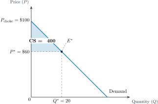
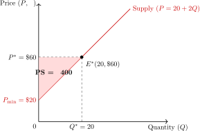
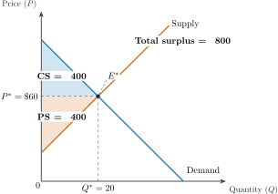
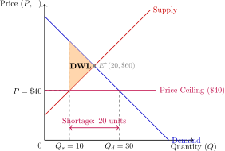
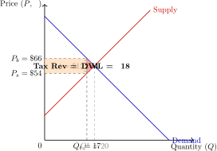

>
This chapter provides a rigorous, pedagogical treatment of Chapter 4: Consumer and Producer Surplus, Market Efficiency, and Welfare, benchmarked to standard principles curriculum.

## Consumer Surplus and Marginal Willingness to Pay

### Conceptual Introduction {.unnumbered}
Have you ever walked into a store prepared to spend $\$50$ on a pair of shoes, only to find them on sale for $\$30$? If so, you walked out with the shoes *and* an extra $\$20$ in your pocket that you were completely willing to part with. In economics, that $\$20$ gain is called your **Consumer Surplus ($CS$)**. Every shopper enters the market with a personal maximum price in mind—the highest dollar amount they would pay before walking away empty-handed. Economists call this boundary your **willingness to pay (WTP)**. Whenever the actual market price is lower than what you were willing to pay, you capture a net financial and psychological win.

In a market, buyers purchase goods one unit at a time. The very first buyers—or the first few items purchased—usually have the highest personal value to consumers (what economists sometimes call ``early buyers'' or intramarginal units). For instance, your first cup of coffee in the morning might be worth $\$8$ to you, but the café only charges $\$4$, giving you $\$4$ in surplus. Your second cup might be worth $\$5$, giving you $\$1$ in surplus. By the time you consider a third cup, its value to you might drop to exactly $\$4$. For that final unit, your willingness to pay matches the market price, yielding zero extra surplus. If price rose to $\$4.01$, you simply would not buy it.

When we add up the surplus enjoyed by every single customer in the entire market, we get **Total Consumer Surplus**. It represents the total dollar value of happiness, savings, and satisfaction that consumers walk away with over and above what they had to pay. When prices drop—thanks to new technology, cheaper shipping, or increased competition—consumer surplus expands, leaving households with more money left over to spend on other goals like tuition, healthcare, or savings.

### Visual Representation {.unnumbered}
Figure 1 graphs consumer surplus on a standard market diagram.

::: {.callout-note title="Graphing Tip: Why is Price on the Vertical Y-Axis?"}

In high school algebra, you usually put the independent variable on the horizontal $x$-axis and the dependent variable on the vertical $y$-axis ($y = f(x)$). In economics, by historical tradition dating back to Alfred Marshall in 1890, we place **Price ($P$)** on the vertical axis and **Quantity ($Q$)** on the horizontal axis. When looking at a demand equation like $P = 100 - 2Q$, to find the top vertical intercept (the **choke price** where nobody buys anything), simply plug in $Q = 0$, giving $P = \$100$.

:::

{fig-alt="Consumer Surplus at Equilibrium. The blue region lies below demand and above the $60 market price; at Q^*=20, its area is $400."}

### Real-World Application: Airline Dynamic Pricing and Flight Upgrades {.unnumbered}
Imagine a college student flying home for Thanksgiving break versus a business consultant booking a flight to close a critical $\$100,000$ client deal.

*  The **consultant** has an urgent deadline. Their company's maximum willingness to pay for a last-minute seat is **\$900**.
*  The **student** has a tight budget. Their personal maximum willingness to pay is **\$400**.

When both go online, the airline lists the standard coach fare at **\$350**. Both travelers buy a ticket at that exact price, but look at the difference in their net surplus:

$$
\text{Consultant's Surplus} = \$900 - \$350 = \mathbf{\$550}
$$

$$
\text{Student's Surplus} = \$400 - \$350 = \mathbf{\$50}
$$

Both sit in identical seats drinking the same tomato juice, but the consultant captures $\$550$ in surplus while the student captures $\$50$. This real-world difference explains why airlines work so hard with algorithms to separate travelers and charge higher fares to business passengers whenever possible.

### Mathematical Foundation (Algebra Level) {.unnumbered}
Because the demand curve in our example is a straight line, the area of Consumer Surplus forms a simple right-angled triangle. You do not need any advanced calculus—just basic high school geometry:

$$
\text{Consumer Surplus } (CS) = \frac{1}{2} \times \text{Base} \times \text{Height}
$$

Where:

*  $\text{Base} = Q^*$ (The quantity of units bought at the market price).
*  $\text{Height} = P_{\text{choke}} - P^*$ (The vertical gap between the highest walk-away price on the demand curve and the actual price paid).

**Worked Problem:**
A campus bookstore sells portable battery chargers according to the demand equation:

$$
P = 100 - 2Q
$$

If the market price settles at $P^* = \$60$, calculate the total Consumer Surplus enjoyed by students.

**Step-by-Step Breakdown:**

*  **Find the Choke Price ($P_{\text{choke}}$):** The choke price is the vertical intercept where quantity demanded drops to zero ($Q = 0$). Plug $0$ in for $Q$:

$$
P_{\text{choke}} = 100 - 2(0) = \$100
$$

*Meaning: If the store charged $\$100$ or more, zero students would buy a charger.*

*  **Solve for the Quantity Bought ($Q^*$):** Plug the market price of $\$60$ into the demand equation and solve for $Q$:

$$
60 = 100 - 2Q
$$

Subtract $100$ from both sides:

$$
-40 = -2Q
$$

Divide both sides by $-2$:

$$
Q^* = 20\text{ chargers}
$$

*Meaning: At a price of $\$60$, students purchase 20 chargers.*

*  **Find the Height of the Surplus Triangle:**

$$
\text{Height} = P_{\text{choke}} - P^* = \$100 - \$60 = \$40
$$

*  **Calculate the Area of the Consumer Surplus Triangle:**

$$
CS = \frac{1}{2} \times \text{Base} \times \text{Height} = \frac{1}{2} \times 20 \times \$40 = 10 \times \$40 = \mathbf{\$400}
$$

**Conclusion:** Students receive a total net economic benefit of **\$400** beyond what they paid for the chargers.

::: {.callout-note title="Optional Advanced Section: Calculus Extension"}

*Note for Economics Majors and Quantitative Students:*
When demand curves are curved rather than straight lines ($P = P(q)$), the area is found by taking the definite integral of marginal willingness to pay minus the market price from 0 to $Q^*$:

$$
CS = \int_{0}^{Q^*} \left[ P(q) - P^* \right] dq
$$

For our linear equation $P(q) = 100 - 2q$ with $Q^* = 20$ and $P^* = 60$:

$$
CS = \int_{0}^{20} (100 - 2q - 60)\,dq = \int_{0}^{20} (40 - 2q)\,dq = \left[ 40q - q^2 \right]_{0}^{20} = (40(20) - 20^2) - 0 = 800 - 400 = \mathbf{\$400}
$$

Notice that elementary triangle geometry and calculus yield the exact same $\$400$ result.

:::

## Producer Surplus and Marginal Cost

### Conceptual Introduction {.unnumbered}
Just as consumers gain surplus by paying less than their maximum valuation, sellers gain surplus by selling goods for more than it cost to make them. Every business owner has a minimum price they must receive before they agree to produce and sell an additional unit. Economists call this threshold their **willingness to accept (WTA)**, which directly equals the **marginal cost ($MC$)** of producing that extra item.

**Producer Surplus ($PS$)** is the net operating gain earned by firms. It is the gap between the money a firm collects at the market price and the minimum cost required to produce those items:

$$
PS = \text{Total Revenue Received} - \text{Total Variable Cost of Production}
$$

A vital point for business and economics students is that **producer surplus is not the same thing as total accounting profit**. Profit subtracts all costs, including fixed overhead like building rent, machinery leases, and insurance ($\text{Profit} = \text{Revenue} - \text{Variable Costs} - \text{Fixed Costs}$). Producer surplus only looks at operating revenue minus the direct, day-to-day variable costs of making the product ($PS = \text{Revenue} - \text{Variable Costs}$). That operating surplus is the cash flow a firm uses to pay its fixed rent and earn an eventual profit.

Because supply curves slope upward (due to diminishing returns and rising production costs), earlier units can be produced very cheaply, generating large operating surplus. The very last unit produced breaks even on operating costs ($P^* = MC$).

### Visual Representation {.unnumbered}
Figure 2 depicts Producer Surplus as the orange shaded triangle located above the supply curve and below the market price line.

{fig-alt="Producer Surplus at Equilibrium. The orange region lies above supply and below the $60 market price; at Q^*=20, its area is $400."}

### Real-World Application: Coffee Shops and Morning Espresso Sales {.unnumbered}
Consider an independent café in San Francisco selling cold brew coffee for **\$5.00** a cup.

*  The direct variable cost (coffee beans, filtered water, compostable cup, and milk) for the barista to brew the first batch of cups is only about **\$1.50 per cup**.
*  On those early cups, the coffee shop earns a producer surplus of:

$$
\text{Surplus per Cup} = \$5.00 - \$1.50 = \mathbf{\$3.50}
$$

As the morning rush peaks, the café has to hire extra staff and run grinders continuously at higher overtime expense, pushing the marginal cost of the 300th cup up to **\$4.50**. Even on that late cup, the café still captures $\$0.50$ in surplus.

Across 300 cups, the accumulated producer surplus might total $\$600$ for the morning. Does the owner pocket all $\$600$ as pure profit? No—they must use that $\$600$ producer surplus to pay fixed bills like the $\$4,000$ monthly shop rent, electric utilities, and insurance. Whatever is left over after paying fixed costs is their economic profit.

### Mathematical Foundation (Algebra Level) {.unnumbered}
For a linear supply curve, Producer Surplus ($PS$) is calculated as the area of a right-angled triangle:

$$
\text{Producer Surplus } (PS) = \frac{1}{2} \times \text{Base} \times \text{Height}
$$

Where:

*  $\text{Base} = Q^*$ (The quantity sold in the market).
*  $\text{Height} = P^* - P_{\text{min}}$ (The difference between the market price received and the minimum threshold price at the bottom of the supply curve).

**Worked Problem:**
A group of student tutoring services has an aggregate supply curve given by:

$$
P = 20 + 2Q
$$

If the equilibrium tutoring wage settles at $P^* = \$60$ per session, compute the total Producer Surplus earned by the student tutors.

**Step-by-Step Breakdown:**

*  **Find the Minimum Supply Price ($P_{\text{min}}$):** Plug $Q = 0$ into the supply curve:

$$
P_{\text{min}} = 20 + 2(0) = \$20
$$

*Meaning: Below $\$20$, no tutor is willing to work a session.*

*  **Solve for the Quantity Supplied ($Q^*$):** Set the market price equal to the supply equation:

$$
60 = 20 + 2Q \implies 40 = 2Q \implies Q^* = 20\text{ sessions}
$$

*  **Calculate the Height of the Triangle:**

$$
\text{Height} = P^* - P_{\text{min}} = \$60 - \$20 = \$40
$$

*  **Compute the Total Producer Surplus Area:**

$$
PS = \frac{1}{2} \times \text{Base} \times \text{Height} = \frac{1}{2} \times 20 \times \$40 = 10 \times \$40 = \mathbf{\$400}
$$

**Conclusion:** The student tutors earn a collective operating surplus of **\$400** above their minimum hourly opportunity costs.

::: {.callout-note title="Optional Advanced Section: Calculus Extension"}

*Note for Economics Majors:*
For continuous, non-linear marginal cost curves $MC(q)$, Producer Surplus is the integral of the market price minus marginal cost from 0 to $Q^*$:

$$
PS = \int_{0}^{Q^*} \left[ P^* - MC(q) \right] dq = \int_{0}^{20} (60 - (20 + 2q))\,dq = \int_{0}^{20} (40 - 2q)\,dq = \left[ 40q - q^2 \right]_{0}^{20} = \mathbf{\$400}
$$

:::

## Allocative Efficiency and Price Controls

### Conceptual Introduction {.unnumbered}
When we combine both sides of the market, we arrive at the total economic gain created by voluntary trade, known as **Total Social Surplus ($TS$)**:

$$
\text{Total Social Surplus} = \text{Consumer Surplus} + \text{Producer Surplus}
$$

Notice something remarkable about this equation: the market price itself actually cancels out! Price simply determines how the economic pie is divided between buyers and sellers. If the price goes up, buyers get less surplus and sellers get more; if the price goes down, buyers get more and sellers get less. But the *overall size* of the pie depends entirely on how many mutually beneficial trades are allowed to happen.

A competitive market in equilibrium achieves what economists call **allocative efficiency**. At the point where the supply and demand curves cross, the marginal benefit to society matches the marginal cost of producing the good ($MB = MC$). Every buyer who values the good at more than it costs to make gets one, and no resources are wasted making products that people don't value. Economists call this condition **Pareto efficiency**: at this exact output level, you cannot make one person better off without making someone else worse off.

When governments try to dictate prices by law—such as imposing a legal maximum price (**price ceiling**)—the market cannot reach this balance. If the ceiling is set below the natural equilibrium price, two things happen: sellers produce fewer units because low prices do not cover their costs, while buyers rush to purchase more because it is cheap. This creates an immediate physical **shortage**. More importantly, trades that both buyers and sellers wanted to make are legally blocked, shrinking the total economic pie and creating a permanent loss to society called **deadweight loss**.

### Visual Representation {.unnumbered}
Figure 3 shows the market in natural balance, maximizing the total economic pie to $\$800$. Figure 4 shows what happens when the government imposes a price ceiling at $\$40$.

{fig-alt="Maximized Social Surplus in a Free Market. At E^*(20,$60), consumer surplus and producer surplus each equal $400, for total surplus of $800."}

{fig-alt="The Impact of a Binding Price Ceiling. At $40, quantity supplied is 10 and quantity demanded is 30, so the shortage is 20 units. The purple triangle marks the lost gains from trade."}

### Real-World Application: Rent Control in San Francisco and New York {.unnumbered}
In expensive housing markets like San Francisco and New York City, local governments often cap how much landlords can raise apartment rents each year. The compassionate goal is simple: keep current residents from being priced out of their neighborhoods.

However, consider the economic consequences over time:

*  **Supply Collapses:** Landlords faced with capped rents cannot cover rising maintenance, plumbing, and property tax costs. Some convert apartments into luxury condos, while developers stop building modest rental apartments altogether.
*  **Demand Surges:** Low capped rents encourage people to stay in huge apartments alone or move in from outside the city.
*  **The Result:** A severe **housing shortage**. College students and young workers searching for an apartment face lines around the block, application lotteries, and expensive broker finder fees. While incumbent tenants lucky enough to have a rent-controlled lease benefit, many others are locked out completely—an exact demonstration of deadweight loss and shortages in action.

### Mathematical Foundation (Algebra Level) {.unnumbered}
Let's analyze the exact numbers when the government imposes a price ceiling of $\bar{P} = \$40$ on our battery charger market ($P_d = 100 - 2Q$ and $P_s = 20 + 2Q$).

**Step-by-Step Breakdown:**

*  **Calculate Quantity Supplied ($Q_s$) under the Ceiling:**
Plug $P = \$40$ into the supply equation:

$$
40 = 20 + 2Q_s \implies 20 = 2Q_s \implies Q_s = \mathbf{10\text{ units}}
$$

*Result: Sellers only produce 10 chargers because $\$40$ barely covers their costs.*

*  **Calculate Quantity Demanded ($Q_d$) under the Ceiling:**
Plug $P = \$40$ into the demand equation:

$$
40 = 100 - 2Q_d \implies 2Q_d = 60 \implies Q_d = \mathbf{30\text{ units}}
$$

*Result: At the bargain price of $\$40$, students line up wanting 30 chargers.*

*  **Calculate the Physical Shortage:**

$$
\text{Shortage} = Q_d - Q_s = 30 - 10 = \mathbf{20\text{ units}}
$$

*  **Identify the Actual Number of Transactions:**
Because it takes two willing parties to make a deal, the number of units actually bought and sold is limited by whoever produces the least:

$$
Q_{\text{actual}} = \min(Q_s, Q_d) = \min(10, 30) = \mathbf{10\text{ units}}
$$

*  **Calculate the Value of the 10th Unit to Consumers:**
What was the 10th charger worth to students? Plug $Q = 10$ into the demand curve:

$$
P = 100 - 2(10) = \$80
$$

*  **Calculate Deadweight Loss ($DWL$):**
The market dropped from producing 20 units down to 10 units. Trades for units 11 through 20 were completely eliminated. The lost value forms the purple triangle in Figure 4:

$$
\text{Base of DWL Triangle} = \text{Vertical Gap at } Q=10 = \$80 - \$40 = \$40
$$

$$
\text{Height of DWL Triangle} = Q^* - Q_s = 20 - 10 = 10\text{ units}
$$

$$
DWL = \frac{1}{2} \times \text{Base} \times \text{Height} = \frac{1}{2} \times \$40 \times 10 = \mathbf{\$200}
$$

**Conclusion:** The price ceiling destroyed **\$200** in social surplus that both students and producers would have shared if trade had not been blocked.

::: {.callout-note title="Optional Advanced Section: Social Planner Maximization"}

*Note for Economics Majors:*
A benevolent social planner chooses total output $Q$ to maximize total surplus:

$$
\max_Q W(Q) = \int_{0}^{Q} \left[ P_d(q) - P_s(q) \right] dq
$$

Taking the first derivative with respect to $Q$ and setting it to 0:

$$
\frac{dW}{dQ} = P_d(Q) - P_s(Q) = 0 \implies P_d(Q^*) = P_s(Q^*)
$$

This proves mathematically that social welfare is strictly maximized where supply meets demand. Any artificial intervention that forces $Q \neq Q^*$ mathematically guarantees $W(Q) < W(Q^*)$.

:::

## Market Distortions: Taxes, Wedges, and Deadweight Loss

### Conceptual Introduction {.unnumbered}
Governments need revenue to fund essential public goods like highways, libraries, and public colleges. One of the most common ways they raise money is by levying an **excise tax**—a flat dollar tax per unit sold, such as a $\$1.00$ tax on a pack of cigarettes or a $\$0.50$ tax per gallon of gasoline.

When a tax is enacted, it drives a physical **tax wedge** between what the buyer pays and what the seller actually gets to keep:

$$
P_{\text{buyer}} - P_{\text{seller}} = t
$$

A widespread misconception among the general public is that politicians can decide who pays a tax simply by writing it into law. If politicians say ``the oil company must pay this $\$0.50$ tax,'' people assume the oil company bears 100\% of the cost. In economics, this is completely false. The legal rule is called **statutory incidence**, but the true financial burden is called **economic incidence**. As you will see below, **it makes zero difference whether the tax is legally placed on the buyer or the seller**—the final prices paid, prices received, and quantity sold are 100\% mathematically identical!

Because the tax raises the price buyers pay and lowers the price sellers keep, fewer total transactions take place ($Q_t < Q^*$). The government successfully collects revenue, but the lost trades that never happened generate **Deadweight Loss ($DWL$)**. Furthermore, as the tax rate increases, deadweight loss does not grow in a straight line—it explodes with the square of the tax rate ($DWL \propto t^2$). This principle, known as the **Quadratic Excess Burden Theorem**, means that doubling a tax rate actually *quadruples* the wasted welfare in the economy!

### Visual Representation {.unnumbered}
Figure 5 illustrates a tax wedge of $t = \$12$ placed on our charger market.

{fig-alt="The Anatomy of an Excise Tax. A $12 tax lowers quantity from 20 to 17, with buyers paying $66 and sellers receiving $54. The amber rectangle is $204 in tax revenue; the purple triangle is $18 in deadweight loss."}

### Real-World Application: California Gasoline Excise Taxes {.unnumbered}
Every time drivers in California fill their fuel tanks, they pay approximately **\$0.54 per gallon** in state excise taxes, plus federal taxes and environmental fees.

*  **Where does the money go?** The amber rectangle in Figure 5 represents the billions of dollars flowing directly into state coffers to pave roads, fix highway bridges, and fund regional transit like BART and Caltrain.
*  **Where is the deadweight loss?** Because gas costs more, some families cancel a weekend road trip, small contractors drive fewer delivery routes, and some commuters spend extra hours on slower buses. The loss in satisfaction and economic productivity from those foregone trips represents the purple triangle: deadweight loss that nobody captures.

### Mathematical Foundation (Algebra Level) {.unnumbered}

::: {.callout-note title="Key Concept: Statutory Neutrality (Who Pays Doesn't Matter!)"}

Suppose the government passes a $\$12$ tax on our chargers. Look at what happens under the two legal options:

*  **Case A (Tax collected from sellers):** Sellers must pay $\$12$ per charger to the government, so their required price increases by $\$12$:

$$
P_s^{\text{new}} = (20 + 2Q) + 12 = 32 + 2Q
$$

Set equal to Demand: $100 - 2Q = 32 + 2Q \implies 68 = 4Q \implies \mathbf{Q_t = 17}$.
Buyers pay $P_b = 100 - 2(17) = \mathbf{\$66}$. Sellers keep $P_s = 66 - 12 = \mathbf{\$54}$.

*  **Case B (Tax collected from buyers):** Buyers must hand $\$12$ to the government at the checkout register, so their willingness to pay the store drops by $\$12$:

$$
P_d^{\text{new}} = (100 - 2Q) - 12 = 88 - 2Q
$$

Set equal to original Supply: $88 - 2Q = 20 + 2Q \implies 68 = 4Q \implies \mathbf{Q_t = 17}$.
Store receives $P_s = 20 + 2(17) = \mathbf{\$54}$. Buyer pays $P_b = 54 + 12 = \mathbf{\$66}$.

**The Takeaway:** Regardless of who physically writes the check to the government, the outcome is 100\% identical: **buyers pay \$66, sellers keep \$54, and output is 17 units**.

:::

**Worked Problem: Computing Government Revenue and Deadweight Loss**
Using our charger market where $P_d = 100 - 2Q$, $P_s = 20 + 2Q$, and tax $t = \$12$:

**Step-by-Step Breakdown:**

*  **Find the Pre-Tax Baseline ($Q^*, P^*$):**
Unregulated equilibrium occurred at $Q^* = 20$ units and $P^* = \$60$.

*  **Determine Post-Tax Volume ($Q_t$):**
From our statutory proof above, $Q_t = \mathbf{17\text{ chargers}}$.

*  **Determine the Prices Paid and Received:**

$$
P_b = 100 - 2(17) = \mathbf{\$66\text{ (paid by buyer)}}
$$

$$
P_s = 20 + 2(17) = \mathbf{\$54\text{ (kept by seller)}}
$$

Notice that the $\$12$ tax was split evenly: buyers pay $\$6$ more ($66 - 60 = 6$) and sellers receive $\$6$ less ($60 - 54 = 6$) because the demand and supply curves have identical steepness (both have slopes with magnitude 2).

*  **Calculate Output Contraction ($\Delta Q$):**

$$
\Delta Q = Q^* - Q_t = 20 - 17 = \mathbf{3\text{ chargers}}
$$

*Meaning: 3 students and 3 sellers were priced out of doing business together.*

*  **Calculate Government Tax Revenue ($T_{\text{rev}}$):**
Multiply the per-unit tax by the number of units actually sold:

$$
T_{\text{rev}} = \text{Tax per unit} \times Q_t = \$12 \times 17 = \mathbf{\$204}
$$

*  **Calculate Deadweight Loss ($DWL$):**
The lost trades form the purple Harberger triangle with base equal to the tax wedge ($t = \$12$) and height equal to the lost units ($\Delta Q = 3$):

$$
DWL = \frac{1}{2} \times \text{Base} \times \text{Height} = \frac{1}{2} \times t \times \Delta Q = \frac{1}{2} \times \$12 \times 3 = 6 \times 3 = \mathbf{\$18}
$$

**Conclusion:** The government successfully raises **\$204** in tax revenue, but causes **\$18** of economic value to be permanently lost to society.

::: {.callout-note title="Optional Advanced Section: The Quadratic Excess Burden Theorem"}

*Note for Quantitative Students:*
Why do economists caution so strongly against high tax rates? Let linear demand have slope $-b$ and supply have slope $d$. The output reduction is $\Delta Q = \frac{t}{b + d}$. Plugging this into the Harberger triangle formula yields:

$$
DWL(t) = \frac{1}{2} \times t \times \Delta Q = \frac{1}{2} t \left( \frac{t}{b + d} \right) = \frac{t^2}{2(b + d)}
$$

Differentiating with respect to the tax rate $t$:

$$
\frac{d(DWL)}{dt} = \frac{t}{b + d} > 0, \quad \frac{d^2(DWL)}{dt^2} = \frac{1}{b + d} > 0
$$

Because the second derivative is strictly positive, **deadweight loss grows with the square of the tax rate ($t^2$)**.

*  If tax is $t = \$12$, $DWL = \frac{12^2}{2(2+2)} = \frac{144}{8} = \mathbf{\$18}$.
*  If tax doubles to $t = \$24$, $DWL = \frac{24^2}{8} = \frac{576}{8} = \mathbf{\$72}$.

Doubling the tax from $\$12$ to $\$24$ did not double the deadweight loss—it **quadrupled** it from $\$18$ to $\$72$!

:::
