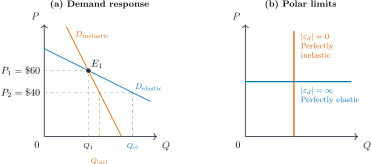
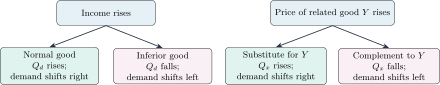

>
This chapter develops elasticity as a unit-free measure of economic responsiveness in competitive markets, aligned with the Principles of Microeconomics curriculum. It covers price elasticity of demand and the midpoint formula, the total revenue test, income, cross-price, and supply elasticities, and how relative elasticities govern economic tax incidence.

## Price Elasticity of Demand and the Midpoint Formula

### Conceptual Introduction {.unnumbered}
In Chapter 3, we established the Law of Demand: when the price of a good goes up, consumers buy less of it. But for a business owner setting prices or a policymaker designing a tax, knowing the *direction* of the change is not enough—they need to know *how much* quantity changes. If a café raises the price of its morning latte by $10\%$, will customer traffic drop by $2\%$ or collapse by $40\%$? Economists measure this sensitivity using the **Price Elasticity of Demand ($\varepsilon_d$)**, defined as the percentage change in quantity demanded divided by the percentage change in price.

Why do economists use percentage changes rather than the raw slope of the demand curve? Because raw slope depends entirely on arbitrary measurement units. Switching a pricing table from dollars to cents, or measuring coffee in ounces instead of cups, changes the numerical slope even though consumer behavior has not changed at all. By converting both price and quantity movements into unit-free percentages, elasticity allows us to compare the responsiveness of insulin, concert tickets, and gasoline on a single standardized scale.

Because demand curves slope downward, price and quantity move in opposite directions, making the raw ratio negative. By convention, economists take the absolute value $|\varepsilon_d|$ (or report the magnitude) to classify demand into three regimes:

*  **Elastic Demand ($|\varepsilon_d| > 1$):** Consumers are highly sensitive to price; the percentage change in quantity is larger than the percentage change in price.
*  **Unit Elastic Demand ($|\varepsilon_d| = 1$):** The percentage change in quantity exactly matches the percentage change in price.
*  **Inelastic Demand ($|\varepsilon_d| < 1$):** Consumers are relatively unresponsive to price; the percentage change in quantity is smaller than the percentage change in price.

### Visual Representation {.unnumbered}
Figure 1 contrasts steep (inelastic) and flat (elastic) demand curves passing through the same initial market point, alongside the extreme polar cases of perfectly inelastic and perfectly elastic demand.

::: {.callout-note title="Clear It Up: Slope Is Not the Same as Elasticity"}

A linear demand curve has a *constant slope* from top to bottom, yet its *elasticity changes at every single point*! Near the top-left of a straight-line demand curve (high price, low quantity), a $\$1$ price cut represents a tiny percentage drop in price but a huge percentage jump in quantity, making demand **elastic**. Near the bottom-right (low price, high quantity), that exact same $\$1$ price cut is a large percentage drop in price and a tiny percentage gain in quantity, making demand **inelastic**.

:::

{fig-alt="For the same price change, quantity responds less on steep inelastic demand than on flatter elastic demand; panel (b) shows the limiting cases."}

### Real-World Application: Necessities and Substitutes {.unnumbered}
Consider a household deciding how to allocate its budget between a medically necessary prescription and restaurant meals. If close alternatives for a purchase are limited, buyers may have less room to reduce quantity when its price rises; if many alternatives are available, buyers have more ways to switch. This comparison illustrates the economic mechanism, not a medical recommendation or a measured elasticity for either market.

*  A treatment with few clinically appropriate alternatives may have less price-responsive demand than a discretionary purchase. Actual responsiveness depends on the treatment, patient group, insurance coverage, and time horizon.
*  Restaurant meals often have alternatives such as cooking at home or choosing another restaurant. Those options can make switching easier, but the size of the response must be estimated rather than assumed.

Four structural determinants help explain responsiveness: (1) **availability of close substitutes**, (2) **necessity versus discretionary use**, (3) **share of the household budget** (a given price change matters more when the good takes a larger share), and (4) **time horizon** (buyers generally have more opportunity to adjust over a longer period).

### Mathematical Foundation (Algebra Level) {.unnumbered}
If you compute a percentage change from Point A to Point B and then reverse direction from Point B back to Point A, standard percentage formulas give two different answers because the starting base changes. To eliminate this direction bias, economists use the **Midpoint (Arc) Elasticity Formula**, dividing each change by the average of the starting and ending values:

$$
\varepsilon_d = \frac{\%\Delta Q_d}{\%\Delta P} = \frac{\dfrac{Q_2 - Q_1}{(Q_1 + Q_2)/2}}{\dfrac{P_2 - P_1}{(P_1 + P_2)/2}}
$$

**Worked Problem:**
Suppose a hypothetical transit agency raises the monthly express-pass fare from $P_1 = \$80$ to $P_2 = \$100$, and monthly sales fall from $Q_1 = 1{,}200$ to $Q_2 = 800$ passes. Calculate the price elasticity of demand using the midpoint formula and classify the demand regime.

**Step-by-Step Breakdown:**

*  **Calculate the Percentage Change in Quantity Demanded ($\%\Delta Q_d$):**
First find the change in quantity and the midpoint quantity:

$$
\Delta Q = Q_2 - Q_1 = 800 - 1{,}200 = -400\text{ passes}
$$

$$
Q_{\text{mid}} = \frac{Q_1 + Q_2}{2} = \frac{1{,}200 + 800}{2} = \frac{2{,}000}{2} = 1{,}000\text{ passes}
$$

Divide the change by the midpoint:

$$
\%\Delta Q_d = \frac{-400}{1{,}000} = -0.40 \quad (\text{or } -40\%)
$$

*  **Calculate the Percentage Change in Price ($\%\Delta P$):**
Find the change in price and the midpoint price:

$$
\Delta P = P_2 - P_1 = \$100 - \$80 = +\$20
$$

$$
P_{\text{mid}} = \frac{P_1 + P_2}{2} = \frac{\$80 + \$100}{2} = \frac{\$180}{2} = \$90
$$

Divide the change by the midpoint:

$$
\%\Delta P = \frac{20}{90} \approx +0.2222 \quad (\text{or } +22.22\%)
$$

*  **Divide $\%\Delta Q_d$ by $\%\Delta P$:**

$$
\varepsilon_d = \frac{-0.40}{20/90} = -0.40 \times \frac{90}{20} = -0.40 \times 4.5 = -1.80
$$

*  **Take the Absolute Value and Classify:**

$$
|\varepsilon_d| = |-1.80| = \mathbf{1.80}
$$

Because $1.80 > 1$, demand for express commuter bus passes over this price range is **elastic**.

**Conclusion:** Over this price range, the midpoint elasticity is $-1.80$: demand is elastic, so quantity responds more than proportionally to price. This arc estimate is not a forecast for every 1\% price change.

::: {.callout-note title="Optional Advanced Section: Point Elasticity via Calculus"}

*Note for Economics Majors and Quantitative Students:*
For infinitesimally small price changes along a differentiable demand function $Q_d = f(P)$, the **point price elasticity of demand** replaces discrete differences with the first derivative:

$$
\varepsilon_d = \frac{dQ_d}{dP} \cdot \frac{P}{Q_d}
$$

For example, given linear demand $Q_d = 100 - 2P$, we have $\frac{dQ_d}{dP} = -2$. At $P = \$30$, $Q_d = 100 - 2(30) = 40$, giving:

$$
\varepsilon_d = (-2) \cdot \frac{30}{40} = -1.5 \implies |\varepsilon_d| = 1.5 \text{ (Elastic)}
$$

Notice that when $P = \$25$ and $Q_d = 50$ (the exact midpoint of the linear demand curve), $|\varepsilon_d| = |-2 \cdot \frac{25}{50}| = 1.0$ (Unit Elastic).

:::

## The Total Revenue Test

### Conceptual Introduction {.unnumbered}
Every business manager faces a fundamental pricing dilemma: if I raise my price, will my company bring in more money or less money? At first glance, raising prices sounds like a guaranteed way to boost sales dollars. Yet every price increase sets off a tug-of-war between two opposing forces inside the firm's **Total Revenue ($TR = P \times Q$)**:

*  **The Price Effect:** Each unit still sold now brings in more dollars ($P \uparrow$), pushing total revenue upward.
*  **The Quantity Effect:** Fewer total units are sold because some buyers walk away ($Q \downarrow$), pulling total revenue downward.

Which force wins the tug-of-war depends entirely on the price elasticity of demand. When demand is **inelastic** ($|\varepsilon_d| < 1$), customers barely cut back their purchases when prices rise; the positive Price Effect overpowers the weak Quantity Effect, so **raising price increases total revenue**. Conversely, when demand is **elastic** ($|\varepsilon_d| > 1$), customers flee in large numbers; the negative Quantity Effect crushes the Price Effect, so **raising price actually reduces total revenue**.

This relationship gives firms and economists a practical diagnostic known as the **Total Revenue Test**. Even without estimating a full econometric demand curve, observing how total dollar receipts move after a price change immediately reveals whether demand is elastic, inelastic, or unit elastic. Furthermore, it proves that a firm seeking to maximize total revenue (before accounting for production costs) should operate right at the **unit elastic midpoint** ($|\varepsilon_d| = 1$), where revenue reaches its peak.

### Visual Representation {.unnumbered}
Figure 2 stacks a linear demand curve directly above its corresponding parabolic Total Revenue curve, showing how revenue rises along the elastic upper half, peaks at the unit-elastic midpoint, and falls along the inelastic lower half.

{fig-alt="Demand Elasticity and Total Revenue. Moving down the linear demand curve from Q=0 to Q=25 lowers price in the elastic region, causing Total Revenue to climb to its maximum of $1{,}250 at the unit-elastic midpoint. Beyond Q=25, further price cuts enter the inelastic region and cause Total Revenue to decline."}

### Real-World Application: Subscription and Ticket Pricing {.unnumbered}
The following are stylized examples, not observations about any named company or event. They show how a seller can use the total-revenue test to reason about a price change:

*  Suppose a monthly subscription price rises from $\$15$ to $\$17$ while subscribers fall from $1{,}000$ to $970$. Revenue changes from $\$15{,}000$ to $\$16{,}490$ per month, so revenue rises over this interval.
*  Suppose a ticket price falls from $\$100$ to $\$70$ while sales rise from 100 to 200 tickets. Revenue changes from $\$10{,}000$ to $\$14{,}000$, so demand is elastic over this interval by the total-revenue test.

### Mathematical Foundation (Algebra Level) {.unnumbered}
Total Revenue is the product of market price and quantity sold:

$$
TR = P \times Q
$$

To test how a price change alters total revenue, compute $TR_1 = P_1 \times Q_1$ before the change and $TR_2 = P_2 \times Q_2$ after the change:

*  If $P \uparrow$ and $TR \uparrow$ (price and revenue move in the **same** direction), demand is **inelastic** ($|\varepsilon_d| < 1$).
*  If $P \uparrow$ and $TR \downarrow$ (price and revenue move in **opposite** directions), demand is **elastic** ($|\varepsilon_d| > 1$).
*  If $P \uparrow$ and $TR$ stays **unchanged**, demand is **unit elastic** ($|\varepsilon_d| = 1$).

**Worked Problem:**
Suppose a campus bookstore selling university hoodies faces the stylized linear demand schedule $P = 100 - 2Q$, where $P$ is dollars per hoodie and $Q$ is hoodies sold per week, as plotted in Figure 2. Compare weekly total revenue across three pricing strategies:

*  **Strategy A:** High price $P_A = \$70$
*  **Strategy B:** Midpoint price $P_B = \$50$
*  **Strategy C:** Low price $P_C = \$30$

**Step-by-Step Breakdown:**

*  **Compute Quantity and Revenue under Strategy A ($P_A = \$70$):**
Substitute $P = 70$ into $P = 100 - 2Q$:

$$
70 = 100 - 2Q_A \implies 2Q_A = 30 \implies Q_A = 15\text{ hoodies}
$$

Calculate Total Revenue:

$$
TR_A = P_A \times Q_A = \$70 \times 15 = \mathbf{\$1{,}050}
$$

*  **Compute Quantity and Revenue under Strategy B ($P_B = \$50$):**
Substitute $P = 50$ into $P = 100 - 2Q$:

$$
50 = 100 - 2Q_B \implies 2Q_B = 50 \implies Q_B = 25\text{ hoodies}
$$

Calculate Total Revenue:

$$
TR_B = P_B \times Q_B = \$50 \times 25 = \mathbf{\$1{,}250}
$$

*Interpretation:* Cutting price from $\$70$ to $\$50$ increased Total Revenue from $\$1{,}050$ to $\$1{,}250$, confirming that demand between $P=\$70$ and $P=\$50$ is **elastic**.

*  **Compute Quantity and Revenue under Strategy C ($P_C = \$30$):**
Substitute $P = 30$ into $P = 100 - 2Q$:

$$
30 = 100 - 2Q_C \implies 2Q_C = 70 \implies Q_C = 35\text{ hoodies}
$$

Calculate Total Revenue:

$$
TR_C = P_C \times Q_C = \$30 \times 35 = \mathbf{\$1{,}050}
$$

*Interpretation:* Cutting price further from $\$50$ to $\$30$ reduced Total Revenue from $\$1{,}250$ back down to $\$1{,}050$, confirming that demand below $P=\$50$ is **inelastic**.

**Conclusion:** Total Revenue is maximized at $\mathbf{\$1{,}250}$ when $P = \$50$ and $Q = 25$ hoodies. This is the unit-elastic midpoint for this linear demand curve; the maximum for a general demand curve need not occur at its geometric midpoint.

::: {.callout-note title="Work It Out: Connecting Midpoint Elasticity and the Total Revenue Test"}

**Prompt:** Suppose a student-run film society tests raising its semester pass price from $P_1 = \$18$ to $P_2 = \$22$. Under *ceteris paribus* assumptions, semester pass sales decrease from $Q_1 = 525$ to $Q_2 = 475$.

*  Compute initial total revenue ($TR_1$) and new total revenue ($TR_2$). Based on the Total Revenue Test alone, predict whether demand over this interval is elastic or inelastic.
*  Verify your prediction by computing the midpoint price elasticity of demand ($\varepsilon_d$).

**Guided Solution:**

*  **Apply the Total Revenue Test:**

$$
TR_1 = \$18 \times 525 = \$9{,}450, \qquad TR_2 = \$22 \times 475 = \$10{,}450
$$

Because price rose and total revenue also rose ($\Delta TR = +\$1{,}000$), the price effect outweighed the quantity effect. The Total Revenue Test predicts **inelastic demand** ($|\varepsilon_d| < 1$).
*  **Verify with the Midpoint Formula:**

$$
\%\Delta Q_d = \frac{475 - 525}{(525 + 475)/2} = \frac{-50}{500} = -0.10 \quad (-10\%)
$$

$$
\%\Delta P = \frac{22 - 18}{(18 + 22)/2} = \frac{4}{20} = +0.20 \quad (+20\%)
$$

$$
\varepsilon_d = \frac{-0.10}{+0.20} = -0.50 \implies |\varepsilon_d| = \mathbf{0.50} < 1
$$

The direct elasticity calculation confirms that demand is **inelastic** over this price interval, matching the Total Revenue Test.

:::

::: {.callout-note title="Optional Advanced Section: Calculus Proof of the Total Revenue Test"}

*Note for Economics Majors:*
Express Total Revenue as a function of price, $TR(P) = P \cdot Q(P)$. Differentiating with respect to $P$ using the product rule gives:

$$
\frac{d(TR)}{dP} = Q(P) + P \frac{dQ}{dP} = Q(P) \left[ 1 + \frac{dQ}{dP} \cdot \frac{P}{Q(P)} \right] = Q(P) \left( 1 + \varepsilon_d \right)
$$

Since $\varepsilon_d = -|\varepsilon_d|$ for downward-sloping demand, we can rewrite this as:

$$
\frac{d(TR)}{dP} = Q(P) \left( 1 - |\varepsilon_d| \right)
$$

*  When $|\varepsilon_d| < 1$ (inelastic), $1 - |\varepsilon_d| > 0 \implies \frac{d(TR)}{dP} > 0$ (price increases raise $TR$).
*  When $|\varepsilon_d| > 1$ (elastic), $1 - |\varepsilon_d| < 0 \implies \frac{d(TR)}{dP} < 0$ (price increases lower $TR$).
*  At an interior stationary point with positive quantity, setting $\frac{d(TR)}{dP}=0$ yields $|\varepsilon_d|=1$. At an interior revenue maximum, this is the unit-elastic point; for a linear demand curve, that point is also the geometric midpoint.

:::

## Income, Cross-Price, and Supply Elasticities

### Conceptual Introduction {.unnumbered}
While own-price elasticity measures movement *along* a demand curve, two related demand elasticities measure how much the entire demand curve *shifts* when income or related-good prices change:

*  **Income Elasticity of Demand ($\varepsilon_I$):** Measures the percentage change in quantity demanded divided by the percentage change in consumer income ($I$). Unlike own-price elasticity, **never drop the plus or minus sign** here! A positive value ($\varepsilon_I > 0$) identifies a **normal good** (if $\varepsilon_I > 1$, it is an income-elastic *luxury*; if $0 < \varepsilon_I < 1$, it is an income-inelastic *necessity*). A negative value ($\varepsilon_I < 0$) identifies an **inferior good**, which households buy less of as their paychecks grow.
*  **Cross-Price Elasticity of Demand ($\varepsilon_{xy}$):** Measures the percentage change in quantity demanded of Good $X$ divided by the percentage change in the price of Good $Y$. Again, the sign carries critical economic meaning: if $\varepsilon_{xy} > 0$, rising prices for Good $Y$ drive consumers to buy more of Good $X$, proving the two goods are **substitutes** (such as Uber and Lyft). If $\varepsilon_{xy} < 0$, rising prices for Good $Y$ cause sales of Good $X$ to fall, proving they are **complements** (such as game consoles and video games).

On the other side of the market, the **Price Elasticity of Supply ($\varepsilon_s$)** measures how flexibly producers can expand output when market prices rise ($\varepsilon_s = \%\Delta Q_s / \%\Delta P \ge 0$). Supply elasticity is governed primarily by production capacity and time: agricultural crops after harvest or beachfront land have nearly vertical, inelastic supply ($\varepsilon_s \approx 0$), whereas digital software downloads or mass-produced apparel can scale up rapidly at nearly constant cost, exhibiting high supply elasticity ($\varepsilon_s > 1$).

::: {.callout-note title="Clear It Up: Why You Must Keep the Sign for $\varepsilon_I$ and $\varepsilon_{xy}$"}

For own-price elasticity of demand ($\varepsilon_d$), economists often report the absolute value $|\varepsilon_d|$ because the Law of Demand already implies a negative sign. Do **not** take absolute values for income elasticity ($\varepsilon_I$) or cross-price elasticity ($\varepsilon_{xy}$): dropping the sign erases the economic classification. For example, $\varepsilon_I = +0.5$ indicates a normal necessity while $\varepsilon_I = -0.5$ indicates an inferior good; similarly, $\varepsilon_{xy} = +0.5$ indicates substitutes while $\varepsilon_{xy} = -0.5$ indicates complements.

:::

### Visual Representation {.unnumbered}
Figure 3 illustrates how production time horizons transform the Price Elasticity of Supply from rigid in the immediate market period to highly responsive in the long run.

{fig-alt="Supply Elasticity Across Time Horizons. Following an unexpected demand surge from D_1 to D_2, fixed immediate capacity (S_{\text{immediate}}) forces price to spike to E_{\text{imm}}. Over the short run (S_{\text{short-run}}) and long run (S_{\text{long-run}}), firms expand factories and enter the market, flattening the supply curve and moderating the price increase."}

### Elasticity Shifts: Income and Related-Good Prices {.unnumbered}
Income elasticity and cross-price elasticity describe shifts in demand, rather than movements along a demand curve. The sign of the elasticity predicts the direction of the shift when the explanatory variable changes.

{fig-alt="How income and related-good prices shift demand. The direction depends on whether the good is normal or inferior, and whether the related goods are substitutes or complements."}

### Real-World Application: Capacity and Substitutes {.unnumbered}

*  **Capacity over time:** A producer in a capacity-intensive industry, such as semiconductor fabrication, may be unable to expand output immediately when demand rises. Investment and entry can make supply more responsive over a longer horizon. This is a qualitative illustration; specific build times, costs, and price movements require a dated source.
*  **Related services:** If two ride-hailing services are substitutes, a price increase for one may shift demand toward the other. If two goods are complements, a price increase for one may reduce demand for the other. These are illustrative mechanisms, not claims about measured responses by named firms.

### Mathematical Foundation (Algebra Level) {.unnumbered}
Using the midpoint method, the three elasticity formulas are:
\begin{align}
\varepsilon_I &= \frac{\%\Delta Q_d}{\%\Delta I}
= \frac{\dfrac{Q_2 - Q_1}{(Q_1 + Q_2)/2}}{\dfrac{I_2 - I_1}{(I_1 + I_2)/2}},\\
\varepsilon_{xy} &= \frac{\%\Delta Q_x}{\%\Delta P_y}
= \frac{\dfrac{Q_{x2} - Q_{x1}}{(Q_{x1} + Q_{x2})/2}}{\dfrac{P_{y2} - P_{y1}}{(P_{y1} + P_{y2})/2}},\\
\varepsilon_s &= \frac{\%\Delta Q_s}{\%\Delta P}
= \frac{\dfrac{Q_{s2} - Q_{s1}}{(Q_{s1} + Q_{s2})/2}}{\dfrac{P_2 - P_1}{(P_1 + P_2)/2}}.
\end{align}

**Worked Problem:**
In a hypothetical example, a graduating college senior's annual income rises from $I_1 = \$30{,}000$ to $I_2 = \$50{,}000$, while other factors affecting demand are held constant. Assume:

*  Their annual purchases of instant ramen packs drop from $Q_1 = 120$ packs to $Q_2 = 40$ packs.
*  Meanwhile, when the price of oat milk rises from $P_{y1} = \$4.00$ to $P_{y2} = \$5.00$ per carton, local café demand for espresso shots falls from $Q_{x1} = 500$ to $Q_{x2} = 450$ shots per day.

Compute both the Income Elasticity of Demand for instant ramen and the Cross-Price Elasticity between espresso shots and oat milk.

**Step-by-Step Breakdown:**

*  **Calculate Percentage Change in Income ($\%\Delta I$):**

$$
\%\Delta I = \frac{50{,}000 - 30{,}000}{(30{,}000 + 50{,}000)/2} = \frac{20{,}000}{40{,}000} = +0.50 \quad (+50\%)
$$

*  **Calculate Income Elasticity of Demand for Instant Ramen ($\varepsilon_I$):**

$$
\%\Delta Q_{\text{ramen}} = \frac{40 - 120}{(120 + 40)/2} = \frac{-80}{80} = -1.00 \quad (-100\%)
$$

Divide $\%\Delta Q_{\text{ramen}}$ by $\%\Delta I$:

$$
\varepsilon_I = \frac{-1.00}{+0.50} = \mathbf{-2.00}
$$

*Classification:* Because $\varepsilon_I < 0$, instant ramen is an **inferior good**.

*  **Calculate Cross-Price Elasticity ($\varepsilon_{\text{espresso, oat milk}}$):**

$$
\%\Delta Q_{\text{espresso}} = \frac{450 - 500}{(500 + 450)/2} = \frac{-50}{475} \approx -0.1053 \quad (-10.53\%)
$$

$$
\%\Delta P_{\text{oat milk}} = \frac{5.00 - 4.00}{(4.00 + 5.00)/2} = \frac{1.00}{4.50} \approx +0.2222 \quad (+22.22\%)
$$

Divide $\%\Delta Q_{\text{espresso}}$ by $\%\Delta P_{\text{oat milk}}$:

$$
\varepsilon_{xy} = \frac{-50/475}{1.00/4.50} = -\frac{50}{475} \times 4.50 = -\frac{225}{475} \approx \mathbf{-0.47}
$$

*Classification:* Because $\varepsilon_{xy} < 0$, espresso shots and oat milk are **complements**.

**Conclusion:** Retaining the algebraic signs reveals that instant ramen is an inferior good ($\varepsilon_I = -2.00$) and oat milk and espresso are complementary goods ($\varepsilon_{xy} \approx -0.47$).

**Worked Supply Example (Illustrative):**
Suppose price rises from $\$10$ to $\$12$ while quantity supplied rises from 100 to 120 units. Using the midpoint formula:

$$
\%\Delta Q_s=\frac{120-100}{(120+100)/2}=\frac{20}{110},
\qquad
\%\Delta P=\frac{12-10}{(12+10)/2}=\frac{2}{11}.
$$

Therefore,

$$
\varepsilon_s=\frac{20/110}{2/11}=1.
$$

Supply is unit elastic over this interval. These values are hypothetical and are not an estimate for a particular market.

::: {.callout-note title="Optional Advanced Section: Point Income, Cross-Price, and Supply Elasticities"}

*Note for Economics Majors and Quantitative Students:*
For a differentiable multivariable demand function $Q_x = f(P_x, I, P_y)$ and supply function $Q_s = g(P)$, point elasticities use partial and ordinary derivatives:

$$
\varepsilon_I = \frac{\partial Q_x}{\partial I} \cdot \frac{I}{Q_x}, \qquad \varepsilon_{xy} = \frac{\partial Q_x}{\partial P_y} \cdot \frac{P_y}{Q_x}, \qquad \varepsilon_s = \frac{dQ_s}{dP} \cdot \frac{P}{Q_s}
$$

For example, given $Q_x = 100 - 4P_x + 0.01I + 5P_y$ evaluated at $(P_x = \$25,\; I = \$40{,}000,\; P_y = \$20)$, we find $Q_x = 100 - 100 + 400 + 100 = 500$, yielding:

$$
\varepsilon_I = 0.01 \cdot \frac{40{,}000}{500} = +0.80 \text{ (normal necessity)}, \qquad \varepsilon_{xy} = 5 \cdot \frac{20}{500} = +0.20 \text{ (substitutes)}.
$$

Similarly, for linear supply $Q_s = -20 + 4P$ at $P = \$25$, we have $Q_s = 80$ and $\varepsilon_s = 4 \cdot \frac{25}{80} = 1.25$ (elastic supply).

:::

## Elasticity and Economic Tax Incidence

### Conceptual Introduction {.unnumbered}
Under the standard competitive supply-and-demand model, for a given per-unit tax and absent differences in compliance or transaction costs, **statutory incidence** (whether the law collects the tax from the buyer or the seller) does not change the economic burden. So what *does* determine how consumers and producers divide that burden? The answer is **relative price elasticity**.

Think of a tax wedge as a financial squeeze between buyers and sellers. Whichever side of the market is **more inelastic**—meaning they have fewer alternatives and cannot easily walk away—gets trapped and absorbs the lion's share of the tax burden. Conversely, whichever side is **more elastic** can easily escape the tax by switching to substitutes or shifting production elsewhere, forcing the other party to pay.

This principle produces two polar rules of public finance:

*  **When Demand Is More Inelastic Than Supply ($|\varepsilon_d| < \varepsilon_s$):** Consumers have few substitutes while producers can easily redirect resources. Sellers pass most of the tax forward to buyers through a sharply higher retail price ($P_b - P^* > P^* - P_s$).
*  **When Supply Is More Inelastic Than Demand ($\varepsilon_s < |\varepsilon_d|$):** Producers are locked into fixed assets or specialized locations while consumers can easily switch away. Sellers must absorb most of the tax by accepting a sharply lower net price ($P^* - P_s > P_b - P^*$).

### Visual Representation {.unnumbered}
Figure 5 compares the exact same excise tax $t$ across two markets: one with inelastic demand (left) where buyers pay almost the entire tax, and one with elastic demand (right) where sellers absorb most of the burden.

{fig-alt="Elasticity Determines Tax Incidence. In panel (a), steep inelastic demand forces buyers to pay almost the entire tax (P_b - P^*). In panel (b), flat elastic demand allows buyers to walk away, forcing sellers with inelastic supply to absorb most of the tax (P^* - P_s)."}

### Real-World Application: Cigarette Excise Taxes {.unnumbered}

*  Cigarette excise taxes are a policy example in which the statutory tax does not by itself reveal who bears the economic burden. Estimating buyer and seller shares requires evidence about how both prices and quantities respond in a specified market and period.
*  The addictive nature of a product may affect the availability of substitutes, but it does not establish a universal demand elasticity or a precise tax pass-through rate. Avoid numerical incidence claims unless the market, period, and source are stated.

### Mathematical Foundation (Algebra Level) {.unnumbered}
We can compute the exact dollar burden and percentage share borne by buyers and sellers using standard linear equations:

$$
\text{Buyer Tax Share} = \frac{P_b - P^*}{t}, \qquad \text{Seller Tax Share} = \frac{P^* - P_s}{t}
$$

Notice that $(P_b - P^*) + (P^* - P_s) = P_b - P_s = t$, so the two shares always sum to $100\%$.

**Worked Problem:**
Consider a stylized competitive market for a specialty allergy medication with linear demand and supply:

$$
\text{Demand: } P_d = 110 - 4Q, \qquad \text{Supply: } P_s = 10 + Q
$$

Suppose the government imposes a per-unit excise tax of $t = \$20$. Calculate the pre-tax equilibrium, post-tax prices ($P_b$ and $P_s$), and the exact percentage of the tax paid by buyers versus sellers.

**Step-by-Step Breakdown:**

*  **Find the Pre-Tax Equilibrium ($Q^*, P^*$):**
Set $P_d = P_s$:

$$
110 - 4Q = 10 + Q \implies 100 = 5Q \implies Q^* = \mathbf{20\text{ units}}
$$

Plug $Q^* = 20$ into either equation to find $P^*$:

$$
P^* = 10 + 20 = \mathbf{\$30}
$$

*  **Impose the Tax Wedge ($P_b - P_s = \$20$):**
Substitute the demand and supply expressions into the tax wedge equation:

$$
(110 - 4Q_t) - (10 + Q_t) = 20
$$

Simplify the left-hand side:

$$
100 - 5Q_t = 20 \implies 5Q_t = 80 \implies Q_t = \mathbf{16\text{ units}}
$$

*  **Compute Post-Tax Buyer Price ($P_b$) and Seller Price ($P_s$):**

$$
P_b = 110 - 4(16) = 110 - 64 = \mathbf{\$46}
$$

$$
P_s = 10 + 16 = \mathbf{\$26}
$$

*Check:* $P_b - P_s = \$46 - \$26 = \$20 = t$.

*  **Calculate Dollar Burdens and Percentage Shares:**

$$
\text{Buyer Dollar Burden} = P_b - P^* = \$46 - \$30 = \mathbf{\$16\text{ per unit}} \quad \Longrightarrow \quad \frac{\$16}{\$20} = \mathbf{80\%}
$$

$$
\text{Seller Dollar Burden} = P^* - P_s = \$30 - \$26 = \mathbf{\$4\text{ per unit}} \quad \Longrightarrow \quad \frac{\$4}{\$20} = \mathbf{20\%}
$$

**Conclusion:** At the pre-tax equilibrium, demand elasticity has magnitude $0.375$ and supply elasticity is $1.50$. Demand is more inelastic in this example, and the calculated tax wedge assigns **$80\%$** of the per-unit burden to buyers and **$20\%$** to sellers. Curve slopes alone do not generally measure relative elasticity.

::: {.callout-note title="Work It Out: Tax Incidence When Supply Is Inelastic"}

**Prompt:** Consider a stylized competitive market for stadium-adjacent event parking permits, where nearby lots are relatively fixed in supply while drivers can switch to transit or rideshares:

$$
\text{Demand: } P_d = 70 - Q, \qquad \text{Supply: } P_s = -30 + 3Q \quad (Q \ge 10)
$$

Suppose the city levies a per-permit excise tax of $t = \$16$. Find (1) the pre-tax equilibrium $(Q^*, P^*)$, (2) the post-tax quantity $Q_t$ and prices $(P_b, P_s)$, and (3) the dollar burden and percentage share borne by buyers versus lot owners.

**Guided Solution:**

*  **Pre-Tax Equilibrium:** Set $70 - Q = -30 + 3Q \implies 100 = 4Q \implies Q^* = \mathbf{25\text{ permits}}$ and $P^* = 70 - 25 = \mathbf{\$45}$.
*  **Post-Tax Wedge ($P_b - P_s = 16$):**

$$
(70 - Q_t) - (-30 + 3Q_t) = 16 \implies 100 - 4Q_t = 16 \implies 4Q_t = 84 \implies Q_t = \mathbf{21\text{ permits}}
$$

Substitute $Q_t = 21$ into the demand and supply curves:

$$
P_b = 70 - 21 = \mathbf{\$49}, \qquad P_s = -30 + 3(21) = \mathbf{\$33} \quad (\text{Check: } \$49 - \$33 = \$16 = t).
$$

*  **Economic Tax Incidence:**

$$
\text{Buyer Burden} = \$49 - \$45 = \mathbf{\$4} \;\left(\frac{4}{16} = \mathbf{25\%}\right), \qquad \text{Seller Burden} = \$45 - \$33 = \mathbf{\$12} \;\left(\frac{12}{16} = \mathbf{75\%}\right).
$$

Because supply is more inelastic ($\varepsilon_s = \frac{1}{3} \cdot \frac{45}{25} = 0.60$) than demand ($|\varepsilon_d| = 1 \cdot \frac{45}{25} = 1.80$), lot owners absorb $75\%$ of the tax burden, illustrating panel~(b) of Figure 5.

:::

::: {.callout-note title="Optional Advanced Section: The Elasticity Tax-Pass-Through Formula"}

*Note for Economics Majors and Quantitative Students:*
For small taxes, the exact share of an excise tax passed forward to buyers depends directly on the ratio of supply elasticity to the sum of demand and supply elasticities:

$$
\frac{dP_b}{dt} = \frac{\varepsilon_s}{\varepsilon_s + |\varepsilon_d|}, \qquad \frac{dP_s}{dt} = -\frac{|\varepsilon_d|}{\varepsilon_s + |\varepsilon_d|}
$$

In our worked problem above, at the pre-tax equilibrium $(Q^*=20, P^*=30)$:

$$
|\varepsilon_d| = \left|-\frac{1}{4}\right| \cdot \frac{30}{20} = 0.375, \qquad \varepsilon_s = (1) \cdot \frac{30}{20} = 1.50
$$

Plugging into the pass-through formula:

$$
\text{Buyer Share} = \frac{1.50}{1.50 + 0.375} = \frac{1.50}{1.875} = \mathbf{0.80 \text{ (80\%)}}
$$

This confirms the exact $80\% / 20\%$ split derived via linear algebra.

:::

::: {.callout-tip title="Bring It Home: Designing a City Commuter Pricing and Tax Package"}

Suppose a metropolitan transit authority faces a budget shortfall and evaluates four linked policy levers in a stylized commuter corridor (illustrative economic mechanisms, not empirical estimates for a specific city):

*  **Own-Price Elasticity and Total Revenue:** Rush-hour rail commuters have few immediate alternatives, so their demand is typically less price-responsive than weekend leisure riders. Raising peak fares moves total revenue upward if peak demand is inelastic ($|\varepsilon_d| < 1$), whereas raising off-peak fares can *reduce* total revenue if leisure demand is elastic ($|\varepsilon_d| > 1$).
*  **Cross-Price and Income Elasticities:** If downtown garage parking and commuter rail are substitutes ($\varepsilon_{xy} > 0$), higher downtown parking prices shift rail demand to the right. Meanwhile, whether transit ridership rises or falls as regional wages grow depends on the sign of income elasticity ($\varepsilon_I$).
*  **Supply Elasticity Over Time:** Adding express buses takes months of procurement and driver hiring. Immediately after a demand surge, seat capacity is nearly fixed ($\varepsilon_s \approx 0$), causing crowding; over the long run, fleet expansion flattens the supply curve.
*  **Economic Tax Incidence:** If the city adds a per-trip excise fee on rideshares, the split between higher passenger fares and lower driver net payouts depends on the relative elasticity of rider demand versus driver supply—not on whether the statute collects the fee from passengers or platforms.

Together, these four tools explain why effective pricing and public finance depend on measuring responsiveness rather than relying on intuition about direction alone.

:::
