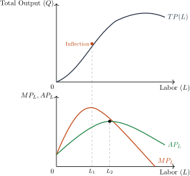
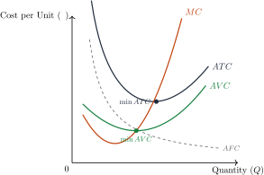
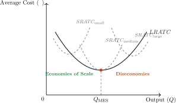

>
This chapter provides a rigorous, pedagogical treatment of Chapter 6: The Theory of the Firm: Production and Cost Curves, benchmarked to standard principles curriculum.

## Short-Run Production and Diminishing Marginal Product

### 1. Conceptual Introduction {.unnumbered}
To understand how businesses decide how much to produce and what prices they must charge to survive, economists look inside the firm's production process. A **production function** describes the technological relationship between the physical inputs a firm hires—such as labor ($L$) and physical capital ($K$)—and the maximum quantity of output ($Q$) it can generate.

In analyzing production, economists distinguish between two operational time horizons:

*  **The Short Run:** A period brief enough that at least one input—typically factory square footage, ovens, or heavy machinery—is **fixed** ($\bar{K}$). The firm can only expand output by hiring more variable inputs like hourly workers ($L$).
*  **The Long Run:** A horizon long enough that *all* inputs become variable—the firm can build a larger factory, install new assembly lines, or exit the industry entirely.

In the short run, hiring the first few workers allows staff to specialize—one person takes orders, another preps ingredients, and a third operates the espresso machine—so output surges rapidly. Soon, however, the kitchen becomes crowded. Because oven space and counter capacity are fixed, adding extra workers yields smaller and smaller output gains. This universal physical constraint is the **Law of Diminishing Marginal Product**: as successive units of a variable input are added to a fixed input, the **Marginal Product of Labor ($MP_L$)** eventually declines.

### 2. Visual Representation {.unnumbered}
Figure 1 stacks Total Product ($TP$) directly above Marginal Product ($MP_L$) and Average Product ($AP_L$), illustrating how specialization initially boosts productivity before diminishing returns set in.

{fig-alt="Short-Run Production Curves. Up to L_1, specialization raises MP_L and Total Product accelerates. Beyond L_1, diminishing marginal product sets in; MP_L intersects AP_L at its maximum (L_2) and reaches zero where Total Product peaks."}

### 3. Real-World Application: Restaurant Kitchen Bottlenecks {.unnumbered}
Consider a campus sandwich shop with two commercial panini presses (fixed capital $\bar{K}$). Hiring the first worker yields $25$ sandwiches per hour; a second worker specializing in prep raises output to $60$ sandwiches per hour ($MP_2 = 35$). Hiring a third and fourth worker adds $30$ and $20$ sandwiches respectively ($MP_3 = 30$, $MP_4 = 20$). By Workers 5 and 6, crowding around the same two grills limits each additional worker to just $8$–$10$ sandwiches per hour—demonstrating the classic law of diminishing marginal product.

### 4. Mathematical Foundation (Algebra Level) {.unnumbered}
Marginal Product of Labor ($MP_L$) and Average Product of Labor ($AP_L$) are calculated as:

$$
MP_L = \frac{\Delta Q}{\Delta L}, \qquad AP_L = \frac{Q}{L}
$$

**Worked Problem:**
A small print shop operates with fixed printing presses and observes the following daily output schedule as it hires additional technicians ($L$):

*  $L = 0 \implies Q = 0$ posters
*  $L = 1 \implies Q = 30$ posters
*  $L = 2 \implies Q = 70$ posters
*  $L = 3 \implies Q = 105$ posters
*  $L = 4 \implies Q = 128$ posters

Compute $MP_L$ and $AP_L$ for each worker from $L = 1$ to $L = 4$, and identify with which worker diminishing marginal product begins.

**Step-by-Step Breakdown:**

*  **Worker 1 ($L = 1$):**

$$
MP_1 = \frac{30 - 0}{1 - 0} = \mathbf{30}, \qquad AP_1 = \frac{30}{1} = \mathbf{30}
$$

*  **Worker 2 ($L = 2$):**

$$
MP_2 = \frac{70 - 30}{2 - 1} = \mathbf{40}, \qquad AP_2 = \frac{70}{2} = \mathbf{35}
$$

*  **Worker 3 ($L = 3$):**

$$
MP_3 = \frac{105 - 70}{3 - 2} = \mathbf{35}, \qquad AP_3 = \frac{105}{3} = \mathbf{35}
$$

*  **Worker 4 ($L = 4$):**

$$
MP_4 = \frac{128 - 105}{4 - 3} = \mathbf{23}, \qquad AP_4 = \frac{128}{4} = \mathbf{32}
$$

**Conclusion:** Marginal product rises from $30$ to $40$ with the second worker, then falls to $35$ with the third worker—so diminishing marginal product begins with **Worker 3**. Notice also that $MP_3 = AP_3 = 35$, marking the peak of Average Product.

## Short-Run Cost Structure and Curve Geometry

### 1. Conceptual Introduction {.unnumbered}
Every physical production schedule has a direct mirror image in dollar costs. In the short run, a firm's **Total Cost ($TC$)** splits into two categories:

*  **Fixed Costs ($FC$):** Overhead expenses that do not vary with output level—such as building rent, equipment leases, and property insurance. Even if the firm produces $Q = 0$, it still pays $FC$.
*  **Variable Costs ($VC$):** Expenses that rise as output increases—such as hourly wages, raw ingredients, and shipping boxes. At $Q = 0$, $VC = 0$.

Dividing total costs by output $Q$ gives per-unit average costs: **Average Fixed Cost ($AFC = FC/Q$)**, which falls continuously as overhead is spread over more units, **Average Variable Cost ($AVC = VC/Q$)**, and **Average Total Cost ($ATC = TC/Q = AFC + AVC$)**.

The single most important cost metric for pricing and output decisions is **Marginal Cost ($MC = \Delta TC / \Delta Q$)**—the extra cost of producing one additional unit. Because fixed costs do not change when $Q$ increases, marginal cost is driven entirely by variable inputs and is inversely linked to worker productivity ($MC = w / MP_L$, where $w$ is the wage rate). When diminishing marginal product sets in ($MP_L \downarrow$), marginal cost rises ($MC \uparrow$), giving $MC$, $AVC$, and $ATC$ their classic U-shapes.

### 2. Visual Representation {.unnumbered}
Figure 2 illustrates the canonical geometry of short-run cost curves, highlighting how $MC$ intersects both $AVC$ and $ATC$ at their exact minimum points.

::: {.callout-note title="Clear It Up: Why MC Crosses ATC and AVC at Their Minimums (By Design)"}

Think of your cumulative GPA. If your GPA is $3.40$ and you earn a $3.80$ in your next class (your *marginal* grade), your cumulative GPA gets pulled upward. If you earn a $2.90$, your cumulative GPA gets pulled downward. Cost curves obey the exact same arithmetic: whenever $MC < ATC$, the next unit is cheaper than the average and pulls $ATC$ down; whenever $MC > ATC$, the next unit is more expensive and pulls $ATC$ up. Therefore, $MC$ must cross $ATC$ (and $AVC$) at its exact lowest point!

:::

{fig-alt="Short-Run Per-Unit Cost Curves. Average Fixed Cost (AFC) declines steadily as output expands. Marginal Cost (MC) slopes upward due to diminishing returns and intersects both AVC and ATC at their respective minimum points."}

### 3. Real-World Application: Fixed Overhead vs. Variable Costs in Commercial Aviation {.unnumbered}
Operating a commercial jetliner involves massive fixed costs—aircraft lease payments, hangar maintenance, and pilot salaries—that must be paid whether a plane carries $40$ passengers or $180$ passengers. As an airline fills more seats on a route, its Average Fixed Cost per passenger drops sharply, pulling Average Total Cost downward. The airline reaches MES—the most efficient scale for that aircraft type—when it fills most of its available seats, balancing the fixed overhead against variable operating costs per flight.

### 4. Mathematical Foundation (Algebra Level) {.unnumbered}
The core short-run cost identities are:

$$
TC = FC + VC, \qquad ATC = \frac{TC}{Q} = AFC + AVC, \qquad MC = \frac{\Delta TC}{\Delta Q} = \frac{\Delta VC}{\Delta Q}
$$

**Worked Problem:**
A custom bakery has daily fixed rent and oven lease costs of $FC = \$200$. Its total variable costs for baking batches of artisan sourdough loaves ($Q$) are:

*  $Q = 0 \implies VC = \$0$
*  $Q = 10 \implies VC = \$100$
*  $Q = 20 \implies VC = \$180$
*  $Q = 30 \implies VC = \$310$

Calculate $TC$, $AFC$, $AVC$, $ATC$, and $MC$ at $Q = 20$ and $Q = 30$ loaves.

**Step-by-Step Breakdown:**

*  **Compute Costs at $Q = 20$:**

$$
TC_{20} = \$200 + \$180 = \mathbf{\$380}
$$

$$
AFC_{20} = \frac{\$200}{20} = \mathbf{\$10.00}, \qquad AVC_{20} = \frac{\$180}{20} = \mathbf{\$9.00}, \qquad ATC_{20} = \frac{\$380}{20} = \mathbf{\$19.00}
$$

$$
MC_{10 \to 20} = \frac{\$380 - \$300}{20 - 10} = \frac{\$80}{10} = \mathbf{\$8.00\text{ per loaf}}
$$

*  **Compute Costs at $Q = 30$:**

$$
TC_{30} = \$200 + \$310 = \mathbf{\$510}
$$

$$
AFC_{30} = \frac{\$200}{30} \approx \mathbf{\$6.67}, \qquad AVC_{30} = \frac{\$310}{30} \approx \mathbf{\$10.33}, \qquad ATC_{30} = \frac{\$510}{30} = \mathbf{\$17.00}
$$

$$
MC_{20 \to 30} = \frac{\$510 - \$380}{30 - 20} = \frac{\$130}{10} = \mathbf{\$13.00\text{ per loaf}}
$$

**Conclusion:** Between $20$ and $30$ loaves, $MC = \$13.00$ is still below $ATC_{20} = \$19.00$, so $ATC$ continues falling from $\$19.00$ down to $\$17.00$.

::: {.callout-note title="Optional Advanced Section: Calculus Proof of Minimum Cost Crossings"}

*Note for Economics Majors and Quantitative Students:*
Given a differentiable Total Cost function $TC(Q)$, Average Total Cost is $ATC(Q) = \frac{TC(Q)}{Q}$. Differentiating $ATC(Q)$ with respect to $Q$ via the quotient rule yields:

$$
\frac{d(ATC)}{dQ} = \frac{Q \cdot \frac{d(TC)}{dQ} - TC(Q) \cdot 1}{Q^2} = \frac{MC(Q) - ATC(Q)}{Q}
$$

Setting $\frac{d(ATC)}{dQ} = 0$ proves that $ATC$ achieves its critical minimum at the exact output where $MC(Q) = ATC(Q)$.

:::

## Long-Run Costs, Economies of Scale, and Efficient Scale

### 1. Conceptual Introduction {.unnumbered}
In the long run, a firm is no longer trapped inside a cramped kitchen or a single factory—it can choose among many possible plant sizes, each with its own short-run $ATC$ curve. Consider three representative cases: a small sandwich shop, a medium regional bakery chain, and a large metropolitan production facility, each with its own short-run $ATC$ curve. Tracing the lowest achievable per-unit cost at every output level forms the **Long-Run Average Total Cost ($LRATC$)** envelope curve by selecting the cheapest plant size for each quantity.

As a company scales up its long-run production capacity, $LRATC$ typically passes through three distinct phases:

*  **Economies of Scale ($LRATC$ Slopes Downward):** Doubling all inputs more than doubles output, driving per-unit costs down through worker specialization, bulk input discounts, and automated machinery.
*  **Constant Returns to Scale ($LRATC$ Is Flat):** The firm reaches **Minimum Efficient Scale ($Q_{\text{MES}}$)**—the smallest output at which $LRATC$ reaches its lowest point. Beyond this scale, the firm experiences neither further cost savings nor rising costs, until diseconomies eventually appear.
*  **Diseconomies of Scale ($LRATC$ Slopes Upward):** Beyond a massive size, bureaucracy, communication breakdowns, and managerial bloat cause per-unit costs to rise again.

### 2. Visual Representation {.unnumbered}
Figure 3 shows the U-shaped Long-Run Average Total Cost ($LRATC$) curve enveloping three short-run plant sizes ($SRATC_1$, $SRATC_2$, and $SRATC_3$).

{fig-alt="Long-Run Average Total Cost (LRATC). Expanding from a small plant to a medium plant captures economies of scale until reaching Minimum Efficient Scale (Q_{\text{MES}}), after which excessive size generates diseconomies of scale."}

### 3. Real-World Application: Semiconductor Fabs vs. Local Coffee Shops {.unnumbered}
Modern semiconductor fabrication plants cost over $\$15\text{ billion}$ to construct, meaning $LRATC$ falls steeply over millions of wafers—creating massive economies of scale that explain why only a handful of global firms (such as TSMC, Samsung, and Intel) manufacture leading-edge chips. By contrast, independent coffee shops reach Minimum Efficient Scale at a very modest daily volume, allowing hundreds of small cafés to coexist competitively across a single city.

### 4. Mathematical Foundation (Algebra Level) {.unnumbered}
Long-run returns to scale compare the percentage increase in output ($\%\Delta Q$) to a proportional percentage increase in *all* inputs ($\%\Delta \text{Inputs}$):

$$
\text{Economies of Scale} \iff \%\Delta Q > \%\Delta \text{Inputs} \iff LRATC \downarrow
$$

**Worked Problem:**
A regional solar-panel manufacturer doubles all of its factory floor space, assembly robots, and technicians ($+100\%$ increase in all inputs). Its annual output rises from $50{,}000$ panels to $125{,}000$ panels, while total long-run cost doubles from $\$10{,}000{,}000$ to $\$20{,}000{,}000$. Compute $LRATC$ before and after expansion and identify the scale regime.

**Step-by-Step Breakdown:**

*  **Compute Initial $LRATC_1$:**

$$
LRATC_1 = \frac{\$10{,}000{,}000}{50{,}000} = \mathbf{\$200\text{ per panel}}
$$

*  **Compute Expanded $LRATC_2$:**

$$
LRATC_2 = \frac{\$20{,}000{,}000}{125{,}000} = \mathbf{\$160\text{ per panel}}
$$

*  **Compare Input Growth vs. Output Growth:**
Inputs increased by $100\%$, while output increased by $\frac{125{,}000 - 50{,}000}{50{,}000} = +150\%$.

**Conclusion:** Because output grew faster than inputs ($150\% > 100\%$) and per-unit cost fell from $\$200$ to $\$160$, the firm is experiencing **economies of scale**.
