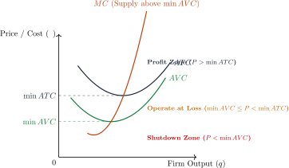
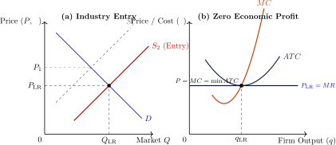

>
This chapter provides a rigorous, pedagogical treatment of Chapter 7: Perfect Competition and Long-Run Industry Equilibrium, benchmarked to standard principles curriculum.

## Price-Taking Behavior and Short-Run Profit Maximization

### 1. Conceptual Introduction {.unnumbered}
Economists begin studying market structures with **perfect competition**, an idealized benchmark defined by four strict conditions: (1) many small buyers and sellers, (2) identical (**homogeneous**) products across every firm, (3) perfect information about prices and quality, and (4) free entry and exit in the long run with zero barriers. Agricultural commodities like wheat, corn, and soybeans come closest to this model in practice.

Because each competitive firm supplies a tiny fraction of total market output and sells an identical product, an individual farmer has zero power to raise price above the going market rate—if they charge even one penny more, buyers switch instantly to neighbors. Consequently, every competitive firm is a **price taker** facing a perfectly horizontal demand curve at the market price $P^*$. Every additional unit sold adds exactly $P^*$ to revenue, meaning **Price equals Marginal Revenue and Average Revenue ($P = MR = AR$)**.

To maximize economic profit ($\pi = TR - TC$), a competitive firm expands output up to the exact point where Marginal Revenue equals Marginal Cost:

$$
P = MR = MC(q^*)
$$

Once optimal output $q^*$ is chosen, the firm's profit or loss per unit is the vertical gap between market price $P^*$ and Average Total Cost ($ATC$) at $q^*$: $\pi = (P^* - ATC) \times q^*$.

### 2. Visual Representation {.unnumbered}
Figure 1 links the overall market supply-and-demand equilibrium (left) to an individual price-taking firm earning positive short-run economic profit (right).

{fig-alt="Short-Run Profit Maximization under Perfect Competition. The market sets equilibrium price P^* (left), establishing a horizontal P = MR line for the individual firm (right). Producing q^* where P = MC generates positive economic profit shown by the green shaded box."}

### 3. Real-World Application: Midwest Corn Farmers and Global Grain Prices {.unnumbered}
A family corn farm in Iowa harvesting $150{,}000$ bushels cannot negotiate its own price with grain elevators—it sells at the daily Chicago Board of Trade spot price. When global grain prices surge due to droughts overseas, the farm's horizontal $P = MR$ line shifts upward, prompting the farmer to apply extra fertilizer and harvest every acre ($P = MC$) to capture positive economic profits.

### 4. Mathematical Foundation (Algebra Level) {.unnumbered}
A competitive firm maximizes profit at $P = MC(q^*)$, earning total economic profit:

$$
\pi = TR - TC = (P - ATC) \times q^*
$$

**Worked Problem:**
A competitive blueberry grower faces a market price of $P = \$30$ per crate. The grower's Total Cost and Marginal Cost equations are:

$$
TC(q) = 50 + 6q + 2q^2, \qquad MC(q) = 6 + 4q
$$

Find the profit-maximizing quantity of crates $q^*$, Average Total Cost at $q^*$, and total economic profit $\pi$.

**Step-by-Step Breakdown:**

*  **Apply the Profit-Maximization Rule ($P = MC$):**
Set market price equal to Marginal Cost and solve for $q^*$:

$$
30 = 6 + 4q^* \implies 24 = 4q^* \implies q^* = \mathbf{6\text{ crates}}
$$

*  **Calculate Total Cost ($TC$) and Average Total Cost ($ATC$) at $q^* = 6$:**

$$
TC(6) = 50 + 6(6) + 2(6^2) = 50 + 36 + 72 = \$158
$$

$$
ATC(6) = \frac{\$158}{6} \approx \mathbf{\$26.33\text{ per crate}}
$$

*  **Calculate Economic Profit ($\pi$):**

$$
\pi = TR - TC = (\$30 \times 6) - \$158 = \$180 - \$158 = \mathbf{+\$22}
$$

**Conclusion:** Producing $6$ crates maximizes profit at $+\$22$.

## Short-Run Shutdown vs. Long-Run Exit Rules

### 1. Conceptual Introduction {.unnumbered}
What should a competitive firm do when market prices drop so low that it loses money ($\pi < 0$)? Many students assume a money-losing business should immediately lock its doors. In economics, that instinct ignores the crucial difference between **sunk fixed costs** in the short run and **escapable fixed costs** in the long run:

*  **Short-Run Shutdown Rule ($P < \min AVC$):** In the short run, fixed costs (such as a signed building lease) must be paid even if output is zero. As long as the market price covers Average Variable Cost ($P \ge \min AVC$), every unit sold brings in enough cash to pay workers and materials *plus* contribute something toward paying the rent. The firm should **keep operating at a loss** to minimize its deficit. Only if $P < \min AVC$ does operating lose even more money than shutting down.
*  **Long-Run Exit Rule ($P < \min ATC$):** In the long run, leases expire and all costs become variable. If price remains below minimum Average Total Cost ($P < \min ATC$), the firm cannot cover its full economic costs and will permanently **exit the industry**.

Consequently, a competitive firm's **short-run supply curve** is simply the upward-sloping portion of its $MC$ curve lying above $\min AVC$.

### 2. Visual Representation {.unnumbered}
Figure 2 maps the three decision zones along a competitive firm's Marginal Cost curve: positive profit ($P > \min ATC$), loss-minimizing operation ($\min AVC \le P < \min ATC$), and immediate short-run shutdown ($P < \min AVC$).

::: {.callout-note title="Clear It Up: Shutdown Is Temporary; Exit Is Permanent"}

A **shutdown** is a short-run decision to produce $q = 0$ today while still paying fixed overhead (like a ski resort closing in July while still paying property taxes). **Exit** is a long-run decision to leave the market completely and eliminate all fixed and variable costs.

:::

{fig-alt="Short-Run Shutdown and Long-Run Exit Thresholds. Below \min AVC, revenue fails to cover variable operating costs and the firm shuts down (q=0). Between \min AVC and \min ATC, the firm operates at a loss to offset fixed costs."}

### 3. Real-World Application: Seasonal Restaurants and Off-Peak Hotels {.unnumbered}
A beachfront hotel in a summer tourist town faces high fixed mortgage and insurance costs year-round. In November, room rates drop from $\$280$ to $\$95$ per night. Because the variable cost of housekeeping and utilities for an occupied room is only $\$45$ per night ($P = \$95 > AVC = \$45$), the hotel stays open through autumn—using the $\$50$ per-night operating surplus to help pay its mortgage rather than shutting down.

### 4. Mathematical Foundation (Algebra Level) {.unnumbered}
Comparing total loss from operating ($\pi_{\text{operate}} = TR - VC - FC$) against total loss from shutting down ($\pi_{\text{shutdown}} = -FC$) proves:

$$
\pi_{\text{operate}} > \pi_{\text{shutdown}} \iff TR - VC - FC > -FC \iff TR > VC \iff P > AVC
$$

**Worked Problem:**
A small print shop has daily fixed rent of $FC = \$300$. At its optimal output of $q^* = 50$ print jobs per day, its Total Variable Cost is $VC = \$400$ (so $AVC = \$8.00$ per job and $ATC = \$14.00$ per job). Suppose a recession pushes the market price down to $P = \$10.00$ per job. Calculate the shop's loss if it operates versus its loss if it shuts down, and determine the optimal short-run decision.

**Step-by-Step Breakdown:**

*  **Calculate Loss If the Shop Operates ($q^* = 50$):**

$$
TR = \$10.00 \times 50 = \$500, \qquad TC = FC + VC = \$300 + \$400 = \$700
$$

$$
\pi_{\text{operate}} = \$500 - \$700 = \mathbf{-\$200\text{ daily loss}}
$$

*  **Calculate Loss If the Shop Shuts Down ($q = 0$):**
Revenue is $\$0$ and variable cost is $\$0$, leaving the fixed rent unpaid:

$$
\pi_{\text{shutdown}} = \$0 - \$300 = \mathbf{-\$300\text{ daily loss}}
$$

*  **Compare Thresholds:**
Because $P\ (\$10.00) > AVC\ (\$8.00)$, operating generates $\$2.00$ per job toward rent, shrinking the loss by $\$100$. However, because $P\ (\$10.00) < ATC\ (\$14.00)$, the shop will exit if prices stay at $\$10.00$ when its lease expires.

**Conclusion:** The shop should **stay open in the short run** (losing $\$200$ instead of $\$300$), but **exit in the long run** unless market prices recover to at least $\$14.00$.

## Long-Run Industry Equilibrium and Zero Economic Profit

### 1. Conceptual Introduction {.unnumbered}
In the long run, **free entry and exit** act as an automatic self-correcting thermostat for perfectly competitive industries. Whenever existing firms earn positive economic profits ($\pi > 0$), entrepreneurs notice the above-normal returns and enter the market. New entrants shift the industry supply curve to the right, driving market price downward until economic profits shrink to zero. Conversely, if firms suffer economic losses ($\pi < 0$), struggling producers exit, shifting industry supply to the left and pushing prices back up until remaining firms break even.

Consequently, every perfectly competitive industry settles into a **long-run equilibrium** characterized by the triple equality:

$$
P = MR = MC = \min ATC
$$

At this equilibrium, firms earn **zero economic profit**—meaning they earn a **normal accounting profit** that covers all explicit bills plus the owner's full implicit opportunity cost of time and invested capital. Moreover, because firms produce at the exact bottom of their $ATC$ curve ($P = \min ATC$) and price equals marginal social cost ($P = MC$), long-run competitive markets achieve both **productive efficiency** and **allocative efficiency** simultaneously.

### 2. Visual Representation {.unnumbered}
Figure 3 shows how new entry shifts industry supply from $S_1$ to $S_2$, pushing market price down from $P_1$ to $P_{\text{LR}} = \min ATC$ where economic profit equals zero.

{fig-alt="Long-Run Competitive Equilibrium. Positive profits at P_1 attract new firms, shifting market supply from S_1 to S_2 until price falls to P_{\text{LR}} = \min ATC, eliminating economic profit."}

### 3. Real-World Application: Craft Breweries and Food Trucks {.unnumbered}
When gourmet food trucks surged in popularity, early operators earned high economic profits. Because startup barriers were low, hundreds of new food trucks entered major cities within a few years—competing prices down and splitting customer traffic until typical operators earned a normal return on their labor and truck investment.

### 4. Mathematical Foundation (Algebra Level) {.unnumbered}
In long-run equilibrium, market price equals the minimum point of each identical firm's $ATC$ curve:

$$
P_{\text{LR}} = \min ATC, \qquad N^* = \frac{Q_{\text{market}}(P_{\text{LR}})}{q_{\text{LR}}}
$$

where $N^*$ is the equilibrium number of firms in the industry.

**Worked Problem:**
Every firm in a competitive lawn-care industry has identical costs with minimum Average Total Cost occurring at $q_{\text{LR}} = 25$ lawns per week and $\min ATC = \$40$ per lawn. Total market demand for lawn care in the city is $Q_d = 2{,}000 - 15P$. Find the long-run equilibrium price $P_{\text{LR}}$, total market quantity $Q_{\text{LR}}$, and equilibrium number of lawn-care firms $N^*$.

**Step-by-Step Breakdown:**

*  **Identify Long-Run Price ($P_{\text{LR}}$):**
Zero economic profit requires price to equal minimum Average Total Cost:

$$
P_{\text{LR}} = \min ATC = \mathbf{\$40\text{ per lawn}}
$$

*  **Calculate Total Market Quantity ($Q_{\text{LR}}$) at $P = \$40$:**

$$
Q_{\text{LR}} = 2{,}000 - 15(40) = 2{,}000 - 600 = \mathbf{1{,}400\text{ lawns per week}}
$$

*  **Calculate Equilibrium Number of Firms ($N^*$):**
Divide total market output by each firm's efficient scale ($q_{\text{LR}} = 25$):

$$
N^* = \frac{1{,}400}{25} = \mathbf{56\text{ firms}}
$$

**Conclusion:** In long-run equilibrium, $56$ firms each service $25$ lawns per week at $\$40$ per lawn, earning zero economic profit.

::: {.callout-note title="Optional Advanced Section: Calculus Derivation of Long-Run Supply"}

*Note for Economics Majors and Quantitative Students:*
Suppose each firm has Total Cost $TC(q) = 100 + 20q + q^2$. Marginal Cost is $MC(q) = \frac{d(TC)}{dq} = 20 + 2q$, and Average Total Cost is $ATC(q) = \frac{100}{q} + 20 + q$. Setting $MC(q) = ATC(q)$:

$$
20 + 2q = \frac{100}{q} + 20 + q \implies q = \frac{100}{q} \implies q^2 = 100 \implies q_{\text{LR}} = 10
$$

Substituting $q_{\text{LR}} = 10$ back into $MC(q)$ gives $P_{\text{LR}} = 20 + 2(10) = \$40$, establishing a horizontal long-run constant-cost industry supply curve at $P = \$40$.

:::
