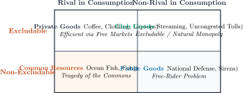

>
This chapter examines why competitive markets fail to achieve social efficiency in the presence of externalities, public goods, and common resources. Each section develops plain-English intuition before presenting coordinate geometry, algebra-first worked problems, policy applications (Pigouvian taxes and subsidies, cap-and-trade permits, Coase bargaining, and fishery catch shares), and optional calculus extensions.

## Negative and Positive Externalities

### Conceptual Introduction {.unnumbered}
In Chapter 4, we showed that competitive markets maximize total social surplus when private buyers and sellers capture all benefits and pay all costs of a transaction ($MB = MC$). However, markets fail to allocate resources efficiently whenever production or consumption creates an **externality**—an uncompensated cost or benefit imposed on a third party outside the market transaction.

Externalities split into two fundamental categories:

*  **Negative Externalities (External Costs):** When producing or consuming a good imposes unpriced harm on bystanders—such as industrial air pollution, highway traffic congestion, or late-night noise—the **Marginal Social Cost ($MSC$)** exceeds the firm's **Marginal Private Cost ($MPC$)** by the **Marginal External Cost ($MEC$)**: $MSC = MPC + MEC$. Because unregulated firms ignore $MEC$ and produce where $MB = MPC$, the free market **overproduces** ($Q_M > Q^*$), creating a Deadweight Loss ($DWL$) triangle on the excess units whose social cost exceeds social benefit.
*  **Positive Externalities (External Benefits):** When an activity generates unpriced spillover benefits for third parties—such as vaccinations reducing disease transmission, basic scientific research, or neighborhood historic preservation—the **Marginal Social Benefit ($MSB$)** exceeds **Marginal Private Benefit ($MPB$)** by the **Marginal External Benefit ($MEB$)**: $MSB = MPB + MEB$. Left alone, the market produces where $MPB = MC$ and **underproduces** ($Q_M < Q^*$), forfeiting mutually beneficial surplus on the missing units.

::: {.callout-note title="Clear It Up: Why the Socially Optimal Level of Pollution Is Rarely Zero"}

Students often assume that because pollution causes real harm, the economically efficient level of emissions must be zero. In reality, eliminating the very last unit of emissions from electricity generation, shipping, or manufacturing often requires shutting down vital economic activity whose marginal benefit vastly exceeds the marginal damage of a small amount of pollution ($MB > MSC$). Social efficiency balances incremental benefits against incremental social costs at $MB = MSC$ ($Q^* > 0$), curbing only those units where marginal social harm exceeds marginal benefit.

:::

### Visual Representation {.unnumbered}
Figure 1 illustrates a negative production externality under three simplifying assumptions: a competitive market, linear marginal benefit and marginal private cost schedules, and a constant marginal external cost ($MEC = \$10$ per unit). Because $MSC$ lies vertically above $MPC$ by $MEC$, unregulated market output $Q_M = 40$ exceeds the socially efficient output $Q^* = 35$, generating the shaded Deadweight Loss triangle on the five overproduced units.

{fig-alt="Negative Production Externality. Because firms ignore Marginal External Cost (MEC = $10), the unregulated market reaches E_M at Q_M = 40 (MB = MPC) instead of the socially optimal E^* at Q^* = 35 (MB = MSC). On units 35 through 40, MSC exceeds MB, generating a Deadweight Loss of $25."}

::: {.callout-tip title="Bring It Home: Urban Traffic Congestion and Carbon Emissions"}

Every weekday morning on congested metropolitan highways and bridges, each additional commuter who merges onto the roadway considers only their private travel time and fuel expense ($MPC$). Yet their car slows down thousands of drivers behind them, imposing an unpriced **congestion externality** ($MEC$) in lost time and extra idling emissions. Dynamic tolling—such as peak-hour bridge tolls or express-lane congestion pricing—attempts to price that external delay so drivers weigh the full social cost of rush-hour travel.

A similar gap separates private decisions from social costs in energy markets. Industrial and transportation fossil-fuel combustion releases greenhouse gases whose climate damages fall globally outside the private transaction. Empirical analysis carefully distinguishes physical emissions volumes—such as annual U.S. energy-related carbon dioxide emissions compiled by the U.S. Energy Information Administration and published on St. Louis Fed FRED under series \texttt{EMISSCO2TOTVTTTOUSA} (measured in million metric tons of $\text{CO}_2$)—from the estimated dollar marginal external damage per ton (the social cost of carbon).

:::

### Mathematical Foundation (Algebra Level) {.unnumbered}
Comparing unregulated equilibrium ($MB = MPC$) with social efficiency ($MB = MSC = MPC + MEC$) under linear curves and a constant marginal external cost yields a triangular deadweight loss whose base is the overproduced quantity $(Q_M - Q^*)$ and whose height is $MEC(Q_M) = MSC(Q_M) - MB(Q_M)$:

$$
MSC(Q) = MPC(Q) + MEC(Q), \qquad DWL = \frac{1}{2} \times (Q_M - Q^*) \times MEC(Q_M)
$$

::: {.callout-note title="Work It Out: Quantifying Overproduction and Deadweight Loss"}

**Problem:** Using the linear competitive market in Figure 1, suppose marginal benefit is $MB = 100 - Q$, marginal private cost is $MPC = 20 + Q$, and marginal external cost is constant at $MEC = \$10$ per unit (assuming no consumption externalities, so $MSB = MB$). Compute the unregulated outcome $(Q_M, P_M)$, the socially efficient outcome $(Q^*, P^*)$, and the Deadweight Loss ($DWL$) from unregulated production.

\medskip
**Step-by-Step Solution:**

*  **Find Unregulated Equilibrium ($Q_M, P_M$) Where $MB = MPC$:**

$$
100 - Q_M = 20 + Q_M \implies 2Q_M = 80 \implies Q_M = \mathbf{40\text{ units}}
$$

Substitute $Q_M = 40$ into $MB$:

$$
P_M = 100 - 40 = \mathbf{\$60}
$$

*  **Construct $MSC$ and Find Efficient Equilibrium ($Q^*, P^*$) Where $MB = MSC$:**

$$
MSC = MPC + MEC = (20 + Q) + 10 = 30 + Q
$$

Set $MB = MSC$:

$$
100 - Q^* = 30 + Q^* \implies 2Q^* = 70 \implies Q^* = \mathbf{35\text{ units}}, \qquad P^* = 100 - 35 = \mathbf{\$65}
$$

*  **Compute Deadweight Loss ($DWL$) from the Five Overproduced Units:**
At $Q_M = 40$, $MSC(40) = 30 + 40 = \$70$ while $MB(40) = \$60$, confirming the vertical gap $MSC(40) - MB(40) = \$10 = MEC$:

$$
DWL = \frac{1}{2} \times (Q_M - Q^*) \times MEC = \frac{1}{2} \times (40 - 35) \times \$10 = \frac{1}{2} \times 5 \times \$10 = \mathbf{\$25}
$$

**Conclusion:** Ignoring the $\$10$ per-unit external damage causes the market to overproduce by $5$ units at an artificially low price ($\$60$ vs. $\$65$), destroying $\$25$ in net social welfare.

:::

::: {.callout-note title="Optional Advanced Section: Calculus of Social Surplus and Deadweight Loss"}

*Note for Economics Majors and Quantitative Students:*
Let $TB(Q)$ be Total Benefit, $TPC(Q)$ be Total Private Cost, and $TEC(Q)$ be Total External Cost. Maximizing Net Social Benefit $NSB(Q) = TB(Q) - TPC(Q) - TEC(Q)$ requires the first-order condition:

$$
\frac{d(NSB)}{dQ} = MB(Q^*) - MPC(Q^*) - MEC(Q^*) = 0 \implies MB(Q^*) = MSC(Q^*)
$$

For any overproduced market quantity $Q_M > Q^*$, exact Deadweight Loss equals the definite integral of excess marginal social cost over marginal benefit:

$$
DWL = \int_{Q^*}^{Q_M} \bigl[MSC(Q) - MB(Q)\bigr]\,dQ
$$

In Figure 1, $MSC(Q) - MB(Q) = (30 + Q) - (100 - Q) = 2Q - 70$, so:

$$
DWL = \int_{35}^{40} (2Q - 70)\,dQ = \bigl[Q^2 - 70Q\bigr]_{35}^{40} = (1{,}600 - 2{,}800) - (1{,}225 - 2{,}450) = -1{,}200 - (-1{,}225) = \$25
$$

:::

## Corrective Policies: Pigouvian Taxes, Subsidies, and Coase Bargaining

### Conceptual Introduction {.unnumbered}
How can society restore efficiency when externalities distort market outcomes? Economists evaluate both private bargaining mechanisms and public policy tools designed to **internalize the externality**—bringing external costs or benefits directly inside private decision-makers' incentives:

*  **Pigouvian Taxes and Subsidies:** Named after British economist Arthur Pigou, a **Pigouvian tax** sets a per-unit tax equal to Marginal External Cost at the efficient quantity ($t^* = MEC(Q^*)$), shifting private supply $MPC$ upward onto $MSC$ so firms voluntarily choose $Q^*$. Conversely, a **Pigouvian subsidy** equal to $MEB(Q^*)$ raises private incentives to correct positive externalities.
*  **Cap-and-Trade (Tradable Emissions Permits):** Regulators cap total emissions at $Q^*$ and issue tradable permits. Allowing firms to buy and sell permits directs pollution cuts to whichever facilities can abate most cheaply, achieving the cap at the lowest possible total abatement cost—unlike rigid command-and-control mandates that force identical cuts across firms with very different costs.
*  **The Coase Theorem:** Nobel laureate Ronald Coase showed that if **property rights are clearly defined** and **transaction costs are low**, private parties can bargain directly to reach the socially efficient outcome $Q^*$ without government intervention—regardless of which party initially holds the property right. (Initial ownership still determines who pays whom, affecting income distribution, even though $Q^*$ is identical.) However, when thousands or millions of dispersed residents are affected by urban smog or climate emissions, high negotiation costs and holdout problems prevent private bargaining and motivate public policy.

::: {.callout-note title="Clear It Up: Why a Pigouvian Tax Increases Welfare Instead of Causing DWL"}

In Chapter 4, taxing a distortion-free competitive market created deadweight loss by driving out trades where $MB > MC$. When a market already suffers from a negative externality, however, a Pigouvian tax *eliminates* deadweight loss by stopping overproduction on units where true social cost exceeds social benefit ($MSC > MB$). Furthermore, the tax revenue collected can finance public services or offset other distortionary taxes.

:::

### Visual Representation {.unnumbered}
Figure 2 illustrates how levying a Pigouvian corrective tax $t^* = MEC = \$10$ per unit on producers in the Section 10.1 market shifts private marginal cost from $MPC$ onto $MSC = MPC + t^*$. Equilibrium moves from $Q_M = 40$ to $Q^* = 35$, the buyer price rises to $P^* = \$65$, sellers retain $P_s = \$55$ net of tax, deadweight loss falls to zero, and the government collects $\$350$ in corrective tax revenue.

{fig-alt="Correcting a Negative Externality with a Pigouvian Tax. Setting t^* = MEC = $10 shifts private marginal cost from MPC onto MSC, reducing output from 40 to the socially efficient Q^* = 35. Buyers pay P^* = $65, sellers net P_s = $55, deadweight loss is eliminated, and tax revenue equals $10 \times 35 = $350."}

::: {.callout-tip title="Bring It Home: California's Cap-and-Trade Program"}

California enforces a statewide cap on greenhouse gas emissions across electricity generators, fuel distributors, refineries, and major industrial plants while allowing regulated facilities to buy and sell emission allowances. Suppose two factories must jointly reduce emissions by $30$ tons, where Facility A can cut pollution at lower marginal abatement cost ($MAC_A = 2a_A$) than Facility B ($MAC_B = 4a_B$).

*  **Uniform Mandate (Command-and-Control):** Forcing each factory to cut $15$ tons independently costs Facility A $\$225$ and Facility B $\$450$, for a combined abatement cost of $\$675$.
*  **Cap-and-Trade:** Allowing permit trading at a market price of $\$40/\text{ton}$ induces Facility A to cut $20$ tons (costing $\$400$) and sell spare permits to Facility B, which cuts $10$ tons (costing $\$200$). Total emissions drop by the exact same $30$ tons, yet total abatement cost falls to $\$600$—saving $\$75$ through cost-effective specialization.

:::

### Mathematical Foundation (Algebra Level) {.unnumbered}
To restore efficiency in a competitive market with externalities, set the corrective Pigouvian tax or subsidy equal to the marginal spillover evaluated at the socially efficient quantity $Q^*$:

$$
t^* = MEC(Q^*), \qquad s^* = MEB(Q^*)
$$

Under a Pigouvian tax $t^*$, total government revenue is $R = t^* \times Q^*$, and the net price received by sellers is $P_s = P^* - t^*$. Under a Pigouvian subsidy $s^*$, total government expenditure is $E = s^* \times Q^*$, and the effective out-of-pocket price paid by buyers is $P_b = P_{\text{seller}} - s^*$.

::: {.callout-note title="Work It Out: Designing a Pigouvian Subsidy for Community Vaccinations"}

**Problem:** Suppose community flu vaccinations have linear marginal private benefit $MPB = 80 - 2Q$, marginal social benefit $MSB = 100 - 2Q$, and constant marginal cost $MC = \$30$ per dose (where $Q$ is measured in thousands of doses and there are no external production costs). Compute:

*  The unregulated vaccination quantity $Q_M$ and the socially efficient quantity $Q^*$.
*  The optimal Pigouvian subsidy $s^*$ per dose and the out-of-pocket price buyers pay under the subsidy.
*  The Deadweight Loss avoided by moving from $Q_M$ to $Q^*$ and total public subsidy expenditure.

\medskip
**Step-by-Step Solution:**

*  **Find Unregulated ($Q_M$) and Socially Efficient ($Q^*$) Quantities:**
Unregulated buyers equate $MPB = MC$:

$$
80 - 2Q_M = 30 \implies 2Q_M = 50 \implies Q_M = \mathbf{25\text{ thousand doses}}
$$

Social efficiency equates $MSB = MC$:

$$
100 - 2Q^* = 30 \implies 2Q^* = 70 \implies Q^* = \mathbf{35\text{ thousand doses}}
$$

*  **Compute the Optimal Pigouvian Subsidy ($s^*$) and Buyer Price ($P_b$):**
The marginal external benefit of herd protection is:

$$
s^* = MEB(Q^*) = MSB - MPB = (100 - 2Q) - (80 - 2Q) = \mathbf{\$20\text{ per dose}}
$$

Because clinics require $MC = \$30$ per dose, a $\$20$ subsidy lowers the buyer's out-of-pocket price to $P_b = \$30 - \$20 = \mathbf{\$10\text{ per dose}}$ (which matches $MPB(35) = 80 - 2(35) = \$10$).

*  **Compute Deadweight Loss Avoided and Total Subsidy Outlay:**

$$
DWL_{\text{avoided}} = \frac{1}{2} \times (Q^* - Q_M) \times MEB = \frac{1}{2} \times (35 - 25)\text{ thousand} \times \$20 = \mathbf{\$100\text{ thousand}}
$$

$$
\text{Total Subsidy Outlay} = s^* \times Q^* = \$20 \times 35\text{ thousand} = \mathbf{\$700\text{ thousand}}
$$

**Conclusion:** A $\$20$ per-dose subsidy lowers the patient's price to $\$10$, expanding uptake from $25{,}000$ to $35{,}000$ doses and capturing $\$100{,}000$ in previously lost social surplus.

:::

::: {.callout-note title="Optional Advanced Section: Equimarginal Abatement and Corrective Tax Optimality"}

*Note for Economics Majors and Quantitative Students:*
When a competitive firm faces price $P$ and a per-unit Pigouvian tax $t$, it maximizes after-tax profit $\pi(Q) = PQ - TPC(Q) - tQ$, yielding the first-order condition:

$$
\frac{d\pi}{dQ} = P - MPC(Q) - t = 0 \implies P = MPC(Q) + t
$$

Setting $t = t^* = MEC(Q^*)$ aligns private equilibrium ($MB = P = MPC + t^*$) identically with the social planner's optimum ($MB(Q^*) = MPC(Q^*) + MEC(Q^*)$).

Similarly, minimizing total abatement cost $C_1(a_1) + C_2(a_2)$ across two polluters subject to a joint emissions cap $a_1 + a_2 = \bar{A}$ sets up the Lagrangian $\mathcal{L} = C_1(a_1) + C_2(a_2) + \lambda(\bar{A} - a_1 - a_2)$. First-order conditions yield the **equimarginal principle**:

$$
C_1'(a_1^*) = C_2'(a_2^*) = \lambda \iff MAC_1(a_1^*) = MAC_2(a_2^*) = p_{\text{permit}}
$$

In the California Cap-and-Trade illustration ($MAC_1 = 2a_1$, $MAC_2 = 4a_2$, $\bar{A} = 30$), $2a_1^* = 4a_2^*$ and $a_1^* + a_2^* = 30$ uniquely give $a_1^* = 20$, $a_2^* = 10$, and $p_{\text{permit}} = \$40/\text{ton}$, minimizing combined abatement cost at $\int_0^{20} 2a_1\,da_1 + \int_0^{10} 4a_2\,da_2 = \$400 + \$200 = \$600$.

:::

## Public Goods, Common Resources, and the Free-Rider Problem

### Conceptual Introduction {.unnumbered}
Economists classify all goods in society using two physical questions: (1) Is the good **excludable** (can providers feasibly prevent non-payers from consuming it)? and (2) Is the good **rival in consumption** (does one person's use diminish the amount available for others)?

Crossing these two traits creates a four-quadrant classification matrix:

*  **Private Goods (Excludable & Rival):** Coffee, laptops, and sneakers. Because sellers can charge prices and buyers capture the full benefit of each unit, competitive markets generally supply private goods efficiently.
*  **Club Goods (Excludable & Non-Rival):** Streaming platforms, uncongested toll bridges, and password-protected Wi-Fi. Providers can exclude non-payers, though high fixed costs and near-zero marginal costs often create natural-monopoly pricing challenges.
*  **Public Goods (Non-Excludable & Non-Rival):** National defense, coastal tsunami warning sirens, and basic scientific discoveries. Because nobody can be excluded once the good exists, rational individuals face an incentive to enjoy the benefit without contributing—the **free-rider problem**—causing private markets to severely underprovide public goods unless funded collectively through taxation.
*  **Common Resources (Non-Excludable & Rival):** Open-ocean fisheries, clean ambient air, and congested free public highways. Because anyone can access the resource at zero price while each user depletes what remains for others, uncoordinated individuals overexploit common resources—a market failure known as the **Tragedy of the Commons**.

::: {.callout-note title="Clear It Up: ``Public Goods'' Does Not Mean ``Government-Provided Goods''"}

In everyday speech, people call any government service a ``public good.'' In economics, however, classification depends strictly on the physical traits of *excludability* and *rivalry*—not on whether the provider is public or private. A city bus or state park with ticket gates is *excludable* (not a pure public good), whereas privately written open-source software or free over-the-air radio broadcasts are non-excludable and non-rival—making them economic public goods even when supplied outside government.

:::

### Visual Representation {.unnumbered}
Figure 3 organizes the four economic categories of goods by excludability and rivalry, highlighting the two market failures triggered by non-excludability. Figure 4 then illustrates the defining geometry of public-good valuation: because every resident consumes the exact same quantity $Q$ simultaneously, society sums individual marginal willingness to pay **vertically** (unlike private goods, where market demand sums individual quantities horizontally at each price).

{fig-alt="The Four Economic Categories of Goods. Non-excludability creates two distinct market failures: underprovision of non-rival Public Goods (free-rider problem) and overexploitation of rival Common Resources (Tragedy of the Commons)."}

{fig-alt="Vertical Summation for a Non-Rival Public Good. Summing Oakville's (MB_1 = 50 - Q) and Pinehurst's (MB_2 = 30 - Q) marginal benefits vertically yields the kinked MSB curve (MSB = 80 - 2Q for 0 \le Q \le 30, merging with MB_1 once MB_2 reaches $0 at Q = 30). Social efficiency occurs at E^*(20, $40) where MB_1 ($30) + MB_2 ($10) = MC ($40), avoiding $100 in underprovision loss relative to unilateral provision (Q_1 = 10)."}

::: {.callout-tip title="Bring It Home: Pacific Salmon Fisheries and Catch Shares"}

Open-ocean fisheries are classic common resources: every fishing vessel captures the full market revenue of the salmon it lands today while ignoring the external depletion cost imposed on future breeding stocks. Without coordination, competing fleets race to harvest before rivals do, driving fish populations toward biological collapse.

Policy solutions align private incentives with long-term stock health. Many coastal fisheries use **Individual Transferable Quotas (ITQs)**—also called **catch shares**—which cap the total sustainable seasonal catch and grant fishers enforceable, tradable shares of that cap. Because quota holders own a stake in next year's harvest, they have a direct financial incentive to protect spawning stocks. In addition, Nobel laureate Elinor Ostrom documented that local communities frequently avoid the Tragedy of the Commons without centralized privatization by enforcing clear community boundaries, mutual monitoring, and graduated sanctions for rule-breakers.

:::

### Mathematical Foundation (Algebra Level) {.unnumbered}
Because a pure public good is non-rival (every citizen consumes the same total quantity $Q$), society calculates **Marginal Social Benefit ($MSB$)** by summing all non-negative individual marginal benefits **vertically** at each $Q$ and equating the sum to marginal cost:

$$
MSB(Q) = MB_1(Q) + MB_2(Q) + \dots + MB_N(Q) = MC(Q)
$$

::: {.callout-note title="Work It Out: Vertical Summation for a Local Public Good"}

**Problem:** Two neighboring coastal towns, Oakville and Pinehurst, share a non-rival, non-excludable tsunami warning siren network (as graphed in Figure 4). Oakville's marginal benefit is $MB_1 = 50 - Q$, and Pinehurst's marginal benefit is $MB_2 = 30 - Q$, where $Q$ is the number of sirens installed (with $MB_i \ge 0$). The marginal cost of installing each siren is constant at $MC = \$40$.

*  Determine how many sirens either town would install acting alone.
*  Construct the piecewise Marginal Social Benefit schedule $MSB(Q)$ and compute the socially optimal number of sirens $Q^*$.
*  Verify each town's marginal valuation at $Q^*$ and calculate the social surplus gained by moving from unilateral provision to $Q^*$.

\medskip
**Step-by-Step Solution:**

*  **Check Unilateral Provision ($MB_i = MC$):**

*  Oakville alone: $50 - Q_1 = 40 \implies Q_1 = \mathbf{10\text{ sirens}}$.
*  Pinehurst alone: $30 - Q_2 = 40 \implies Q_2 = \mathbf{0\text{ sirens}}$ (since Pinehurst's maximum willingness to pay is $\$30 < \$40$).

Thus, without cooperation, Oakville installs $10$ sirens and Pinehurst free rides on them.

*  **Sum Marginal Benefits Vertically and Solve $MSB(Q^*) = MC$:**
Because willingness to pay cannot be negative, $MB_2 = 30 - Q$ reaches $\$0$ at $Q = 30$, creating a kink:

$$
MSB(Q) =
\begin{cases}
(50 - Q) + (30 - Q) = 80 - 2Q & \text{for } 0 \le Q \le 30, \\
50 - Q & \text{for } 30 < Q \le 50.
\end{cases}
$$

Setting the upper segment equal to $MC = 40$:

$$
80 - 2Q^* = 40 \implies 2Q^* = 40 \implies Q^* = \mathbf{20\text{ sirens}}
$$

Because $Q^* = 20 \le 30$, both towns have strictly positive marginal benefit at the optimum.

*  **Verify Individual Valuations and Social Surplus Gain:**
At $Q^* = 20$: $MB_1(20) = 50 - 20 = \$30$ and $MB_2(20) = 30 - 20 = \$10$, summing cleanly to $\$30 + \$10 = \$40 = MC$.
At the unilateral quantity $Q_1 = 10$, $MSB(10) = 80 - 2(10) = \$60 > \$40$. Moving from $10$ to $20$ sirens recovers the shaded welfare triangle:

$$
\text{Social Surplus Gain} = \frac{1}{2} \times (20 - 10) \times (\$60 - \$40) = \frac{1}{2} \times 10 \times \$20 = \mathbf{\$100}
$$

**Conclusion:** Acting independently, the towns install only $10$ sirens; pooling their joint willingness to pay achieves the socially optimal $20$ sirens and generates $\$100$ in additional net social benefit.

:::

::: {.callout-note title="Optional Advanced Section: Samuelson Condition for Public Goods"}

*Note for Economics Majors and Quantitative Students:*
For $N$ consumers with smooth utility functions $U_i(x_i, G)$ over a private composite good $x_i$ and a non-rival public good $G$, Pareto efficiency requires maximizing consumer $1$'s utility holding all other consumers' utilities constant subject to the economy's production possibilities frontier $F(X, G) = 0$ (where $X = \sum_{i=1}^N x_i$). The first-order conditions yield the **Samuelson Condition**:

$$
\sum_{i=1}^{N} MRS_{G, x}^i = MRT_{G, x}
$$

Unlike private goods—where efficiency equates each consumer's individual marginal rate of substitution to the marginal rate of transformation ($MRS^1 = MRS^2 = MRT$)—public goods sum marginal valuations across the entire population because every citizen consumes the same marginal unit of $G$ simultaneously. In our two-town siren example with money as the numeraire ($p_x = 1$), $MRS^1 + MRS^2 = \$30 + \$10 = \$40 = MRT = MC$.

:::
