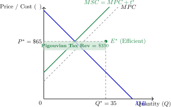

>
This chapter provides a rigorous, pedagogical treatment of Chapter 10: Externalities, Public Goods, and Common Resources, benchmarked to standard principles curriculum.

## Negative and Positive Externalities

### 1. Conceptual Introduction {.unnumbered}
In Chapter 4, we showed that competitive markets maximize total social surplus when private buyers and sellers capture all benefits and pay all costs of a transaction ($MB = MC$). However, markets fail to allocate resources efficiently whenever production or consumption creates an **externality**—an uncompensated cost or benefit imposed on a third party outside the market transaction.

Externalities split into two fundamental categories:

*  **Negative Externalities (External Costs):** When producing or consuming a good imposes unpriced harm on bystanders—such as industrial air pollution, highway traffic congestion, or late-night noise—the **Marginal Social Cost ($MSC$)** exceeds the firm's **Marginal Private Cost ($MPC$)** by the **Marginal External Cost ($MEC$)**: $MSC = MPC + MEC$. Because unregulated firms ignore $MEC$ and produce where $MB = MPC$, the free market **overproduces** ($Q_{\text{market}} > Q_{\text{efficient}}$), creating a Deadweight Loss triangle on the excess units.
*  **Positive Externalities (External Benefits):** When an activity generates unpriced spillover benefits for third parties—such as vaccinations reducing disease transmission, basic scientific research, or home solar installations—the **Marginal Social Benefit ($MSB$)** exceeds **Marginal Private Benefit ($MPB$)** by the **Marginal External Benefit ($MEB$)**: $MSB = MPB + MEB$. Left alone, the market produces where $MPB = MC$ and **underproduces** ($Q_{\text{market}} < Q_{\text{efficient}}$).

### 2. Visual Representation {.unnumbered}
Figure 1 illustrates a negative production externality where $MSC$ lies above $MPC$ by the vertical distance $MEC$, causing unregulated market output $Q_M$ to exceed the socially efficient output $Q^*$ and generating an orange Deadweight Loss triangle.

{fig-alt="Negative Production Externality. Because firms ignore Marginal External Cost (MEC), the unregulated market produces Q_M = 40 where MB = MPC instead of the socially optimal Q^* = 35 where MB = MSC, generating Deadweight Loss on the five overproduced units."}

### 3. Real-World Application: Urban Traffic Congestion and Carbon Emissions {.unnumbered}
During rush hour on Bay Area bridges and freeways, every additional driver entering the highway slows down thousands of commuters behind them—an unpriced external time cost ($MEC$). Similarly, industrial carbon dioxide emissions impose climate damages outside the factory gate, separating measured physical emissions (tracked in St. Louis Fed FRED series `EMISSCO2TOTVTTTOUSA`) from marginal external dollar damages.

### 4. Mathematical Foundation (Algebra Level) {.unnumbered}
Comparing unregulated equilibrium ($MB = MPC$) with social efficiency ($MB = MSC = MPC + MEC$):

$$
DWL = \frac{1}{2} \times (Q_M - Q^*) \times MEC(Q_M)
$$

**Worked Problem:**
Using the linear model in Figure 1, suppose inverse marginal benefit is $MB = 100 - Q$, marginal private cost is $MPC = 20 + Q$, and marginal external cost is a constant $MEC = \$10$ per unit. Compute $Q_M$, $Q^*$, and Deadweight Loss ($DWL$).

**Step-by-Step Breakdown:**

*  **Find Unregulated Output ($Q_M$) Where $MB = MPC$:**

$$
100 - Q_M = 20 + Q_M \implies 2Q_M = 80 \implies Q_M = \mathbf{40\text{ units}}
$$

*  **Construct $MSC$ and Find Efficient Output ($Q^*$) Where $MB = MSC$:**

$$
MSC = MPC + MEC = (20 + Q) + 10 = 30 + Q
$$

Set $MB = MSC$:

$$
100 - Q^* = 30 + Q^* \implies 2Q^* = 70 \implies Q^* = \mathbf{35\text{ units}}
$$

*  **Compute Deadweight Loss ($DWL$) from Overproduction:**

$$
DWL = \frac{1}{2} \times (40 - 35) \times \$10 = \frac{1}{2} \times 5 \times \$10 = \mathbf{\$25}
$$

**Conclusion:** Ignoring the $\$10$ external damage leads the market to overproduce by $5$ units and destroys $\$25$ in social welfare.

## Corrective Policies: Pigouvian Taxes, Subsidies, and Coase Bargaining

### 1. Conceptual Introduction {.unnumbered}
How can society restore efficiency when externalities distort market outcomes? Economists evaluate both private bargaining solutions and public policy tools designed to **internalize the externality**—forcing decision-makers to weigh external costs or benefits inside their own private calculations:

*  **Pigouvian Taxes and Subsidies:** Named after economist Arthur Pigou, a **Pigouvian tax** sets a per-unit tax equal to Marginal External Cost at the efficient quantity ($t^* = MEC(Q^*)$), shifting $MPC$ upward onto $MSC$ so firms voluntarily choose $Q^*$. Conversely, a **Pigouvian subsidy** equal to $MEB(Q^*)$ corrects positive externalities.
*  **Cap-and-Trade (Tradable Permits):** Regulators cap total emissions at $Q^*$ and allow firms to buy and sell permits—achieving the exact same pollution reduction at the lowest possible abatement cost across firms.
*  **The Coase Theorem:** Economist Ronald Coase proved that if **property rights are clearly defined** and **transaction costs are low**, private parties can bargain directly to reach the efficient outcome $Q^*$ without government intervention—regardless of which party initially holds the property right. However, when millions of dispersed residents are affected by urban smog, high transaction costs prevent private bargaining and require public policy.

### 2. Visual Representation {.unnumbered}
Figure 2 shows how levying a Pigouvian corrective tax $t^* = MEC = \$10$ shifts the private supply curve from $MPC$ onto $MSC$, eliminating deadweight loss and guiding the market cleanly to $Q^* = 35$.

::: {.callout-note title="Clear It Up: Why a Pigouvian Tax Increases Welfare Instead of Causing DWL"}

In Chapter 4, taxing a distortion-free market created deadweight loss. When a market already suffers from a negative externality, however, a Pigouvian tax *eliminates* deadweight loss by stopping overproduction where social cost exceeds social benefit ($MSC > MB$)!

:::

{fig-alt="Correcting a Negative Externality with a Pigouvian Tax. Setting t^* = MEC = $10 shifts private cost from MPC to MSC, contracting output from 40 to Q^* = 35 and raising $350 in revenue while eliminating deadweight loss."}

### 3. Real-World Application: California's Cap-and-Trade Program {.unnumbered}
California enforces a statewide cap on greenhouse gas emissions across power plants, refineries, and industrial facilities while allowing companies to trade emission allowances. Firms that can cut emissions cheaply sell spare permits to firms facing higher abatement costs, achieving the statewide emissions cap at minimum economic cost.

### 4. Mathematical Foundation (Algebra Level) {.unnumbered}
To restore efficiency, set the corrective tax or subsidy equal to the marginal spillover at $Q^*$:

$$
t^* = MEC(Q^*), \qquad s^* = MEB(Q^*)
$$

**Worked Problem:**
Suppose community flu vaccinations have private marginal benefit $MPB = 80 - 2Q$, marginal social benefit $MSB = 100 - 2Q$, and constant marginal cost $MC = \$30$ per dose (where $Q$ is thousands of doses). Compute the unregulated vaccination quantity $Q_M$, the socially efficient quantity $Q^*$, and the optimal Pigouvian subsidy $s^*$ per dose.

**Step-by-Step Breakdown:**

*  **Find Unregulated Quantity ($Q_M$) Where $MPB = MC$:**

$$
80 - 2Q_M = 30 \implies 2Q_M = 50 \implies Q_M = \mathbf{25\text{ thousand doses}}
$$

*  **Find Efficient Quantity ($Q^*$) Where $MSB = MC$:**

$$
100 - 2Q^* = 30 \implies 2Q^* = 70 \implies Q^* = \mathbf{35\text{ thousand doses}}
$$

*  **Compute the Optimal Pigouvian Subsidy ($s^*$):**

$$
s^* = MSB - MPB = (100 - 2Q) - (80 - 2Q) = \mathbf{\$20\text{ per dose}}
$$

**Conclusion:** A $\$20$ per-dose subsidy lowers the out-of-pocket price to $\$10$, expanding vaccinations from $25{,}000$ to the socially optimal $35{,}000$ doses.

## Public Goods, Common Resources, and the Free-Rider Problem

### 1. Conceptual Introduction {.unnumbered}
Economists classify all goods in society using two physical questions: (1) Is the good **excludable** (can sellers prevent non-payers from using it)? and (2) Is the good **rival in consumption** (does one person's use reduce the amount available for others)?

Crossing these two traits creates a four-quadrant classification matrix:

*  **Private Goods (Excludable & Rival):** Coffee, laptops, and sneakers. Private markets supply these efficiently.
*  **Club Goods (Excludable & Non-Rival):** Streaming services, toll roads without congestion, and private Wi-Fi.
*  **Public Goods (Non-Excludable & Non-Rival):** National defense, municipal storm sirens, and basic scientific knowledge. Because nobody can be excluded once provided, individuals face a temptation to enjoy the benefit without paying—known as the **free-rider problem**—causing private markets to underprovide public goods unless funded through taxation.
*  **Common Resources (Non-Excludable & Rival):** Open-ocean fisheries, clean air, and congested public highways. Because anyone can access the resource for free yet each user depletes what remains for others, individuals overuse common resources—a market failure known as the **Tragedy of the Commons**.

### 2. Visual Representation {.unnumbered}
Figure 3 organizes the four economic categories of goods by excludability and rivalry, and contrasts private horizontal demand summation against public-good vertical willingness-to-pay summation.

{fig-alt="The Four Economic Categories of Goods. Non-excludability creates two distinct market failures: underprovision of non-rival Public Goods (free riding) and overexploitation of rival Common Resources (Tragedy of the Commons)."}

### 3. Real-World Application: Pacific Salmon Fisheries and Catch Shares {.unnumbered}
Open-ocean fisheries are classic common resources: every fishing boat captures the full revenue of the fish it hauls in, while ignoring the external depletion cost imposed on future breeding stocks. Regulated **Individual Transferable Quotas (ITQs)** assign enforceable property rights over sustainable catch limits, preventing fishery collapse.

### 4. Mathematical Foundation (Algebra Level) {.unnumbered}
Because a public good is non-rival (everyone consumes the same quantity $Q$), total **Marginal Social Benefit ($MSB$)** sums individual marginal willingness to pay **vertically**:

$$
MSB(Q) = MB_1(Q) + MB_2(Q) + \dots + MB_N(Q) = MC(Q)
$$

**Worked Problem:**
Two neighboring towns, Oakville and Pinehurst, share a coastal tsunami warning siren network. Oakville's marginal benefit is $MB_1 = 50 - Q$, and Pinehurst's marginal benefit is $MB_2 = 30 - Q$, where $Q$ is the number of sirens installed. The marginal cost of installing each siren is $MC = \$40$.

*  Determine how many sirens either town would buy acting alone.
*  Compute the socially optimal number of sirens $Q^*$ by summing marginal benefits vertically.

**Step-by-Step Breakdown:**

*  **Check Individual Provision ($MB_i = MC$):**

*  Oakville alone: $50 - Q_1 = 40 \implies Q_1 = \mathbf{10\text{ sirens}}$.
*  Pinehurst alone: $30 - Q_2 = 40 \implies Q_2 = \mathbf{0\text{ sirens}}$ (since its maximum willingness to pay $\$30 < \$40$).

*  **Sum Marginal Benefits Vertically ($MSB = MB_1 + MB_2$) and Set Equal to $MC$:**

$$
MSB(Q) = (50 - Q) + (30 - Q) = 80 - 2Q
$$

Set $MSB = MC$:

$$
80 - 2Q^* = 40 \implies 2Q^* = 40 \implies Q^* = \mathbf{20\text{ sirens}}
$$

**Conclusion:** Acting independently, the towns install at most $10$ sirens; pooling their joint valuation yields the socially optimal $20$ sirens.

::: {.callout-note title="Optional Advanced Section: Samuelson Condition for Public Goods"}

*Note for Economics Majors and Quantitative Students:*
For $N$ consumers with utility functions $U_i(x_i, G)$ over private good $x_i$ and non-rival public good $G$, Pareto efficiency requires the **Samuelson Condition**: the sum of Marginal Rates of Substitution across all citizens must equal the Marginal Rate of Transformation:

$$
\sum_{i=1}^{N} MRS_{G, x}^i = MRT_{G, x}
$$

Unlike private goods (where $MRS^1 = MRS^2 = MRT$), public goods sum marginal valuations across the entire population because every citizen consumes the same unit of $G$ simultaneously.

:::
