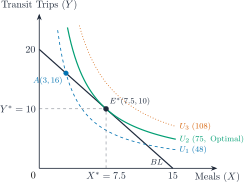
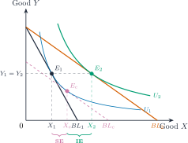

>
This chapter provides a rigorous, pedagogical treatment of Chapter 11: Consumer Choice Theory: Utility and Indifference Curves, benchmarked to standard principles curriculum.

## The Budget Constraint and Relative Prices

### 1. Conceptual Introduction {.unnumbered}
Behind every downward-sloping market demand curve lies millions of individual household decisions. To model how rational consumers allocate limited dollars across competing goods, economists separate *what a consumer can afford* from *what a consumer wants*. The boundary of affordability is captured by the **budget constraint** (or **budget line**), which plots all combinations of two goods—say, campus meals ($X$) and commuter transit passes ($Y$)—that exhaust a consumer's fixed monthly income $I$ at given market prices $P_x$ and $P_y$.

Every point on or inside the budget line belongs to the consumer's affordable **budget set** ($P_x X + P_y Y \le I$), while bundles outside the line are unaffordable. The steepness of the budget line reflects the **relative price** of the two goods: its slope equals $-P_x / P_y$, measuring the exact opportunity cost of buying one additional unit of Good $X$ in terms of forgone units of Good $Y$.

Changes in income and prices transform the budget line in two geometrically distinct ways:

*  **A Change in Income ($I$):** Holding prices fixed, higher income shifts the entire budget line **outward in parallel** (preserving the exact same slope $-P_x / P_y$), whereas lower income shifts it inward in parallel.
*  **A Change in One Price ($P_x$ or $P_y$):** Holding income and the other price fixed, a drop in $P_x$ rotates (pivots) the budget line outward along the horizontal $X$-axis while keeping the vertical $Y$-intercept anchored.

### 2. Visual Representation {.unnumbered}
Figure 1 illustrates a baseline budget constraint alongside a parallel outward shift from higher income (left) and an outward pivot from a lower price of Good $X$ (right).

{fig-alt="Shifts and Pivots of the Budget Line. In panel (a), an increase in income at constant prices shifts the budget line outward in parallel. In panel (b), a reduction in the price of X pivots the line outward around the fixed vertical intercept I / P_y."}

### 3. Real-World Application: Transit Subsidies vs. Unrestricted Cash Stipends {.unnumbered}
Suppose a university wants to help low-income students commute and eat on campus. Giving students a $\$60$ unrestricted cash stipend shifts their budget constraint outward in parallel (expanding choices across all goods), whereas subsidizing campus meal plans by $50\%$ pivots the budget line outward along the meals axis—altering the relative price ratio and incentivizing students to consume more campus meals specifically.

### 4. Mathematical Foundation (Algebra Level) {.unnumbered}
Solving the budget identity $P_x X + P_y Y = I$ for $Y$ expresses the budget line in slope-intercept form:

$$
Y = \frac{I}{P_y} - \frac{P_x}{P_y}X
$$

**Worked Problem:**
A student has a monthly entertainment budget of $I = \$120$ to spend on movie tickets ($P_x = \$15$ each) and paperback books ($P_y = \$20$ each).

*  Find the horizontal intercept, vertical intercept, and slope of the student's budget line.
*  Write the budget line equation in slope-intercept form ($Y$ as a function of $X$).
*  Suppose a student discount lowers movie ticket prices to $P_x^{\text{new}} = \$10$. Find the new horizontal intercept and slope.

**Step-by-Step Breakdown:**

*  **Compute Baseline Intercepts and Slope:**

$$
X_{\max} = \frac{\$120}{\$15} = \mathbf{8\text{ movies}}, \qquad Y_{\max} = \frac{\$120}{\$20} = \mathbf{6\text{ books}}
$$

$$
\text{Slope} = -\frac{P_x}{P_y} = -\frac{15}{20} = \mathbf{-0.75\text{ books per movie}}
$$

*  **Write the Slope-Intercept Equation:**

$$
Y = \mathbf{6 - 0.75X}
$$

*  **Recompute After Price Drop to $P_x^{\text{new}} = \$10$:**
The vertical intercept stays anchored at $Y_{\max} = \mathbf{6\text{ books}}$, while the horizontal intercept expands to:

$$
X_{\max}^{\text{new}} = \frac{\$120}{\$10} = \mathbf{12\text{ movies}}, \qquad \text{Slope}^{\text{new}} = -\frac{10}{20} = \mathbf{-0.50\text{ books per movie}}
$$

**Conclusion:** Lowering movie ticket prices to $\$10$ rotates the budget line outward along the horizontal axis and reduces the opportunity cost of a movie from $0.75$ books to $0.50$ books.

## Preferences, Indifference Curves, and Optimal Tangency

### 1. Conceptual Introduction {.unnumbered}
Once the budget line defines what is affordable, consumer preferences determine which affordable bundle yields the highest satisfaction, or **utility**. Because happiness cannot be measured on an objective thermometer across different people, modern economics treats utility as an **ordinal ranking**: utility numbers simply rank bundles from least preferred to most preferred.

To map preferences geometrically, economists draw **indifference curves**—each curve connects all bundles $(X, Y)$ that leave the consumer equally satisfied. Well-behaved indifference curves obey four properties: (1) curves further from the origin represent higher utility (*more is preferred to less*), (2) indifference curves slope downward, (3) indifference curves never cross, and (4) indifference curves are **bowed inward (convex to the origin)**. Convexity reflects **diminishing Marginal Rate of Substitution ($MRS_{XY}$)**: the more meals you already have relative to transit trips, the fewer transit trips you are willing to give up to get one more meal.

To maximize utility subject to their budget, a consumer selects the bundle on the highest reachable indifference curve—occurring at the exact **tangency point** where the slope of the indifference curve equals the slope of the budget line:

$$
MRS_{XY} = \frac{MU_x}{MU_y} = \frac{P_x}{P_y} \quad \Longleftrightarrow \quad \frac{MU_x}{P_x} = \frac{MU_y}{P_y}
$$

In plain English, the **equimarginal principle** states that the last dollar spent on Good $X$ must deliver the exact same marginal utility per dollar as the last dollar spent on Good $Y$.

### 2. Visual Representation {.unnumbered}
Figure 2 shows the consumer's optimal bundle $E^*(7.5, 10)$ where indifference curve $U_2$ is tangent to the budget line, strictly outperforming affordable non-tangent points like $A$ on lower curve $U_1$.

{fig-alt="Utility Maximization at Tangency. The consumer reaches the highest attainable indifference curve U_2 at bundle E^*(7.5, 10), where the slope of the indifference curve (-MRS_{XY}) matches the slope of the budget line (-P_x / P_y)."}

### 3. Real-World Application: Grocery Shopping and the Equimarginal Rule {.unnumbered}
When shoppers compare $\$12$ organic berries against $\$3$ bananas at the grocery store, they instinctively apply $\frac{MU_{\text{berries}}}{P_{\text{berries}}} = \frac{MU_{\text{bananas}}}{P_{\text{bananas}}}$: berries must feel at least four times as satisfying per carton as bananas to justify taking up four times as much budget space.

### 4. Mathematical Foundation (Algebra Level) {.unnumbered}
To solve for an interior consumer optimum, combine the tangency condition with the budget equation:

$$
\frac{MU_x}{MU_y} = \frac{P_x}{P_y} \quad \text{and} \quad P_x X + P_y Y = I
$$

**Worked Problem:**
A student allocates $I = \$60$ per month between meals ($X$) priced at $P_x = \$4$ and transit trips ($Y$) priced at $P_y = \$3$. The student's utility function is $U(X, Y) = X \cdot Y$, with marginal utilities $MU_x = Y$ and $MU_y = X$. Solve for the utility-maximizing bundle $(X^*, Y^*)$.

**Step-by-Step Breakdown:**

*  **Apply the Tangency Condition ($MRS_{XY} = P_x / P_y$):**

$$
\frac{MU_x}{MU_y} = \frac{P_x}{P_y} \implies \frac{Y}{X} = \frac{4}{3} \implies Y = \frac{4}{3}X
$$

*  **Substitute $Y = \frac{4}{3}X$ into the Budget Constraint ($4X + 3Y = 60$):**

$$
4X + 3\left(\frac{4}{3}X\right) = 60 \implies 4X + 4X = 60 \implies 8X = 60 \implies X^* = \mathbf{7.5\text{ meals}}
$$

*  **Solve for $Y^*$ and Verify Total Spending:**

$$
Y^* = \frac{4}{3}(7.5) = \mathbf{10\text{ transit trips}}
$$

Check budget exhaustion: $\$4(7.5) + \$3(10) = \$30 + \$30 = \$60$.

**Conclusion:** Purchasing $7.5$ meals and $10$ transit trips maximizes utility at $U = 7.5 \times 10 = 75$.

## Income and Substitution Effects of a Price Change

### 1. Conceptual Introduction {.unnumbered}
When the price of a good falls—say, laptop prices drop by $25\%$—consumers almost always buy more of it. Economists decompose this total change in quantity demanded into two distinct behavioral mechanisms:

*  **The Substitution Effect:** Because laptops are now cheaper relative to tablets and smartphones, consumers substitute away from relatively pricier alternatives and buy more laptops, *holding real purchasing power constant* along the initial indifference curve. The substitution effect **always moves in the opposite direction of the price change** ($P_x \downarrow \implies X_{\text{sub}} \uparrow$).
*  **The Income Effect:** A lower laptop price stretches the consumer's fixed paycheck further, boosting their real purchasing power. For a **normal good**, higher purchasing power raises quantity demanded further ($X_{\text{inc}} \uparrow$), reinforcing the substitution effect. For an **inferior good**, higher purchasing power reduces quantity demanded ($X_{\text{inc}} \downarrow$), partially offsetting the substitution effect.

### 2. Visual Representation {.unnumbered}
Figure 3 decomposes a price drop from $P_{x1}$ to $P_{x2}$ into the substitution effect ($E_1 \to E_{\text{comp}}$ along $U_1$) and the income effect ($E_{\text{comp}} \to E_2$ onto higher indifference curve $U_2$).

::: {.callout-note title="Clear It Up: What Is a Giffen Good?"}

For almost all inferior goods, the negative substitution effect of a price hike still overpowers the positive income effect, keeping the demand curve downward sloping. Only in an extraordinary theoretical case—a **Giffen good**, where an inferior staple consumes such a huge share of a poor household's budget that the income effect outweighs the substitution effect—could a price rise ever increase quantity demanded.

:::

{fig-alt="Hicksian Decomposition of a Price Decrease. The movement from X_1 to X_c along U_1 isolates the pure Substitution Effect, while the outward shift from X_c to X_2 onto U_2 captures the Income Effect for a normal good."}

### 3. Real-World Application: Gasoline Price Spikes and Commuter Behavior {.unnumbered}
When retail gasoline jumps from $\$3.50$ to $\$5.50$ per gallon, commuters respond through both channels: the **substitution effect** pushes drivers to carpool, take public transit, or combine errands, while the **income effect** leaves households with less discretionary money left over for dining out or weekend travel.

### 4. Mathematical Foundation (Algebra Level) {.unnumbered}
Total quantity change equals the sum of the substitution and income effects:

$$
\Delta X_{\text{total}} = X_2 - X_1 = \underbrace{(X_c - X_1)}_{\text{Substitution Effect}} + \underbrace{(X_2 - X_c)}_{\text{Income Effect}}
$$

**Worked Problem:**
Continuing our Cobb-Douglas student ($U = XY$, $I = \$60$, $P_y = \$3$), initially $P_{x1} = \$4$ and the student buys $X_1 = 7.5$ meals and $Y_1 = 10$ trips ($U_1 = 75$). Suppose a campus dining discount lowers meal prices to $P_{x2} = \$2$.

*  Find the new optimal bundle $(X_2, Y_2)$ and total change in meals $\Delta X_{\text{total}}$.
*  Given that the compensated meal quantity keeping $U_1 = 75$ at the new price ratio is $X_c \approx 10.6$ meals, separate $\Delta X_{\text{total}}$ into the substitution effect and the income effect.

**Step-by-Step Breakdown:**

*  **Solve for New Optimal Bundle ($X_2, Y_2$) at $P_{x2} = \$2$:**
Tangency requires $\frac{Y}{X} = \frac{2}{3} \implies Y = \frac{2}{3}X$. Plug into $2X + 3Y = 60$:

$$
2X + 3\left(\frac{2}{3}X\right) = 60 \implies 4X = 60 \implies X_2 = \mathbf{15\text{ meals}}, \qquad Y_2 = \mathbf{10\text{ trips}}
$$

Total change in meals: $\Delta X_{\text{total}} = 15 - 7.5 = \mathbf{+7.5\text{ meals}}$.

*  **Decompose into Substitution and Income Effects:**

$$
\text{Substitution Effect} = X_c - X_1 = 10.6 - 7.5 = \mathbf{+3.1\text{ meals}}
$$

$$
\text{Income Effect} = X_2 - X_c = 15.0 - 10.6 = \mathbf{+4.4\text{ meals}}
$$

**Conclusion:** Of the $7.5$ extra meals purchased, $+3.1$ meals come from substituting toward cheaper food and $+4.4$ meals come from higher real purchasing power.

::: {.callout-note title="Optional Advanced Section: Lagrangian Optimization and the Slutsky Equation"}

*Note for Economics Majors and Quantitative Students:*
Maximizing $U(X, Y)$ subject to $P_x X + P_y Y = I$ forms the Lagrangian $\mathcal{L} = U(X, Y) + \lambda(I - P_x X - P_y Y)$. First-order conditions yield $\frac{\partial U/\partial X}{P_x} = \frac{\partial U/\partial Y}{P_y} = \lambda$, where $\lambda$ is the marginal utility of income. The **Slutsky Equation** decomposes total price sensitivity into compensated substitution and income terms:

$$
\frac{\partial X}{\partial P_x} = \underbrace{\frac{\partial X^h}{\partial P_x}}_{\text{Substitution } (<0)} - \underbrace{X \frac{\partial X}{\partial I}}_{\text{Income Effect}}
$$

:::
