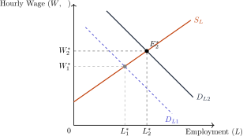

>
This chapter provides a rigorous, pedagogical treatment of Chapter 12: Factor Markets, Labor Demand, and Wage Determination, benchmarked to standard principles curriculum.

## Derived Demand and Marginal Revenue Product of Labor

### 1. Conceptual Introduction {.unnumbered}
Up to this point, we have studied **product markets**, where households buy finished goods from businesses. Now we flip the Circular Flow diagram around to examine **factor markets**, where businesses hire the four inputs of production—**labor, land, capital, and entrepreneurship**—from households. Unlike pizza or concert tickets, firms do not hire workers for the personal enjoyment of watching people work; a company hires software engineers, nurses, or baristas solely because customers want to buy the goods and services those workers produce. Economists therefore call factor demand a **derived demand**—it is derived directly from consumer demand in the output market.

How does a profit-maximizing firm decide exactly how many workers to hire? It applies the exact same marginal principle we learned in Chapter 1, comparing the extra dollar revenue generated by hiring one additional worker against the extra dollar wage paid to that worker:

*  **Marginal Revenue Product of Labor ($MRP_L$):** The additional total revenue a firm earns by hiring one more unit of labor. For a firm selling output in a competitive product market at price $P$, $MRP_L$ equals the worker's physical output contribution (**Marginal Product of Labor, $MP_L$**) multiplied by the selling price of the product: $MRP_L = MP_L \times P$.
*  **Marginal Factor Cost ($MFC_L$):** The additional total cost incurred by hiring one more worker. In a competitive labor market where the firm is a wage taker, $MFC_L$ simply equals the market wage rate $W$.

Because diminishing marginal product causes $MP_L$ to decline as more workers are added to fixed capital, the firm's $MRP_L$ curve slopes downward—and serves directly as the firm's **labor demand curve**. A competitive firm hires workers up to the exact point where $MRP_L = W$.

### 2. Visual Representation {.unnumbered}
Figure 1 shows a competitive firm's downward-sloping Marginal Revenue Product of Labor ($MRP_L$) curve intersecting the horizontal market wage line $W^*$ at the optimal employment level $L^*$.

{fig-alt="Competitive Labor Demand (MRP_L). A wage-taking firm hires workers until the value of the last worker's marginal output (MRP_L) equals the market wage (W^*). Any shift in output price P or worker productivity MP_L shifts the entire MRP_L curve."}

### 3. Real-World Application: AI Productivity Tools and Software Engineer Demand {.unnumbered}
When generative AI coding assistants boost a software engineer's physical productivity ($MP_L \uparrow$) or when surging enterprise demand raises cloud software prices ($P \uparrow$), each engineer's Marginal Revenue Product ($MRP_L = MP_L \times P$) shifts rightward—raising the equilibrium market wage and expanding hiring for skilled engineers. Conversely, if automated self-checkout kiosks substitute for routine cashier tasks, demand for manual cashier labor shifts leftward.

### 4. Mathematical Foundation (Algebra Level) {.unnumbered}
For a competitive firm selling output at price $P$ and hiring labor at market wage $W$:

$$
MRP_L = MP_L \times P, \qquad \text{Hiring Rule: } MRP_L = W
$$

**Worked Problem:**
A specialty coffee roaster sells bags of roasted beans in a competitive market for $P = \$15$ per bag and hires packaging technicians at a daily wage of $W = \$180$ per worker. The roaster's daily output schedule is:

*  $L = 1 \implies Q = 20$ bags
*  $L = 2 \implies Q = 38$ bags
*  $L = 3 \implies Q = 52$ bags
*  $L = 4 \implies Q = 62$ bags
*  $L = 5 \implies Q = 68$ bags

Compute $MP_L$ and $MRP_L$ for each worker and determine the profit-maximizing number of technicians to hire.

**Step-by-Step Breakdown:**

*  **Compute $MP_L = \Delta Q / \Delta L$ and $MRP_L = MP_L \times \$15$ for Each Worker:**

*  **Worker 1:** $MP_1 = 20 - 0 = 20\text{ bags} \implies MRP_1 = 20 \times \$15 = \mathbf{\$300}$
*  **Worker 2:** $MP_2 = 38 - 20 = 18\text{ bags} \implies MRP_2 = 18 \times \$15 = \mathbf{\$270}$
*  **Worker 3:** $MP_3 = 52 - 38 = 14\text{ bags} \implies MRP_3 = 14 \times \$15 = \mathbf{\$210}$
*  **Worker 4:** $MP_4 = 62 - 52 = 10\text{ bags} \implies MRP_4 = 10 \times \$15 = \mathbf{\$150}$
*  **Worker 5:** $MP_5 = 68 - 62 = 6\text{ bags} \implies MRP_5 = 6 \times \$15 = \mathbf{\$90}$

*  **Compare $MRP_L$ to the Daily Wage ($W = \$180$):**

*  Workers 1, 2, and 3 generate $\$300$, $\$270$, and $\$210$ in extra revenue—each exceeding their $\$180$ daily wage.
*  Worker 4 generates only $\$150 < \$180$, which would reduce profit by $\$30$.

**Conclusion:** The roaster should hire **$L^* = 3$ technicians**, earning a net surplus above wages of $(\$300 - \$180) + (\$270 - \$180) + (\$210 - \$180) = \$240$.

## Labor Supply and Competitive Market Equilibrium

### 1. Conceptual Introduction {.unnumbered}
While firms form the demand side of the labor market, individual workers form the **labor supply** side. Every worker faces a fundamental trade-off between **paid work** (which generates income to buy consumption goods) and **leisure** (time spent resting, studying, or caring for family). The opportunity cost of an hour of leisure is the hourly wage $W$ you give up by not working.

When the market wage rises, two competing behavioral effects tug on a worker's hours:

*  **The Substitution Effect:** A higher wage makes leisure more expensive in terms of foregone earnings, motivating the worker to substitute away from leisure and **work more hours**.
*  **The Income Effect:** A higher wage makes the worker wealthier; because leisure is a normal good, higher income encourages the worker to "buy" more leisure and **work fewer hours**.

Across an entire occupation or industry, higher wages attract new workers from other sectors, so the **market labor supply curve slopes upward**. Equilibrium wage $W^*$ and employment $L^*$ settle where market labor supply equals market labor demand.

### 2. Visual Representation {.unnumbered}
Figure 2 shows how an increase in labor demand (from $D_{L1}$ to $D_{L2}$) raises both equilibrium wages and employment in a competitive occupation.

{fig-alt="Competitive Labor Market Equilibrium. Rising productivity or higher product demand shifts labor demand rightward from D_{L1} to D_{L2}, raising equilibrium wages from W_1^* to W_2^* and expanding employment from L_1^* to L_2^*."}

### 3. Real-World Application: Nursing Shortages and Demographic Shifts {.unnumbered}
As the U.S. population ages, demand for hospital and outpatient healthcare services has surged—shifting the derived demand for registered nurses ($D_L$) sharply rightward. Because becoming a licensed nurse requires years of clinical training, short-run nursing supply is relatively steep, driving substantial wage increases and sign-on bonuses across metropolitan hospital systems.

### 4. Mathematical Foundation (Algebra Level) {.unnumbered}
Market labor equilibrium solves $L_d(W^*) = L_s(W^*)$:

$$
W_d(L^*) = W_s(L^*)
$$

**Worked Problem:**
In a metropolitan market for certified electricians, labor demand is $L_d = 1{,}200 - 15W$ and labor supply is $L_s = 200 + 10W$ (where $W$ is the hourly wage in dollars and $L$ is the number of employed electricians). Find the equilibrium wage $W^*$ and equilibrium employment $L^*$.

**Step-by-Step Breakdown:**

*  **Set Labor Demand Equal to Labor Supply ($L_d = L_s$):**

$$
1{,}200 - 15W^* = 200 + 10W^*
$$

*  **Solve for Equilibrium Hourly Wage ($W^*$):**

$$
1{,}000 = 25W^* \implies W^* = \mathbf{\$40\text{ per hour}}
$$

*  **Substitute $W^* = \$40$ to Find Equilibrium Employment ($L^*$):**

$$
L^* = 200 + 10(40) = 200 + 400 = \mathbf{600\text{ electricians}}
$$

**Conclusion:** The competitive labor market clears at a wage of $\$40$ per hour with $600$ electricians employed.

## Monopsony Power and Minimum Wage Floors

### 1. Conceptual Introduction {.unnumbered}
What happens when a single dominant employer—such as a rural hospital system, a remote mining company, or a dominant regional warehouse hub—is the primary buyer of labor in a local town? Economists call a market with a single buyer (or dominant employer) a **monopsony**.

Unlike a competitive wage-taking firm, a monopsonist faces the entire upward-sloping local labor supply curve $W(L)$. To attract one additional worker, the monopsonist must offer a higher wage—and because workplace fairness and payroll rules require paying the new higher wage to *all* existing employees as well, the **Marginal Factor Cost of Labor ($MFC_L$)** lies strictly above the labor supply curve ($MFC_L > W$).

To maximize profit, the monopsonist hires workers up to where $MRP_L = MFC_L$, restricting hiring below the competitive level ($L_M < L_C$) and paying a depressed wage read off the labor supply curve ($W_M < MRP_L$). This creates a remarkable policy contrast:

*  In a **competitive labor market**, a binding minimum wage set above $W_C$ reduces quantity of labor demanded and creates unemployment.
*  In a **monopsony labor market**, a carefully set minimum wage flattens the firm's $MFC_L$ curve over the lower range, which can **increase both wages and employment simultaneously** up to the competitive level!

### 2. Visual Representation {.unnumbered}
Figure 3 illustrates how a monopsonist equates $MRP_L = MFC_L$ to restrict employment to $L_M$ and depress wages to $W_M$, below the competitive equilibrium $(L_C, W_C)$.

{fig-alt="Monopsony Labor Market Power. Facing an upward-sloping labor supply curve, the monopsonist's Marginal Factor Cost (MFC_L) rises twice as fast as the wage. Hiring where MRP_L = MFC_L restricts employment to L_M < L_C and depresses wages to W_M < W_C, creating deadweight loss (orange triangle)."}

### 3. Real-World Application: Empirical Minimum Wage Studies in Local Labor Markets {.unnumbered}
Classic empirical research by economists David Card and Alan Krueger (and subsequent studies of regional hospital and retail labor markets) found that modest minimum wage increases frequently had little or no negative effect on employment—and occasionally increased employment—consistent with employers possessing local monopsony power due to worker commuting costs and search frictions.

### 4. Mathematical Foundation (Algebra Level) {.unnumbered}
When inverse labor supply is linear, $W(L) = a + bL$, Total Labor Cost is $TLC = W(L) \cdot L = aL + bL^2$, and Marginal Factor Cost has twice the slope of labor supply:

$$
MFC_L = a + 2bL
$$

**Worked Problem:**
A rural distribution center is a monopsonist facing an inverse labor supply curve $W = 12 + L$ and Marginal Factor Cost $MFC_L = 12 + 2L$ (where $W$ is hourly wage in dollars and $L$ is workers in tens). Its Marginal Revenue Product of Labor is $MRP_L = 48 - L$.

*  Find the monopsonist's profit-maximizing employment $L_M$ and hourly wage $W_M$.
*  Compare this to the competitive benchmark $(L_C, W_C)$ where $MRP_L = W$.

**Step-by-Step Breakdown:**

*  **Solve for Monopsony Employment ($L_M$) and Wage ($W_M$):**
Set $MRP_L = MFC_L$:

$$
48 - L_M = 12 + 2L_M \implies 36 = 3L_M \implies L_M = \mathbf{12\ (120\text{ workers})}
$$

Read the wage off the labor supply curve $W = 12 + L_M$:

$$
W_M = 12 + 12 = \mathbf{\$24\text{ per hour}}
$$

*  **Solve for Competitive Benchmark ($L_C, W_C$):**
Set $MRP_L = W$:

$$
48 - L_C = 12 + L_C \implies 36 = 2L_C \implies L_C = \mathbf{18\ (180\text{ workers})}
$$

$$
W_C = 12 + 18 = \mathbf{\$30\text{ per hour}}
$$

**Conclusion:** Monopsony power cuts hiring from $180$ down to $120$ workers and depresses wages from $\$30$ to $\$24$ per hour. Setting a minimum wage at $\$28$ or $\$30$ per hour would raise both wages and employment.

::: {.callout-note title="Optional Advanced Section: Calculus of Monopsony Optimization"}

*Note for Economics Majors and Quantitative Students:*
Let revenue be $R(L)$ with $MRP_L = R'(L)$, and inverse labor supply be $W(L)$ with $W'(L) > 0$. The monopsonist maximizes $\pi(L) = R(L) - W(L) \cdot L$. Differentiating with respect to $L$:

$$
\frac{d\pi}{dL} = R'(L) - \left[ W(L) + L \cdot W'(L) \right] = 0 \implies MRP_L = W(L) \left( 1 + \frac{1}{\varepsilon_{L,s}} \right) = MFC_L
$$

where $\varepsilon_{L,s} = \frac{dL}{dW}\frac{W}{L}$ is the wage elasticity of labor supply. The less elastic the local labor supply, the wider the markdown between $MRP_L$ and the wage paid.

:::
