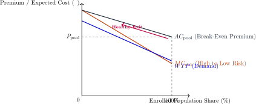

>
This chapter provides a rigorous, pedagogical treatment of Chapter 13: Asymmetric Information, Risk, and Market Design, benchmarked to standard principles curriculum.

## Adverse Selection, Signaling, and Screening

### 1. Conceptual Introduction {.unnumbered}
Standard supply-and-demand models assume that buyers and sellers share the exact same information about product quality. In many real-world markets—used cars, health insurance, bank loans, and job hiring—one side possesses private knowledge that the other side cannot observe. Economists call this imbalance **asymmetric information**, and it produces two distinct market failures depending on *when* the hidden information occurs:

*  **Adverse Selection (Hidden Characteristics *Before* a Contract):** When sellers or applicants know their private quality or risk type before signing a contract, uninformed buyers offer a single pooled price based on average expected quality. High-quality sellers (or healthy insurance applicants) find that pooled price unattractive and exit the market—lowering average quality further and causing the market to unravel (George Akerlof's classic *"Market for Lemons"*).
*  **Signaling and Screening:** Markets counter adverse selection using two mechanisms. **Signaling** occurs when the *informed* party takes a costly, credible action to reveal high quality (e.g., a used-car dealer offering a 3-year powertrain warranty, or a job applicant earning a rigorous college degree). **Screening** occurs when the *uninformed* party designs a menu of choices to separate hidden types (e.g., an auto insurer offering high-deductible vs. low-deductible plans).

### 2. Visual Representation {.unnumbered}
Figure 1 illustrates adverse selection in a health insurance risk pool: when insurers charge a single pooled premium based on average risk, low-risk enrollees drop out, driving average medical costs and premiums steadily upward.

{fig-alt="Adverse Selection and Risk-Pool Unraveling. At a single pooled break-even premium P_{\text{pool}}, low-risk individuals on the right have willingness to pay below the pooled price and drop out, pushing average pool costs upward."}

### 3. Real-World Application: Certified Pre-Owned Vehicle Programs {.unnumbered}
Private used-car markets suffer heavily from adverse selection because owners of reliable vehicles refuse to sell at discounted "average" prices. Automakers solve this information gap through **Certified Pre-Owned (CPO)** inspections and extended factory warranties—a credible signal that would be prohibitively expensive to honor on a defective car.

### 4. Mathematical Foundation (Algebra Level) {.unnumbered}
Under pooled pricing with asymmetric information, uninformed buyers offer the expected value across remaining types:

$$
E[V] = p_H V_H + p_L V_L
$$

**Worked Problem:**
In a used-car market, $50\%$ of cars are high-quality ("peaches") worth $\$12{,}000$ to buyers (and $\$10{,}500$ to sellers), and $50\%$ are low-quality ("lemons") worth $\$6{,}000$ to buyers (and $\$5{,}000$ to sellers). Buyers cannot tell peaches from lemons before purchase.

*  Compute the maximum pooled price uninformed buyers are willing to pay if all cars are offered for sale.
*  Determine which cars actually get sold and what the final equilibrium price becomes.

**Step-by-Step Breakdown:**

*  **Compute Initial Pooled Willingness to Pay ($E[V]$):**

$$
E[V] = 0.50(\$12{,}000) + 0.50(\$6{,}000) = \$6{,}000 + \$3{,}000 = \mathbf{\$9{,}000}
$$

*  **Compare Pooled Offer ($\$9{,}000$) Against Seller Reservation Values:**

*  Peach owners value their cars at $\$10{,}500 > \$9{,}000$, so **all peach owners withdraw from the market**.
*  Lemon owners value their cars at $\$5{,}000 < \$9{,}000$, so only lemons remain.

*  **Update Buyer Beliefs ($100\%$ Lemons Remaining):**
Knowing only lemons remain in the pool, buyers revise their offer downward to **$\$6{,}000$**.

**Conclusion:** Asymmetric information drives every high-quality vehicle out of the market, collapsing trade to lemons only at $\$6{,}000$.

## Moral Hazard and Incentive Design

### 1. Conceptual Introduction {.unnumbered}
While adverse selection occurs *before* a contract is signed, **moral hazard** occurs *after* a transaction when one party's hidden actions cannot be fully monitored by the other party. Whenever an insurance policy, corporate bailout, or fixed salary shields a person from the full financial consequences of their choices, they face weaker incentives to take costly precautions.

For example, a driver with zero-deductible comprehensive auto insurance may park in riskier neighborhoods or drive slightly less cautiously than an uninsured driver, and a homeowner with full flood insurance may build in a coastal floodplain. Moral hazard is not necessarily malicious fraud—it is a predictable behavioral response to altered marginal incentives.

To mitigate moral hazard while still providing valuable financial protection, insurers and employers design incentive-compatible contracts using three tools: (1) **deductibles** (requiring the insured to pay the first $\$500$ or $\$1{,}000$ of any claim), (2) **co-payments and coinsurance** (sharing a percentage of ongoing medical or repair bills), and (3) **performance-linked compensation** (aligning worker effort with firm outcomes).

### 2. Visual Representation {.unnumbered}
Figure 2 illustrates moral hazard in healthcare utilization: full insurance lowers the patient's out-of-pocket price from $P_0$ to $\$0$, expanding doctor visits from $Q^*$ to $Q_{\text{insured}}$ where marginal medical benefit falls below the true resource cost $MC$.

{fig-alt="Moral Hazard in Health Insurance. Lowering out-of-pocket price from true resource cost MC to a low co-payment P_{\text{copay}} expands care consumption from Q^* to Q_{\text{ins}}, generating overutilization where MC > MB (orange triangle)."}

### 3. Real-World Application: Deductibles in Auto Insurance and Coinsurance in Health Plans {.unnumbered}
Auto insurers rarely sell zero-deductible collision policies because even a small $\$500$ or $\$1{,}000$ deductible forces drivers to keep "skin in the game"—preserving strong incentives to drive carefully and avoid minor fender-benders while still protecting families against catastrophic $\$30{,}000$ accidents.

### 4. Mathematical Foundation (Algebra Level) {.unnumbered}
With a deductible $D$ and coinsurance rate $c$ (share paid by the insured above the deductible), a policyholder's out-of-pocket cost on a loss $L > D$ is:

$$
\text{Out-of-Pocket Payment} = D + c(L - D)
$$

**Worked Problem:**
A homeowner chooses between two property insurance policies against a potential $\$10{,}000$ storm damage claim:

*  **Plan A:** $\$1{,}000$ deductible plus $20\%$ coinsurance above the deductible.
*  **Plan B:** $\$2{,}500$ deductible with $0\%$ coinsurance above the deductible.

Calculate the homeowner's total out-of-pocket payment and the insurer's payout under each plan if a $\$10{,}000$ loss occurs.

**Step-by-Step Breakdown:**

*  **Evaluate Plan A ($D = \$1{,}000$, $c = 0.20$):**

$$
\text{Out-of-Pocket}_A = \$1{,}000 + 0.20(\$10{,}000 - \$1{,}000) = \$1{,}000 + \$1{,}800 = \mathbf{\$2{,}800}
$$

$$
\text{Insurer Payout}_A = \$10{,}000 - \$2{,}800 = \mathbf{\$7{,}200}
$$

*  **Evaluate Plan B ($D = \$2{,}500$, $c = 0.00$):**

$$
\text{Out-of-Pocket}_B = \$2{,}500 + 0 = \mathbf{\$2{,}500}, \qquad \text{Insurer Payout}_B = \$10{,}000 - \$2{,}500 = \mathbf{\$7{,}500}
$$

**Conclusion:** Both plans require the homeowner to absorb at least $\$2{,}500$ of the loss, preserving strong incentives to maintain roof and drainage protection.

## Expected Value, Risk Aversion, and Expected Utility

### 1. Conceptual Introduction {.unnumbered}
Why are households willing to pay insurance premiums that exceed their average annual claim payouts? Because most people exhibit **diminishing marginal utility of wealth**: gaining an extra $\$1{,}000$ when you are already comfortable adds less happiness than losing $\$1{,}000$ when you are struggling to pay rent. Consequently, most individuals are **risk averse**—given two prospects with the exact same average dollar payoff, a risk-averse person strictly prefers a guaranteed certain outcome over a risky gamble.

To model decisions under uncertainty, economists distinguish two criteria:

*  **Expected Value ($E[W]$):** The probability-weighted average of dollar outcomes across all possible states of the world. A **risk-neutral** agent cares only about Expected Value.
*  **Expected Utility ($EU$):** The probability-weighted average of the *utility* generated by wealth in each state. A **risk-averse** agent has a concave utility function $u(W)$ and maximizes Expected Utility.

The maximum extra dollar amount above expected loss that a risk-averse person is willing to pay to eliminate risk completely is called the **risk premium**.

### 2. Visual Representation {.unnumbered}
Figure 3 plots a concave utility-of-wealth curve $u(W)$, showing why a gamble between low wealth $W_1$ and high wealth $W_2$ yields lower expected utility $EU$ than receiving the expected wealth $E[W]$ with certainty—creating a positive risk premium between $CE$ and $E[W]$.

::: {.callout-note title="Clear It Up: Why Insurance Companies Can Profit While Customers Benefit"}

An insurance company pools thousands of independent risks across many households, diversifying away randomness so its payout per customer is nearly certain. Because risk-averse households gain utility by trading an uncertain catastrophic loss for a predictable annual premium, insurance creates mutual gains from trade even when premiums include an administrative markup above expected loss!

:::

![Figure 3. Concave Utility and Risk Aversion. Because $u(W)$ bends downward (diminishing marginal utility of wealth), the expected utility of a 50/50 gamble ($EU$) lies below the utility of certain expected wealth $u(E[W])$. The gap $E[W] - CE$ is the risk premium.](figures/chapter_13_asymmetric_information_risk_and_market_design_figure_03.svg){fig-alt="Concave Utility and Risk Aversion. Because u(W) bends downward (diminishing marginal utility of wealth), the expected utility of a 50/50 gamble (EU) lies below the utility of certain expected wealth u(E[W]). The gap E[W] - CE is the risk premium."}

### 3. Real-World Application: Smartphone Protection Plans vs. Catastrophic Health Insurance {.unnumbered}
Economic theory predicts that households should insure against large, catastrophic wealth shocks (home fires, major hospitalization) where diminishing marginal utility creates huge risk premiums—while self-insuring small, affordable losses (such as $\$150$ phone screen repairs) rather than paying steep retail warranty markups.

### 4. Mathematical Foundation (Algebra Level) {.unnumbered}
For two wealth states $W_1$ and $W_2$ occurring with probabilities $p_1$ and $p_2$ ($p_1 + p_2 = 1$):

$$
E[W] = p_1 W_1 + p_2 W_2, \qquad EU = p_1 u(W_1) + p_2 u(W_2)
$$

**Worked Problem:**
A graduate student has initial wealth $W_0 = \$10{,}000$ and utility of wealth $u(W) = \sqrt{W}$. During the academic year, there is a $20\%$ probability ($p = 0.20$) that their laptop and equipment are stolen, causing a $\$6{,}400$ loss (leaving $W_1 = \$3{,}600$), and an $80\%$ probability ($1 - p = 0.80$) of no loss ($W_2 = \$10{,}000$).

*  Calculate the Expected Wealth $E[W]$ and Expected Loss without insurance.
*  Calculate Expected Utility $EU$ without insurance, and find the Certainty Equivalent wealth $CE$ (where $\sqrt{CE} = EU$).
*  Determine the maximum insurance premium the student would be willing to pay for full coverage.

**Step-by-Step Breakdown:**

*  **Compute Expected Wealth ($E[W]$) and Expected Loss:**

$$
\text{Expected Loss} = 0.20 \times \$6{,}400 = \mathbf{\$1{,}280}
$$

$$
E[W] = 0.20(\$3{,}600) + 0.80(\$10{,}000) = \$720 + \$8{,}000 = \mathbf{\$8{,}720}
$$

*  **Compute Expected Utility ($EU$) and Certainty Equivalent ($CE$):**

$$
EU = 0.20\sqrt{3{,}600} + 0.80\sqrt{10{,}000} = 0.20(60) + 0.80(100) = 12 + 80 = \mathbf{92\text{ utils}}
$$

Find the Certainty Equivalent $CE$ yielding $92$ utils:

$$
\sqrt{CE} = 92 \implies CE = 92^2 = \mathbf{\$8{,}464}
$$

*  **Calculate Maximum Willingness to Pay for Full Insurance:**
The student is indifferent between facing the theft risk and paying up to $\$10{,}000 - \$8{,}464 = \mathbf{\$1{,}536}$ for full coverage—consisting of the $\$1{,}280$ actuarially fair expected loss plus a $\mathbf{\$256}$ risk premium ($E[W] - CE = \$8{,}720 - \$8{,}464$).

**Conclusion:** Because the student is risk averse, they will gladly buy full coverage at any premium up to $\$1{,}536$.

::: {.callout-note title="Optional Advanced Section: Arrow-Pratt Measure of Risk Aversion"}

*Note for Economics Majors and Quantitative Students:*
For a twice-differentiable utility function $u(W)$ with $u'(W) > 0$, risk aversion requires strict concavity ($u''(W) < 0$). Economists measure the curvature of utility using the **Arrow-Pratt Coefficient of Absolute Risk Aversion**:

$$
A(W) = -\frac{u''(W)}{u'(W)} > 0
$$

For $u(W) = \sqrt{W} = W^{1/2}$, $u'(W) = \frac{1}{2}W^{-1/2}$ and $u''(W) = -\frac{1}{4}W^{-3/2}$, giving $A(W) = \frac{1}{2W}$—confirming decreasing absolute risk aversion as wealth grows.

:::
