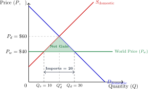

>
This chapter provides a rigorous, pedagogical treatment of Chapter 14: International Trade, Comparative Advantage, and Protectionism, benchmarked to standard principles curriculum.

## Free Trade Welfare Mechanics

### 1. Conceptual Introduction {.unnumbered}
In Chapter 2, we saw that specialization according to comparative advantage expands consumption beyond domestic production limits. Now we use supply, demand, and surplus analysis to pinpoint *who wins and who loses* inside a country when it opens its borders to international trade.

To determine whether a small open economy becomes an importer or an exporter of a specific good, compare its **autarky (no-trade) domestic equilibrium price ($P_d$)** against the prevailing **world price ($P_w$)**:

*  **Importing Country ($P_w < P_d$):** Foreign producers have a comparative advantage and can supply the good cheaper than domestic firms. Under free trade, the domestic price drops to $P_w$. Domestic consumers cheer—buying more at a lower price and capturing a massive expansion in **Consumer Surplus ($CS$)**. Domestic producers hurt—cutting production and losing **Producer Surplus ($PS$)**. However, the gain to consumers strictly exceeds the loss to domestic producers, creating a net gain in **Total Social Surplus**.
*  **Exporting Country ($P_w > P_d$):** Domestic producers have a comparative advantage and can sell abroad at a higher world price. Under free trade, the domestic price rises to $P_w$. Domestic producers expand output and gain more Producer Surplus than domestic consumers lose in Consumer Surplus—once again increasing net Total Social Surplus.

This sharp distributional split explains why trade policy is always politically contentious: the gains from free trade are spread thinly across millions of consumers (e.g., saving $\$30$ on a pair of shoes), whereas the losses are concentrated among specific domestic factories and workers who lobby intensely for protection.

### 2. Visual Representation {.unnumbered}
Figure 1 illustrates an importing market where the world price $P_w$ lies below the autarky price $P_d$, expanding total social surplus by the green shaded triangle.

{fig-alt="Welfare Gains from Free Trade (Importing Case). When P_w = $40 < P_d = $60, domestic production falls to 10 and domestic consumption rises to 30, generating 20 units of imports and a net gain in Total Social Surplus (green triangle)."}

### 3. Real-World Application: Global Apparel and Consumer Electronics Trade {.unnumbered}
When U.S. retailers import smartphones, laptops, and apparel from specialized global supply chains at lower world prices, American households save thousands of dollars per year on everyday goods—expanding Consumer Surplus across the entire economy, even as domestic apparel manufacturing employment contracts.

### 4. Mathematical Foundation (Algebra Level) {.unnumbered}
At world price $P_w < P_d$, import volume and net social surplus gain are:

$$
\text{Imports} = Q_d(P_w) - Q_s(P_w), \qquad \Delta TS_{\text{trade}} = \frac{1}{2} \times \text{Imports} \times (P_d - P_w)
$$

**Worked Problem:**
In a small country's market for steel, domestic inverse demand is $P_d = 100 - 2Q$ and domestic inverse supply is $P_s = 20 + 2Q$.

*  Find the autarky equilibrium price $P_d^*$ and quantity $Q_d^*$.
*  Suppose the country opens to free trade at a world price of $P_w = \$40$ per ton. Calculate domestic quantity supplied, domestic quantity demanded, import volume, and the net gain in Total Social Surplus ($\Delta TS$).

**Step-by-Step Breakdown:**

*  **Find Autarky Equilibrium ($P_d^*, Q_d^*$):**
Set demand equal to supply:

$$
100 - 2Q = 20 + 2Q \implies 80 = 4Q \implies Q_d^* = \mathbf{20\text{ tons}}, \qquad P_d^* = 100 - 2(20) = \mathbf{\$60}
$$

*  **Find Quantities and Imports at $P_w = \$40$:**

$$
40 = 20 + 2Q_s \implies 2Q_s = 20 \implies Q_s = \mathbf{10\text{ tons produced domestically}}
$$

$$
40 = 100 - 2Q_d \implies 2Q_d = 60 \implies Q_d = \mathbf{30\text{ tons consumed domestically}}
$$

$$
\text{Imports} = Q_d - Q_s = 30 - 10 = \mathbf{20\text{ tons}}
$$

*  **Calculate Net Social Surplus Gain ($\Delta TS$):**

$$
\Delta TS = \frac{1}{2} \times \text{Imports} \times (P_d^* - P_w) = \frac{1}{2} \times 20 \times (\$60 - \$40) = 10 \times \$20 = \mathbf{+\$200}
$$

**Conclusion:** Opening to free trade generates $20$ tons of steel imports and increases national social welfare by $+\$200$.

## Tariffs, Import Quotas, and Deadweight Loss

### 1. Conceptual Introduction {.unnumbered}
To shield domestic industries from foreign competition, governments frequently impose trade barriers—most commonly a **tariff** (a per-unit tax levied on imported goods) or an **import quota** (a legal cap on the physical quantity of goods allowed into the country).

When a small country levies a per-unit tariff $t$ on imports, the domestic market price rises from $P_w$ to $P_w + t$. This price hike triggers four distinct welfare transfers, traditionally labeled Areas $A, B, C,$ and $D$:

*  **Consumer Surplus Shrinks by $-(A + B + C + D)$:** Domestic buyers pay a higher price and buy fewer units.
*  **Producer Surplus Expands by $+A$:** Domestic producers expand output at the protected higher price—a direct transfer from domestic consumers to domestic firms.
*  **Government Tariff Revenue Equals $+C = t \times \text{Imports}_{\text{tariff}}$:** Collected on every imported unit that still crosses the border.
*  **Deadweight Loss Equals $-(B + D)$:** Area $B$ represents **production inefficiency** (using high-cost domestic factories to produce units that could have been imported cheaply at $P_w$), while Area $D$ represents **consumption inefficiency** (mutually beneficial trades blocked by the artificial price hike).

An **import quota** restricting imports to the exact same volume raises the domestic price to $P_w + t$ and causes the exact same deadweight loss $(B + D)$—except Area $C$ goes to whoever holds the valuable **import licenses** (**quota rents**) rather than the domestic treasury!

### 2. Visual Representation {.unnumbered}
Figure 2 illustrates the four welfare regions ($A, B, C, D$) created when a tariff $t = \$10$ raises the domestic price from $P_w = \$40$ to $P_w + t = \$50$.

::: {.callout-note title="Clear It Up: Why Tariffs Create Two Deadweight Loss Triangles ($B + D$)"}

Unlike a domestic excise tax (which creates one Harberger triangle), a tariff creates *two* separate deadweight loss triangles: **Triangle $B$** wastes resources by expanding inefficient domestic production above $P_w$, while **Triangle $D$** destroys consumer surplus by pricing buyers out of the market above $P_w$.

:::

{fig-alt="Welfare Effects of an Import Tariff. A $10 tariff raises domestic price from $40 to $50, cutting imports from 20 to 10. Consumers lose A+B+C+D, domestic producers gain A, the government collects tariff revenue C, and society suffers deadweight loss B+D."}

### 3. Real-World Application: Solar Panel and Steel Tariffs in Downstream Industries {.unnumbered}
When tariffs raise domestic steel or solar-panel prices by $20\%$, domestic steel mills and panel assemblers gain Area $A$, while downstream U.S. manufacturers—automakers, construction firms, and rooftop solar installers—face higher input costs, illustrating how protection for one sector imposes direct costs on consumers and downstream jobs.

### 4. Mathematical Foundation (Algebra Level) {.unnumbered}
Under a tariff $t$ raising domestic price to $P_t = P_w + t$:

$$
\text{Tariff Revenue } (C) = t \times (Q_{d2} - Q_{s2}), \qquad DWL = B + D = \frac{1}{2} t (Q_{s2} - Q_{s1}) + \frac{1}{2} t (Q_{d1} - Q_{d2})
$$

**Worked Problem:**
Continuing our steel market ($P_d = 100 - 2Q$, $P_s = 20 + 2Q$, $P_w = \$40$), suppose the government imposes a tariff of $t = \$10$ per ton, raising the domestic price to $P_t = \$50$. Compute Areas $A, B, C,$ and $D$, total Consumer Surplus loss, and net Deadweight Loss.

**Step-by-Step Breakdown:**

*  **Find Post-Tariff Domestic Supply ($Q_{s2}$) and Demand ($Q_{d2}$) at $P_t = \$50$:**

$$
50 = 20 + 2Q_{s2} \implies Q_{s2} = \mathbf{15\text{ tons}}, \qquad 50 = 100 - 2Q_{d2} \implies Q_{d2} = \mathbf{25\text{ tons}}
$$

Post-tariff imports shrink from $20$ tons down to $25 - 15 = \mathbf{10\text{ tons}}$.

*  **Compute Producer Surplus Gain (Trapezoid $A$):**

$$
\text{Area } A = \frac{Q_{s1} + Q_{s2}}{2} \times t = \frac{10 + 15}{2} \times \$10 = 12.5 \times \$10 = \mathbf{\$125}
$$

*  **Compute Government Tariff Revenue (Rectangle $C$):**

$$
\text{Area } C = t \times \text{Imports}_{\text{tariff}} = \$10 \times 10 = \mathbf{\$100}
$$

*  **Compute Deadweight Loss Triangles ($B$ and $D$):**

$$
\text{Area } B = \frac{1}{2} \times (15 - 10) \times \$10 = \mathbf{\$25}, \qquad \text{Area } D = \frac{1}{2} \times (30 - 25) \times \$10 = \mathbf{\$25}
$$

$$
DWL = B + D = \$25 + \$25 = \mathbf{\$50}
$$

*  **Verify Total Consumer Surplus Loss:**

$$
\Delta CS = -(A + B + C + D) = -(\$125 + \$25 + \$100 + \$25) = \mathbf{-\$275}
$$

**Conclusion:** Domestic consumers lose $\$275$ in surplus; $\$125$ transfers to domestic steel producers, $\$100$ goes to government tariff revenue, and $\$50$ is permanently destroyed as deadweight loss.

::: {.callout-note title="Optional Advanced Section: Optimal Tariff Argument for a Large Country"}

*Note for Economics Majors and Quantitative Students:*
While a tariff always reduces national welfare for a *small* price-taking country ($P_w$ fixed), a *large* country whose import demand affects world prices can improve its terms of trade if a small tariff pushes $P_w$ downward by $\Delta P_w$. Net welfare changes by $\Delta W = (\Delta P_w \times M_t) - (B + D)$, which is positive only if foreign exporters absorb more of the tariff than domestic deadweight loss—and only assuming foreign governments do not retaliate with counter-tariffs.

:::
